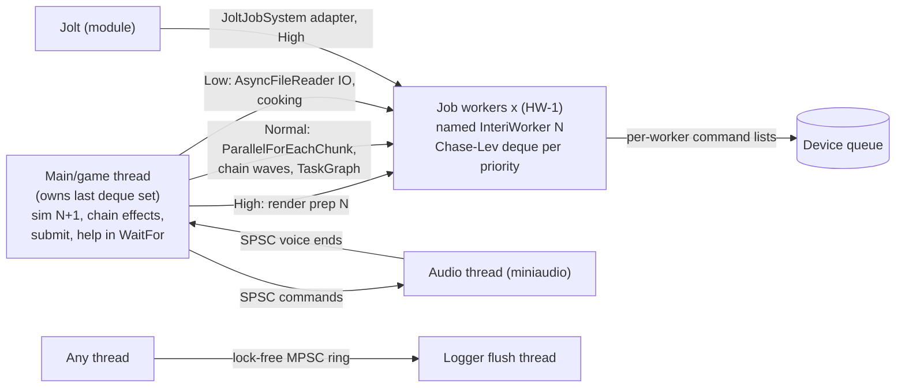

# Concurrency & Job System — Goal State

## Vision
Interi runs every parallel workload (ECS systems, chain waves, render preparation and recording, IO, and in modules Jolt physics and destruction) through one work-stealing `JobSystem`. Its thread model is documented, and every thread-ownership contract is asserted in debug builds. Simulation of frame N+1 overlaps render preparation of frame N, and destruction bursts are absorbed by jobs within a per-frame budget, without serial hot spots or global-lock contention. No job can outlive the code or data it references across hot reload or shutdown. Waiting threads help or sleep, and never spin for long. Races are caught before merge, because ThreadSanitizer is a required PR check.

## Thread model (target)

## Acceptance criteria
- [ ] AC-1 Unloading or reloading a module waits for every job that module submitted before its library closes. A `ModuleHostTest` case that leaves 1,000 queued Low jobs from a module and then reloads and unloads it passes under ASan and TSan, and `GameSession` and `level_editor` shut down cleanly with such jobs queued. (resolves CONC-001)
- [ ] AC-2 With `maxJobs = 4`, a 10,000-node chain `TaskGraph` completes on `windows-msvc-debug`. Low jobs are never executed inline on the submitting thread while workers exist (asserted by a test), and pool exhaustion is counted in `JobSystem` stats. (resolves CONC-002)
- [ ] AC-3 A non-worker thread waiting 200 ms in `AsyncFileReader::WaitAll` uses less than 5% of one core (measured CPU time in a test). (resolves CONC-003)
- [ ] AC-4 `AsyncFileReader::WaitAll` and `~AsyncFileReader` assert when called from inside a job while workers exist, as shown by an assert-handler test. (resolves CONC-004)
- [ ] AC-5 `CommandBuffers::Local` asserts on a worker index outside its slots, on a different `JobSystem`, and on two non-worker threads recording in the same cycle, each covered by a unit test. (resolves CONC-005)
- [ ] AC-6 `.github/workflows/ci.yml` runs `linux-clang-tsan` with at least the `unit|stress` labels on `pull_request`, and the job is a required status check for `main`. (resolves CONC-006)
- [ ] AC-7 `JobSystem_SmallJobsScaling` at 16 and 32 workers is at least 1.5x faster than the 2026-10-19 baseline (release preset, the same machine). The job hot path no longer performs `PoolAllocator::m_freeCount` RMWs, and `m_head` sits on its own cache line. (resolves CONC-007)
- [ ] AC-8 `GameSession` (and the editor's play mode) drive frames through `FramePipeline` or an equivalent: a Tracy capture on the profile preset shows render preparation of frame N overlapping simulation of N+1, and recording uses per-worker `CommandListPool` lists. (resolves CONC-008)
- [ ] AC-9 `JoltJobSystem::CreateJob` helps the job system while its pool is dry. A physics stress test with a tiny `maxJobs` completes without hanging under TSan. (resolves CONC-009)
- [ ] AC-10 `AudioEngine` asserts owner-thread use in every public member function, as shown by an assert-handler test. (resolves CONC-010)
- [ ] AC-11 Every return path of `tools/editor/main.cpp` uninstalls the global logger before destroying it, and `~Logger` asserts it is not still installed. (resolves CONC-011)
- [ ] AC-12 Worker stack size is configurable through `JobSystemDesc`, and a 32-level nested `ParallelFor` test with 16 KB stack per level passes on `windows-msvc-debug`. (resolves CONC-012)
- [ ] AC-13 A main-thread wait on a 1 ms `ParallelFor` with 50 ms Normal jobs queued has a 99th percentile below 2 ms in a benchmark, or long work is provably Low (documented rule plus audit). (resolves CONC-013)
- [ ] AC-14 Job workers and the logger flush thread carry OS thread names in all build types (visible in `ps -T`). (resolves CONC-014)
- [ ] AC-15 Chain wave evaluation allocates from per-thread arenas: the heap allocation count per step in the chain stress scenario is at least 80% lower, and the cross-platform golden hash is unchanged. (resolves CONC-015)
- [ ] AC-16 `JobSystem::Enqueue` documents the publish-then-count order and the transient negative `m_queued`, and `PoolAllocator.h` documents the 32-bit ABA tag margin. (resolves CONC-016, CONC-017)
- [ ] AC-17 The properties verified in CONC-018 still hold: a fixed-capacity Chase-Lev deque with seq_cst Pop/Steal, Vyukov sequence protocols in `MPMCQueue` and `Logger`, SPSC release/acquire, the sleep-path Dekker check, and destruction plus Jolt work routed only through `interi::JobSystem`. Confirmed by the stress suites under the TSan PR gate. (resolves CONC-018)

## Guardrails to keep it that way
- TSan PR gate (AC-6) covering `interi_core_stress_tests`, `interi_jobs` stress, `interi_runtime_stress_tests`, `interi_audio_stress_tests`, `interi_chain_stress_tests`, `ModuleHostTest` and `ModuleProjectTest`, with the full ASan/TSan run kept nightly.
- A review checklist item for any change touching `engine/jobs`, `engine/core/containers`, `PoolAllocator` or `Log.cpp`: state the memory-order argument in a comment, use seq_cst operations instead of fences (TSan), and add or extend a stress test.
- An owner-thread assertion pattern (`CommandListPool`, `AudioEngine`, `CommandBuffers`) required for every new single-thread API, with a test that the assertion fires.
- A hot-reload test module that submits outstanding jobs, kept in `tests/hotreload/modules`, so CONC-001 cannot regress.
- `JobBenchmarks` results tracked per milestone (release preset), with a regression of more than 10% in small-job throughput flagged in the PR.
- A grep check in the lint job that rejects `std::async`, `.detach()` and raw `std::thread` outside `engine/jobs`, `engine/core/src/Log.cpp` and tests.

## Out of scope
- Bit-exact determinism of parallel results across thread counts and platforms (Determinism-Replication discipline). This discipline only requires that concurrency changes keep the existing determinism tests green.
- General algorithmic cost of systems, the renderer or the solver (Performance-Optimization).
- Jolt's internal threading and barrier implementation (vendored third-party code), beyond the adapter boundary.
- Console-specific thread affinity and core reservation (PS5/Xbox backends live in private repositories).
