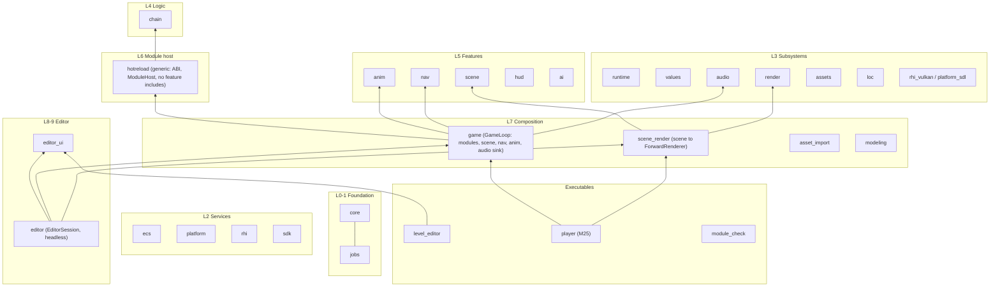

# Program Architecture — Goal State

## Vision
Interi is a strictly layered, acyclic set of engine modules with the layer order written down and checked on every configure and in CI.

The module host is generic infrastructure. Engine features (animation, navigation, AI, audio and future ones) plug into it through one registration seam, just as gameplay modules do through `ContributionRegistry`.

There is one runtime composition root, the game loop. The game, play-in-editor and the M25 player all run the same step pipeline, so behaviour in the editor matches the shipped game.

Key decisions live in ADRs inside the repository, and the module ABI is protected by an automated guard rather than a manual version number.

## Target (to-be) module structure

## Dependency rules (enforced)
1. A module may depend only on modules in strictly lower layers. The same layer is allowed only where explicitly allowlisted (e.g. `hud` → `loc`).
2. `hotreload` must not include or link `anim`, `nav`, `scene`, `hud`, `game`, `editor*`, `asset_import`.
3. Nothing below L7 includes `game`, `editor`, `editor_ui`, `asset_import`, `modeling` or `scene_render`.
4. `rhi`, `render` and `platform` never include Vulkan or SDL headers (existing rule, M25.2 check).
5. Every `#include <interi/X/` in `engine/<m>/` names `m` or a declared dependency of `m`.
6. Executables (`tools/*`) contain UI and argument wiring only. Composition logic lives in a tested library.

## Ownership and threading model (to be documented in `docs/architecture.md`)
- **Game loop (`game`)** owns `World`, `JobSystem`, `ModuleHost`, `SceneRuntime`, `NavSource`, `AnimationLibrary`, the audio sink and the fixed step. It is called from one game thread.
- **`ModuleHost`** owns `ModuleSet`, `HookRegistry`, `DataRegistry`, `ChainRegistry` and `SaveRegistry`. It is not thread-safe and is called between frames. It owns no feature state.
- **Feature libraries** own their own state (e.g. `nav::NavSource`) and expose it to modules through `ModuleHostDesc::services`.
- **Render prep** runs as a job through `FramePipeline`. The audio thread is reached only through `AudioEngine`'s SPSC queues.

## Acceptance criteria
- [ ] AC-1 `grep -rE "#include <interi/(anim|nav|scene|game)/" engine/hotreload` returns no lines, and `engine/hotreload/CMakeLists.txt` lists neither `interi::anim` nor `interi::nav` (resolves ARCH-001).
- [ ] AC-2 `ModuleHost.cpp` contains no feature-specific registration calls (`RegisterAnimationLibrary`, `RegisterNavigationLibrary`, `AnimationContracts`, `NavigationContracts`, `AiContracts`). Features arrive through `ModuleHostDesc` (resolves ARCH-001).
- [ ] AC-3 Exactly one function builds the engine contract and library set, and both `ModuleHost` users and the editor fallback use it. A test asserts that the editor's fallback contract list equals a `ModuleHost`'s (resolves ARCH-003).
- [ ] AC-4 One `GameLoop` (or `GameSession`) step pipeline runs module systems, scene, navigation, animation and the audio sink, and `ScenePlaySession` delegates to it. A parity test shows that the starter sample produces identical world and Values hashes through both paths at 1/4/16 workers (resolves ARCH-002).
- [ ] AC-5 `StepAnimator` and `ChainExecutor::Sounds()` have non-test callers in the game loop, and `interi::audio` is linked by `game` or the player (resolves ARCH-002).
- [ ] AC-6 The scene-to-renderer bridge is a library target, and the M25 player target links no `interi::editor*` target (resolves ARCH-002).
- [ ] AC-7 Configure fails on a layer violation, and the `ArchLayering_IncludesMatchDeps` test passes in CI on Linux and Windows. Undeclared direct dependencies (render/rhi_vulkan/platform_sdl → core, hotreload → jobs, editor_ui → assets/chain/ecs/scene/values) are declared (resolves ARCH-004).
- [ ] AC-8 `docs/architecture.md` exists with the module diagram, the dependency rules and the ownership model. `docs/adr/` holds at least 6 ADRs. README links to the architecture doc (resolves ARCH-005).
- [ ] AC-9 A check confirms that the shared-module list in CLAUDE.md matches the `interi_add_module(... SHARED` set, and `AGENTS.md` cannot diverge from CLAUDE.md (generated or a pointer) (resolves ARCH-005).
- [ ] AC-10 Changing the layout of an ABI-surface type without bumping `INTERI_MODULE_ABI_VERSION` makes a test fail or the loader reject the stale module (resolves ARCH-006).
- [ ] AC-11 `tools/editor/EditorApp.cpp` (1652 lines at the time of writing) is under 600 lines, the same threshold as Refactoring AC-2 (one target for both disciplines). Project, module host, registry selection and play orchestration live in a headless, tested `editor` class. A CTest `integration` test runs `level_editor --video-driver offscreen --frames 120` (resolves ARCH-007).
- [ ] AC-12 `FileWatcher` lives outside `hotreload`, and `engine/asset_import/CMakeLists.txt` does not list `interi::hotreload` (resolves ARCH-008).
- [ ] AC-13 The fixed step has one owner: `GameSession` passes its configured step to the scene executor and to navigation. A test with a non-default step passes (resolves ARCH-009).
- [ ] AC-14 The milestone plan tracks the "not here yet" gaps listed in ARCH-010 (imported skeleton/clip conversion, renderer UVs, editor module systems) as backlog items (acknowledges ARCH-010).

## Guardrails to keep it that way
- The CMake layer check (`interi_check_layers`) is fatal on every configure.
- The `ArchLayering_IncludesMatchDeps` CTest (label `unit`) runs in CI on both platforms.
- An ABI-surface hash test runs in `hotreload` tests.
- The editor/game parity test (label `integration`) runs in CI.
- A docs consistency test checks the module list against CMake.
- Review checklist: "Does this PR add a dependency edge? Is it allowed by docs/architecture.md? Does it need an ADR?"
- Preserve what already works:
  - The acyclic include graph.
  - `render` → `rhi` only.
  - `platform` never links SDL.
  - `Result<T>`/`INTERI_TRY` for runtime errors, `INTERI_ASSERT` for programming errors, one `Logger`, one `IAllocator`, no exceptions except allocation failure.
  - `ContributionRegistry` as the single extension mechanism.

## Out of scope
- Language-level code quality inside modules (C++ analyst).
- Performance budgets and memory-budget policy (M25.3; performance analyst).
- Netcode or multiplayer architecture (explicitly not planned).
- The internal architecture of the gitignored `modules/physics` and `modules/destruction` projects, beyond their use of the engine's module API.
- Console backends in private repositories.
