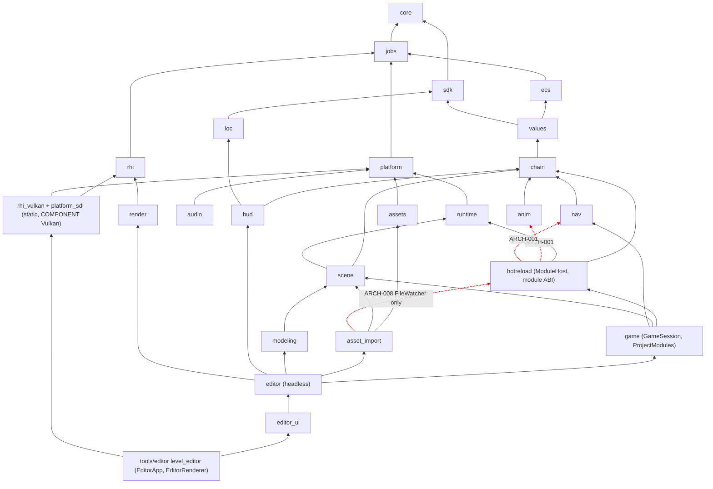

# Program Architecture — Issues

**Project:** Interi (repository root) @ 4631f35
**Analyzed:** 2026-10-19
**Scope:** System-level structure of the 25 first-party modules under `engine/` (their `CMakeLists.txt` target graph and `#include <interi/...>` graph), `tools/editor` (level_editor), `engine/game`, `engine/hotreload`, `engine/sdk`, `cmake/InteriModule.cmake`, README.md, CLAUDE.md, AGENTS.md, `docs/` (3 files), and the milestone plan `~/.claude/plans/create-a-plan-for-starry-dove.md` for stated goals. `modules/`, `external/`, `build*/`, `cmake-build-*/` are excluded.
**Summary:** 10 issues — Critical: 0 · High: 2 · Medium: 5 · Low: 2 · Info: 1

## As-is architecture

The module graph below comes from the actual cross-module `#include <interi/X/...>` set of each `engine/<m>/` directory, checked against the `DEPS` of each `interi_add_module` call. Edges to `core`, and edges already implied by a longer path, are omitted. The graph is **acyclic**. The layers run bottom to top. Red dotted edges point from infrastructure into feature modules (ARCH-001, ARCH-008).



Entry points:
- `level_editor` (tools/editor) is the only interactive executable.
- `interi_module_check` (tools/module_check) is a CLI.
- `GameSession` (engine/game) is the game composition root. Only tests construct it.
- `audio` is linked by no other engine target or tool (see ARCH-002).

Strengths to preserve:
- The include graph is acyclic and no lower layer includes `editor`, `editor_ui`, `game`, `hotreload` or `asset_import`.
- `render` depends only on `rhi`, and `rhi` never includes Vulkan.
- `platform` never links SDL.
- The cross-cutting strategies are consistent: `Result<T>` plus `INTERI_TRY` for runtime errors; `INTERI_ASSERT` for programming errors; one `Logger`; one `IAllocator` (`GetDefaultAllocator`, `core/memory/Allocator.h:49`). The only `throw`s in `engine/` are `std::bad_alloc` / `bad_array_new_length` in allocator adapters.
- `ContributionRegistry` is the single, deliberate extension mechanism (hooks, chain events, data).

## Findings

### ARCH-001 — The module host (module ABI layer) hard-codes specific engine features (anim, nav, AI) and owns navigation state
- **Severity:** High
- **Confidence:** High
- **Category:** Layering and dependency direction / extensibility
- **Location:** `engine/hotreload/CMakeLists.txt:17`, `engine/hotreload/include/interi/hotreload/ModuleHost.h:12,132-134,167-168`, `engine/hotreload/src/ModuleHost.cpp:2,376-408`, `engine/hotreload/include/interi/hotreload/NavigationService.h:13-40`, `engine/sdk/include/interi/sdk/Ai.h:39`
- **Evidence:**
  - `hotreload` is the layer every gameplay module links: ABI v7, `ModuleRegistrar`, `ModuleHost`. It declares `DEPS interi::anim interi::nav interi::chain interi::runtime ...`, and every `DEPS` entry is PUBLIC (`cmake/InteriModule.cmake:54`).
  - `ModuleHost.h` includes `<interi/nav/NavEvents.h>`, exposes `nav::NavSource& Navigation()` and stores `std::shared_ptr<nav::NavSource> m_navigation` plus `std::unique_ptr<NavigationService> m_navigationService`.
  - The constructor appends each feature's contract ids one by one (`chain::CoreContracts()`, `anim::AnimationContracts()`, `nav::NavigationContracts()`, `sdk::AiContracts()`, `sdk::PhysicsContracts()`, lines 376-395). It then registers each feature's chain library by name (lines 400-408):
    ```cpp
    auto animation = anim::RegisterAnimationLibrary(*m_chains);
    m_navigation = std::make_shared<nav::NavSource>();
    m_navigationService = std::make_unique<NavigationService>(*m_navigation);
    m_desc.services.try_emplace(std::string(NavigationService::kServiceName), m_navigationService.get());
    auto navigation = nav::RegisterNavigationLibrary(*m_chains, m_navigation);
    ```
  - AI's contract list lives in the generic `sdk` (`sdk/Ai.h`), next to manifests and SemVer.
- **Impact:**
  - The stated goal is "a generic core plus gameplay engines that live in modules" (CLAUDE.md; plan § Context). The module-loading infrastructure instead depends upward on feature modules.
  - Every new engine subsystem must edit `ModuleHost`'s constructor, and usually its public header too. Planned M25 subsystems (budgets, export) would follow the same pattern.
  - Through PUBLIC linking, every gameplay module (starter, Destruction, Jolt) transitively links `anim` and `nav` (Recast/Detour are private, but the shared libraries load).
  - A change to `nav/NavEvents.h` recompiles every module and is part of the ABI surface (see ARCH-006).
  - Navigation state ownership is split across three modules: `nav` defines `NavSource`, `hotreload` owns it, and `game` loads the mesh and steps the agents (`engine/game/src/GameSession.cpp:49-59,97-127`).

### ARCH-002 — No reusable runtime composition root: game, play-in-editor and the renderer bridge are assembled separately and none of them drives anim or audio
- **Severity:** High
- **Confidence:** High (code facts) / Medium (impact on M25)
- **Category:** Fit to stated goals / runtime composition
- **Location:** `engine/game/src/GameSession.cpp:90-95`, `engine/editor/src/ScenePlay.cpp:10-41`, `tools/editor/EditorRenderer.h:70-76`, `tools/editor/CMakeLists.txt:4-7`, `engine/chain/include/interi/chain/Executor.h:268`, `engine/audio/CMakeLists.txt:8`
- **Evidence:**
  - `GameSession::Step()` runs `RunSystems`, then `m_scene->Step()`, then `StepNavigation()`. It has no `FixedStepClock`, no `FramePipeline`, no animation, no audio and no rendering.
  - Play-in-editor (`ScenePlaySession::Start/Advance`) runs only `SceneRuntime::Step()` on the editor's chain registry. It has no module systems, no navigation stepping and no `SaveRegistry`.
  - The scene-to-`ForwardRenderer` bridge (`EditorRenderer`, 469 lines) lives in the `level_editor` executable. It is not in a library.
  - Graph check (cypher CALLS, confirmed by grep):
    - `StepAnimator` has no non-test caller.
    - `StepNavAgents` and `ModuleHost::RunSystems` are called only from `GameSession.cpp:92,101`.
    - `ChainExecutor::Sounds()` (the `world.PlaySound` requests) has no consumer outside `engine/chain`.
    - No CMake target links `interi::audio` (grep of all `CMakeLists.txt` under engine/tools/samples).
  - CLAUDE.md acknowledges part of this ("Animation and localization are not stepped/owned by `GameSession`: a game drives them"; "module systems don't run in the editor yet").
- **Impact:**
  - The plan's next milestone requires "The runtime player is the same engine without the editor" (M25.1.1). The plan's end-to-end check plays in the editor, then runs the exported game.
  - Today the two play paths already behave differently: nav agents move only in `GameSession`, and module systems run only there.
  - Chain events `anim.Play` and `world.PlaySound` are accepted and compiled, but have no effect in any shipped composition.
  - Building the player means extracting the render bridge out of an executable, plus a third, hand-assembled frame loop. Without a shared composition root, editor/game parity drifts further with every subsystem.

### ARCH-003 — The "engine contract set" and engine chain libraries are assembled in two places that have already diverged
- **Severity:** Medium
- **Confidence:** High
- **Category:** State ownership / duplication of composition
- **Location:** `engine/hotreload/src/ModuleHost.cpp:376-408`, `tools/editor/EditorApp.cpp:94-106,136-147,247-250`
- **Evidence:**
  - `EditorApp`'s constructor builds its own `sdk::ModuleSet m_chainModules` and `ChainRegistry`. It declares `CoreContracts`, `AnimationContracts` and `NavigationContracts`, but not `sdk::AiContracts()` or `sdk::PhysicsContracts()`, which `ModuleHost` declares.
  - It registers the core, animation and navigation libraries again, with a throw-away `std::make_shared<nav::NavSource>()`.
  - `ActiveChains()` returns this registry whenever no project modules are loaded (`return m_modules != nullptr ? m_modules->Chains() : *m_chains;`).
- **Impact:**
  - Without a loaded project (or when modules fail to load and the editor falls back, per CLAUDE.md), the chain editor's palette and compile checks run against a different contract set from the game's. Shared `ai.*` / `service.Physics*` ids are undeclared there.
  - Every new engine library must be added in two places, and the drift shows that this is already missed.
  - Real impact is limited to the fallback path today.

### ARCH-004 — Dependency rules are not declared or enforced; all module dependencies are PUBLIC and several direct dependencies are undeclared
- **Severity:** Medium
- **Confidence:** High
- **Category:** Build architecture / enforceability
- **Location:** `cmake/InteriModule.cmake:54-59`, `engine/render/CMakeLists.txt:19`, `engine/rhi_vulkan/CMakeLists.txt:30`, `engine/platform_sdl/CMakeLists.txt:12`, `engine/editor_ui/CMakeLists.txt:30`, `engine/hotreload/CMakeLists.txt:17`
- **Evidence:**
  - `interi_add_module` links `${ARG_DEPS}` PUBLIC unconditionally.
  - Comparing each module's `#include <interi/X/` set with its `DEPS` finds modules that include another module directly without declaring it. They compile only through transitive PUBLIC links:
    - `render` → core
    - `rhi_vulkan` → core
    - `platform_sdl` → core
    - `hotreload` → jobs
    - `editor_ui` → assets, chain, ecs, scene, values, core
  - Some declared dependencies have no direct include behind them: `anim` declares `ecs` and `values`.
  - No CMake check or test pins the layer order (`tests/cmake/` only checks `module_without_tests`).
  - The plan's only enforcement item (M25.2) covers Vulkan/SDL/POSIX types, not engine layering.
- **Impact:**
  - Layering is maintained only by reviewer discipline. An upward include (e.g. `scene` → `hotreload`) would compile without complaint as long as some path links it.
  - Removing a dependency elsewhere (e.g. fixing ARCH-001) can break unrelated modules that relied on it transitively.
  - Every module's consumers inherit its full dependency closure, which inflates link and rebuild sets for installed consumers.

### ARCH-005 — No human-facing architecture overview, layer diagram or ADRs; decision records are discarded; agent docs have drifted
- **Severity:** Medium
- **Confidence:** High
- **Category:** Documentation
- **Location:** `README.md` (68 lines), `CLAUDE.md:54`, `AGENTS.md` (200 lines), `docs/` (3 files), plan `~/.claude/plans/create-a-plan-for-starry-dove.md:72`
- **Evidence:**
  - README covers build, modules folder, TDD and licensing. It has no module map or dependency rules.
  - The architecture description is CLAUDE.md (553 lines), written as agent guidance.
  - `AGENTS.md` is a tracked, shorter, diverged copy (`diff` differs from line 7).
  - CLAUDE.md:54 lists the shared libraries as 13 ("core, jobs, ecs, platform, rhi, render, audio, runtime, sdk, values, chain, scene and hotreload"). 17 modules use `interi_add_module(... SHARED`: `anim`, `nav`, `loc` and `hud` are missing from the list.
  - The plan says technical decisions are "recorded in each milestone's findings.md", but CLAUDE.md declares `findings.md` gitignored working state that is never committed. No ADR folder exists.
- **Impact:**
  - Key decisions are not recoverable from the repository: the physics-engine split, the shared-engine and toolchain-fingerprint model, the module ABI, determinism rules, and why ModuleHost owns navigation.
  - Out-of-tree module authors and new contributors cannot see the intended layering.
  - Stale lists (e.g. the shared libraries, which matter for Windows' "no exported data" rule) mislead readers.

### ARCH-006 — Module ABI surface is wide and transitive, but ABI compatibility relies on a hand-bumped version number
- **Severity:** Medium
- **Confidence:** Medium
- **Category:** Boundaries / extensibility stability
- **Location:** `engine/hotreload/include/interi/hotreload/ModuleApi.h:38-47,60-62`, `engine/sdk/include/interi/sdk/Toolchain.h:18`, `engine/hotreload/include/interi/hotreload/ModuleHost.h:4-19`
- **Evidence:**
  - `ModuleApi.h` (the header every gameplay module compiles against) includes `chain/Event.h`, `ecs/Component.h`, `ecs/Query.h`, `ecs/Scheduler.h`, `runtime/SaveGame.h`, `sdk/Hooks.h`, `values/DataRegistry.h` and `values/Reflection.h`.
  - The comment at line 60 says the version is "Bumped whenever ModuleContext, ModuleApi, ModuleRegistrar, the hook types, DataRegistry or the chain registry change". The value is a literal `#define INTERI_MODULE_ABI_VERSION 7`.
  - Nothing detects a layout change in those types: no layout hash, no `static_assert` on sizes, no CI diff.
  - `git log` shows the ABI-surface headers and the version changed together in recent milestones (e.g. 9791813). No missed bump was found.
- **Impact:**
  - The toolchain fingerprint guards compiler and flags, not engine type layouts.
  - Suppose a module binary built against an older engine of the same ABI number is loaded after a change to, for example, `DataRegistry` or `ChainRegistry`. The result is silent ODR/UB across the DLL boundary. This is plausible with installed engines and the Module Manager's `LibraryWatcher`.
  - The surface grows with every feature (ARCH-001 adds `nav`).

### ARCH-007 — `EditorApp` is an untested god object that holds the editor's composition logic inside the executable
- **Severity:** Medium
- **Confidence:** High
- **Category:** Cohesion / testability
- **Location:** `tools/editor/EditorApp.h:72-258`, `tools/editor/EditorApp.cpp` (1652 lines), `tools/editor/CMakeLists.txt:4`
- **Evidence:**
  - The graph's largest first-party class by methods is `EditorApp` (44 methods), ahead of `VulkanDevice` (41) and `ModuleHost` (32).
  - Its members own the project definition, module host, trust store, Module Manager models, library watcher, chain registry fallback, HUD designer state, chain editor state, mesh cache and layout.
  - Decisions such as `ActiveData()` / `ActiveChains()` fallback, project open, trust confirmation and play start/stop live here.
  - `level_editor` is an `add_executable` with no test target. No `CMakeLists.txt` under `tests/` and no step in `.github/workflows/ci.yml` runs it. The documented `--frames 120` smoke run is manual. The headless libraries (`interi::editor`, `editor_ui`) are well tested, but this orchestration is not.
- **Impact:**
  - Regressions in composition (e.g. ARCH-003's divergent registries, module load fallback, trust gating) are invisible to CI.
  - Every editor milestone adds members to this one class.
  - The class cannot be reused for the M25 player or a headless editor host.

### ARCH-008 — `FileWatcher` lives in `hotreload`, so the editor-only `asset_import` links the whole module host
- **Severity:** Low
- **Confidence:** High
- **Category:** Cohesion / dependency weight
- **Location:** `engine/hotreload/include/interi/hotreload/FileWatcher.h:4-13`, `engine/asset_import/CMakeLists.txt:27`, `engine/asset_import/src/AssetDatabase.cpp:9,1001`
- **Evidence:**
  - `FileWatcher` depends only on `<filesystem>`, `<vector>` and `<cstdint>`.
  - `asset_import` declares `DEPS ... interi::hotreload` and uses only `hotreload::FileWatcher`. Through ARCH-001 this pulls in `anim`, `nav`, `chain` and `runtime`.
  - `hotreload` also hosts `ModuleDocs` (Markdown generation for the Module Manager), which is tooling, not runtime.
- **Impact:** This creates an accidental dependency edge from asset import into the module runtime and lowers `hotreload`'s cohesion.

### ARCH-009 — `GameSession` derives the navigation step from a default-constructed `ExecutorDesc` instead of the running executor's step
- **Severity:** Low
- **Confidence:** High
- **Category:** Hidden coupling / time-step ownership
- **Location:** `engine/game/src/GameSession.cpp:100`, `engine/scene/include/interi/scene/SceneRuntime.h:56`, `engine/chain/include/interi/chain/Executor.h:142`
- **Evidence:**
  - `const float kStepSeconds = static_cast<float>(chain::ExecutorDesc{}.stepNanoseconds) * 1e-9f;`
  - `SceneRuntimeDesc::executor` makes the step configurable per runtime.
  - Both use the 16 666 667 ns default today, so the code is correct now.
- **Impact:** The fixed step has no single owner. Once a game configures a different step, navigation agents move at the wrong speed relative to chains and module systems.

### ARCH-010 — Acknowledged "not here yet" gaps (stated vs actual), for the record
- **Severity:** Info
- **Confidence:** High
- **Category:** Stated-vs-actual alignment
- **Location:** CLAUDE.md § Asset import ("Not here yet"), § Editor ("module systems don't run in the editor yet"), § Animation (`.iskel`/`.ianim` not converted to `engine/anim` formats); `engine/anim/CMakeLists.txt:12` (anim does not depend on `assets`)
- **Evidence:**
  - The documented gaps match the code: `anim` has no dependency on `assets`, so no converter exists; the renderer samples no UVs; `ScenePlaySession` runs no module systems.
  - The plan (M24.1.1 "playback and blending for the M21 clips") implies the converter was intended. It is listed as a known gap rather than a hidden one.
- **Impact:** None beyond what ARCH-002 covers. Track these gaps in the milestone plan, not only in CLAUDE.md.

## GitNexus exploration log
**Access:** mcp · **Index:** refreshed (@4631f35 = HEAD)

| # | Tool | Argument | Result (one line) |
|---|---|---|---|
| 1 | list_repos | — | Interi: 37,920 files, 365,792 nodes, 4,973 communities, 614 processes; lastCommit 4631f35 = HEAD |
| 2 | cypher | `MATCH (c:Community) ... ORDER BY symbolCount DESC LIMIT 30` | Top 30 all third-party (Joystick, Hidapi, Profiler, Manifold, Tracy, SDL "Video"...) |
| 3 | cypher | `MATCH (p:Process) RETURN p LIMIT 30` | 30 processes, all SDL3 buildtree flows (SDL_AppIterate, Android_CreateWindow...) |
| 4 | cypher | cross-module IMPORTS with `split()` | Error: function SPLIT does not exist |
| 5 | cypher | first-party communities via MEMBER_OF, `filePath STARTS WITH 'engine/'` | Editor 204, Math 81, Editor_ui 73, Scene 66, Chain 53, Platform 48, Render 43, Sdk 43, Values 36... |
| 6 | cypher | cross-module IMPORTS with `string_split()` | 0 rows |
| 7 | cypher | engine File→File relation types | only 27 IMPORTS edges among engine files |
| 8 | cypher | relation types from engine files to any node | DEFINES dominate; 11 CALLS, 27 IMPORTS: `<interi/...>` includes not resolved |
| 9 | cypher | list the 27 engine IMPORTS | all intra-module private headers (asset_import, assets, audio, rhi_vulkan, values) |
| 10 | cypher | cross-module CALLS count | 0 |
| 11 | query | "ModuleHost load project register modules hooks services" | ModuleHost, ModuleRegistrar.Service, ModuleApi, EditorApp.LoadProjectModulesHost, ProjectModules (definitions only, no processes; BM25 ~47 s, degraded) |
| 12 | query | "ContributionRegistry provider override resolve" | ContributionRegistry, FunctionRegistry, EventRegistry, HookRegistry, CharacterRegistry |
| 13 | query | "GameSession step scene runtime navigation save slot" | GameSession.Step/StartScene/LoadFromSlot, ScenePlaySession.Start/Advance, ModuleHost.Navigation |
| 14 | context | ModuleHost (class) | 32 methods incl. Chains, Data, Hooks, Navigation, Saves, RunSystems; incoming not resolved |
| 15 | impact | ContributionRegistry upstream | 1 direct, risk LOW: undercount (template uses not resolved), not used as evidence |
| 16 | check | cycles | 3 cycles, all in external/vcpkg buildtrees (manifold wasm, SDL cocoa); none first-party (but see limitations) |
| 17 | cypher | largest engine/tools classes by HAS_METHOD | EditorApp 44, VulkanDevice 41, SmallVector 36, IDevice 35, InputMapper 32, ModuleHost 32 |
| 18 | context | GameSession (class) | owns m_jobs, m_modules, m_scene, m_files, m_slots; methods Step, StepNavigation, Save/LoadFromSlot |
| 19 | cypher | callers of StepAnimator / StepNavAgents / RunSystems / ExpandPrefabs | StepAnimator and StepNavAgents: tests only; confirmed by grep (GameSession only for nav and RunSystems) |

## Analysis limitations
- The graph does not resolve angle-bracket `#include <interi/...>` edges or cross-module CALLS (only 27 intra-module IMPORTS among engine files; 0 cross-module CALLS). So `check`'s "no first-party cycles" is not evidence of acyclicity. The module graph and its acyclicity were derived instead from a per-module scan of `#include <interi/X/` prefixes compared with the CMake `DEPS`.
- The BM25 index is degraded (each `query` took about 47 s and returned definitions without processes). Unfiltered clusters and processes are dominated by third-party build trees and were not usable for the first-party view.
- Upstream `impact` counts on template-heavy types (ContributionRegistry) are undercounts and were not used for severity.
- `modules/` (Jolt, Destruction) is not indexed and was not read. I could not check whether they also rely on `ModuleHost::Navigation()`, on transitive `anim`/`nav` links, or on `FileWatcher` through `hotreload`.
- Static reading only: nothing was built or run, so the transitive-link claims in ARCH-004 come from include and CMake inspection, not a link map.

## Cross-discipline notes
- C++ / Build: `interi_add_module` links all `DEPS` PUBLIC (`cmake/InteriModule.cmake:54`). It is worth reviewing which dependencies must be public for header use.
- Unit-Tests: `level_editor` has no CTest smoke run; the documented `--video-driver offscreen --frames 120` run is manual (`tools/editor/CMakeLists.txt:4`).
- Documentation / Onboarding: `AGENTS.md` and `CLAUDE.md` diverge from line 7 onward. Shared-library list at `CLAUDE.md:54` is stale.
- Audio: `ChainExecutor::Sounds()` requests have no consumer; `interi::audio` is linked by no engine target or tool.
