# Remediation Plan — Interi

**Generated:** 2026-10-19 by project-analyzer (commit `4631f35`, branch `autoflow/003-goal-implement-milestone-21-8367f0`)
**Status:** Proposed. Nothing in this plan has been implemented.
**Updated:** 2026-10-19 with the maintainer's answers to `QUESTIONS.md` (see Maintainer decisions) and decisions C-1 to C-4.
**Disciplines analyzed (19):** CI-CD, Security, Performance-Optimization, Game-Engine-Design, UI-UX, Game-Platforms, Cpp, CMake, HLSL, Python, Open-Source-Validation, Unit-Tests, Refactoring, Program-Architecture, Physics-Destruction, Determinism-Replication, Concurrency-Job-System, Rendering-Pipeline, Content-Pipeline-Tools · **Skipped:** none (every roster discipline matched this project).

Per-discipline detail lives in `project-analysis/<Discipline>/{Issues,Remediation,Goal}.md`. This plan references those
files for steps instead of copying them.

## Executive summary

Interi is in good shape at the foundations. The analysts recorded as verified strengths: a correct lock-free job system,
deterministic ordering everywhere they looked, permissive-only dependencies with license gates in CI, a clean library
include DAG, sound HLSL binding practice and a strong test suite. The serious risks are concentrated in a few places:

- **Two Critical security bugs in content loading** (SEC-001: a crafted `.inav` causes heap out-of-bounds writes;
  SEC-002/CPT-009: a crafted `.meta` deletes arbitrary files when a project opens), plus a predictable shared `/tmp`
  shadow-copy path for module libraries (SEC-003). These are Phase 0 and are small (S–M).
- **CI does not gate what the project says it values.** TSan runs only nightly on `main` (flagged independently by
  CI-CD, Concurrency and Unit-Tests), and the shipping/asserts-off, static-engine and scalar configurations are never
  compiled (flagged by six disciplines). Several assert-only guards (CPP-002, RND-001) only matter in exactly those
  unbuilt configurations.
- **Nothing outside the editor runs a game.** GameSession is a simulation step only; there is no player, render
  interpolation, audio or animation consumer, physics world step, shipping cook, or static-module path (ENG-001,
  ARCH-002, PHYS-001, CPT-001, PLAT-001/008). This is the M25 milestone in the project's own plan and is the largest
  block of work here (Phase 3).
- **Save/load is not continuous** (DET-001..004): spawned objects are lost, Start re-fires, executor state is dropped.
- **Upload and MeshPool design stalls the GPU** on every mesh or debris upload (RND-002/003, PERF-003, ENG-008).

Recommended start: M-01 (Phase 0, three work items, about two days), then M-02/M-03/M-04 so that TSan and shipping
builds protect the Phase 2 hardening. Physics/destruction module work (M-21, M-28) lives in separate repositories and
can proceed in parallel once its engine prerequisites land.

| Discipline | Critical | High | Medium | Low | Info |
|---|---|---|---|---|---|
| CI-CD | 0 | 2 | 8 | 7 | 1 |
| Security | 2 | 2 | 5 | 8 | 1 |
| Performance-Optimization | 0 | 4 | 5 | 3 | 2 |
| Game-Engine-Design | 0 | 1 | 7 | 3 | 1 |
| UI-UX | 0 | 3 | 10 | 4 | 2 |
| Game-Platforms | 0 | 4 | 7 | 8 | 2 |
| Cpp | 0 | 3 | 3 | 4 | 2 |
| CMake | 0 | 0 | 3 | 9 | 3 |
| HLSL | 0 | 0 | 6 | 6 | 2 |
| Python | 0 | 0 | 5 | 5 | 1 |
| Open-Source-Validation | 0 | 0 | 2 | 5 | 4 |
| Unit-Tests | 0 | 1 | 7 | 6 | 1 |
| Refactoring | 0 | 1 | 5 | 4 | 1 |
| Program-Architecture | 0 | 2 | 5 | 2 | 1 |
| Physics-Destruction | 0 | 5 | 10 | 1 | 1 |
| Determinism-Replication | 0 | 2 | 4 | 4 | 1 |
| Concurrency-Job-System | 0 | 1 | 8 | 6 | 3 |
| Rendering-Pipeline | 0 | 3 | 5 | 10 | 2 |
| Content-Pipeline-Tools | 0 | 2 | 10 | 5 | 1 |
| **Total (raw)** | **2** | **36** | **115** | **100** | **32** |
| **Work items after dedupe** | 2 | 33 | 98 | 66 | — |

285 findings (253 non-Info) became **196 work items**, plus **3** from maintainer decisions, in **38 milestones**. Work-item severity is the highest severity among its sources.

### Severity normalization and placement notes

Original analyst severities are kept in the traceability index; the notes below explain placement.

- **SEC-003 (High) is placed in Phase 0.** It is a local code-execution path (another user swaps a predictable `/tmp`
  file before `dlopen`), which meets the shared scale's "exploitable vulnerability" bar. Its severity stays High everywhere in this plan; only its
  phase is raised.
- **OSS-001 and OSS-002 (Medium) are placed in Phase 1** (M-06): the installed package ships third-party code without
  its notices, which is a distribution-compliance gap that must close before any release work (M-35).
- **Architecture-scale Highs sit in Phase 3, not Phase 2:** ENG-001/ARCH-002/PLAT-008 (runtime player), PHYS-001
  (physics world lifecycle), PERF-001 (hierarchy rebuild; depends on the shared step pipeline ENG-005), PLAT-001 and
  PLAT-002 (both XL; decided as C-2 and C-3), CPT-001 (shipping cook), REF-001/ARCH-007 (EditorApp), ARCH-001 and
  PHYS-002. They are structural changes that the Phase 1 gates (TSan on PRs, shipping builds, editor smoke run,
  I/O fault injection) should protect.
- **Low items placed early:** a few Low findings sit in Phase 1–3 milestones because they share a file or a fix with a
  higher item, or because a higher item depends on them (CPP-007 with CPP-006; SEC-011/SEC-013/CPP-008 with the parser
  hardening; CONC-013 before frame pipelining; REF-007 before REF-006; RND-013 as the editor smoke-run safety net;
  RND-015 with swapchain error handling; DET-007/DET-009 with the determinism milestone; PY-007/PY-009 with the Python
  gate; PHYS-016 with the module milestone).
- **Dependency adjusted:** SEC-015/PLAT-019 (WI-050) does not wait for PLAT-008 (Phase 3). It reuses the per-user
  directory handling that WI-003 (M-01) introduces for shadow copies and adds the config/data locations, so the
  shared-temp-directory fix is not blocked by the player.
- **Dependency cycles broken:** PERF-012 listed PERF-003 ("shared persistent upload queue") while RND-003 depends on
  RND-002; the upload queue is built in WI-077 itself, so WI-077 does not wait for WI-078. ENG-001 listed ENG-003 while
  ENG-003 needs ENG-001's extraction point; interpolation (WI-119) follows the player (WI-118).
- **Partial overlap kept as two items:** PLAT-009 (older-glibc and static-engine CI) is separate from CICD-003
  (Windows GPU tests) because the static-engine leg depends on PLAT-001.

## Milestone tracker

Statuses: `Not started` · `In progress` · `Blocked` · `Done`. Progress = closed work items / total. Milestones tagged **[module repo]** are implemented in the gitignored `modules/physics` and `modules/destruction` repositories.

| Milestone | Title | Phase | Work items | Depends on | Effort | Status | Progress |
|---|---|---|---|---|---|---|---|
| M-01 | No known exploitable content or host vulnerabilities | 0 | WI-001, WI-002, WI-003 | — | 2×M + 1×S | Done | 3/3 |
| M-02 | CI is reproducible, pinned and cached | 1 | WI-004, WI-005, WI-006, WI-007, WI-008 | — | 2×M + 3×S | Done | 5/5 |
| M-03 | CI merge gates catch races and hangs | 1 | WI-009, WI-010, WI-011, WI-012, WI-013 | M-02 | 1×M + 4×S | Not started | 0/5 |
| M-04 | Shipping, static and scalar configurations build and test | 1 | WI-014, WI-015, WI-016, WI-017, WI-018 | M-02 | 1×L + 2×M + 2×S | Not started | 0/5 |
| M-05 | Failure paths are covered by tests | 1 | WI-019, WI-020, WI-021, WI-022, WI-023, WI-024, WI-025 | M-03 | 4×M + 3×S | Not started | 0/7 |
| M-06 | License and tooling gates are correct | 1 | WI-026, WI-027, WI-028, WI-029, WI-030, WI-031, WI-032 | M-02 | 2×M + 5×S | Not started | 0/7 |
| M-07 | Hot paths are measurable | 1 | WI-033, WI-034, WI-035 | M-02, M-04 | 2×M + 1×S | Not started | 0/3 |
| M-08 | Runtime content parsers are hardened and fuzzed | 2 | WI-036, WI-037, WI-038, WI-039 | M-01, M-03 | 1×L + 3×S | Not started | 0/4 |
| M-09 | Native modules load only when trusted and unload safely | 2 | WI-040, WI-041, WI-042, WI-043, WI-044 | — | 4×M + 1×S | Not started | 0/5 |
| M-10 | File system and save writes are safe on every platform | 2 | WI-045, WI-046, WI-047, WI-048, WI-049, WI-050 | — | 3×M + 3×S | Not started | 0/6 |
| M-11 | Runtime failures are errors, not assert-only guards | 2 | WI-051, WI-052, WI-053, WI-054, WI-055, WI-056 | M-04 | 1×L + 3×M + 2×S | Not started | 0/6 |
| M-12 | Save and load continue the uninterrupted run | 2 | WI-057, WI-058, WI-059, WI-060 | — | 2×M + 2×S | Not started | 0/4 |
| M-13 | Determinism is pinned cross-platform | 2 | WI-061, WI-062, WI-063, WI-064 | M-12 | 2×M + 2×S | Not started | 0/4 |
| M-14 | Job-system contracts are enforced | 2 | WI-065, WI-066, WI-067, WI-068, WI-069, WI-070, WI-071 | — | 4×M + 3×S | Not started | 0/7 |
| M-15 | The editor never silently loses work | 2 | WI-072, WI-073 | — | 2×M | Not started | 0/2 |
| M-16 | Menus and rebinding work with a controller | 2 | WI-074, WI-075, WI-076 | — | 2×M + 1×S | Not started | 0/3 |
| M-17 | GPU uploads never stall the frame | 2 | WI-077, WI-078 | M-11 | 2×L | Not started | 0/2 |
| M-18 | CPU/GPU shader contracts are checked | 2 | WI-079, WI-080, WI-081, WI-082 | — | 2×M + 2×S | Not started | 0/4 |
| M-19 | Assets cook headlessly, incrementally and off the UI thread | 2 | WI-083, WI-084, WI-085, WI-086 | — | 1×L + 2×M + 1×S | Not started | 0/4 |
| M-20 | Per-step CPU hot spots are fixed (measured) | 2 | WI-087, WI-088, WI-089 | M-07 | 3×M | Not started | 0/3 |
| M-21 | [module repo] Destruction debris is bounded and physically correct | 2 | WI-090, WI-091, WI-092, WI-093, WI-094, WI-095, WI-096 | — | 3×M + 4×S | Not started | 0/7 |
| M-22 | The module host is feature-agnostic and ABI-guarded | 3 | WI-097, WI-098, WI-099, WI-100, WI-101 | — | 1×L + 4×M | Not started | 0/5 |
| M-23 | One fixed-step pipeline for game and editor | 3 | WI-102, WI-103, WI-104, WI-105 | M-07 | 2×L + 2×M | Not started | 0/4 |
| M-24 | Console-readiness decisions are implemented | 3 | WI-106, WI-107, WI-108, WI-109, WI-110 | M-18 | 2×XL + 1×L + 2×M | Not started | 0/5 |
| M-25 | Content reaches a shipped game | 3 | WI-111, WI-112, WI-113, WI-114, WI-115, WI-116, WI-117 | M-19 | 2×XL + 4×L + 1×M | Not started | 0/7 |
| M-26 | A standalone player runs the starter game | 3 | WI-118, WI-119, WI-120, WI-121 | M-04, M-09, M-14, M-22, M-23, M-24, M-25 | 2×XL + 1×M + 1×S | Not started | 0/4 |
| M-27 | The editor is thin and tested | 3 | WI-122, WI-123, WI-124, WI-125, WI-126, WI-127 | M-22, M-26 | 1×XL + 1×L + 3×M + 1×S | Not started | 0/6 |
| M-28 | [module repo] Physics is driven by the host and scales | 3 | WI-128, WI-129, WI-130, WI-131, WI-132, WI-133, WI-134, WI-135, WI-136, WI-197, WI-198, WI-199 | M-21, M-23 | 2×L + 5×M + 5×S | Not started | 0/12 |
| M-29 | Renderer GPU work scales with content | 4 | WI-137, WI-138, WI-139, WI-140, WI-141, WI-142 | M-18 | 1×L + 3×M + 2×S | Not started | 0/6 |
| M-30 | Renderer robustness and shader polish | 4 | WI-143, WI-144, WI-145, WI-146, WI-147, WI-148, WI-149 | M-07, M-18 | 4×M + 3×S | Not started | 0/7 |
| M-31 | Job system scales and ports cleanly | 4 | WI-150, WI-151, WI-152, WI-153, WI-154 | M-03, M-07 | 1×L + 3×M + 1×S | Not started | 0/5 |
| M-32 | Game UI is scalable, safe-area aware and localizable | 4 | WI-155, WI-156, WI-157, WI-158, WI-159, WI-160 | M-16 | 2×M + 4×S | Not started | 0/6 |
| M-33 | Editor UX is accessible and consistent | 4 | WI-161, WI-162, WI-163, WI-164, WI-165, WI-166 | M-15 | 1×M + 5×S | Not started | 0/6 |
| M-34 | Package and build-system polish | 4 | WI-167, WI-168, WI-169, WI-170, WI-171, WI-172 | — | 1×L + 2×M + 3×S | Not started | 0/6 |
| M-35 | Tagged releases ship complete, attributed packages | 4 | WI-173, WI-174, WI-175, WI-176, WI-177, WI-178 | M-02, M-04, M-06 | 1×L + 2×M + 3×S | Not started | 0/6 |
| M-36 | Operability: crashes, cvars, memory, desync and devices | 4 | WI-179, WI-180, WI-181, WI-182, WI-183, WI-184 | M-12, M-23, M-26 | 1×L + 3×M + 2×S | Not started | 0/6 |
| M-37 | Code hygiene guardrails | 4 | WI-185, WI-186, WI-187, WI-188, WI-189, WI-190, WI-191 | M-11, M-27 | 1×L + 4×M + 2×S | Not started | 0/7 |
| M-38 | Asset pipeline polish | 4 | WI-192, WI-193, WI-194, WI-195, WI-196 | M-19, M-25 | 2×M + 3×S | Not started | 0/5 |

## Cross-discipline conflicts and decisions

### C-1 — Trust prompt on project open
- **Between:** SEC-004 (and UX-011's error flow) vs the documented behaviour in `CLAUDE.md` (Module Manager: "Opening a
  project that already lists modules does not ask") and `docs/module-manager.md:74-75`.
- **Tension:** loading native libraries with full trust on open is a code-execution path for a downloaded project; a
  prompt changes the editor's documented UX and the play-in-editor flow.
- **Options were:** (A) prompt for untrusted libraries on open, defaulting to "open without modules" (Security's
  recommendation); (B) keep the behaviour, but load modules only after an explicit "Enable project modules" action;
  (C) keep it and document the risk.
- **Decided (maintainer, 2026-10-19, Q-28): option A.** WI-041 is unblocked: opening a project prompts for every
  library not trusted by content hash (WI-040), defaulting to "open without modules", and the change updates `CLAUDE.md`
  and `docs/module-manager.md`, which currently document the opposite.

### C-2 — Statically linked modules vs hot-reload-only loading
- **Between:** PLAT-001 (consoles need statically linked gameplay code) vs the module host design (ABI v7, shadow
  copies, `ModuleHost::Supported()` false for a static engine) and ARCH-006.
- **Tension:** static linking needs a registration path that bypasses `dlopen`, without forking module code between
  development (hot reload) and shipping.
- **Options were:** (A) a static registry (`INTERI_GAMEPLAY_MODULE` registers into a link-time table when
  `INTERI_BUILD_SHARED=OFF`) with the same `Register` entry point; (B) keep shared-only on PC and leave static linking to
  the private console repositories.
- **Decided (maintainer, 2026-10-19): option A.** WI-106 builds the link-time registry and WI-110's static-engine CI leg
  runs the starter through it; module source is the same for hot reload and shipping.

### C-3 — Shader formats beyond SPIR-V in a public repository
- **Between:** PLAT-002/HLSL-012 (add DXIL and a backend include) vs the policy that console backends live in private
  repositories and Open-Source-Validation's NDA guardrail (OSS-011, AC-9).
- **Tension:** DXIL is public and harmless; console shader formats are NDA. The include layer must be generic enough
  for private backends without naming them.
- **Options were:** (A) public `spirv` + `dxil` targets and a backend-macro header, private repositories add their
  own targets; (B) SPIR-V only in public, with only the backend-macro header added.
- **Decided (maintainer, 2026-10-19): option A.** WI-107 adds SPIR-V and DXIL targets and the generic backend-macro
  header; console formats stay in the private repositories, and this repository names none of them.

### C-4 — Purpose of the static Vulkan package component
- **Between:** CMAKE-003 option A (executables only; fail configure for a module that links it) vs option B (build it
  PIC and support linking into module DLLs), with CMAKE-009 (installing shader tooling) depending on the answer.
- **Options were:** A is cheaper and matches "modules draw through render features"; B lets modules own GPU
  pipelines.
- **Decided (maintainer, 2026-10-19): option A.** The component is for executables only, and configure fails for a
  module library that links it (WI-167). CMAKE-009 (WI-168) documents that modules own no shader pipelines instead of
  installing the shader tooling.

### C-5 — Determinism vs performance and concurrency changes
- **Between:** DET-005/DET-006 and the project's determinism rules vs PERF-001/ENG-004 (incremental hierarchy),
  PERF-005 (chain buffer reuse and trigger index), CONC-007/CONC-015 (job hot path, arenas), RND/HLSL particle changes.
- **Resolution:** every such work item must keep id-order iteration, `(key, sequence)` playback and the existing
  golden hashes (`ChainDeterminism.MatchesCrossPlatformGoldenHash`, Jolt and collapse hashes) unchanged; any rebaseline
  must be deliberate and explained in the commit (DET Goal AC-11, PHYS Goal AC-18). The performance analysts already
  wrote their remediations under this constraint.

### C-6 — Nav re-planning every step
- **Between:** PERF-002 (a full A* per moving agent per step) vs the documented design ("re-plans each step",
  `docs/animation-navigation-localization.md`).
- **Resolution:** keep the documented semantics and pool/reuse the Detour query (removes the allocation, keeps thread
  safety). Changing the re-plan policy is out of scope unless the maintainer decides otherwise.

### C-7 — TSan on every PR vs CI cost
- **Between:** CICD-001/CONC-006/TEST-002 (TSan as a PR gate) vs CI time and cost (CICD-007 shows TSan dependencies
  rebuild every night today).
- **Resolution:** land the cache-key and ccache fix (WI-007, M-02) before WI-009 (M-03), run TSan on `unit|stress` only
  on PRs, and keep the full TSan run nightly.

### C-8 — Refactoring EditorApp vs the editor UX fixes
- **Between:** UX-002/UX-011 (prompts and rollback, Phase 2) touch the same `EditorApp.cpp` methods that REF-001/ARCH-007
  split in Phase 3.
- **Resolution:** do the UX fixes first, behind small helpers, with tests from WI-019 (fault-injecting file system) and
  WI-025 (smoke run); the Phase 3 split then moves already-tested logic. This costs some rework but delivers user-facing
  safety sooner.

### C-9 — Symlink refusal vs developer workflows
- **Between:** SEC-012 (NativeFileSystem refuses symlink escapes) vs projects that symlink shared content folders.
- **Resolution:** refuse escapes by default with an explicit per-mount opt-in in `project.json`; record it in the
  architecture doc (WI-097).

## Maintainer decisions (QUESTIONS.md)

The maintainer answered the open questions in `QUESTIONS.md` (assumptions recorded while implementing milestones
M17–M24) on 2026-10-19. Q-numbers follow the file's order. Most answers confirm the assumption already in the code, so
no work is needed for them. The others add notes or exit criteria to existing work items, or add new work items at the
end of the list, so earlier numbers are unchanged. The new items come from no analyst finding, so they are not in the
traceability index; their source is "maintainer decision Q-n". C-2, C-3 and C-4 were decided the same day (see above).

| Q | Milestone | Question | Answer | Plan impact |
|---|---|---|---|---|
| Q-1 | M17 | A project pins a Physics Engine but no module declares `physicsEngines`: is the pin selected? | Yes: the pinned engine is selected (bottom of the priority list). | None (matches current code). |
| Q-2 | M17 | Where does `CanAddModule` insert the candidate? | Top (highest priority) by default, with a position parameter. | None. |
| Q-3 | M17 | Which base version does an extender's chain use? | Highest installed base whose chain satisfies every declaring module and the pin. | None. |
| Q-4 | M17 | Which `service.Physics*` contract ids exist? | Keep the reserved prefix and `service.PhysicsQueries`; widen it. | Confirms WI-129 (M-28); note added. |
| Q-5 | M17 | May a PhysicsEngine module declare `dependencies`? | No: keep rejecting at parse time. | None. |
| Q-6 | M18 | Are `interi::hud` (shared, no rendering) and `interi::game` (static) the right modules? | Yes, keep both. | None; the player, WI-118 (M-26), renders HUD draw lists itself. |
| Q-7 | M18/M20 | What is an editor render feature? | DebugDraw lines and boxes plus RenderObjects and Decals into the forward pass. | None; custom passes stay out of scope (see C-4). |
| Q-8 | M18 | How do modules contribute shared `input.*` actions? | Input config files (Add), with the project/player config on top (Replace). | None; no manifest section. |
| Q-9 | M18 | Is O(volumes × actors) trigger testing acceptable? | Yes for now. | None; no broadphase work item. |
| Q-10 | M18 | How do editor extension modules get Dear ImGui? | Each links its own ImGui at the editor's version and adopts its context. | None. |
| Q-11 | M19 | Do the Jolt module's layers become fully table-driven? | No: the seven built-ins stay as defaults, and table rows override or add layers. | None; the golden hash is unchanged. WI-128 (M-28) applies the rows. |
| Q-12 | M19 | Is `INTERI_EXTRA_TSAN_SUPPRESSIONS` the right suppression mechanism? | Yes, keep it. | None. |
| Q-13 | M19 | Shared `interi_jolt_physics` plus a shadow-copied entry library; Windows untested. | Keep the layout and add Windows verification. | New WI-198 (M-28). |
| Q-14 | M19 | What does OnOverlap mean? | SensorSystem sphere queries, begin events only. | None. |
| Q-15 | M19 | How are physics components reflected? | Through the editor's `IEditorExtensions::Reflection()` hook. | New WI-197 (M-28). |
| Q-16 | M20 | Should Health/Armor be shared `attr.*` ids? | No: keep local `com.interi.destruction:` ids. | None. |
| Q-17 | M20 | How do destructibles and spawn points appear in a scene? | Keep `.idest` MeshComponents and add a SpawnPoint component. | New WI-199 (M-28). |
| Q-18 | M20 | Do render features need GPU particles? | Not now. | None. |
| Q-19 | M20 | How does the Destruction editor extension get ImGui? | Same as Q-10. | None. |
| Q-20 | M20 | Should sandbox weapon cooldown and selection move to chains? | No, keep them in C++. | None. |
| Q-21 | M20 | In-tree module builds return early without Jolt. | Keep, and log the skip clearly. | Note and exit criterion added to WI-170 (M-34). |
| Q-22 | M21 | KTX2 and BC7? | BC7/BC6H through the planned encoders; no KTX2. | Confirms WI-113 (M-25); note added. |
| Q-23 | M21 | Do material texture slots store a path or a guid? | Keep writing the path, resolve guid first. | Note added to WI-111 (M-25). |
| Q-24 | M21 | Should the asset browser list raw sources? | No, cooked assets only. | None. |
| Q-25 | M21 | Is a CPU-drawn material preview and thumbnail acceptable? | Yes for now. | None. |
| Q-26 | M22 | Build M22 without M21? | Moot: `4631f35` merged M22–M24 into the M21 branch. | None. |
| Q-27 | M22 | Which chain canvas library? | Keep the own ImDrawList canvas. | None. |
| Q-28 | M23 | What does trust key on, and does opening a project ask? | Trust prompt on open (C-1 option A). | C-1 decided; WI-041 (M-09) unblocked. |
| Q-29 | M23 | What does the docs generator cover? | Keep: loaded modules in full; unloadable ones get manifest, Values and Tables. | None. |
| Q-30 | M23 | Which libraries does the editor's hot-reload loop reload? | Keep reloading all loaded modules with a library. | None. |
| Q-31 | M24 | Where do skeletons and clips come from without M21? | Moot after the merge; WI-116 (M-25) unifies the formats. | None. |
| Q-32 | M24 | Animation runtime: ozz or in-house? | In-house (nlerp, bit-identical). | None. |
| Q-33 | M24 | What is "Management" computer-player spawning? | The generic `ai.SpawnComputerPlayer` hook. | None. |
| Q-34 | M24 | Animation states per archetype: who attaches `AnimatorComponent`? | Character archetypes; attach automatically at spawn. | Note and exit criterion added to WI-118 (M-26). |
| Q-35 | M24 | How do HUD Values and translations combine? | Keep `{valueId}` plus `{@key}`, with no nested expansion. | None. |
| Q-36 | M24 | Navmesh location and component authoring? | Keep `content/navmesh.inav`; add reflection, editor UI and a bake step. | Note and exit criterion added to WI-114 (M-25). |

## Phased plan

### Phase 0 — Blockers

| WI | Title | Milestone | Sources | Severity | Effort | Depends on | Parallel group |
|---|---|---|---|---|---|---|---|
| WI-001 | Validate .inav tile data before handing it to Detour | M-01 | SEC-001 | Critical | M | — | A |
| WI-002 | Contain .meta product paths before Cook/Prune delete them | M-01 | SEC-002, CPT-009 | Critical | S | — | A |
| WI-003 | Private per-user module shadow-copy directory (0700, O_EXCL\|O_NOFOLLOW) | M-01 | SEC-003 | High | M | — | A |

Parallel group: items in group A have no dependency inside this phase and can start together (subject to their milestone order); group B items wait for a group A item they depend on, and so on.

#### M-01 — No known exploitable content or host vulnerabilities
- **Status:** Done
- **Outcome:** Crafted .inav and .meta files can no longer corrupt memory or delete files, and module shadow copies cannot be swapped by another local user.
- **Depends on:** —
- **Effort:** 2×M + 1×S
- **Work items:**
  - [x] WI-001 — Validate .inav tile data before handing it to Detour
  - [x] WI-002 — Contain .meta product paths before Cook/Prune delete them
  - [x] WI-003 — Private per-user module shadow-copy directory (0700, O_EXCL|O_NOFOLLOW)
- **Exit criteria:**
  - [x] `NavMesh::Read` returns `Corrupt` for any `.inav` whose tile sizes don't match Detour's layout. A unit test with truncated, negative-count and inflated-count tiles passes under `linux-clang-asan` with no sanitizer report. (resolves SEC-001) (Security/Goal.md AC-1)
  - [x] After `AssetDatabase::CookAll()` and `Prune()`, `.meta` product paths that are absolute, contain `..`, or point outside `imported/` cause no deletion. Regression tests in `tests/asset_import`, each with a valid source asset next to the crafted meta, cover all … (Security/Goal.md AC-2)
  - [x] A `.meta` listing absolute or `..` product paths causes no deletion outside `imported/` during Cook or Prune, and it produces a warning. (resolves CPT-009) (Content-Pipeline-Tools/Goal.md AC-10)
  - [x] Module shadow copies are created in a per-user directory owned by the current uid with mode 0700, using `O_EXCL|O_NOFOLLOW`. A test that pre-creates a foreign or symlinked shadow directory makes the load fail. No module file is written under the shared … (Security/Goal.md AC-3)
  - [x] All work items above closed

##### WI-001 — Validate .inav tile data before handing it to Detour
- **Sources:** SEC-001 (Critical)
- **Why:** Header fields in a crafted .inav drive heap out-of-bounds writes in dtNavMesh::init/addTile; GameSession loads content/navmesh.inav automatically, so content-only projects are exposed.
- **Steps:** follow Security/Remediation.md § SEC-001.
- **Depends on:** —
- **Done when:** Security/Goal.md AC-1
- **Milestone:** M-01 · **Effort:** M · **Severity:** Critical
- **Owner discipline:** Security / C++

##### WI-002 — Contain .meta product paths before Cook/Prune delete them
- **Sources:** SEC-002 (Critical), CPT-009 (Medium)
- **Why:** AssetDatabase deletes paths read unvalidated from .meta files; opening a crafted project in level_editor deletes any file the user can write, with no prompt.
- **Steps:** follow Security/Remediation.md § SEC-002; Content-Pipeline-Tools/Remediation.md § CPT-009.
- **Depends on:** —
- **Done when:** Security/Goal.md AC-2; Content-Pipeline-Tools/Goal.md AC-10
- **Milestone:** M-01 · **Effort:** S · **Severity:** Critical
- **Owner discipline:** Security / Content pipeline

##### WI-003 — Private per-user module shadow-copy directory (0700, O_EXCL|O_NOFOLLOW)
- **Sources:** SEC-003 (High)
- **Why:** Shadow copies go to a shared, predictable /tmp/interi_modules path before dlopen, so another local user can swap the file and run code as the victim.
- **Steps:** follow Security/Remediation.md § SEC-003.
- **Depends on:** —
- **Done when:** Security/Goal.md AC-3
- **Milestone:** M-01 · **Effort:** M · **Severity:** High
- **Owner discipline:** Security / Hot reload

### Phase 1 — Foundations

| WI | Title | Milestone | Sources | Severity | Effort | Depends on | Parallel group |
|---|---|---|---|---|---|---|---|
| WI-004 | One composite setup action, JUnit results and a single aggregate ci-ok check | M-02 | CICD-016 | Low | S | — | A |
| WI-005 | Pin actions by SHA and the container image by digest; add Dependabot | M-02 | CICD-005, SEC-017 | Medium | S | — | A |
| WI-006 | Pin Clang, clang-format and MSVC toolset versions in a tracked file | M-02 | CICD-006 | Medium | M | WI-005 | B |
| WI-007 | Fix vcpkg binary-cache keys and add a compiler cache | M-02 | CICD-007 | Medium | M | WI-004, WI-006 | C |
| WI-008 | Dependency-vulnerability scan over the vcpkg SBOM (stb_image and other decoders) | M-02 | SEC-009 | Medium | S | WI-005 | B |
| WI-009 | Run TSan on every PR and push as a required check | M-03 | CICD-001, CONC-006, TEST-002 | High | M | WI-007, WI-012 | D |
| WI-010 | Fix the concurrency group so nightly runs are not cancelled and PR branches run once | M-03 | CICD-004 | Medium | S | — | A |
| WI-011 | Add timeout-minutes to every job and per-test timeouts | M-03 | CICD-008 | Medium | S | — | A |
| WI-012 | Run CTest in parallel with timeouts from the presets | M-03 | CICD-009, CMAKE-008 | Medium | S | — | A |
| WI-013 | Select tests by exclusion (-LE pending), not by label allowlist | M-03 | CICD-013 | Low | S | — | A |
| WI-014 | INTERI_SHIPPING CMake option and shipping presets (Release, IPO/LTO), propagated through interi::build_settings | M-04 | CMAKE-002, PLAT-007, PERF-009, CPP-004 | Medium | M | — | A |
| WI-015 | CI legs for shipping, static-engine and scalar (INTERI_SIMD=OFF) configurations | M-04 | CICD-002, CMAKE-011, TEST-013 | High | M | WI-007, WI-014 | D |
| WI-016 | Configure without a preset either works or fails clearly; triplets use the engine Clang | M-04 | CMAKE-001, CMAKE-007 | Medium | S | — | A |
| WI-017 | Platform hardening flags (RELRO, PIE, canary, FORTIFY, CFG/CET) via InteriHardening.cmake | M-04 | SEC-007 | Medium | S | — | A |
| WI-018 | Run Vulkan RHI, GPU and golden tests on Windows with a software driver | M-04 | CICD-003 | Medium | L | WI-004, WI-005 | B |
| WI-019 | Fault-injecting IFileSystem and I/O failure tests (save, autosave, cook, prefab apply, slots) | M-05 | TEST-001 | High | M | — | A |
| WI-020 | Make save-file corruption tests assert error codes; one every-byte corruption test per container; shared helpers | M-05 | TEST-003, TEST-012 | Medium | S | — | A |
| WI-021 | Make tests assert what their names claim, and assert error codes in malformed-input tables | M-05 | TEST-004, TEST-005 | Medium | M | — | A |
| WI-022 | CPU-only ReflectSpirv error-branch tests and bindless table-full tests | M-05 | TEST-006 | Medium | M | — | A |
| WI-023 | Deterministic job/platform tests: wait-nesting cap, burst wake without sleeps, AsyncFileReader drain, FileWatcher mtime | M-05 | TEST-007, TEST-009, TEST-010, TEST-011 | Medium | S | WI-009 | E |
| WI-024 | Test LoadFromSlot with a newer-version slot and a failing section restore | M-05 | TEST-008 | Medium | M | WI-019 | B |
| WI-025 | Editor smoke runs in CTest with validation layers on by default in debug | M-05 | RND-013 | Low | S | — | A |
| WI-026 | One effective-license function: overrides apply only to missing metadata, are version-bound, and feed the notices | M-06 | PY-001, PY-002, OSS-003 | Medium | S | — | A |
| WI-027 | Complete THIRD_PARTY_NOTICES for bundled sub-components (libbacktrace, LZ4, rpmalloc, ImGui fonts) | M-06 | OSS-002 | Medium | M | — | A |
| WI-028 | Install LICENSE and THIRD_PARTY_NOTICES.md with cmake --install | M-06 | OSS-001 | Medium | S | WI-026, WI-027 | B |
| WI-029 | SPDX header check covers every tracked source (benchmarks/, samples/) with an exact match | M-06 | OSS-004, PY-006 | Low | S | — | A |
| WI-030 | Declare the Python floor (CMake and pyproject) | M-06 | PY-008 | Low | S | — | A |
| WI-031 | Python lint/format/type gate and static analysis in CI (ruff, mypy, CodeQL, actionlint) | M-06 | PY-005, CICD-014 | Medium | M | WI-005, WI-030 | B |
| WI-032 | Python tools: documented exit codes and no sys.path hacks | M-06 | PY-007, PY-009 | Low | S | WI-031 | C |
| WI-033 | Profiling zones on step and frame hot paths, GPU debug labels, timestamps and render stats | M-07 | PERF-004, RND-007 | High | M | — | A |
| WI-034 | Fix compare_benchmarks.py (missing benchmarks, time units) and give it tests | M-07 | PY-003, PY-004, PY-010 | Medium | S | — | A |
| WI-035 | Benchmarks for scene, chain, trigger, nav and HUD steps; nightly comparison against a baseline | M-07 | PERF-008, CICD-011 | Medium | M | WI-006, WI-014 | C |

Parallel group: items in group A have no dependency inside this phase and can start together (subject to their milestone order); group B items wait for a group A item they depend on, and so on.

#### M-02 — CI is reproducible, pinned and cached
- **Status:** Done
- **Outcome:** Every CI input (actions, container image, toolchains, vcpkg ports) is pinned and cached, and a dependency-vulnerability scan runs.
- **Depends on:** —
- **Effort:** 2×M + 3×S
- **Work items:**
  - [x] WI-004 — One composite setup action, JUnit results and a single aggregate ci-ok check
  - [x] WI-005 — Pin actions by SHA and the container image by digest; add Dependabot
  - [x] WI-006 — Pin Clang, clang-format and MSVC toolset versions in a tracked file
  - [x] WI-007 — Fix vcpkg binary-cache keys and add a compiler cache
  - [x] WI-008 — Dependency-vulnerability scan over the vcpkg SBOM (stb_image and other decoders)
- **Exit criteria:**
  - [x] Shared setup lives in one composite action, CTest JUnit results are published, and a single aggregate `ci-ok` job is the only required status check. (resolves CICD-016) (CI-CD/Goal.md AC-16) — *`ci-ok` exists and aggregates every required job; switching branch protection to it alone is a maintainer action (QUESTIONS.md).*
  - [x] `grep -nE 'uses: [^@]+@(v[0-9]+|main|master)\b' .github/workflows/*.yml` returns nothing, the container image is referenced by `@sha256:` digest, `.github/dependabot.yml` covers `github-actions`, and every checkout sets `persist-credentials: false`. (resolves … (CI-CD/Goal.md AC-5)
  - [x] A dependency-vulnerability scan (OSV-Scanner or equivalent over the vcpkg SBOM) runs in CI. It reports no unwaived advisory against stb_image or any other enabled decoder or library. (resolves SEC-009, SEC-017) (Security/Goal.md AC-9)
  - [x] Every `uses:` in `.github/workflows/ci.yml` is pinned to a commit SHA, the container image is pinned by digest, and Dependabot updates them. (resolves SEC-017) (Security/Goal.md AC-17) — *Dependabot bumps the actions; the container digest is bumped by hand (QUESTIONS.md).*
  - [x] The Clang, clang-format and MSVC toolset versions used in CI are pinned in a tracked file, and each job fails if the installed version differs. (resolves CICD-006) (CI-CD/Goal.md AC-6)
  - [x] Cache keys include the OS, triplet, compiler version and `cmake/ports/**`, and new cache entries are saved on every run. The second consecutive nightly TSan run builds zero vcpkg ports, and ccache or sccache reports a hit rate above 80 % on a no-op PR. … (CI-CD/Goal.md AC-7) — *Mechanism in place (cache path from the shell's `$GITHUB_WORKSPACE`, run-unique keys with split restore/save, `ccache --show-stats` in every Linux leg); the nightly zero-port-build and >80 % hit-rate observations are post-merge checks (QUESTIONS.md).*
  - [x] All work items above closed

##### WI-004 — One composite setup action, JUnit results and a single aggregate ci-ok check
- **Sources:** CICD-016 (Low)
- **Why:** Setup is duplicated across jobs and there is no single required check, which makes every later CI change touch four places.
- **Steps:** follow CI-CD/Remediation.md § CICD-016.
- **Depends on:** —
- **Done when:** CI-CD/Goal.md AC-16
- **Milestone:** M-02 · **Effort:** S · **Severity:** Low
- **Owner discipline:** CI/CD

##### WI-005 — Pin actions by SHA and the container image by digest; add Dependabot
- **Sources:** CICD-005 (Medium), SEC-017 (Low)
- **Why:** Floating action tags and an unpinned fedora image let upstream changes alter or compromise CI silently.
- **Steps:** follow CI-CD/Remediation.md § CICD-005; Security/Remediation.md § SEC-017.
- **Depends on:** —
- **Done when:** CI-CD/Goal.md AC-5; Security/Goal.md AC-9; Security/Goal.md AC-17
- **Milestone:** M-02 · **Effort:** S · **Severity:** Medium
- **Owner discipline:** CI/CD / Security

##### WI-006 — Pin Clang, clang-format and MSVC toolset versions in a tracked file
- **Sources:** CICD-006 (Medium)
- **Why:** Floating toolchains make builds, lint results and module toolchain fingerprints unreproducible.
- **Steps:** follow CI-CD/Remediation.md § CICD-006.
- **Depends on:** WI-005
- **Done when:** CI-CD/Goal.md AC-6
- **Milestone:** M-02 · **Effort:** M · **Severity:** Medium
- **Owner discipline:** CI/CD

##### WI-007 — Fix vcpkg binary-cache keys and add a compiler cache
- **Sources:** CICD-007 (Medium)
- **Why:** Cache keys cause permanent TSan misses and stale hits; without ccache, adding TSan to PRs would be too slow.
- **Steps:** follow CI-CD/Remediation.md § CICD-007.
- **Depends on:** WI-004, WI-006
- **Done when:** CI-CD/Goal.md AC-7
- **Milestone:** M-02 · **Effort:** M · **Severity:** Medium
- **Owner discipline:** CI/CD

##### WI-008 — Dependency-vulnerability scan over the vcpkg SBOM (stb_image and other decoders)
- **Sources:** SEC-009 (Medium)
- **Why:** stb_image 2.30 has a history of unpatched advisories and nothing checks dependency advisories.
- **Steps:** follow Security/Remediation.md § SEC-009.
- **Depends on:** WI-005
- **Done when:** Security/Goal.md AC-9
- **Milestone:** M-02 · **Effort:** S · **Severity:** Medium
- **Owner discipline:** Security

#### M-03 — CI merge gates catch races and hangs
- **Status:** Not started
- **Outcome:** TSan, parallel CTest with timeouts and label-independent test selection gate every PR and push.
- **Depends on:** M-02
- **Effort:** 1×M + 4×S
- **Work items:**
  - [ ] WI-009 — Run TSan on every PR and push as a required check
  - [ ] WI-010 — Fix the concurrency group so nightly runs are not cancelled and PR branches run once
  - [ ] WI-011 — Add timeout-minutes to every job and per-test timeouts
  - [ ] WI-012 — Run CTest in parallel with timeouts from the presets
  - [ ] WI-013 — Select tests by exclusion (-LE pending), not by label allowlist
- **Exit criteria:**
  - [ ] The PR/push matrix includes `linux-clang-tsan`, and a PR with a deliberate data race in a stress test cannot be merged. (resolves CICD-001) (CI-CD/Goal.md AC-1)
  - [ ] `.github/workflows/ci.yml` runs the `linux-clang-tsan` preset on `pull_request` events (at least `-L "unit|stress"`). (resolves TEST-002) (Unit-Tests/Goal.md AC-2)
  - [ ] `.github/workflows/ci.yml` runs `linux-clang-tsan` with at least the `unit|stress` labels on `pull_request`, and the job is a required status check for `main`. (resolves CONC-006) (Concurrency-Job-System/Goal.md AC-6)
  - [ ] The `concurrency.group` includes the event name, and runs on `main` are never cancelled. A same-repo working-branch commit with an open PR triggers exactly one full CI run, and pushes to `milestone-*` and `autoflow/*` branches still trigger CI. (resolves … (CI-CD/Goal.md AC-4)
  - [ ] Every job in every workflow has `timeout-minutes`, and `test-base` sets a per-test `timeout`. (resolves CICD-008) (CI-CD/Goal.md AC-8)
  - [ ] Every CI `ctest` call runs in parallel (`--parallel` or an integer `execution.jobs` in `test-base`), and 10 consecutive green `main` runs show no new flakes. (resolves CICD-009) (CI-CD/Goal.md AC-9)
  - [ ] `test-base` sets `execution.jobs` and `execution.timeout`. `ctest --preset linux-clang-debug` runs in parallel and stays green across 5 consecutive runs. (resolves CMAKE-008) (CMake/Goal.md AC-8)
  - [ ] No blocking CI job filters tests with a `-L` allowlist (only `-LE pending` or the preset exclusion). `interi_add_module_load_test` sets a default label, and a test enforces that every CTest test has at least one label. (resolves CICD-013) (CI-CD/Goal.md AC-13)
  - [ ] All work items above closed

##### WI-009 — Run TSan on every PR and push as a required check
- **Sources:** CICD-001 (High), CONC-006 (Medium), TEST-002 (Medium)
- **Why:** TSan runs only nightly on main, so milestone and autoflow branches merge races before anything reports them, despite CLAUDE.md requiring TSan-clean ModuleHost tests.
- **Steps:** follow CI-CD/Remediation.md § CICD-001; Concurrency-Job-System/Remediation.md § CONC-006; Unit-Tests/Remediation.md § TEST-002.
- **Depends on:** WI-007, WI-012
- **Done when:** CI-CD/Goal.md AC-1; Unit-Tests/Goal.md AC-2; Concurrency-Job-System/Goal.md AC-6
- **Milestone:** M-03 · **Effort:** M · **Severity:** High
- **Owner discipline:** CI/CD / Concurrency

##### WI-010 — Fix the concurrency group so nightly runs are not cancelled and PR branches run once
- **Sources:** CICD-004 (Medium)
- **Why:** Pushes to main and the nightly sanitizer run cancel each other, and PR branches run CI twice.
- **Steps:** follow CI-CD/Remediation.md § CICD-004.
- **Depends on:** —
- **Done when:** CI-CD/Goal.md AC-4
- **Milestone:** M-03 · **Effort:** S · **Severity:** Medium
- **Owner discipline:** CI/CD

##### WI-011 — Add timeout-minutes to every job and per-test timeouts
- **Sources:** CICD-008 (Medium)
- **Why:** A hung test burns the default 6-hour runner limit.
- **Steps:** follow CI-CD/Remediation.md § CICD-008.
- **Depends on:** —
- **Done when:** CI-CD/Goal.md AC-8
- **Milestone:** M-03 · **Effort:** S · **Severity:** Medium
- **Owner discipline:** CI/CD

##### WI-012 — Run CTest in parallel with timeouts from the presets
- **Sources:** CICD-009 (Medium), CMAKE-008 (Low)
- **Why:** Tests run serially in every job and presets set no parallelism or timeout, so the extra TSan leg would be slow.
- **Steps:** follow CI-CD/Remediation.md § CICD-009; CMake/Remediation.md § CMAKE-008.
- **Depends on:** —
- **Done when:** CI-CD/Goal.md AC-9; CMake/Goal.md AC-8
- **Milestone:** M-03 · **Effort:** S · **Severity:** Medium
- **Owner discipline:** CI/CD / CMake

##### WI-013 — Select tests by exclusion (-LE pending), not by label allowlist
- **Sources:** CICD-013 (Low)
- **Why:** A new test without one of the allowlisted labels is silently skipped by CI.
- **Steps:** follow CI-CD/Remediation.md § CICD-013.
- **Depends on:** —
- **Done when:** CI-CD/Goal.md AC-13
- **Milestone:** M-03 · **Effort:** S · **Severity:** Low
- **Owner discipline:** CI/CD

#### M-04 — Shipping, static and scalar configurations build and test
- **Status:** Not started
- **Outcome:** An INTERI_SHIPPING option and presets exist (Release, LTO, hardening flags, asserts off), CI builds them plus static-engine and scalar legs, and Windows runs the GPU suites.
- **Depends on:** M-02
- **Effort:** 1×L + 2×M + 2×S
- **Work items:**
  - [ ] WI-014 — INTERI_SHIPPING CMake option and shipping presets (Release, IPO/LTO), propagated through interi::build_settings
  - [ ] WI-015 — CI legs for shipping, static-engine and scalar (INTERI_SIMD=OFF) configurations
  - [ ] WI-016 — Configure without a preset either works or fails clearly; triplets use the engine Clang
  - [ ] WI-017 — Platform hardening flags (RELRO, PIE, canary, FORTIFY, CFG/CET) via InteriHardening.cmake
  - [ ] WI-018 — Run Vulkan RHI, GPU and golden tests on Windows with a software driver
- **Exit criteria:**
  - [ ] `linux-clang-shipping` and `windows-msvc-shipping` presets exist with `CMAKE_BUILD_TYPE=Release`, `INTERI_SHIPPING` defined and IPO/LTO enabled, and CI builds at least one of them. (resolves PERF-009) (Performance-Optimization/Goal.md AC-11)
  - [ ] `linux-clang-shipping` and `windows-msvc-shipping` presets define `INTERI_SHIPPING` (propagated through `interi::build_settings`) and build and pass `-L unit` in CI. (resolves PLAT-007) (Game-Platforms/Goal.md AC-7)
  - [ ] The presets `linux-clang-shipping` and `windows-msvc-shipping` exist, define `INTERI_SHIPPING`, and run `ctest -L unit` green in CI on every push. (resolves CPP-004) (Cpp/Goal.md AC-4)
  - [ ] `option(INTERI_SHIPPING)` exists, and `linux-clang-shipping` and `windows-msvc-shipping` presets exist. In a shipping build, `compile_commands.json` has `-DINTERI_SHIPPING=1` on every TU, and the installed `InteriTargets.cmake` lists `INTERI_SHIPPING=1` in … (CMake/Goal.md AC-2)
  - [ ] Shipping presets (`INTERI_SHIPPING` defined, `CMAKE_BUILD_TYPE=Release`) exist for Linux and Windows and are built and tested on every PR. `INTERI_SIMD=OFF` and `INTERI_BUILD_SHARED=OFF` legs are built at least nightly. (resolves CICD-002) (CI-CD/Goal.md AC-2)
  - [ ] CI builds and unit-tests static-engine, scalar and shipping presets, at least nightly. No hand-maintained PIC target list remains in `engine/hotreload/CMakeLists.txt`. (resolves CMAKE-011) (CMake/Goal.md AC-11)
  - [ ] A shipping (`INTERI_SHIPPING=ON`) preset runs `-L unit` at least nightly, and the assert-dependent tests have asserts-off siblings or documented exemptions. (resolves TEST-013) (Unit-Tests/Goal.md AC-13)
  - [ ] Configuring without a preset ends in one of two ways. Either it configures with Clang and the overlay port, or it stops with a message naming `cmake --preset`. It never fails inside `InteriShaders.cmake`. `vcpkg-configuration.json` declares `overlay-ports` … (CMake/Goal.md AC-1)
  - [ ] Every vcpkg port in the Linux presets is configured with `clang++`, shown by the port's `CMAKE_CXX_COMPILER` in its vcpkg build log, including in the TSan triplet. (resolves CMAKE-007) (CMake/Goal.md AC-7)
  - [ ] Release binaries pass `checksec` with Full RELRO, a stack canary, NX, PIE and FORTIFY on Linux, and `dumpbin /headers` shows CFG and CET compatibility on Windows. Both are produced by an `InteriHardening.cmake` applied to engine and tool targets. (resolves … (Security/Goal.md AC-7)
  - [ ] The Windows CI log shows the `VulkanTest`-based suites executing (0 skipped) with `INTERI_REQUIRE_GPU=1` set, or a documented, reviewed exception lists exactly which suites are Linux-only. (resolves CICD-003) (CI-CD/Goal.md AC-3)
  - [ ] All work items above closed

##### WI-014 — INTERI_SHIPPING CMake option and shipping presets (Release, IPO/LTO), propagated through interi::build_settings
- **Sources:** CMAKE-002 (Medium), PLAT-007 (Medium), PERF-009 (Medium), CPP-004 (Medium)
- **Why:** Nothing defines INTERI_SHIPPING, "release" is RelWithDebInfo with asserts on, and installed consumers would be built as dev and rejected by the toolchain fingerprint.
- **Steps:** follow CMake/Remediation.md § CMAKE-002; Game-Platforms/Remediation.md § PLAT-007; Performance-Optimization/Remediation.md § PERF-009; Cpp/Remediation.md § CPP-004.
- **Depends on:** —
- **Done when:** Performance-Optimization/Goal.md AC-11; Game-Platforms/Goal.md AC-7; Cpp/Goal.md AC-4; CMake/Goal.md AC-2
- **Milestone:** M-04 · **Effort:** M · **Severity:** Medium
- **Owner discipline:** CMake

##### WI-015 — CI legs for shipping, static-engine and scalar (INTERI_SIMD=OFF) configurations
- **Sources:** CICD-002 (High), CMAKE-011 (Low), TEST-013 (Low)
- **Why:** Three supported configurations are never compiled, the static-mode PIC list is stale, and asserts-off behaviour is untested.
- **Steps:** follow CI-CD/Remediation.md § CICD-002; CMake/Remediation.md § CMAKE-011; Unit-Tests/Remediation.md § TEST-013.
- **Depends on:** WI-007, WI-014
- **Done when:** CI-CD/Goal.md AC-2; CMake/Goal.md AC-11; Unit-Tests/Goal.md AC-13
- **Milestone:** M-04 · **Effort:** M · **Severity:** High
- **Owner discipline:** CI/CD / Unit tests

##### WI-016 — Configure without a preset either works or fails clearly; triplets use the engine Clang
- **Sources:** CMAKE-001 (Medium), CMAKE-007 (Low)
- **Why:** Preset-less configure fails inside InteriShaders.cmake, and the default Linux triplet builds dependencies with the host compiler.
- **Steps:** follow CMake/Remediation.md § CMAKE-001; CMake/Remediation.md § CMAKE-007.
- **Depends on:** —
- **Done when:** CMake/Goal.md AC-1; CMake/Goal.md AC-7
- **Milestone:** M-04 · **Effort:** S · **Severity:** Medium
- **Owner discipline:** CMake

##### WI-017 — Platform hardening flags (RELRO, PIE, canary, FORTIFY, CFG/CET) via InteriHardening.cmake
- **Sources:** SEC-007 (Medium)
- **Why:** The build sets no platform hardening flags, which weakens every memory-safety bug.
- **Steps:** follow Security/Remediation.md § SEC-007.
- **Depends on:** —
- **Done when:** Security/Goal.md AC-7
- **Milestone:** M-04 · **Effort:** S · **Severity:** Medium
- **Owner discipline:** Security / CMake

##### WI-018 — Run Vulkan RHI, GPU and golden tests on Windows with a software driver
- **Sources:** CICD-003 (Medium)
- **Why:** Windows silently skips every VulkanTest suite, so MSVC-only GPU regressions reach main.
- **Steps:** follow CI-CD/Remediation.md § CICD-003.
- **Depends on:** WI-004, WI-005
- **Done when:** CI-CD/Goal.md AC-3
- **Milestone:** M-04 · **Effort:** L · **Severity:** Medium
- **Owner discipline:** CI/CD / Rendering

#### M-05 — Failure paths are covered by tests
- **Status:** Not started
- **Outcome:** A fault-injecting IFileSystem, stronger corruption/error-code assertions and an editor smoke run give later refactors a safety net.
- **Depends on:** M-03
- **Effort:** 4×M + 3×S
- **Work items:**
  - [ ] WI-019 — Fault-injecting IFileSystem and I/O failure tests (save, autosave, cook, prefab apply, slots)
  - [ ] WI-020 — Make save-file corruption tests assert error codes; one every-byte corruption test per container; shared helpers
  - [ ] WI-021 — Make tests assert what their names claim, and assert error codes in malformed-input tables
  - [ ] WI-022 — CPU-only ReflectSpirv error-branch tests and bindless table-full tests
  - [ ] WI-023 — Deterministic job/platform tests: wait-nesting cap, burst wake without sleeps, AsyncFileReader drain, FileWatcher mtime
  - [ ] WI-024 — Test LoadFromSlot with a newer-version slot and a failing section restore
  - [ ] WI-025 — Editor smoke runs in CTest with validation layers on by default in debug
- **Exit criteria:**
  - [ ] `interi_testing` (or `tests/platform`) provides a fault-injecting `IFileSystem`, and tests assert graceful `IoError` handling for `EditorDocument::Save`/`Autosave`, `AssetDatabase` cooking, prefab apply, `SaveSlots::Write` and `NativeFileSystem::WriteFile`. … (Unit-Tests/Goal.md AC-1)
  - [ ] `SaveGame` tests assert `!has_value()` plus a `Corrupt`/`VersionMismatch` code at every flipped byte, and cover unsorted, duplicate, empty-id and over-4096 sections. (resolves TEST-003) (Unit-Tests/Goal.md AC-3)
  - [ ] `Workers`/`Bytes` helpers are defined once in `interi_testing`, and every hashed-container implementation has one every-byte corruption test. (resolves TEST-012) (Unit-Tests/Goal.md AC-12)
  - [ ] The four tests named in TEST-004 assert the behaviour in their names (clamped values, a real reflection round trip, a position-dependent outcome, the resolved behaviour id), or are renamed to match their bodies. (resolves TEST-004) (Unit-Tests/Goal.md AC-4)
  - [ ] The parser error tables (HUD, Value JSON and schema, string tables, primitives) assert an error code or message fragment per case, and every `Invalid(...)` site in `engine/hud/src/HudDocument.cpp` has a case. (resolves TEST-005) (Unit-Tests/Goal.md AC-5)
  - [ ] Each `ReflectSpirv` error branch has a CPU-only test that runs on Windows CI, and each bindless table-full path has a `VulkanTest`. (resolves TEST-006) (Unit-Tests/Goal.md AC-6)
  - [ ] A deterministic test fails when the `ownDequeOnly` cap in `JobSystem::WaitFor` is disabled. (resolves TEST-007) (Unit-Tests/Goal.md AC-7)
  - [ ] A FileWatcher test detects a same-size change via an explicitly set mtime. (resolves TEST-009) (Unit-Tests/Goal.md AC-9)
  - [ ] `JobSystem.BurstWhileOneWorkerSearches_WakesEveryWorker` contains no `sleep_for` and passes 200 repetitions under TSan. (resolves TEST-010) (Unit-Tests/Goal.md AC-10)
  - [ ] `AsyncFileReader.DestroyWithRequestsInFlight_Drains` contains an assertion that fails in a non-sanitizer build when the destructor stops draining. (resolves TEST-011) (Unit-Tests/Goal.md AC-11)
  - [ ] `GameSession` tests cover a newer-version slot (run unchanged) and a failing section restore, with behaviour that matches the CLAUDE.md wording. (resolves TEST-008) (Unit-Tests/Goal.md AC-8)
  - [ ] Debug builds of `level_editor` enable validation by default when the layer is installed, and the `--frames N` smoke run fails on any validation error. (resolves RND-013) (Rendering-Pipeline/Goal.md AC-16)
  - [ ] All work items above closed

##### WI-019 — Fault-injecting IFileSystem and I/O failure tests (save, autosave, cook, prefab apply, slots)
- **Sources:** TEST-001 (High)
- **Why:** No test double can make IFileSystem fail, so editor save, partial cooks, prefab apply and save-slot writes are untested on I/O errors.
- **Steps:** follow Unit-Tests/Remediation.md § TEST-001.
- **Depends on:** —
- **Done when:** Unit-Tests/Goal.md AC-1
- **Milestone:** M-05 · **Effort:** M · **Severity:** High
- **Owner discipline:** Unit tests

##### WI-020 — Make save-file corruption tests assert error codes; one every-byte corruption test per container; shared helpers
- **Sources:** TEST-003 (Medium), TEST-012 (Low)
- **Why:** The flipped-byte test passes when a corrupt file is accepted with changed contents, ReadSave validation branches are untested, and helpers are copied into 8 files.
- **Steps:** follow Unit-Tests/Remediation.md § TEST-003; Unit-Tests/Remediation.md § TEST-012.
- **Depends on:** —
- **Done when:** Unit-Tests/Goal.md AC-3; Unit-Tests/Goal.md AC-12
- **Milestone:** M-05 · **Effort:** S · **Severity:** Medium
- **Owner discipline:** Unit tests

##### WI-021 — Make tests assert what their names claim, and assert error codes in malformed-input tables
- **Sources:** TEST-004 (Medium), TEST-005 (Medium)
- **Why:** Several tests assert less than their names say, and 423 failure assertions check only that parsing failed.
- **Steps:** follow Unit-Tests/Remediation.md § TEST-004; Unit-Tests/Remediation.md § TEST-005.
- **Depends on:** —
- **Done when:** Unit-Tests/Goal.md AC-4; Unit-Tests/Goal.md AC-5
- **Milestone:** M-05 · **Effort:** M · **Severity:** Medium
- **Owner discipline:** Unit tests

##### WI-022 — CPU-only ReflectSpirv error-branch tests and bindless table-full tests
- **Sources:** TEST-006 (Medium)
- **Why:** Vulkan backend failure branches are untested even where no GPU is needed, so they could run on Windows.
- **Steps:** follow Unit-Tests/Remediation.md § TEST-006.
- **Depends on:** —
- **Done when:** Unit-Tests/Goal.md AC-6
- **Milestone:** M-05 · **Effort:** M · **Severity:** Medium
- **Owner discipline:** Unit tests / Rendering

##### WI-023 — Deterministic job/platform tests: wait-nesting cap, burst wake without sleeps, AsyncFileReader drain, FileWatcher mtime
- **Sources:** TEST-007 (Medium), TEST-009 (Low), TEST-010 (Low), TEST-011 (Low)
- **Why:** The Windows stack-depth guard has no deterministic test, one test depends on wall-clock timing, one has no assertion, and removing the mtime check passes every test.
- **Steps:** follow Unit-Tests/Remediation.md § TEST-007; Unit-Tests/Remediation.md § TEST-009; Unit-Tests/Remediation.md § TEST-010; Unit-Tests/Remediation.md § TEST-011.
- **Depends on:** WI-009
- **Done when:** Unit-Tests/Goal.md AC-7; Unit-Tests/Goal.md AC-9; Unit-Tests/Goal.md AC-10; Unit-Tests/Goal.md AC-11
- **Milestone:** M-05 · **Effort:** S · **Severity:** Medium
- **Owner discipline:** Unit tests / Concurrency

##### WI-024 — Test LoadFromSlot with a newer-version slot and a failing section restore
- **Sources:** TEST-008 (Medium)
- **Why:** CLAUDE.md promises that a bad slot changes nothing, but only missing or corrupt files are tested.
- **Steps:** follow Unit-Tests/Remediation.md § TEST-008.
- **Depends on:** WI-019
- **Done when:** Unit-Tests/Goal.md AC-8
- **Milestone:** M-05 · **Effort:** M · **Severity:** Medium
- **Owner discipline:** Unit tests

##### WI-025 — Editor smoke runs in CTest with validation layers on by default in debug
- **Sources:** RND-013 (Low)
- **Why:** level_editor runs without validation by default and CI builds but never runs it; a smoke run is the safety net for the EditorApp refactor (REF-001, ARCH-007).
- **Steps:** follow Rendering-Pipeline/Remediation.md § RND-013.
- **Depends on:** —
- **Done when:** Rendering-Pipeline/Goal.md AC-16
- **Milestone:** M-05 · **Effort:** S · **Severity:** Low
- **Owner discipline:** Rendering / Unit tests

#### M-06 — License and tooling gates are correct
- **Status:** Not started
- **Outcome:** License overrides, notices, SPDX scope and the installed package are correct; Python tooling is linted, typed and has a declared floor.
- **Depends on:** M-02
- **Effort:** 2×M + 5×S
- **Work items:**
  - [ ] WI-026 — One effective-license function: overrides apply only to missing metadata, are version-bound, and feed the notices
  - [ ] WI-027 — Complete THIRD_PARTY_NOTICES for bundled sub-components (libbacktrace, LZ4, rpmalloc, ImGui fonts)
  - [ ] WI-028 — Install LICENSE and THIRD_PARTY_NOTICES.md with cmake --install
  - [ ] WI-029 — SPDX header check covers every tracked source (benchmarks/, samples/) with an exact match
  - [ ] WI-030 — Declare the Python floor (CMake and pyproject)
  - [ ] WI-031 — Python lint/format/type gate and static analysis in CI (ruff, mypy, CodeQL, actionlint)
  - [ ] WI-032 — Python tools: documented exit codes and no sys.path hacks
- **Exit criteria:**
  - [ ] `find_violations` applies a policy override only when vcpkg's concluded license is missing or a placeholder. A unit test where the concluded license is `GPL-3.0-only` and the override is `MIT` reports a violation. (resolves PY-001) (Python/Goal.md AC-1)
  - [ ] `gen_notices.py` and `check_licenses.py` take each port's license from one shared function, and `grep -n "LicenseRef-vcpkg-null" THIRD_PARTY_NOTICES.md` returns nothing. `ThirdPartyNotices_UpToDate` passes on Linux and Windows. (resolves PY-002) (Python/Goal.md AC-2)
  - [ ] Every `overrides` entry in `license_policy.json` names the port version it was reviewed for; `LicenseCheck_AllDepsOnAllowlist_Passes` fails when the installed version differs; the notices show the concluded license (no `LicenseRef-vcpkg-null` in … (Open-Source-Validation/Goal.md AC-3)
  - [ ] `THIRD_PARTY_NOTICES.md` contains the copyright and license text for libbacktrace (FSF, BSD-3-Clause), LZ4 (Yann Collet, BSD-2-Clause), Tracy's rpmalloc, and the ImGui ProggyClean/ProggyForever fonts (Tristan Grimmer / Disco Hello, MIT); … (Open-Source-Validation/Goal.md AC-2)
  - [ ] After `cmake --install build/<preset> --prefix 
`, the files `
/share/doc/interi/LICENSE` and `
/share/doc/interi/THIRD_PARTY_NOTICES.md` exist and are byte-identical to the repository copies; a `Package_*` integration test asserts it. (resolves OSS-001) (Open-Source-Validation/Goal.md AC-1)
  - [ ] The SPDX check covers every tracked source and CMake file, including `benchmarks/` and `samples/` (via `git ls-files` or an updated directory list with no `game`). It accepts only an exact `SPDX-License-Identifier: MIT`, and exits 2 when it finds no … (Python/Goal.md AC-6)
  - [ ] `check_spdx_headers.py` scans every tracked first-party source file, including `benchmarks/` and `samples/` (or all of `git ls-files` minus `external/`), and a unit test proves a header-less `samples/` file fails. (resolves OSS-004) (Open-Source-Validation/Goal.md AC-4)
  - [ ] `find_package(Python3 <floor> ...)` in `CMakeLists.txt` and `requires-python` in `pyproject.toml` declare the same minimum version, and every Python file imports `from __future__ import annotations` or is valid on that floor. (resolves PY-008) (Python/Goal.md AC-8)
  - [ ] CodeQL (C++ and Python), `ruff` on `tools/`, and `actionlint`/`zizmor` on workflows run in CI and fail on new findings. (resolves CICD-014) (CI-CD/Goal.md AC-14)
  - [ ] A committed `pyproject.toml` configures ruff (lint and format) and `mypy --strict` for `tools/`. The CI `lint` job runs `ruff check tools`, `ruff format --check tools` and `mypy`, all with pinned versions, and they pass. (resolves PY-005) (Python/Goal.md AC-5)
  - [ ] These cases make the tool exit 2 with a one-line `error:` on stderr and no traceback, each covered by a test: a malformed SPDX or policy JSON file, an override without `license`, a benchmark entry without `real_time`, and `new_module.py --output <existing … (Python/Goal.md AC-7)
  - [ ] No `sys.path.insert` remains in `tools/`, except one documented bootstrap if a script must stay directly runnable, and no `# noqa: E402` remains. (resolves PY-009) (Python/Goal.md AC-9)
  - [ ] All work items above closed

##### WI-026 — One effective-license function: overrides apply only to missing metadata, are version-bound, and feed the notices
- **Sources:** PY-001 (Medium), PY-002 (Medium), OSS-003 (Low)
- **Why:** An override masks any concluded license, so a future GPL relicense of stb or dxc would pass the gate; the notices show stb as LicenseRef-vcpkg-null.
- **Steps:** follow Python/Remediation.md § PY-001; Python/Remediation.md § PY-002; Open-Source-Validation/Remediation.md § OSS-003.
- **Depends on:** —
- **Done when:** Python/Goal.md AC-1; Python/Goal.md AC-2; Open-Source-Validation/Goal.md AC-3
- **Milestone:** M-06 · **Effort:** S · **Severity:** Medium
- **Owner discipline:** Open source / Python

##### WI-027 — Complete THIRD_PARTY_NOTICES for bundled sub-components (libbacktrace, LZ4, rpmalloc, ImGui fonts)
- **Sources:** OSS-002 (Medium)
- **Why:** Notices copy only each port's top-level copyright file and miss components bundled inside Tracy and ImGui.
- **Steps:** follow Open-Source-Validation/Remediation.md § OSS-002.
- **Depends on:** —
- **Done when:** Open-Source-Validation/Goal.md AC-2
- **Milestone:** M-06 · **Effort:** M · **Severity:** Medium
- **Owner discipline:** Open source

##### WI-028 — Install LICENSE and THIRD_PARTY_NOTICES.md with cmake --install
- **Sources:** OSS-001 (Medium)
- **Why:** The installed package ships third-party code (miniaudio, Recast, xxHash, Tracy) with no license or notices.
- **Steps:** follow Open-Source-Validation/Remediation.md § OSS-001.
- **Depends on:** WI-026, WI-027
- **Done when:** Open-Source-Validation/Goal.md AC-1
- **Milestone:** M-06 · **Effort:** S · **Severity:** Medium
- **Owner discipline:** Open source / CMake

##### WI-029 — SPDX header check covers every tracked source (benchmarks/, samples/) with an exact match
- **Sources:** OSS-004 (Low), PY-006 (Low)
- **Why:** The SPDX gate scans a hard-coded directory list and accepts loose matches.
- **Steps:** follow Open-Source-Validation/Remediation.md § OSS-004; Python/Remediation.md § PY-006.
- **Depends on:** —
- **Done when:** Python/Goal.md AC-6; Open-Source-Validation/Goal.md AC-4
- **Milestone:** M-06 · **Effort:** S · **Severity:** Low
- **Owner discipline:** Open source / Python

##### WI-030 — Declare the Python floor (CMake and pyproject)
- **Sources:** PY-008 (Low)
- **Why:** Tests need Python 3.9+ but no minimum is declared.
- **Steps:** follow Python/Remediation.md § PY-008.
- **Depends on:** —
- **Done when:** Python/Goal.md AC-8
- **Milestone:** M-06 · **Effort:** S · **Severity:** Low
- **Owner discipline:** Python

##### WI-031 — Python lint/format/type gate and static analysis in CI (ruff, mypy, CodeQL, actionlint)
- **Sources:** PY-005 (Medium), CICD-014 (Low)
- **Why:** There is no lint, type-check, CodeQL or workflow lint on any code.
- **Steps:** follow Python/Remediation.md § PY-005; CI-CD/Remediation.md § CICD-014.
- **Depends on:** WI-005, WI-030
- **Done when:** CI-CD/Goal.md AC-14; Python/Goal.md AC-5
- **Milestone:** M-06 · **Effort:** M · **Severity:** Medium
- **Owner discipline:** Python / CI/CD

##### WI-032 — Python tools: documented exit codes and no sys.path hacks
- **Sources:** PY-007 (Low), PY-009 (Low)
- **Why:** Bad input exits 1 (reserved for violations) and scripts manipulate sys.path.
- **Steps:** follow Python/Remediation.md § PY-007; Python/Remediation.md § PY-009.
- **Depends on:** WI-031
- **Done when:** Python/Goal.md AC-7; Python/Goal.md AC-9
- **Milestone:** M-06 · **Effort:** S · **Severity:** Low
- **Owner discipline:** Python

#### M-07 — Hot paths are measurable
- **Status:** Not started
- **Outcome:** Profiling zones, GPU markers/timestamps and per-step benchmarks with a working nightly comparison exist, so performance work can be measured.
- **Depends on:** M-02, M-04
- **Effort:** 2×M + 1×S
- **Work items:**
  - [ ] WI-033 — Profiling zones on step and frame hot paths, GPU debug labels, timestamps and render stats
  - [ ] WI-034 — Fix compare_benchmarks.py (missing benchmarks, time units) and give it tests
  - [ ] WI-035 — Benchmarks for scene, chain, trigger, nav and HUD steps; nightly comparison against a baseline
- **Exit criteria:**
  - [ ] A `linux-clang-profile` capture of the starter sample shows named zones for `GameSession::Step`, `SceneRuntime::Step`, `ChainExecutor::Step`, `PropagateTransforms`, `ScanTriggers`, `StepNavAgents`, `CommandBuffers::Playback`, `FrameGraph::Compile`/`Execute`, … (Performance-Optimization/Goal.md AC-5)
  - [ ] A frame budget and a fixed-step budget are written down in `docs/` with the measured baseline they came from. (resolves PERF-004, PERF-008) (Performance-Optimization/Goal.md AC-6)
  - [ ] Partial: this milestone's share of Rendering-Pipeline/Goal.md AC-10 (completes in M-30)
  - [ ] `compare_benchmarks.py` exits 1 when a baseline benchmark is missing (unless `--allow-missing` is given) and exits 2 on an empty or `benchmarks`-less file. Each behaviour has a unit test. (resolves PY-003) (Python/Goal.md AC-3)
  - [ ] `compare_benchmarks.py` normalises `real_time` by `time_unit`. A test comparing 1 ms against 1000 us reports a 0% change. (resolves PY-004) (Python/Goal.md AC-4)
  - [ ] `BenchCompare_PythonUnitTests` is registered in CTest with label `unit` and passes on both CI platforms. Every `read_text`/`write_text` in `tools/**/tests` passes `encoding="utf-8"`. (resolves PY-010) (Python/Goal.md AC-10)
  - [ ] `compare_benchmarks.py` has a CTest, and the nightly run publishes a benchmark comparison against a baseline. (resolves CICD-011) (CI-CD/Goal.md AC-11)
  - [ ] The `benchmarks/` folder covers scene hierarchy and propagation, `SceneRuntime::Step`, `ChainExecutor::Step`, trigger scan and overlap, nav agents and HUD `BuildFrame`, each reporting allocations per iteration. A CI job runs them in an optimized configuration … (Performance-Optimization/Goal.md AC-10)
  - [ ] All work items above closed

##### WI-033 — Profiling zones on step and frame hot paths, GPU debug labels, timestamps and render stats
- **Sources:** PERF-004 (High), RND-007 (Medium)
- **Why:** Zones exist only in JobSystem and TaskGraph, there are no GPU markers or timings, and frame marks are off by default, so no performance finding can be confirmed in a profiler.
- **Steps:** follow Performance-Optimization/Remediation.md § PERF-004; Rendering-Pipeline/Remediation.md § RND-007.
- **Depends on:** —
- **Done when:** Performance-Optimization/Goal.md AC-5; Performance-Optimization/Goal.md AC-6; Rendering-Pipeline/Goal.md AC-10
- **Milestone:** M-07 · **Effort:** M · **Severity:** High
- **Owner discipline:** Performance / Rendering

##### WI-034 — Fix compare_benchmarks.py (missing benchmarks, time units) and give it tests
- **Sources:** PY-003 (Medium), PY-004 (Medium), PY-010 (Low)
- **Why:** An empty or crashed benchmark run exits 0, time_unit is ignored (1000x errors), and the tool has no tests.
- **Steps:** follow Python/Remediation.md § PY-003; Python/Remediation.md § PY-004; Python/Remediation.md § PY-010.
- **Depends on:** —
- **Done when:** Python/Goal.md AC-3; Python/Goal.md AC-4; Python/Goal.md AC-10
- **Milestone:** M-07 · **Effort:** S · **Severity:** Medium
- **Owner discipline:** Python / Performance

##### WI-035 — Benchmarks for scene, chain, trigger, nav and HUD steps; nightly comparison against a baseline
- **Sources:** PERF-008 (Medium), CICD-011 (Low)
- **Why:** Benchmarks cover only core, ecs, jobs, render and audio, and CI never compares results.
- **Steps:** follow Performance-Optimization/Remediation.md § PERF-008; CI-CD/Remediation.md § CICD-011.
- **Depends on:** WI-006, WI-014
- **Done when:** CI-CD/Goal.md AC-11; Performance-Optimization/Goal.md AC-6; Performance-Optimization/Goal.md AC-10
- **Milestone:** M-07 · **Effort:** M · **Severity:** Medium
- **Owner discipline:** Performance / CI/CD

### Phase 2 — Correctness & security hardening

| WI | Title | Milestone | Sources | Severity | Effort | Depends on | Parallel group |
|---|---|---|---|---|---|---|---|
| WI-036 | Bound recursion depth and source length in the chain expression parser and evaluator | M-08 | SEC-006 | Medium | S | — | A |
| WI-037 | ArchiveReader bounds allocation by bytes x element size; enums are range-checked on read | M-08 | SEC-010, CPP-006, CPP-007 | Medium | S | — | A |
| WI-038 | Reject out-of-range JSON floats, non-finite save transforms and oversized audio decodes | M-08 | CPP-008, SEC-013, SEC-011 | Low | S | — | A |
| WI-039 | Fuzz every runtime content parser; nightly long fuzzing with crash upload | M-08 | SEC-008, CICD-015 | Medium | L | WI-001, WI-010, WI-036 | B |
| WI-040 | Content-hash module trust (SHA-256 per library) in a per-user store | M-09 | SEC-005 | Medium | M | — | A |
| WI-041 | Trust confirmation before loading a project's native modules (decided: C-1 option A) | M-09 | SEC-004 | High | M | WI-040 | B |
| WI-042 | Type-check hook signatures on Declare and on every call | M-09 | CPP-001 | High | S | — | A |
| WI-043 | Refuse module components whose relocate/destroy callbacks point into the module image | M-09 | CPP-005 | Medium | M | — | A |
| WI-044 | Quiesce a module's queued jobs before its library closes | M-09 | CONC-001 | High | M | — | A |
| WI-045 | Atomic save and preference writes (temp + flush + rename) with a .bak fallback | M-10 | PLAT-003 | High | M | — | A |
| WI-046 | Windows: wide-path module loading and std::filesystem::path through DynamicLibrary | M-10 | PLAT-004 | High | S | — | A |
| WI-047 | One canonical containment/path validator; NativeFileSystem refuses symlink escapes and caps read sizes | M-10 | REF-005, SEC-012 | Medium | M | — | A |
| WI-048 | Reject Windows reserved names and report case-only mismatches in virtual paths | M-10 | PLAT-010 | Medium | M | — | A |
| WI-049 | Safe DLL search order on Windows (LoadLibraryExW, SetDefaultDllDirectories) | M-10 | SEC-014 | Low | S | — | A |
| WI-050 | Per-user config/data directories; nothing written to the shared temp directory | M-10 | SEC-015, PLAT-019 | Low | S | — | A |
| WI-051 | Runtime-reachable failures get real guards, not INTERI_VERIFY/ASSERT alone | M-11 | CPP-002 | High | M | WI-014 | A |
| WI-052 | Vulkan device loss and OOM are Result errors; the editor reports and autosaves | M-11 | RND-001, CPP-003, RND-017 | High | L | WI-051 | B |
| WI-053 | Every acquired swapchain image is presented or abandoned on all editor paths | M-11 | RND-004 | Medium | S | — | A |
| WI-054 | Forward/decal/particle capacities are enforced in all builds; per-frame slots wait for their timeline value | M-11 | RND-005 | Medium | M | — | A |
| WI-055 | CreateTexture never destroys a texture an unsubmitted command list references | M-11 | RND-008 | Medium | S | — | A |
| WI-056 | Retire swapchains and present semaphores safely on recreation | M-11 | RND-015 | Low | M | — | A |
| WI-057 | Save the chain executor's run state (step, sequence, delays, timers, spawn-id counter) | M-12 | DET-003 | Medium | M | — | A |
| WI-058 | Restore chain-spawned prefab objects on load | M-12 | DET-001 | High | M | WI-057 | B |
| WI-059 | Do not re-fire trigger.Start on load | M-12 | DET-002 | High | S | WI-057 | B |
| WI-060 | Save trigger-overlap state so overlaps do not re-fire after load | M-12 | DET-004 | Medium | S | WI-057 | B |
| WI-061 | Trig-free world.Rotate (deterministic sin/cos) included in the golden hash | M-13 | DET-005 | Medium | M | — | A |
| WI-062 | Cross-platform golden hashes for scene and GameSession stepping | M-13 | DET-006 | Medium | M | WI-058, WI-060, WI-061 | C |
| WI-063 | Explicit /fp:precise on MSVC; configure fails on fast-math flags | M-13 | DET-007 | Low | S | — | A |
| WI-064 | Document or serialize the isOwner authority callback | M-13 | DET-009 | Low | S | — | A |
| WI-065 | Configurable worker stack size | M-14 | CONC-012 | Low | M | — | A |
| WI-066 | Pool exhaustion never runs Low jobs inline and TaskGraph successors do not recurse | M-14 | CONC-002 | Medium | M | WI-065 | B |
| WI-067 | WaitFor blocks instead of spinning when there is nothing to help with | M-14 | CONC-003 | Medium | M | — | A |
| WI-068 | Assert the "never wait on Low work inside a job" contract | M-14 | CONC-004 | Medium | S | — | A |
| WI-069 | CommandBuffers::Local asserts on foreign or extra threads | M-14 | CONC-005 | Medium | S | — | A |
| WI-070 | Helping waits do not pick unrelated long jobs | M-14 | CONC-013 | Low | M | — | A |
| WI-071 | Assert AudioEngine owner-thread use and protect the global logger lifetime | M-14 | CONC-010, CONC-011 | Low | S | — | A |
| WI-072 | Save / Discard / Cancel prompts for every destructive editor action | M-15 | UX-002 | High | M | — | A |
| WI-073 | User-visible error notifications with rollback for save, open and import failures | M-15 | UX-011 | Medium | M | WI-072 | B |
| WI-074 | ui.up/down/accept/back actions with keyboard and gamepad defaults drive MenuStack | M-16 | UX-001 | High | M | — | A |
| WI-075 | Rebinding keeps other devices' bindings, cancels from a gamepad and reports conflicts | M-16 | UX-003 | High | M | WI-074 | B |
| WI-076 | Visible, distinct focus indicator and initial focus in menus | M-16 | UX-004 | Medium | S | — | A |
| WI-077 | Batch uploads on the frame timeline (meshes, render features, ImGui textures); bump the module ABI | M-17 | RND-002, PERF-012 | High | L | WI-052 | C |
| WI-078 | MeshPool Free with timeline-retired reuse; the editor mesh cache stops thrashing | M-17 | RND-003, ENG-008, PERF-003 | High | L | WI-077 | D |
| WI-079 | Shared C++/HLSL layout header or offsetof asserts for every GPU buffer struct | M-18 | HLSL-001 | Medium | M | — | A |
| WI-080 | Keep reflected push-constant and workgroup sizes and check pushes against them | M-18 | HLSL-002 | Medium | M | — | A |
| WI-081 | Reflection checks descriptor types, not just set/binding numbers | M-18 | HLSL-006 | Medium | S | — | A |
| WI-082 | Validate particle capacity and maxEmitPerFrame | M-18 | HLSL-005 | Medium | S | — | A |
| WI-083 | Headless interi_cook CLI that runs in CI and fails on import errors | M-19 | CPT-002 | High | M | — | A |
| WI-084 | AssetWatcher never drops edits made during a cook | M-19 | CPT-007 | Medium | S | — | A |
| WI-085 | Incremental scans and cooks on jobs, off the UI thread, with progress | M-19 | CPT-008, UX-012 | Medium | L | WI-084 | B |
| WI-086 | Infer texture usage: normal and data maps cook linear and compressed | M-19 | CPT-005 | Medium | M | — | A |
| WI-087 | Pool and reuse Detour queries for nav agents | M-20 | PERF-002 | High | M | WI-035 | A |
| WI-088 | ChainExecutor reuses step buffers and indexes trigger nodes | M-20 | PERF-005 | Medium | M | WI-033, WI-035 | A |
| WI-089 | Trigger scan visits only trigger entities without string copies | M-20 | PERF-006 | Medium | M | WI-035 | A |
| WI-090 | Spatially culled, capped contact and explosion damage | M-21 | PHYS-003 | High | M | — | A |
| WI-091 | Wake bodies resting on removed supports; rubble is not permanently static | M-21 | PHYS-004 | High | M | — | A |
| WI-092 | One destruction body budget covering large pieces and rubble | M-21 | PHYS-005 | High | M | WI-091 | B |
| WI-093 | Count Jolt step overflows and log body exhaustion once | M-21 | PHYS-007 | Medium | S | — | A |
| WI-094 | CCD for pieces and wrecks; kill-height cleanup | M-21 | PHYS-013 | Medium | S | WI-092 | C |
| WI-095 | Key destruction saves by object id and cook key; restore all-or-nothing | M-21 | PHYS-014 | Medium | S | — | A |
| WI-096 | Jolt adapter helps the job system while its pool is dry | M-21 | CONC-009 | Medium | S | — | A |

Parallel group: items in group A have no dependency inside this phase and can start together (subject to their milestone order); group B items wait for a group A item they depend on, and so on.

#### M-08 — Runtime content parsers are hardened and fuzzed
- **Status:** Not started
- **Outcome:** Every runtime content parser bounds recursion and allocation, rejects bad enums/floats/transforms, and is fuzzed nightly.
- **Depends on:** M-01, M-03
- **Effort:** 1×L + 3×S
- **Work items:**
  - [ ] WI-036 — Bound recursion depth and source length in the chain expression parser and evaluator
  - [ ] WI-037 — ArchiveReader bounds allocation by bytes x element size; enums are range-checked on read
  - [ ] WI-038 — Reject out-of-range JSON floats, non-finite save transforms and oversized audio decodes
  - [ ] WI-039 — Fuzz every runtime content parser; nightly long fuzzing with crash upload
- **Exit criteria:**
  - [ ] Under asan, each of these returns a compiler diagnostic with no crash: 10,000 nested `(`, 10,000 unary `-`, and a flat left-associative chain of 5,000 `+1` terms. The parser depth, the expression tree depth and the source length are all capped in … (Security/Goal.md AC-6)
  - [ ] Decoding a 1 MB archive that claims about 1M large elements keeps peak allocation below 16 MB, and `kMaxSections` is enforced before allocation. (resolves SEC-010) (Security/Goal.md AC-10)
  - [ ] For any input of N bytes, `ArchiveReader` peak allocation for vectors is at most O(N) bytes, independent of `sizeof(T)` for non-primitive elements. A 64-byte crafted archive allocates under 1 KiB and returns `Corrupt`. No `Read*Asset`/`ReadCookedData`/save … (Cpp/Goal.md AC-6)
  - [ ] Every serialized enum declares its range, and `ArchiveReader` fails sticky on an out-of-range value. Validators contain no magic `> N` enum bounds. (resolves CPP-007) (Cpp/Goal.md AC-7)
  - [ ] `DecodeClip` rejects audio that declares or produces more than the configured maximum number of frames. A test covers it. (resolves SEC-011) (Security/Goal.md AC-11)
  - [ ] `RestoreSceneState` rejects non-finite or degenerate transforms before mutating the world. A test covers it. (resolves SEC-013) (Security/Goal.md AC-13)
  - [ ] Every JSON-to-`float` conversion in `engine/` goes through a helper that rejects `|x| > FLT_MAX`. Feeding `1e39` to each numeric field of `.hud.json`, camera rigs, `.animstates.json`, `.skeleton.json` and `.clip.json` returns a field-named error. (resolves … (Cpp/Goal.md AC-8)
  - [ ] The nightly run fuzzes the importers for at least 15 minutes with a non-fixed seed and uploads crash inputs on failure. (resolves CICD-015) (CI-CD/Goal.md AC-15)
  - [ ] Fuzz targets exist for `NavMesh::Read`, `ReadSave`/`RestoreSceneState`, `ReadCookedData`, chain and chain-function parsing and compilation, expressions, scenes and prefabs, HUD, string tables, anim JSON, module.json, project.json and project data. The nightly … (Security/Goal.md AC-8)
  - [ ] All work items above closed

##### WI-036 — Bound recursion depth and source length in the chain expression parser and evaluator
- **Sources:** SEC-006 (Medium)
- **Why:** Deeply nested expressions in a .chain.json exhaust the stack.
- **Steps:** follow Security/Remediation.md § SEC-006.
- **Depends on:** —
- **Done when:** Security/Goal.md AC-6
- **Milestone:** M-08 · **Effort:** S · **Severity:** Medium
- **Owner discipline:** Security / C++

##### WI-037 — ArchiveReader bounds allocation by bytes x element size; enums are range-checked on read
- **Sources:** SEC-010 (Low), CPP-006 (Medium), CPP-007 (Low)
- **Why:** Counts are checked against remaining bytes, not bytes x element size, so a small file allocates far more than its size and bad_alloc escapes Result readers; enums are read from raw bits.
- **Steps:** follow Security/Remediation.md § SEC-010; Cpp/Remediation.md § CPP-006; Cpp/Remediation.md § CPP-007.
- **Depends on:** —
- **Done when:** Security/Goal.md AC-10; Cpp/Goal.md AC-6; Cpp/Goal.md AC-7
- **Milestone:** M-08 · **Effort:** S · **Severity:** Medium
- **Owner discipline:** C++ / Security

##### WI-038 — Reject out-of-range JSON floats, non-finite save transforms and oversized audio decodes
- **Sources:** CPP-008 (Low), SEC-013 (Low), SEC-011 (Low)
- **Why:** Finiteness is checked before narrowing to float, RestoreSceneState applies non-finite transforms, and audio decoding has no length cap.
- **Steps:** follow Cpp/Remediation.md § CPP-008; Security/Remediation.md § SEC-013; Security/Remediation.md § SEC-011.
- **Depends on:** —
- **Done when:** Security/Goal.md AC-11; Security/Goal.md AC-13; Cpp/Goal.md AC-8
- **Milestone:** M-08 · **Effort:** S · **Severity:** Low
- **Owner discipline:** C++ / Security

##### WI-039 — Fuzz every runtime content parser; nightly long fuzzing with crash upload
- **Sources:** SEC-008 (Medium), CICD-015 (Low)
- **Why:** Fuzzing covers asset import only and runs as a 2,000-iteration smoke test.
- **Steps:** follow Security/Remediation.md § SEC-008; CI-CD/Remediation.md § CICD-015.
- **Depends on:** WI-001, WI-010, WI-036
- **Done when:** CI-CD/Goal.md AC-15; Security/Goal.md AC-8
- **Milestone:** M-08 · **Effort:** L · **Severity:** Medium
- **Owner discipline:** Security / CI/CD

#### M-09 — Native modules load only when trusted and unload safely
- **Status:** Not started
- **Outcome:** Module trust is content-based and asked for on project open (per the decision), hook signatures are type-checked, and no module code (jobs, component callbacks) runs after its library closes.
- **Depends on:** —
- **Effort:** 4×M + 1×S
- **Work items:**
  - [ ] WI-040 — Content-hash module trust (SHA-256 per library) in a per-user store
  - [ ] WI-041 — Trust confirmation before loading a project's native modules (decided: C-1 option A)
  - [ ] WI-042 — Type-check hook signatures on Declare and on every call
  - [ ] WI-043 — Refuse module components whose relocate/destroy callbacks point into the module image
  - [ ] WI-044 — Quiesce a module's queued jobs before its library closes
- **Exit criteria:**
  - [ ] `TrustStore` entries record the SHA-256 of each library, and `NeedsTrust` returns true when the library hash differs even though id, author and license match. Preferences and the trust store are never written to the shared temp directory. (resolves SEC-005) (Security/Goal.md AC-5)
  - [ ] Opening a project that lists a module with a `library` and an empty trust store loads no library. A headless editor test asserts that `EditorModules` is null and that a trust request is pending. Changed libraries are not auto-reloaded until they are trusted … (Security/Goal.md AC-4)
  - [ ] `HookRegistry::Declare` returns `InvalidArgument` when a hook id already has entries with a different signature. `HookPoint::operator()` never invokes an implementation whose stored signature differs from the handle's. Covered by … (Cpp/Goal.md AC-1)
  - [ ] `ModuleHost` refuses to load or reload a module that registered a component whose `relocate`/`moveAssign`/`destroy` resolve into the module's image, with a test module variant proving it. No ASan report on unload follows. (resolves CPP-005) (Cpp/Goal.md AC-5)
  - [ ] Unloading or reloading a module waits for every job that module submitted before its library closes. A `ModuleHostTest` case that leaves 1,000 queued Low jobs from a module and then reloads and unloads it passes under ASan and TSan, and `GameSession` and … (Concurrency-Job-System/Goal.md AC-1)
  - [ ] All work items above closed

##### WI-040 — Content-hash module trust (SHA-256 per library) in a per-user store
- **Sources:** SEC-005 (Medium)
- **Why:** The trust store keys modules by self-declared id, author and license, so a swapped library inherits trust.
- **Steps:** follow Security/Remediation.md § SEC-005.
- **Depends on:** —
- **Done when:** Security/Goal.md AC-5
- **Milestone:** M-09 · **Effort:** M · **Severity:** Medium
- **Owner discipline:** Security / Editor

##### WI-041 — Trust confirmation before loading a project's native modules (decided: C-1 option A)
- **Sources:** SEC-004 (High)
- **Why:** Opening a project loads its native libraries with full trust and no prompt.
- **Steps:** follow Security/Remediation.md § SEC-004. Decided 2026-10-19 (C-1, Q-28): opening a project prompts for every library not trusted by content hash (WI-040), defaulting to "open without modules"; enabling keeps its existing confirmation, and trust stays keyed by id + author + license plus the hash. Update the Module Manager section of `CLAUDE.md` and `docs/module-manager.md:74-75` in the same change.
- **Depends on:** WI-040
- **Done when:** Security/Goal.md AC-4
- **Milestone:** M-09 · **Effort:** M · **Severity:** High
- **Owner discipline:** Security / Editor

##### WI-042 — Type-check hook signatures on Declare and on every call
- **Sources:** CPP-001 (High)
- **Why:** Two providers declaring the same shared hook with different signatures, or a reload changing a signature, is undefined behaviour.
- **Steps:** follow Cpp/Remediation.md § CPP-001.
- **Depends on:** —
- **Done when:** Cpp/Goal.md AC-1
- **Milestone:** M-09 · **Effort:** S · **Severity:** High
- **Owner discipline:** C++ / Module SDK

##### WI-043 — Refuse module components whose relocate/destroy callbacks point into the module image
- **Sources:** CPP-005 (Medium)
- **Why:** Non-trivially-copyable components registered from module code leave function pointers into unloaded libraries.
- **Steps:** follow Cpp/Remediation.md § CPP-005.
- **Depends on:** —
- **Done when:** Cpp/Goal.md AC-5
- **Milestone:** M-09 · **Effort:** M · **Severity:** Medium
- **Owner discipline:** C++ / Hot reload

##### WI-044 — Quiesce a module's queued jobs before its library closes
- **Sources:** CONC-001 (High)
- **Why:** Submit is a header template, so jobs carry code pointers into the submitting library; unload/reload and shutdown can run unmapped code.
- **Steps:** follow Concurrency-Job-System/Remediation.md § CONC-001.
- **Depends on:** —
- **Done when:** Concurrency-Job-System/Goal.md AC-1
- **Milestone:** M-09 · **Effort:** M · **Severity:** High
- **Owner discipline:** Concurrency / Hot reload

#### M-10 — File system and save writes are safe on every platform
- **Status:** Not started
- **Outcome:** Saves are written atomically with a backup, paths are validated by one canonical function, symlinks/reserved names/non-ASCII paths are handled, and nothing is written to the shared temp directory.
- **Depends on:** —
- **Effort:** 3×M + 3×S
- **Work items:**
  - [ ] WI-045 — Atomic save and preference writes (temp + flush + rename) with a .bak fallback
  - [ ] WI-046 — Windows: wide-path module loading and std::filesystem::path through DynamicLibrary
  - [ ] WI-047 — One canonical containment/path validator; NativeFileSystem refuses symlink escapes and caps read sizes
  - [ ] WI-048 — Reject Windows reserved names and report case-only mismatches in virtual paths
  - [ ] WI-049 — Safe DLL search order on Windows (LoadLibraryExW, SetDefaultDllDirectories)
  - [ ] WI-050 — Per-user config/data directories; nothing written to the shared temp directory
- **Exit criteria:**
  - [ ] `NativeFileSystem::WriteFile` writes through a temp file plus flush plus atomic replace. A fault-injection test that aborts mid-write leaves the previous save slot readable. `SaveSlots` keeps a `.bak` and loads it when the primary fails its hash. Saves go … (Game-Platforms/Goal.md AC-3)
  - [ ] A Windows CI test loads a module from a directory whose name contains non-ASCII characters (shadow and search paths). `DynamicLibrary::Open` accepts `std::filesystem::path`. No `path.string()` result is passed to a UTF-8 API in `engine/`. (resolves PLAT-004) (Game-Platforms/Goal.md AC-4)
  - [ ] `NativeFileSystem::ReadFile` and `WriteFile` refuse paths that resolve outside the root through symlinks, `ReadFile` enforces a maximum size, and `CreateProject` doesn't dereference symlinks in templates. Tests cover all of these. (resolves SEC-012) (Security/Goal.md AC-12)
  - [ ] Manifest, project and import references are validated by one containment function covered by a table test (`..`, `a..b`, drive letters, backslashes, absolute paths, empty segments). (resolves REF-005) (Refactoring/Goal.md AC-6)
  - [ ] `NormalizeVirtualPath` rejects Windows reserved names and trailing dots or spaces on every platform. Development builds report case-only mismatches, and a content lint flags them. (resolves PLAT-010) (Game-Platforms/Goal.md AC-10)
  - [ ] On Windows, modules load with `LoadLibraryExW` and safe search flags, and the executables call `SetDefaultDllDirectories`. (resolves SEC-014) (Security/Goal.md AC-14)
  - [ ] The editor creates or opens no file under the shared temp directory. The ImGui layout lives in the per-user config folder. (resolves SEC-015) (Security/Goal.md AC-15)
  - [ ] No editor or game state is written to `temp_directory_path()` except shadow copies and true scratch data. Layout and preferences live in the per-user config folder. (resolves PLAT-019) (Game-Platforms/Goal.md AC-19)
  - [ ] All work items above closed

##### WI-045 — Atomic save and preference writes (temp + flush + rename) with a .bak fallback
- **Sources:** PLAT-003 (High)
- **Why:** Saves and preferences are truncated then written in place, so a crash or power loss destroys both the old and the new save.
- **Steps:** follow Game-Platforms/Remediation.md § PLAT-003.
- **Depends on:** —
- **Done when:** Game-Platforms/Goal.md AC-3
- **Milestone:** M-10 · **Effort:** M · **Severity:** High
- **Owner discipline:** Game platforms

##### WI-046 — Windows: wide-path module loading and std::filesystem::path through DynamicLibrary
- **Sources:** PLAT-004 (High)
- **Why:** Non-ASCII user names break module loading because UTF-8 and the ANSI code page are mixed.
- **Steps:** follow Game-Platforms/Remediation.md § PLAT-004.
- **Depends on:** —
- **Done when:** Game-Platforms/Goal.md AC-4
- **Milestone:** M-10 · **Effort:** S · **Severity:** High
- **Owner discipline:** Game platforms

##### WI-047 — One canonical containment/path validator; NativeFileSystem refuses symlink escapes and caps read sizes
- **Sources:** REF-005 (Medium), SEC-012 (Low)
- **Why:** Manifest, project and import paths are validated by divergent copies, and the native file system follows symlinks with no containment or size cap.
- **Steps:** follow Refactoring/Remediation.md § REF-005; Security/Remediation.md § SEC-012.
- **Depends on:** —
- **Done when:** Security/Goal.md AC-12; Refactoring/Goal.md AC-6
- **Milestone:** M-10 · **Effort:** M · **Severity:** Medium
- **Owner discipline:** Security / Refactoring

##### WI-048 — Reject Windows reserved names and report case-only mismatches in virtual paths
- **Sources:** PLAT-010 (Medium)
- **Why:** Virtual paths are case-preserving with no case or reserved-name checks, so content that works on Linux breaks on Windows and consoles.
- **Steps:** follow Game-Platforms/Remediation.md § PLAT-010.
- **Depends on:** —
- **Done when:** Game-Platforms/Goal.md AC-10
- **Milestone:** M-10 · **Effort:** M · **Severity:** Medium
- **Owner discipline:** Game platforms

##### WI-049 — Safe DLL search order on Windows (LoadLibraryExW, SetDefaultDllDirectories)
- **Sources:** SEC-014 (Low)
- **Why:** Module dependencies resolve through the default DLL search order.
- **Steps:** follow Security/Remediation.md § SEC-014.
- **Depends on:** —
- **Done when:** Security/Goal.md AC-14
- **Milestone:** M-10 · **Effort:** S · **Severity:** Low
- **Owner discipline:** Security / Game platforms

##### WI-050 — Per-user config/data directories; nothing written to the shared temp directory
- **Sources:** SEC-015 (Low), PLAT-019 (Low)
- **Why:** The ImGui layout and fallback preferences go to a fixed file in the shared temp directory. This WI introduces the per-user data path helper that PLAT-019 expected from PLAT-008.
- **Steps:** follow Security/Remediation.md § SEC-015; Game-Platforms/Remediation.md § PLAT-019.
- **Depends on:** —
- **Done when:** Security/Goal.md AC-15; Game-Platforms/Goal.md AC-19
- **Milestone:** M-10 · **Effort:** S · **Severity:** Low
- **Owner discipline:** Security / Game platforms

#### M-11 — Runtime failures are errors, not assert-only guards
- **Status:** Not started
- **Outcome:** Device loss, OOM, capacity overflows and table exhaustion return errors in every build type, and the editor recovers instead of aborting or looping.
- **Depends on:** M-04
- **Effort:** 1×L + 3×M + 2×S
- **Work items:**
  - [ ] WI-051 — Runtime-reachable failures get real guards, not INTERI_VERIFY/ASSERT alone
  - [ ] WI-052 — Vulkan device loss and OOM are Result errors; the editor reports and autosaves
  - [ ] WI-053 — Every acquired swapchain image is presented or abandoned on all editor paths
  - [ ] WI-054 — Forward/decal/particle capacities are enforced in all builds; per-frame slots wait for their timeline value
  - [ ] WI-055 — CreateTexture never destroys a texture an unsubmitted command list references
  - [ ] WI-056 — Retire swapchains and present semaphores safely on recreation
- **Exit criteria:**
  - [ ] No `INTERI_ASSERT`/`INTERI_VERIFY` is the sole guard before an array index, a dereference or placement-new on a condition caused by input, allocation or capacity. `git grep -n INTERI_VERIFY engine` lists only invariant checks, each reviewed. A death or error … (Cpp/Goal.md AC-2)
  - [ ] No `vkQueueSubmit2`, `vkWaitSemaphores` or `vkGetSemaphoreCounterValue` result is discarded or asserted. `IDevice::Submit` and `WaitForValue` report `DeviceLost`/`OutOfMemory` through `Result`, and `lastSubmitted` advances only on a successful submit. A … (Cpp/Goal.md AC-3)
  - [ ] No `INTERI_VK_CHECK` (assert-only check) remains on `vkQueueSubmit2`, `vkWaitSemaphores`, `vkGetSemaphoreCounterValue`, `vkAcquireNextImageKHR`, `vkQueuePresentKHR`, `vkAllocateCommandBuffers` or `vkBegin/EndCommandBuffer`. `VK_ERROR_DEVICE_LOST` maps to a … (Rendering-Pipeline/Goal.md AC-1)
  - [ ] In the editor, a lost device or surface produces a logged report (device name, timeline values, last pass list) and an autosave instead of an abort or a silent loop. (resolves RND-001) (Rendering-Pipeline/Goal.md AC-2)
  - [ ] After a successful `AcquireNextImage`, every exit path of `EditorRenderer::Render` submits and presents (or abandons) the image. A test with a failing pass runs four frames with no assert and no validation error. (resolves RND-004) (Rendering-Pipeline/Goal.md AC-7)
  - [ ] `ForwardRenderer`, `DecalRenderer` and `GpuParticleSystem` clamp or reject inputs over capacity in all build types, and they refuse (assert or wait) to rewrite a per-frame slot whose previous timeline value has not completed. Unit tests cover both. (resolves … (Rendering-Pipeline/Goal.md AC-8)
  - [ ] `render::CreateTexture` validates every mip against the upload chunk before recording, and never calls `IDevice::DestroyTexture` on a texture referenced by an unsubmitted command list (MockDevice test). (resolves RND-008) (Rendering-Pipeline/Goal.md AC-11)
  - [ ] Swapchain recreation retires old swapchains and semaphores by present fence (`VK_EXT_swapchain_maintenance1`) or by a frame-delayed retire list, with no `vkQueueWaitIdle` per resize. A 100-resize test is validation-clean. (resolves RND-015) (Rendering-Pipeline/Goal.md AC-18)
  - [ ] All work items above closed

##### WI-051 — Runtime-reachable failures get real guards, not INTERI_VERIFY/ASSERT alone
- **Sources:** CPP-002 (High)
- **Why:** With asserts off, the 1025th component type, failed allocations and a full bindless table continue into out-of-bounds writes and null dereferences.
- **Steps:** follow Cpp/Remediation.md § CPP-002.
- **Depends on:** WI-014
- **Done when:** Cpp/Goal.md AC-2
- **Milestone:** M-11 · **Effort:** M · **Severity:** High
- **Owner discipline:** C++

##### WI-052 — Vulkan device loss and OOM are Result errors; the editor reports and autosaves
- **Sources:** RND-001 (High), CPP-003 (High), RND-017 (Low)
- **Why:** CheckVk aborts on device loss in development and ignores it in shipping, leaving waits on a timeline value that never arrives; bindless slot exhaustion aborts.
- **Steps:** follow Rendering-Pipeline/Remediation.md § RND-001; Cpp/Remediation.md § CPP-003; Rendering-Pipeline/Remediation.md § RND-017.
- **Depends on:** WI-051
- **Done when:** Cpp/Goal.md AC-3; Rendering-Pipeline/Goal.md AC-1; Rendering-Pipeline/Goal.md AC-2
- **Milestone:** M-11 · **Effort:** L · **Severity:** High
- **Owner discipline:** Rendering / C++

##### WI-053 — Every acquired swapchain image is presented or abandoned on all editor paths
- **Sources:** RND-004 (Medium)
- **Why:** Early returns after AcquireNextImage leave the image unpresented.
- **Steps:** follow Rendering-Pipeline/Remediation.md § RND-004.
- **Depends on:** —
- **Done when:** Rendering-Pipeline/Goal.md AC-7
- **Milestone:** M-11 · **Effort:** S · **Severity:** Medium
- **Owner discipline:** Rendering

##### WI-054 — Forward/decal/particle capacities are enforced in all builds; per-frame slots wait for their timeline value
- **Sources:** RND-005 (Medium)
- **Why:** Capacity is only assert-checked, so shipping builds can write past mapped buffers, and the ring trusts caller pacing.
- **Steps:** follow Rendering-Pipeline/Remediation.md § RND-005.
- **Depends on:** —
- **Done when:** Rendering-Pipeline/Goal.md AC-8
- **Milestone:** M-11 · **Effort:** M · **Severity:** Medium
- **Owner discipline:** Rendering

##### WI-055 — CreateTexture never destroys a texture an unsubmitted command list references
- **Sources:** RND-008 (Medium)
- **Why:** A failed upload destroys the texture while the caller's command list still uses it.
- **Steps:** follow Rendering-Pipeline/Remediation.md § RND-008.
- **Depends on:** —
- **Done when:** Rendering-Pipeline/Goal.md AC-11
- **Milestone:** M-11 · **Effort:** S · **Severity:** Medium
- **Owner discipline:** Rendering

##### WI-056 — Retire swapchains and present semaphores safely on recreation
- **Sources:** RND-015 (Low)
- **Why:** Recreation reuses present semaphores without knowing that pending presents finished.
- **Steps:** follow Rendering-Pipeline/Remediation.md § RND-015.
- **Depends on:** —
- **Done when:** Rendering-Pipeline/Goal.md AC-18
- **Milestone:** M-11 · **Effort:** M · **Severity:** Low
- **Owner discipline:** Rendering

#### M-12 — Save and load continue the uninterrupted run
- **Status:** Not started
- **Outcome:** Loading a save restores spawned objects, executor run state and overlap state without re-firing Start, and bad slots change nothing.
- **Depends on:** —
- **Effort:** 2×M + 2×S
- **Work items:**
  - [ ] WI-057 — Save the chain executor's run state (step, sequence, delays, timers, spawn-id counter)
  - [ ] WI-058 — Restore chain-spawned prefab objects on load
  - [ ] WI-059 — Do not re-fire trigger.Start on load
  - [ ] WI-060 — Save trigger-overlap state so overlaps do not re-fire after load
- **Exit criteria:**
  - [ ] `GameSession.SaveLoadContinue_MatchesUninterruptedRun` passes at 0/1/4/16 workers. It compares the hash of world, Values and trace after N steps for "save at K, load, continue" against "run straight to N", with `flow.Random`, `flow.Delay` and `trigger.Timer` … (Determinism-Replication/Goal.md AC-3)
  - [ ] After save → load, `SceneSave.SpawnedPrefab_SurvivesLoad` passes: chain-spawned roots and their prefab children exist with saved transforms and hidden flags, and the next spawn id exceeds every restored id. (resolves DET-001) (Determinism-Replication/Goal.md AC-1)
  - [ ] `GameSession.Load_DoesNotRefireStart` passes: a chain `trigger.Start → world.SetValue` does not overwrite restored Values after a load, while chains added since the save still start. (resolves DET-002) (Determinism-Replication/Goal.md AC-2)
  - [ ] `SceneSave.ActorInsideVolume_NoOverlapRefireAfterLoad` passes. (resolves DET-004) (Determinism-Replication/Goal.md AC-4)
  - [ ] All work items above closed

##### WI-057 — Save the chain executor's run state (step, sequence, delays, timers, spawn-id counter)
- **Sources:** DET-003 (Medium)
- **Why:** After a load flow.Random repeats from step 0 and delayed effects are dropped, so a loaded game diverges from the uninterrupted run.
- **Steps:** follow Determinism-Replication/Remediation.md § DET-003.
- **Depends on:** —
- **Done when:** Determinism-Replication/Goal.md AC-3
- **Milestone:** M-12 · **Effort:** M · **Severity:** Medium
- **Owner discipline:** Determinism

##### WI-058 — Restore chain-spawned prefab objects on load
- **Sources:** DET-001 (High)
- **Why:** The load rebuilds only the authored scene and skips spawned objects the save recorded.
- **Steps:** follow Determinism-Replication/Remediation.md § DET-001.
- **Depends on:** WI-057
- **Done when:** Determinism-Replication/Goal.md AC-1
- **Milestone:** M-12 · **Effort:** M · **Severity:** High
- **Owner discipline:** Determinism / Scenes

##### WI-059 — Do not re-fire trigger.Start on load
- **Sources:** DET-002 (High)
- **Why:** Start logic runs after the saved Values are restored and can overwrite them.
- **Steps:** follow Determinism-Replication/Remediation.md § DET-002.
- **Depends on:** WI-057
- **Done when:** Determinism-Replication/Goal.md AC-2
- **Milestone:** M-12 · **Effort:** S · **Severity:** High
- **Owner discipline:** Determinism / Game

##### WI-060 — Save trigger-overlap state so overlaps do not re-fire after load
- **Sources:** DET-004 (Medium)
- **Why:** trigger.Overlap fires again on the first step after a load.
- **Steps:** follow Determinism-Replication/Remediation.md § DET-004.
- **Depends on:** WI-057
- **Done when:** Determinism-Replication/Goal.md AC-3; Determinism-Replication/Goal.md AC-4
- **Milestone:** M-12 · **Effort:** S · **Severity:** Medium
- **Owner discipline:** Determinism / Scenes

#### M-13 — Determinism is pinned cross-platform
- **Status:** Not started
- **Outcome:** Rotate is trig-free, scene and game stepping have cross-platform golden hashes, the FP model is explicit on MSVC, and authority callbacks have a contract.
- **Depends on:** M-12
- **Effort:** 2×M + 2×S
- **Work items:**
  - [ ] WI-061 — Trig-free world.Rotate (deterministic sin/cos) included in the golden hash
  - [ ] WI-062 — Cross-platform golden hashes for scene and GameSession stepping
  - [ ] WI-063 — Explicit /fp:precise on MSVC; configure fails on fast-math flags
  - [ ] WI-064 — Document or serialize the isOwner authority callback
- **Exit criteria:**
  - [ ] No simulation-path code calls `std::sin/cos/tan/atan2/pow/exp/log`. `grep -nE "std::(sin|cos|tan|atan2?|pow|exp|log)\b" engine/chain engine/scene/src/SceneRuntime.cpp engine/scene/src/Hierarchy.cpp engine/game` returns nothing. `world.Rotate` uses … (Determinism-Replication/Goal.md AC-5)
  - [ ] `SceneDeterminism.MatchesCrossPlatformGoldenHash` and `GameSessionDeterminism.MatchesCrossPlatformGoldenHash` (label `stress`) exist and pass with the same constant on `linux-clang-*` and `windows-msvc-*` CI jobs. (resolves DET-006) (Determinism-Replication/Goal.md AC-6)
  - [ ] MSVC compile commands contain `/fp:precise`. Clang ones contain `-ffp-contract=off`. Configuring with `-DCMAKE_CXX_FLAGS=-ffast-math` (or `/fp:fast`) fails with a determinism error. (resolves DET-007) (Determinism-Replication/Goal.md AC-7)
  - [ ] `ExecutorDesc::isOwner` documents its concurrency and purity contract, or is called only serially. A 32-worker TSan test of a Client-role executor passes. (resolves DET-009) (Determinism-Replication/Goal.md AC-9)
  - [ ] All work items above closed

##### WI-061 — Trig-free world.Rotate (deterministic sin/cos) included in the golden hash
- **Sources:** DET-005 (Medium)
- **Why:** world.Rotate uses std::sin/std::cos, so chain results differ between standard libraries and the golden hash excludes it.
- **Steps:** follow Determinism-Replication/Remediation.md § DET-005.
- **Depends on:** —
- **Done when:** Determinism-Replication/Goal.md AC-5
- **Milestone:** M-13 · **Effort:** M · **Severity:** Medium
- **Owner discipline:** Determinism

##### WI-062 — Cross-platform golden hashes for scene and GameSession stepping
- **Sources:** DET-006 (Medium)
- **Why:** Only the chain executor has a cross-platform hash; scene, game, ECS and anim are compared across worker counts only.
- **Steps:** follow Determinism-Replication/Remediation.md § DET-006.
- **Depends on:** WI-058, WI-060, WI-061
- **Done when:** Determinism-Replication/Goal.md AC-6
- **Milestone:** M-13 · **Effort:** M · **Severity:** Medium
- **Owner discipline:** Determinism / Unit tests

##### WI-063 — Explicit /fp:precise on MSVC; configure fails on fast-math flags
- **Sources:** DET-007 (Low)
- **Why:** The MSVC floating-point model is implicit and nothing rejects -ffast-math or /fp:fast.
- **Steps:** follow Determinism-Replication/Remediation.md § DET-007.
- **Depends on:** —
- **Done when:** Determinism-Replication/Goal.md AC-7
- **Milestone:** M-13 · **Effort:** S · **Severity:** Low
- **Owner discipline:** Determinism / CMake

##### WI-064 — Document or serialize the isOwner authority callback
- **Sources:** DET-009 (Low)
- **Why:** isOwner runs on worker threads with no stated purity or thread-safety contract.
- **Steps:** follow Determinism-Replication/Remediation.md § DET-009.
- **Depends on:** —
- **Done when:** Determinism-Replication/Goal.md AC-9
- **Milestone:** M-13 · **Effort:** S · **Severity:** Low
- **Owner discipline:** Determinism / Concurrency

#### M-14 — Job-system contracts are enforced
- **Status:** Not started
- **Outcome:** Job-system misuse (inline exhaustion, Low waits in jobs, foreign CommandBuffers threads, audio thread misuse, logger lifetime) is asserted or impossible, and waits no longer burn a core.
- **Depends on:** —
- **Effort:** 4×M + 3×S
- **Work items:**
  - [ ] WI-065 — Configurable worker stack size
  - [ ] WI-066 — Pool exhaustion never runs Low jobs inline and TaskGraph successors do not recurse
  - [ ] WI-067 — WaitFor blocks instead of spinning when there is nothing to help with
  - [ ] WI-068 — Assert the "never wait on Low work inside a job" contract
  - [ ] WI-069 — CommandBuffers::Local asserts on foreign or extra threads
  - [ ] WI-070 — Helping waits do not pick unrelated long jobs
  - [ ] WI-071 — Assert AudioEngine owner-thread use and protect the global logger lifetime
- **Exit criteria:**
  - [ ] Worker stack size is configurable through `JobSystemDesc`, and a 32-level nested `ParallelFor` test with 16 KB stack per level passes on `windows-msvc-debug`. (resolves CONC-012) (Concurrency-Job-System/Goal.md AC-12)
  - [ ] With `maxJobs = 4`, a 10,000-node chain `TaskGraph` completes on `windows-msvc-debug`. Low jobs are never executed inline on the submitting thread while workers exist (asserted by a test), and pool exhaustion is counted in `JobSystem` stats. (resolves … (Concurrency-Job-System/Goal.md AC-2)
  - [ ] A non-worker thread waiting 200 ms in `AsyncFileReader::WaitAll` uses less than 5% of one core (measured CPU time in a test). (resolves CONC-003) (Concurrency-Job-System/Goal.md AC-3)
  - [ ] `AsyncFileReader::WaitAll` and `~AsyncFileReader` assert when called from inside a job while workers exist, as shown by an assert-handler test. (resolves CONC-004) (Concurrency-Job-System/Goal.md AC-4)
  - [ ] `CommandBuffers::Local` asserts on a worker index outside its slots, on a different `JobSystem`, and on two non-worker threads recording in the same cycle, each covered by a unit test. (resolves CONC-005) (Concurrency-Job-System/Goal.md AC-5)
  - [ ] A main-thread wait on a 1 ms `ParallelFor` with 50 ms Normal jobs queued has a 99th percentile below 2 ms in a benchmark, or long work is provably Low (documented rule plus audit). (resolves CONC-013) (Concurrency-Job-System/Goal.md AC-13)
  - [ ] `AudioEngine` asserts owner-thread use in every public member function, as shown by an assert-handler test. (resolves CONC-010) (Concurrency-Job-System/Goal.md AC-10)
  - [ ] Every return path of `tools/editor/main.cpp` uninstalls the global logger before destroying it, and `~Logger` asserts it is not still installed. (resolves CONC-011) (Concurrency-Job-System/Goal.md AC-11)
  - [ ] All work items above closed

##### WI-065 — Configurable worker stack size
- **Sources:** CONC-012 (Low)
- **Why:** Waits nest 32 jobs deep on fixed std::thread stacks (1 MB on Windows).
- **Steps:** follow Concurrency-Job-System/Remediation.md § CONC-012.
- **Depends on:** —
- **Done when:** Concurrency-Job-System/Goal.md AC-12
- **Milestone:** M-14 · **Effort:** M · **Severity:** Low
- **Owner discipline:** Concurrency

##### WI-066 — Pool exhaustion never runs Low jobs inline and TaskGraph successors do not recurse
- **Sources:** CONC-002 (Medium)
- **Why:** Inline fallback ignores priority and TaskGraph chains nest on the stack.
- **Steps:** follow Concurrency-Job-System/Remediation.md § CONC-002.
- **Depends on:** WI-065
- **Done when:** Concurrency-Job-System/Goal.md AC-2
- **Milestone:** M-14 · **Effort:** M · **Severity:** Medium
- **Owner discipline:** Concurrency

##### WI-067 — WaitFor blocks instead of spinning when there is nothing to help with
- **Sources:** CONC-003 (Medium)
- **Why:** A long wait, e.g. on IO, burns a full core.
- **Steps:** follow Concurrency-Job-System/Remediation.md § CONC-003.
- **Depends on:** —
- **Done when:** Concurrency-Job-System/Goal.md AC-3
- **Milestone:** M-14 · **Effort:** M · **Severity:** Medium
- **Owner discipline:** Concurrency

##### WI-068 — Assert the "never wait on Low work inside a job" contract
- **Sources:** CONC-004 (Medium)
- **Why:** AsyncFileReader::WaitAll from a job can deadlock; the rule is only documented.
- **Steps:** follow Concurrency-Job-System/Remediation.md § CONC-004.
- **Depends on:** —
- **Done when:** Concurrency-Job-System/Goal.md AC-4
- **Milestone:** M-14 · **Effort:** S · **Severity:** Medium
- **Owner discipline:** Concurrency

##### WI-069 — CommandBuffers::Local asserts on foreign or extra threads
- **Sources:** CONC-005 (Medium)
- **Why:** Extra threads are silently routed into one shared buffer, which is a data race.
- **Steps:** follow Concurrency-Job-System/Remediation.md § CONC-005.
- **Depends on:** —
- **Done when:** Concurrency-Job-System/Goal.md AC-5
- **Milestone:** M-14 · **Effort:** S · **Severity:** Medium
- **Owner discipline:** Concurrency / ECS

##### WI-070 — Helping waits do not pick unrelated long jobs
- **Sources:** CONC-013 (Low)
- **Why:** A main-thread wait can run an unrelated long Normal job (latency inversion); needed before frame pipelining.
- **Steps:** follow Concurrency-Job-System/Remediation.md § CONC-013.
- **Depends on:** —
- **Done when:** Concurrency-Job-System/Goal.md AC-13
- **Milestone:** M-14 · **Effort:** M · **Severity:** Low
- **Owner discipline:** Concurrency

##### WI-071 — Assert AudioEngine owner-thread use and protect the global logger lifetime
- **Sources:** CONC-010 (Low), CONC-011 (Low)
- **Why:** AudioEngine's single-thread contract is not asserted and the global logger is a raw pointer that main destroys while installed.
- **Steps:** follow Concurrency-Job-System/Remediation.md § CONC-010; Concurrency-Job-System/Remediation.md § CONC-011.
- **Depends on:** —
- **Done when:** Concurrency-Job-System/Goal.md AC-10; Concurrency-Job-System/Goal.md AC-11
- **Milestone:** M-14 · **Effort:** S · **Severity:** Low
- **Owner discipline:** Concurrency

#### M-15 — The editor never silently loses work
- **Status:** Not started
- **Outcome:** Every destructive editor action prompts on unsaved changes, and failures are shown to the user with state rolled back.
- **Depends on:** —
- **Effort:** 2×M
- **Work items:**
  - [ ] WI-072 — Save / Discard / Cancel prompts for every destructive editor action
  - [ ] WI-073 — User-visible error notifications with rollback for save, open and import failures
- **Exit criteria:**
  - [ ] With any document dirty (scene, chain, HUD, material, project data), Quit, window close, New, Open project, Create project, chain New/Load and HUD Load show a Save / Discard / Cancel prompt, and Cancel leaves everything unchanged. This is covered by a … (UI-UX/Goal.md AC-2)
  - [ ] Save, open and import failures show a user-visible notification or modal. Opening a project whose startup scene fails leaves the previous project fully active. (resolves UX-011) (UI-UX/Goal.md AC-11)
  - [ ] All work items above closed

##### WI-072 — Save / Discard / Cancel prompts for every destructive editor action
- **Sources:** UX-002 (High)
- **Why:** Quit, window close, New, Open project and chain/HUD New/Load discard unsaved work without asking.
- **Steps:** follow UI-UX/Remediation.md § UX-002.
- **Depends on:** —
- **Done when:** UI-UX/Goal.md AC-2
- **Milestone:** M-15 · **Effort:** M · **Severity:** High
- **Owner discipline:** UI/UX / Editor

##### WI-073 — User-visible error notifications with rollback for save, open and import failures
- **Sources:** UX-011 (Medium)
- **Why:** Editor errors go only to the console log and leave state half-applied.
- **Steps:** follow UI-UX/Remediation.md § UX-011.
- **Depends on:** WI-072
- **Done when:** UI-UX/Goal.md AC-11
- **Milestone:** M-15 · **Effort:** M · **Severity:** Medium
- **Owner discipline:** UI/UX / Editor

#### M-16 — Menus and rebinding work with a controller
- **Status:** Not started
- **Outcome:** Menus are navigable with ui.* actions on keyboard and gamepad, focus is visible, and rebinding keeps other devices' bindings.
- **Depends on:** —
- **Effort:** 2×M + 1×S
- **Work items:**
  - [ ] WI-074 — ui.up/down/accept/back actions with keyboard and gamepad defaults drive MenuStack
  - [ ] WI-075 — Rebinding keeps other devices' bindings, cancels from a gamepad and reports conflicts
  - [ ] WI-076 — Visible, distinct focus indicator and initial focus in menus
- **Exit criteria:**
  - [ ] The engine defines `ui.up/down/accept/back` actions with keyboard and gamepad defaults, and a non-test caller drives `MenuStack` from them. A test using only `GamepadButtonEvent`s goes Pause > Settings > Back > Resume, and `ui.back` on a root menu never … (UI-UX/Goal.md AC-1)
  - [ ] Rebinding an action with a gamepad button keeps its keyboard bindings and vice versa. The gamepad back button and Escape both cancel a prompt. The activating press is never captured. Conflicts are reported. Axes can be rebound. Each has a unit test. (resolves … (UI-UX/Goal.md AC-3)
  - [ ] A focused HUD button is drawn with an outline whose contrast is at least 3:1 against both the button and its surroundings, distinct from hover. A newly pushed menu has a focused button, and hiding the focused button moves focus to a neighbour. (resolves … (UI-UX/Goal.md AC-4)
  - [ ] All work items above closed

##### WI-074 — ui.up/down/accept/back actions with keyboard and gamepad defaults drive MenuStack
- **Sources:** UX-001 (High)
- **Why:** No UI navigation is bound and MenuStack/HudController have no non-test caller, so menus cannot be used with a controller.
- **Steps:** follow UI-UX/Remediation.md § UX-001.
- **Depends on:** —
- **Done when:** UI-UX/Goal.md AC-1
- **Milestone:** M-16 · **Effort:** M · **Severity:** High
- **Owner discipline:** UI/UX / HUD

##### WI-075 — Rebinding keeps other devices' bindings, cancels from a gamepad and reports conflicts
- **Sources:** UX-003 (High)
- **Why:** RebindPrompt always replaces slot 0, so a gamepad rebind deletes the keyboard binding, and only Escape cancels.
- **Steps:** follow UI-UX/Remediation.md § UX-003.
- **Depends on:** WI-074
- **Done when:** UI-UX/Goal.md AC-3
- **Milestone:** M-16 · **Effort:** M · **Severity:** High
- **Owner discipline:** UI/UX / Platform input

##### WI-076 — Visible, distinct focus indicator and initial focus in menus
- **Sources:** UX-004 (Medium)
- **Why:** Focus is about 1.8:1 contrast, looks like hover, and new menus open with nothing focused.
- **Steps:** follow UI-UX/Remediation.md § UX-004.
- **Depends on:** —
- **Done when:** UI-UX/Goal.md AC-4
- **Milestone:** M-16 · **Effort:** S · **Severity:** Medium
- **Owner discipline:** UI/UX / HUD

#### M-17 — GPU uploads never stall the frame
- **Status:** Not started
- **Outcome:** Mesh, render-feature and ImGui uploads are batched on the frame timeline, and MeshPool frees and reuses space instead of draining the GPU.
- **Depends on:** M-11
- **Effort:** 2×L
- **Work items:**
  - [ ] WI-077 — Batch uploads on the frame timeline (meshes, render features, ImGui textures); bump the module ABI
  - [ ] WI-078 — MeshPool Free with timeline-retired reuse; the editor mesh cache stops thrashing
- **Exit criteria:**
  - [ ] ImGui texture uploads do not call `WaitForValue` on the render thread. (resolves PERF-012) (Performance-Optimization/Goal.md AC-14)
  - [ ] During steady-state play and editing, `IDevice::WaitForValue` is called only by `CommandListPool::BeginFrame` (frame-in-flight pacing). A test or counter shows 0 extra waits per frame while a render feature uploads new meshes every frame. (resolves RND-002) (Rendering-Pipeline/Goal.md AC-3)
  - [ ] `RenderFeatureContext::upload` records into the current frame's command list, and its documentation no longer says "submits it and waits". The module ABI version is bumped and the Destruction Module builds against it. (resolves RND-002) (Rendering-Pipeline/Goal.md AC-4)
  - [ ] An editor run with 300 or more distinct primitive meshes (`level_editor --video-driver offscreen --frames 120`) performs zero mesh uploads and zero `WaitForValue` calls in frames 2-120. Mesh uploads are batched on the timeline, not submitted and waited per … (Performance-Optimization/Goal.md AC-4)
  - [ ] `MeshPool` supports `Remove`. Repeated add/remove cycles never return `OutOfMemory` below capacity, and editor mesh adds issue no per-mesh `WaitForValue` (resolves ENG-008) (Game-Engine-Design/Goal.md AC-9)
  - [ ] `MeshPool` supports `Free` with timeline-retired reuse. A 1000-frame GPU test that adds and frees debris meshes keeps pool usage bounded with zero validation errors, and `EditorRenderer::ResetMeshPool` is not called in that scenario. (resolves RND-003) (Rendering-Pipeline/Goal.md AC-5)
  - [ ] When the pool-full fallback triggers, editor meshes are still drawn in that frame (no one-frame disappearance), as verified by an editor-renderer test. (resolves RND-003) (Rendering-Pipeline/Goal.md AC-6)
  - [ ] All work items above closed

##### WI-077 — Batch uploads on the frame timeline (meshes, render features, ImGui textures); bump the module ABI
- **Sources:** RND-002 (High), PERF-012 (Low)
- **Why:** Every upload creates a staging buffer and command pool and waits for the GPU; the render-feature API makes this official and destruction debris uses it on every break.
- **Steps:** follow Rendering-Pipeline/Remediation.md § RND-002; Performance-Optimization/Remediation.md § PERF-012.
- **Depends on:** WI-052
- **Done when:** Performance-Optimization/Goal.md AC-14; Rendering-Pipeline/Goal.md AC-3; Rendering-Pipeline/Goal.md AC-4
- **Milestone:** M-17 · **Effort:** L · **Severity:** High
- **Owner discipline:** Rendering

##### WI-078 — MeshPool Free with timeline-retired reuse; the editor mesh cache stops thrashing
- **Sources:** RND-003 (High), ENG-008 (Medium), PERF-003 (High)
- **Why:** The append-only pool is cleared with a full GPU drain when full, editor meshes vanish for a frame, and above 256 meshes the cache regenerates and re-uploads every frame.
- **Steps:** follow Rendering-Pipeline/Remediation.md § RND-003; Game-Engine-Design/Remediation.md § ENG-008; Performance-Optimization/Remediation.md § PERF-003.
- **Depends on:** WI-077
- **Done when:** Performance-Optimization/Goal.md AC-4; Game-Engine-Design/Goal.md AC-9; Rendering-Pipeline/Goal.md AC-5; Rendering-Pipeline/Goal.md AC-6
- **Milestone:** M-17 · **Effort:** L · **Severity:** High
- **Owner discipline:** Rendering / Performance

#### M-18 — CPU/GPU shader contracts are checked
- **Status:** Not started
- **Outcome:** Buffer layouts, push-constant sizes and descriptor types are verified between C++ and HLSL, and particle emission parameters are validated.
- **Depends on:** —
- **Effort:** 2×M + 2×S
- **Work items:**
  - [ ] WI-079 — Shared C++/HLSL layout header or offsetof asserts for every GPU buffer struct
  - [ ] WI-080 — Keep reflected push-constant and workgroup sizes and check pushes against them
  - [ ] WI-081 — Reflection checks descriptor types, not just set/binding numbers
  - [ ] WI-082 — Validate particle capacity and maxEmitPerFrame
- **Exit criteria:**
  - [ ] Every field the HLSL reads from `FrameData`, `ObjectData`, the particle `FrameHeader`/`Particle` and `DecalHeader`/`DecalData` is checked by an `offsetof` `static_assert`, or comes from a shared C++/HLSL header. Swapping two same-sized fields fails the build. … (HLSL/Goal.md AC-1)
  - [ ] Each C++ push-constant struct has a `static_assert(sizeof)` matching its HLSL struct. `PipelineData` keeps the reflected push size and workgroup size, and an assert-enabled build fails a test that pushes fewer bytes than the bound pipeline needs. (resolves … (HLSL/Goal.md AC-2)
  - [ ] `ReflectSpirv` rejects a resource whose descriptor type doesn't match its bindless binding, and a `tests/rhi_vulkan` test with a `cbuffer` shader proves it. (resolves HLSL-006) (HLSL/Goal.md AC-3)
  - [ ] `GpuParticleSystem::Create` returns an error for `capacity == 0` or `maxEmitPerFrame > capacity`, and a unit test covers it. (resolves HLSL-005) (HLSL/Goal.md AC-6)
  - [ ] All work items above closed

##### WI-079 — Shared C++/HLSL layout header or offsetof asserts for every GPU buffer struct
- **Sources:** HLSL-001 (Medium)
- **Why:** About 30 hand-written byte offsets mirror the scene buffer and only the total size is asserted; a field swap silently feeds the GPU wrong data.
- **Steps:** follow HLSL/Remediation.md § HLSL-001.
- **Depends on:** —
- **Done when:** HLSL/Goal.md AC-1
- **Milestone:** M-18 · **Effort:** M · **Severity:** Medium
- **Owner discipline:** HLSL / Rendering

##### WI-080 — Keep reflected push-constant and workgroup sizes and check pushes against them
- **Sources:** HLSL-002 (Medium)
- **Why:** Reflection computes these sizes and throws them away; no push-constant struct has a size check.
- **Steps:** follow HLSL/Remediation.md § HLSL-002.
- **Depends on:** —
- **Done when:** HLSL/Goal.md AC-2
- **Milestone:** M-18 · **Effort:** M · **Severity:** Medium
- **Owner discipline:** HLSL / Rendering

##### WI-081 — Reflection checks descriptor types, not just set/binding numbers
- **Sources:** HLSL-006 (Medium)
- **Why:** A stray cbuffer or wrong resource type passes reflection.
- **Steps:** follow HLSL/Remediation.md § HLSL-006.
- **Depends on:** —
- **Done when:** HLSL/Goal.md AC-3
- **Milestone:** M-18 · **Effort:** S · **Severity:** Medium
- **Owner discipline:** HLSL / Rendering

##### WI-082 — Validate particle capacity and maxEmitPerFrame
- **Sources:** HLSL-005 (Medium)
- **Why:** If maxEmitPerFrame exceeds capacity two GPU threads write one slot; capacity 0 is only debug-asserted.
- **Steps:** follow HLSL/Remediation.md § HLSL-005.
- **Depends on:** —
- **Done when:** HLSL/Goal.md AC-6
- **Milestone:** M-18 · **Effort:** S · **Severity:** Medium
- **Owner discipline:** HLSL / Rendering

#### M-19 — Assets cook headlessly, incrementally and off the UI thread
- **Status:** Not started
- **Outcome:** A CLI cook runs in CI, the watcher never drops edits, cooking runs on jobs with progress, and texture usage picks the right colour space and format.
- **Depends on:** —
- **Effort:** 1×L + 2×M + 1×S
- **Work items:**
  - [ ] WI-083 — Headless interi_cook CLI that runs in CI and fails on import errors
  - [ ] WI-084 — AssetWatcher never drops edits made during a cook
  - [ ] WI-085 — Incremental scans and cooks on jobs, off the UI thread, with progress
  - [ ] WI-086 — Infer texture usage: normal and data maps cook linear and compressed
- **Exit criteria:**
  - [ ] `interi_cook` runs in Linux CI without a display, exits non-zero when any source fails to import, and a second invocation reports every source as skipped. (resolves CPT-002) (Content-Pipeline-Tools/Goal.md AC-2)
  - [ ] A test that changes a second source during `CookAll` sees it re-imported on the next `AssetWatcher::Update()`. (resolves CPT-007) (Content-Pipeline-Tools/Goal.md AC-8)
  - [ ] Asset scan and cook run off the UI thread with a progress indicator, and the frame time stays under 100 ms while importing. (resolves UX-012) (UI-UX/Goal.md AC-12)
  - [ ] With 5,000 sources, an `AssetWatcher::Update()` after an unrelated file change costs under 5 ms on the calling thread. Cooks run on jobs and the TSan preset is clean. (resolves CPT-008) (Content-Pipeline-Tools/Goal.md AC-9)
  - [ ] An external `normal.png` referenced as a material's normal texture cooks to a Linear BC5 `.itex` with default settings, and embedded images are compressed by the same rule. (resolves CPT-005) (Content-Pipeline-Tools/Goal.md AC-6)
  - [ ] All work items above closed

##### WI-083 — Headless interi_cook CLI that runs in CI and fails on import errors
- **Sources:** CPT-002 (High)
- **Why:** Only the editor UI drives the AssetDatabase, so CI cannot cook or fail on broken assets.
- **Steps:** follow Content-Pipeline-Tools/Remediation.md § CPT-002.
- **Depends on:** —
- **Done when:** Content-Pipeline-Tools/Goal.md AC-2
- **Milestone:** M-19 · **Effort:** M · **Severity:** High
- **Owner discipline:** Content pipeline

##### WI-084 — AssetWatcher never drops edits made during a cook
- **Sources:** CPT-007 (Medium)
- **Why:** Edits made while a cook runs are lost.
- **Steps:** follow Content-Pipeline-Tools/Remediation.md § CPT-007.
- **Depends on:** —
- **Done when:** Content-Pipeline-Tools/Goal.md AC-8
- **Milestone:** M-19 · **Effort:** S · **Severity:** Medium
- **Owner discipline:** Content pipeline

##### WI-085 — Incremental scans and cooks on jobs, off the UI thread, with progress
- **Sources:** CPT-008 (Medium), UX-012 (Medium)
- **Why:** Every file change and every project open triggers a full Scan, re-hash and serial CookAll on the editor UI thread with no progress.
- **Steps:** follow Content-Pipeline-Tools/Remediation.md § CPT-008; UI-UX/Remediation.md § UX-012.
- **Depends on:** WI-084
- **Done when:** UI-UX/Goal.md AC-12; Content-Pipeline-Tools/Goal.md AC-9
- **Milestone:** M-19 · **Effort:** L · **Severity:** Medium
- **Owner discipline:** Content pipeline / UI/UX

##### WI-086 — Infer texture usage: normal and data maps cook linear and compressed
- **Sources:** CPT-005 (Medium)
- **Why:** Normal and data maps default to sRGB and uncompressed.
- **Steps:** follow Content-Pipeline-Tools/Remediation.md § CPT-005.
- **Depends on:** —
- **Done when:** Content-Pipeline-Tools/Goal.md AC-6
- **Milestone:** M-19 · **Effort:** M · **Severity:** Medium
- **Owner discipline:** Content pipeline

#### M-20 — Per-step CPU hot spots are fixed (measured)
- **Status:** Not started
- **Outcome:** Nav queries are pooled, chain execution reuses buffers and indexes triggers, and trigger scanning touches only trigger entities.
- **Depends on:** M-07
- **Effort:** 3×M
- **Work items:**
  - [ ] WI-087 — Pool and reuse Detour queries for nav agents
  - [ ] WI-088 — ChainExecutor reuses step buffers and indexes trigger nodes
  - [ ] WI-089 — Trigger scan visits only trigger entities without string copies
- **Exit criteria:**
  - [ ] `NavMesh::FindPath` performs no `dtAllocNavMeshQuery`/`init` per call in steady state, and the nav tests pass unchanged. Any re-plan policy change is documented in `docs/animation-navigation-localization.md` and pinned by tests. (resolves PERF-002) (Performance-Optimization/Goal.md AC-3)
  - [ ] `ChainExecutor::Step` reuses its activation, outcome and firing buffers across steps. `AddTriggerFirings` visits only nodes matching the raised trigger. `ChainDeterminism.MatchesCrossPlatformGoldenHash` is unchanged. (resolves PERF-005) (Performance-Optimization/Goal.md AC-7)
  - [ ] `ScanTriggers` visits only entities with a trigger component, reads `Transform` from the chunk, and copies no tag string per volume per step. Overlap results and event order are identical to the brute-force oracle in tests. (resolves PERF-006) (Performance-Optimization/Goal.md AC-8)
  - [ ] All work items above closed

##### WI-087 — Pool and reuse Detour queries for nav agents
- **Sources:** PERF-002 (High)
- **Why:** Each moving agent allocates a Detour query with a 2048-node pool and runs a full A* every step (re-planning each step stays, see C-6).
- **Steps:** follow Performance-Optimization/Remediation.md § PERF-002.
- **Depends on:** WI-035
- **Done when:** Performance-Optimization/Goal.md AC-3
- **Milestone:** M-20 · **Effort:** M · **Severity:** High
- **Owner discipline:** Performance / Navigation

##### WI-088 — ChainExecutor reuses step buffers and indexes trigger nodes
- **Sources:** PERF-005 (Medium)
- **Why:** Step allocates per activation and scans every node per raised trigger.
- **Steps:** follow Performance-Optimization/Remediation.md § PERF-005.
- **Depends on:** WI-033, WI-035
- **Done when:** Performance-Optimization/Goal.md AC-7
- **Milestone:** M-20 · **Effort:** M · **Severity:** Medium
- **Owner discipline:** Performance / Chain

##### WI-089 — Trigger scan visits only trigger entities without string copies
- **Sources:** PERF-006 (Medium)
- **Why:** Every step does redundant lookups, string work and an all-pairs overlap test.
- **Steps:** follow Performance-Optimization/Remediation.md § PERF-006.
- **Depends on:** WI-035
- **Done when:** Performance-Optimization/Goal.md AC-8
- **Milestone:** M-20 · **Effort:** M · **Severity:** Medium
- **Owner discipline:** Performance / Scenes

#### M-21 — [module repo] Destruction debris is bounded and physically correct
- **Status:** Not started
- **Outcome:** In modules/destruction and modules/physics: damage is spatially culled, sleeping bodies wake, every piece is under a budget, overflows are counted, CCD and kill-height apply, saves are keyed by identity, and the Jolt adapter helps the job system.
- **Depends on:** —
- **Effort:** 3×M + 4×S
- **Work items:**
  - [ ] WI-090 — Spatially culled, capped contact and explosion damage
  - [ ] WI-091 — Wake bodies resting on removed supports; rubble is not permanently static
  - [ ] WI-092 — One destruction body budget covering large pieces and rubble
  - [ ] WI-093 — Count Jolt step overflows and log body exhaustion once
  - [ ] WI-094 — CCD for pieces and wrecks; kill-height cleanup
  - [ ] WI-095 — Key destruction saves by object id and cook key; restore all-or-nothing
  - [ ] WI-096 — Jolt adapter helps the job system while its pool is dry
- **Exit criteria:**
  - [ ] The benchmarks `BM_ContactDamage_1kContacts_50kBonds` and `BM_Explosion_ManyInstances` exist with baselines, and damage cost scales with the bonds near the impact, not with total bonds (shown by a benchmark at 10x total bonds with flat cost). Contact damage … (Physics-Destruction/Goal.md AC-4)
  - [ ] The scenario tests `SleepingPieceOnFloor_FloorDestroyed_PieceFalls` and `RubbleOnDestructibleFloor_FloorBreaks_RubbleFalls` pass at 1, 4 and 32 workers. (resolves PHYS-004) (Physics-Destruction/Goal.md AC-5)
  - [ ] A 20,000-step auto-spawn soak test (label `stress`) keeps `PhysicsSync::BodyCount()` within a single configured destruction body budget that covers pieces, debris and rubble, and shows no upward trend in step time. `PlaySession` uses a `DebrisSystem`. … (Physics-Destruction/Goal.md AC-6)
  - [ ] With asserts compiled out, a forced contact-constraint overflow is counted in `PhysicsStats` and logged once per error kind, and running out of bodies logs at most one line per step. (resolves PHYS-007) (Physics-Destruction/Goal.md AC-8)
  - [ ] A 30 m/s piece does not pass through a 0.1 m wall, and pieces, debris and rubble below the world kill height are removed within 2 s. (resolves PHYS-013) (Physics-Destruction/Goal.md AC-14)
  - [ ] Destruction saves are keyed by level object id and asset cook key. Reordering a level's destructibles keeps damage on the right objects, and a save with one bad instance changes nothing. (resolves PHYS-014) (Physics-Destruction/Goal.md AC-15)
  - [ ] `JoltJobSystem::CreateJob` helps the job system while its pool is dry. A physics stress test with a tiny `maxJobs` completes without hanging under TSan. (resolves CONC-009) (Concurrency-Job-System/Goal.md AC-9)
  - [ ] All work items above closed

##### WI-090 — Spatially culled, capped contact and explosion damage
- **Sources:** PHYS-003 (High)
- **Why:** Every contact and explosion walks every bond of every destructible.
- **Steps:** follow Physics-Destruction/Remediation.md § PHYS-003.
- **Depends on:** —
- **Done when:** Physics-Destruction/Goal.md AC-4
- **Milestone:** M-21 · **Effort:** M · **Severity:** High
- **Owner discipline:** Physics & destruction (module repo)

##### WI-091 — Wake bodies resting on removed supports; rubble is not permanently static
- **Sources:** PHYS-004 (High)
- **Why:** Rubble merges into static bodies and nothing wakes sleeping bodies when a support is replaced, so bodies float.
- **Steps:** follow Physics-Destruction/Remediation.md § PHYS-004.
- **Depends on:** —
- **Done when:** Physics-Destruction/Goal.md AC-5
- **Milestone:** M-21 · **Effort:** M · **Severity:** High
- **Owner discipline:** Physics & destruction (module repo)

##### WI-092 — One destruction body budget covering large pieces and rubble
- **Sources:** PHYS-005 (High)
- **Why:** Large falling pieces and rubble piles are outside every budget and accumulate for the whole session.
- **Steps:** follow Physics-Destruction/Remediation.md § PHYS-005.
- **Depends on:** WI-091
- **Done when:** Physics-Destruction/Goal.md AC-6
- **Milestone:** M-21 · **Effort:** M · **Severity:** High
- **Owner discipline:** Physics & destruction (module repo)

##### WI-093 — Count Jolt step overflows and log body exhaustion once
- **Sources:** PHYS-007 (Medium)
- **Why:** Overflow is only asserted and running out of bodies logs every step.
- **Steps:** follow Physics-Destruction/Remediation.md § PHYS-007.
- **Depends on:** —
- **Done when:** Physics-Destruction/Goal.md AC-8
- **Milestone:** M-21 · **Effort:** S · **Severity:** Medium
- **Owner discipline:** Physics & destruction (module repo)

##### WI-094 — CCD for pieces and wrecks; kill-height cleanup
- **Sources:** PHYS-013 (Medium)
- **Why:** Fast pieces tunnel through thin walls and nothing removes bodies that fall out of the world.
- **Steps:** follow Physics-Destruction/Remediation.md § PHYS-013.
- **Depends on:** WI-092
- **Done when:** Physics-Destruction/Goal.md AC-6; Physics-Destruction/Goal.md AC-14
- **Milestone:** M-21 · **Effort:** S · **Severity:** Medium
- **Owner discipline:** Physics & destruction (module repo)

##### WI-095 — Key destruction saves by object id and cook key; restore all-or-nothing
- **Sources:** PHYS-014 (Medium)
- **Why:** Restore matches instances by list position with no asset identity and can partially apply.
- **Steps:** follow Physics-Destruction/Remediation.md § PHYS-014.
- **Depends on:** —
- **Done when:** Physics-Destruction/Goal.md AC-15
- **Milestone:** M-21 · **Effort:** S · **Severity:** Medium
- **Owner discipline:** Physics & destruction (module repo)

##### WI-096 — Jolt adapter helps the job system while its pool is dry
- **Sources:** CONC-009 (Medium)
- **Why:** The adapter yields in a loop instead of running jobs, which can livelock under load.
- **Steps:** follow Concurrency-Job-System/Remediation.md § CONC-009. Needs a public "help once" JobSystem API in the engine; CONC-002/CONC-003 would also use it but are not prerequisites.
- **Depends on:** —
- **Done when:** Concurrency-Job-System/Goal.md AC-9
- **Milestone:** M-21 · **Effort:** S · **Severity:** Medium
- **Owner discipline:** Concurrency (module repo)

### Phase 3 — Architecture & refactoring

| WI | Title | Milestone | Sources | Severity | Effort | Depends on | Parallel group |
|---|---|---|---|---|---|---|---|
| WI-097 | Architecture doc, dependency rules and ADRs; keep CLAUDE.md and AGENTS.md in sync | M-22 | ARCH-005 | Medium | M | — | A |
| WI-098 | Declare and enforce layering; PRIVATE dependencies where possible; declare missing direct deps | M-22 | ARCH-004 | Medium | M | WI-097 | B |
| WI-099 | Remove anim/nav/AI knowledge from hotreload via ModuleHostDesc feature registration | M-22 | ARCH-001 | High | L | WI-098 | C |
| WI-100 | One function builds the engine contract and library set for host and editor | M-22 | ARCH-003 | Medium | M | WI-099 | D |
| WI-101 | Automatic ABI-surface guard for INTERI_MODULE_ABI_VERSION | M-22 | ARCH-006 | Medium | M | WI-099 | D |
| WI-102 | One fixed-step owner: step length defined once and passed to executor, nav and module systems | M-23 | ENG-002, ARCH-009, DET-008 | Medium | M | — | A |
| WI-103 | One step function shared by GameSession and play-in-editor, with navigation before propagation and triggers | M-23 | ENG-005 | Medium | M | — | A |
| WI-104 | Physics Engine world lifecycle and step phase in the host contract | M-23 | PHYS-001 | High | L | — | A |
| WI-105 | Incremental hierarchy index with dirty tracking; change ticks only on real writes | M-23 | PERF-001, ENG-004, PERF-007 | High | L | WI-033, WI-035, WI-103 | B |
| WI-106 | Statically linked gameplay modules through a link-time registry (decided: C-2 option A) | M-24 | PLAT-001 | High | XL | — | A |
| WI-107 | Shader toolchain for SPIR-V and DXIL with a backend include for Vulkan-only features (decided: C-3 option A) | M-24 | PLAT-002, HLSL-012 | High | XL | WI-079 | A |
| WI-108 | Window modes, display selection and DPI-correct pixel coordinates | M-24 | PLAT-006 | Medium | M | — | A |
| WI-109 | Lifecycle, focus, suspend and user/device platform events | M-24 | PLAT-005 | Medium | L | WI-108 | B |
| WI-110 | CI legs for an older-glibc Linux baseline and a static-engine game run | M-24 | PLAT-009 | Medium | M | WI-106 | B |
| WI-111 | Runtime resource manager with GUID references and async loads | M-25 | ENG-007, CPT-010 | Medium | XL | WI-083 | A |
| WI-112 | AssetDatabase accepts module-owned asset kinds and importers | M-25 | CPT-011 | Medium | L | — | A |
| WI-113 | Platform cook profiles in the cook key; BC7 and BC6H encoders | M-25 | CPT-006, PLAT-018 | Medium | L | WI-083 | A |
| WI-114 | Navmesh bake from the editor and CLI | M-25 | CPT-012, Q-36 | Medium | M | WI-083, WI-112 | B |
| WI-115 | Cooked materials and textures reach rendering; instances reference materials | M-25 | CPT-003 | Medium | L | WI-111 | B |
| WI-116 | One runtime skeleton type: imported skeletons, clips and skins play through engine/anim; UV path in the renderer | M-25 | ENG-006, CPT-004 | Medium | L | WI-111, WI-112 | B |
| WI-117 | Shipping cook and package step for a game | M-25 | CPT-001 | High | XL | WI-083, WI-111, WI-112, WI-113 | B |
| WI-118 | Runtime composition root and installable player executable | M-26 | ENG-001, ARCH-002, PLAT-008, Q-34 | High | XL | WI-014, WI-099, WI-102, WI-103, WI-106, WI-111 | D |
| WI-119 | Render interpolation with FixedStepClock::Alpha() | M-26 | ENG-003 | Medium | M | WI-118 | E |
| WI-120 | Frame pipelining: render preparation of N overlaps simulation of N+1 | M-26 | CONC-008 | Medium | XL | WI-044, WI-067, WI-070 | A |
| WI-121 | Runtime CPU baseline check in every shipped executable | M-26 | PLAT-011 | Medium | S | WI-118 | E |
| WI-122 | One project-data loader through IFileSystem | M-27 | REF-002 | Medium | M | — | A |
| WI-123 | One public hashed-container helper | M-27 | REF-003 | Medium | M | — | A |
| WI-124 | Shared JSON parsing helpers with one set of rules | M-27 | REF-004 | Medium | M | — | A |
| WI-125 | Complexity guardrails in clang-tidy | M-27 | REF-007 | Low | S | — | A |
| WI-126 | Split the ten longest functions (Split Phase) | M-27 | REF-006 | Medium | L | WI-124, WI-125 | B |
| WI-127 | Split EditorApp into headless, tested editor classes | M-27 | REF-001, ARCH-007 | High | XL | WI-100, WI-118, WI-122 | E |
| WI-128 | Apply the Jolt module's data-driven rules (step rate, gravity, budget, layers, materials) | M-28 | PHYS-002 | High | S | WI-104 | B |
| WI-129 | Widen service.PhysicsQueries (layer names, impulses, contacts, stable ids) | M-28 | PHYS-006 | Medium | M | WI-104 | B |
| WI-130 | Aggregate contact and break events before Chain Reaction | M-28 | PHYS-008 | Medium | S | — | A |
| WI-131 | Incremental relabel and compound rebuild with a rebuild budget | M-28 | PHYS-009 | Medium | L | WI-090 | A |
| WI-132 | Stress solves reach a break decision even when starved | M-28 | PHYS-010 | Medium | M | — | A |
| WI-133 | Resolution-independent, occlusion-aware explosion damage | M-28 | PHYS-011 | Medium | M | WI-090 | A |
| WI-134 | External loads and cross-instance support in the stress solver | M-28 | PHYS-012 | Medium | M | WI-104 | B |
| WI-135 | Destruction updates navigation | M-28 | PHYS-015 | Medium | L | WI-091, WI-104 | B |
| WI-136 | Interpolate physics poses in the sandbox | M-28 | PHYS-016 | Low | S | — | A |
| WI-197 | Register physics component reflection through the editor's Reflection() hook | M-28 | Q-15 | Low | S | — | A |
| WI-198 | Verify the Jolt shared-library layout on Windows | M-28 | Q-13 | Medium | M | — | A |
| WI-199 | SpawnPoint component replaces name-based spawn points | M-28 | Q-17 | Low | S | — | A |

Parallel group: items in group A have no dependency inside this phase and can start together (subject to their milestone order); group B items wait for a group A item they depend on, and so on.

#### M-22 — The module host is feature-agnostic and ABI-guarded
- **Status:** Not started
- **Outcome:** hotreload has no anim/nav/AI knowledge, one function builds the engine contract set, layering is documented and enforced, and ABI changes are caught automatically.
- **Depends on:** —
- **Effort:** 1×L + 4×M
- **Work items:**
  - [ ] WI-097 — Architecture doc, dependency rules and ADRs; keep CLAUDE.md and AGENTS.md in sync
  - [ ] WI-098 — Declare and enforce layering; PRIVATE dependencies where possible; declare missing direct deps
  - [ ] WI-099 — Remove anim/nav/AI knowledge from hotreload via ModuleHostDesc feature registration
  - [ ] WI-100 — One function builds the engine contract and library set for host and editor
  - [ ] WI-101 — Automatic ABI-surface guard for INTERI_MODULE_ABI_VERSION
- **Exit criteria:**
  - [ ] `docs/architecture.md` exists with the module diagram, the dependency rules and the ownership model. `docs/adr/` holds at least 6 ADRs. README links to the architecture doc (resolves ARCH-005). (Program-Architecture/Goal.md AC-8)
  - [ ] A check confirms that the shared-module list in CLAUDE.md matches the `interi_add_module(... SHARED` set, and `AGENTS.md` cannot diverge from CLAUDE.md (generated or a pointer) (resolves ARCH-005). (Program-Architecture/Goal.md AC-9)
  - [ ] Configure fails on a layer violation, and the `ArchLayering_IncludesMatchDeps` test passes in CI on Linux and Windows. Undeclared direct dependencies (render/rhi_vulkan/platform_sdl → core, hotreload → jobs, editor_ui → assets/chain/ecs/scene/values) are … (Program-Architecture/Goal.md AC-7)
  - [ ] `grep -rE "#include <interi/(anim|nav|scene|game)/" engine/hotreload` returns no lines, and `engine/hotreload/CMakeLists.txt` lists neither `interi::anim` nor `interi::nav` (resolves ARCH-001). (Program-Architecture/Goal.md AC-1)
  - [ ] `ModuleHost.cpp` contains no feature-specific registration calls (`RegisterAnimationLibrary`, `RegisterNavigationLibrary`, `AnimationContracts`, `NavigationContracts`, `AiContracts`). Features arrive through `ModuleHostDesc` (resolves ARCH-001). (Program-Architecture/Goal.md AC-2)
  - [ ] Exactly one function builds the engine contract and library set, and both `ModuleHost` users and the editor fallback use it. A test asserts that the editor's fallback contract list equals a `ModuleHost`'s (resolves ARCH-003). (Program-Architecture/Goal.md AC-3)
  - [ ] Changing the layout of an ABI-surface type without bumping `INTERI_MODULE_ABI_VERSION` makes a test fail or the loader reject the stale module (resolves ARCH-006). (Program-Architecture/Goal.md AC-10)
  - [ ] All work items above closed

##### WI-097 — Architecture doc, dependency rules and ADRs; keep CLAUDE.md and AGENTS.md in sync
- **Sources:** ARCH-005 (Medium)
- **Why:** There is no human-facing architecture overview or ADRs, CLAUDE.md's shared-library list is stale, and AGENTS.md has diverged.
- **Steps:** follow Program-Architecture/Remediation.md § ARCH-005.
- **Depends on:** —
- **Done when:** Program-Architecture/Goal.md AC-8; Program-Architecture/Goal.md AC-9
- **Milestone:** M-22 · **Effort:** M · **Severity:** Medium
- **Owner discipline:** Program architecture

##### WI-098 — Declare and enforce layering; PRIVATE dependencies where possible; declare missing direct deps
- **Sources:** ARCH-004 (Medium)
- **Why:** Dependency rules are not enforced, all module deps are PUBLIC and several direct deps are undeclared.
- **Steps:** follow Program-Architecture/Remediation.md § ARCH-004.
- **Depends on:** WI-097
- **Done when:** Program-Architecture/Goal.md AC-7
- **Milestone:** M-22 · **Effort:** M · **Severity:** Medium
- **Owner discipline:** Program architecture / CMake

##### WI-099 — Remove anim/nav/AI knowledge from hotreload via ModuleHostDesc feature registration
- **Sources:** ARCH-001 (High)
- **Why:** The module host registers anim, nav and AI contracts and owns NavSource, so every gameplay module transitively links anim and nav.
- **Steps:** follow Program-Architecture/Remediation.md § ARCH-001.
- **Depends on:** WI-098
- **Done when:** Program-Architecture/Goal.md AC-1; Program-Architecture/Goal.md AC-2
- **Milestone:** M-22 · **Effort:** L · **Severity:** High
- **Owner discipline:** Program architecture

##### WI-100 — One function builds the engine contract and library set for host and editor
- **Sources:** ARCH-003 (Medium)
- **Why:** The editor fallback registry already omits the AI and Physics contracts that ModuleHost declares.
- **Steps:** follow Program-Architecture/Remediation.md § ARCH-003.
- **Depends on:** WI-099
- **Done when:** Program-Architecture/Goal.md AC-3
- **Milestone:** M-22 · **Effort:** M · **Severity:** Medium
- **Owner discipline:** Program architecture

##### WI-101 — Automatic ABI-surface guard for INTERI_MODULE_ABI_VERSION
- **Sources:** ARCH-006 (Medium)
- **Why:** The ABI surface is wide and transitive but compatibility relies on a hand-bumped number.
- **Steps:** follow Program-Architecture/Remediation.md § ARCH-006.
- **Depends on:** WI-099
- **Done when:** Program-Architecture/Goal.md AC-10
- **Milestone:** M-22 · **Effort:** M · **Severity:** Medium
- **Owner discipline:** Program architecture / Module SDK

#### M-23 — One fixed-step pipeline for game and editor
- **Status:** Not started
- **Outcome:** One step owner and one step function drive module systems, physics, scene, navigation and triggers in GameSession and play-in-editor, with incremental hierarchy maintenance.
- **Depends on:** M-07
- **Effort:** 2×L + 2×M
- **Work items:**
  - [ ] WI-102 — One fixed-step owner: step length defined once and passed to executor, nav and module systems
  - [ ] WI-103 — One step function shared by GameSession and play-in-editor, with navigation before propagation and triggers
  - [ ] WI-104 — Physics Engine world lifecycle and step phase in the host contract
  - [ ] WI-105 — Incremental hierarchy index with dirty tracking; change ticks only on real writes
- **Exit criteria:**
  - [ ] `git grep "16'666'667" -- engine` finds exactly one definition. `SystemContext` exposes the step time. A test with a 30 Hz step shows chains, navigation and a module system all using 1/30 s (resolves ENG-002) (Game-Engine-Design/Goal.md AC-3)
  - [ ] The fixed step has one owner: `GameSession` passes its configured step to the scene executor and to navigation. A test with a non-default step passes (resolves ARCH-009). (Program-Architecture/Goal.md AC-13)
  - [ ] `GameSession::StepNavigation` uses the running executor's step length, and a test with a non-default step passes. Docs list each subsystem's determinism tier (cross-platform, per-toolchain, or engine-defined). (resolves DET-008) (Determinism-Replication/Goal.md AC-8)
  - [ ] `GameSession::Step` and `ScenePlaySession` call one shared step function. A test shows a nav agent's child and the agent's trigger overlap updating in the same step as the agent's move, and a nav agent moving in play-in-editor (resolves ENG-005) (Game-Engine-Design/Goal.md AC-6)
  - [ ] An integration test plays `modules/destruction/projects/sandbox` through `GameSession::Step` with no hand-written loop: a charge placed and detonated through chains breaks bonds and spawns falling pieces, with identical state hashes at 1, 4 and 16 workers. … (Physics-Destruction/Goal.md AC-1)
  - [ ] `docs/writing-a-physics-engine.md` documents the world lifecycle contract and the sync-phase order, and `tests/hotreload/PhysicsEngineHostTests.cpp` has a test in which the selected engine is created and stepped by the host. (resolves PHYS-001) (Physics-Destruction/Goal.md AC-2)
  - [ ] `SceneRuntime::Step` builds at most one hierarchy index per step, and none when the step made no structural change. `HierarchyIndex` lookups and pre-order traversal do not allocate per node. A benchmark at 10k objects reports zero heap allocations per … (Performance-Optimization/Goal.md AC-1)
  - [ ] `ChainExecutor::Step` builds its stable-id → entity lookup only when effects run, and `GameSession::StepNavigation` reuses the runtime's index instead of calling `BuildHierarchy`. (resolves PERF-001) (Performance-Optimization/Goal.md AC-2)
  - [ ] After two `SceneRuntime::Step`s with no chain activity, `Changed<Transform>` and `Changed<LocalTransformComponent>` match zero chunks for the second step, and a unit test pins this. (resolves PERF-007) (Performance-Optimization/Goal.md AC-9)
  - [ ] Partial: this milestone's share of Game-Engine-Design/Goal.md AC-5 (completes in M-36)
  - [ ] All work items above closed

##### WI-102 — One fixed-step owner: step length defined once and passed to executor, nav and module systems
- **Sources:** ENG-002 (Medium), ARCH-009 (Low), DET-008 (Low)
- **Why:** The step is a literal in FixedStepClock.h and Executor.h, navigation takes it from a default ExecutorDesc, and module systems never receive it.
- **Steps:** follow Game-Engine-Design/Remediation.md § ENG-002; Program-Architecture/Remediation.md § ARCH-009; Determinism-Replication/Remediation.md § DET-008.
- **Depends on:** —
- **Done when:** Game-Engine-Design/Goal.md AC-3; Program-Architecture/Goal.md AC-13; Determinism-Replication/Goal.md AC-8
- **Milestone:** M-23 · **Effort:** M · **Severity:** Medium
- **Owner discipline:** Engine design

##### WI-103 — One step function shared by GameSession and play-in-editor, with navigation before propagation and triggers
- **Sources:** ENG-005 (Medium)
- **Why:** Play-in-editor runs only the scene, and in the game nav agents' children and overlaps lag one step.
- **Steps:** follow Game-Engine-Design/Remediation.md § ENG-005.
- **Depends on:** —
- **Done when:** Game-Engine-Design/Goal.md AC-6
- **Milestone:** M-23 · **Effort:** M · **Severity:** Medium
- **Owner discipline:** Engine design

##### WI-104 — Physics Engine world lifecycle and step phase in the host contract
- **Sources:** PHYS-001 (High)
- **Why:** The engine has no way for a Physics Engine module to create or step its world, so projects that select Jolt never simulate under GameSession or play-in-editor.
- **Steps:** follow Physics-Destruction/Remediation.md § PHYS-001.
- **Depends on:** —
- **Done when:** Physics-Destruction/Goal.md AC-1; Physics-Destruction/Goal.md AC-2
- **Milestone:** M-23 · **Effort:** L · **Severity:** High
- **Owner discipline:** Physics & destruction / Engine design

##### WI-105 — Incremental hierarchy index with dirty tracking; change ticks only on real writes
- **Sources:** PERF-001 (High), ENG-004 (Medium), PERF-007 (Medium)
- **Why:** Every step rebuilds std::map indexes of every object three to four times, and GetMut marks every transform changed every step.
- **Steps:** follow Performance-Optimization/Remediation.md § PERF-001; Game-Engine-Design/Remediation.md § ENG-004; Performance-Optimization/Remediation.md § PERF-007.
- **Depends on:** WI-033, WI-035, WI-103
- **Done when:** Performance-Optimization/Goal.md AC-1; Performance-Optimization/Goal.md AC-2; Performance-Optimization/Goal.md AC-9; Game-Engine-Design/Goal.md AC-5
- **Milestone:** M-23 · **Effort:** L · **Severity:** High
- **Owner discipline:** Performance / Scenes

#### M-24 — Console-readiness decisions are implemented
- **Status:** Not started
- **Outcome:** Per C-2 and C-3 (both decided, option A): modules can link statically through a link-time registry, shaders build as SPIR-V and DXIL, the window layer handles fullscreen/DPI, lifecycle events exist, and CI covers the static engine and an older glibc.
- **Depends on:** M-18
- **Effort:** 2×XL + 1×L + 2×M
- **Work items:**
  - [ ] WI-106 — Statically linked gameplay modules through a link-time registry (decided: C-2 option A)
  - [ ] WI-107 — Shader toolchain for SPIR-V and DXIL with a backend include for Vulkan-only features (decided: C-3 option A)
  - [ ] WI-108 — Window modes, display selection and DPI-correct pixel coordinates
  - [ ] WI-109 — Lifecycle, focus, suspend and user/device platform events
  - [ ] WI-110 — CI legs for an older-glibc Linux baseline and a static-engine game run
- **Exit criteria:**
  - [ ] A CI job configures with `-DINTERI_BUILD_SHARED=OFF`, links the starter module statically into a player or test executable, and the starter scenario (collect, win, save, load) passes. `ModuleHost` loads statically linked modules without `DynamicLibrary` or a … (Game-Platforms/Goal.md AC-1)
  - [ ] CI has a Steam Runtime (or older-glibc) Linux build whose binaries run on a stock Ubuntu LTS image, Windows GPU and golden tests running on a software Vulkan driver, and jobs for `INTERI_BUILD_SHARED=OFF` and `INTERI_SIMD=OFF`. (resolves PLAT-009, PLAT-001) (Game-Platforms/Goal.md AC-9)
  - [ ] Every shader target in `interi_add_shaders` builds for at least `spirv` and `dxil` in CI. No engine `.hlsl`/`.hlsli` file uses a raw `[[vk::` attribute outside the backend-macro header. `render` and `editor_ui` choose bytecode through the device's shader … (Game-Platforms/Goal.md AC-2)
  - [ ] Push constants, bindless declarations and the base-instance input go through a platform include. Every shader also compiles to DXIL with DXC `-WX` in a CI check, and the SPIR-V output is byte-identical to before. (resolves HLSL-012) (HLSL/Goal.md AC-12)
  - [ ] `IWindow` supports windowed, borderless and exclusive modes, display selection and `DisplayScale()`. Mouse events are in pixels, as is `Size()`, verified by a unit test with pixel density 2.0. (resolves PLAT-006) (Game-Platforms/Goal.md AC-6)
  - [ ] `InputEvent` includes focus, minimise, suspend/resume, display-scale and locale events, translated from SDL3 with unit tests. Focus loss clears held input. `GameSession` pauses on suspend. Gamepad connections carry a user id. A `PlatformServices` header … (Game-Platforms/Goal.md AC-5)
  - [ ] All work items above closed

##### WI-106 — Statically linked gameplay modules through a link-time registry (decided: C-2 option A)
- **Sources:** PLAT-001 (High)
- **Why:** Gameplay code runs only as shadow-copied shared libraries; a static engine cannot run any project with modules, which blocks consoles.
- **Steps:** follow Game-Platforms/Remediation.md § PLAT-001. Decided 2026-10-19 (C-2): with `INTERI_BUILD_SHARED=OFF`, `INTERI_GAMEPLAY_MODULE` registers the module into a link-time table using the same `Register` entry point, so module code is identical for hot reload and shipping; `ModuleHost` loads registered modules from that table instead of `dlopen`, and the static-engine CI leg (WI-110) runs the starter that way.
- **Depends on:** —
- **Done when:** Game-Platforms/Goal.md AC-1; Game-Platforms/Goal.md AC-9
- **Milestone:** M-24 · **Effort:** XL · **Severity:** High
- **Owner discipline:** Game platforms / Hot reload

##### WI-107 — Shader toolchain for SPIR-V and DXIL with a backend include for Vulkan-only features (decided: C-3 option A)
- **Sources:** PLAT-002 (High), HLSL-012 (Low)
- **Why:** The build produces only SPIR-V and the HLSL relies on Vulkan-only attributes, so there is no route to D3D12 or console shader formats.
- **Steps:** follow Game-Platforms/Remediation.md § PLAT-002; HLSL/Remediation.md § HLSL-012. Decided 2026-10-19 (C-3): public `spirv` and `dxil` targets plus a generic backend-macro header; private repositories add their own targets without this repository naming console formats (OSS-011 guardrail).
- **Depends on:** WI-079
- **Done when:** Game-Platforms/Goal.md AC-2; HLSL/Goal.md AC-12
- **Milestone:** M-24 · **Effort:** XL · **Severity:** High
- **Owner discipline:** Game platforms / HLSL

##### WI-108 — Window modes, display selection and DPI-correct pixel coordinates
- **Sources:** PLAT-006 (Medium)
- **Why:** No fullscreen or display control, and mouse window coordinates are mixed with pixel sizes.
- **Steps:** follow Game-Platforms/Remediation.md § PLAT-006.
- **Depends on:** —
- **Done when:** Game-Platforms/Goal.md AC-6
- **Milestone:** M-24 · **Effort:** M · **Severity:** Medium
- **Owner discipline:** Game platforms

##### WI-109 — Lifecycle, focus, suspend and user/device platform events
- **Sources:** PLAT-005 (Medium)
- **Why:** There is no application lifecycle, user or platform-services abstraction.
- **Steps:** follow Game-Platforms/Remediation.md § PLAT-005.
- **Depends on:** WI-108
- **Done when:** Game-Platforms/Goal.md AC-5
- **Milestone:** M-24 · **Effort:** L · **Severity:** Medium
- **Owner discipline:** Game platforms

##### WI-110 — CI legs for an older-glibc Linux baseline and a static-engine game run
- **Sources:** PLAT-009 (Medium)
- **Why:** CI builds only on Fedora glibc and never runs a static-engine project (Windows GPU coverage is handled by the CICD-003 work item).
- **Steps:** follow Game-Platforms/Remediation.md § PLAT-009.
- **Depends on:** WI-106
- **Done when:** Game-Platforms/Goal.md AC-9
- **Milestone:** M-24 · **Effort:** M · **Severity:** Medium
- **Owner discipline:** Game platforms / CI/CD

#### M-25 — Content reaches a shipped game
- **Status:** Not started
- **Outcome:** Assets are referenced by GUID through a runtime resource manager, module asset kinds plug into the database, cooking has platform profiles, materials/skeletons/navmeshes flow to the runtime, and a cook step packages a game.
- **Depends on:** M-19
- **Effort:** 2×XL + 4×L + 1×M
- **Work items:**
  - [ ] WI-111 — Runtime resource manager with GUID references and async loads
  - [ ] WI-112 — AssetDatabase accepts module-owned asset kinds and importers
  - [ ] WI-113 — Platform cook profiles in the cook key; BC7 and BC6H encoders
  - [ ] WI-114 — Navmesh bake from the editor and CLI
  - [ ] WI-115 — Cooked materials and textures reach rendering; instances reference materials
  - [ ] WI-116 — One runtime skeleton type: imported skeletons, clips and skins play through engine/anim; UV path in the renderer
  - [ ] WI-117 — Shipping cook and package step for a game
- **Exit criteria:**
  - [ ] Scene mesh references survive renaming the source asset (GUID resolution test). Meshes and textures load through a runtime resource manager on Low-priority jobs, with no IO wait inside the fixed step (resolves ENG-007) (Game-Engine-Design/Goal.md AC-8)
  - [ ] Moving a source and its `.meta` to another folder and re-cooking leaves every scene, prefab and chain reference to its products resolving. (resolves CPT-010, CPT-018) (Content-Pipeline-Tools/Goal.md AC-11)
  - [ ] A test module registers an importer for a new extension, and Scan, Cook, Dependents, Prune and the asset browser handle it. (resolves CPT-011) (Content-Pipeline-Tools/Goal.md AC-12)
  - [ ] The asset cook key includes a cook target, and products are written per target, so two targets' cooks coexist. (resolves PLAT-018) (Game-Platforms/Goal.md AC-18)
  - [ ] The cook takes a platform profile that is part of the cook key, and BC7 (alpha) and BC6H (HDR) encoders exist with decode error-bound tests. (resolves CPT-006) (Content-Pipeline-Tools/Goal.md AC-7)
  - [ ] A nav bake from the CLI and the editor writes `content/navmesh.inav` from scene geometry, and it re-bakes when the scene changes. (resolves CPT-012) (Content-Pipeline-Tools/Goal.md AC-13)
  - [ ] A model instanced in a scene references its materials. Editing the `.material.json` and re-cooking changes the rendered or listed colour of the existing instance without re-dropping it. (resolves CPT-003) (Content-Pipeline-Tools/Goal.md AC-4)
  - [ ] An imported skinned glTF plays a clip at run time without hand-written `.skeleton.json`, and an imported UV-mapped texture renders with its UVs in a golden test. The engine has one runtime skeleton type (resolves ENG-006) (Game-Engine-Design/Goal.md AC-7)
  - [ ] A skinned glTF fixture imports, and its clip plays through `engine/anim` (by direct `.iskel/.ianim` support or a converter), with joint matrices within tolerance of the glTF reference. (resolves CPT-004) (Content-Pipeline-Tools/Goal.md AC-5)
  - [ ] `interi_cook --project samples/modules/starter/templates/coins --platform pc --out <dir>` produces a package. `GameSession` runs the starter sample from it in an `integration` test, and the package contains no `.meta`, `project_data.json` or source model or … (Content-Pipeline-Tools/Goal.md AC-1)
  - [ ] Partial: this milestone's share of Content-Pipeline-Tools/Goal.md AC-3 (completes in M-38)
  - [ ] The editor bakes `content/navmesh.inav`, and `NavAgentComponent`/`AnimatorComponent` round-trip through `.scene.json` and are editable in the inspector (Q-36)
  - [ ] All work items above closed

##### WI-111 — Runtime resource manager with GUID references and async loads
- **Sources:** ENG-007 (Medium), CPT-010 (Medium)
- **Why:** Assets are referenced by path string and loaded synchronously, so moves and renames break scenes.
- **Steps:** follow Game-Engine-Design/Remediation.md § ENG-007; Content-Pipeline-Tools/Remediation.md § CPT-010. Per Q-23: authored `.material.json` texture slots keep writing the source path, but resolution looks up the guid first (path as fallback), so a renamed source whose `.meta` moved with it keeps its link; add a rename test.
- **Depends on:** WI-083
- **Done when:** Game-Engine-Design/Goal.md AC-8; Content-Pipeline-Tools/Goal.md AC-11
- **Milestone:** M-25 · **Effort:** XL · **Severity:** Medium
- **Owner discipline:** Engine design / Content pipeline

##### WI-112 — AssetDatabase accepts module-owned asset kinds and importers
- **Sources:** CPT-011 (Medium)
- **Why:** The database is closed to module-owned asset kinds.
- **Steps:** follow Content-Pipeline-Tools/Remediation.md § CPT-011.
- **Depends on:** —
- **Done when:** Content-Pipeline-Tools/Goal.md AC-12
- **Milestone:** M-25 · **Effort:** L · **Severity:** Medium
- **Owner discipline:** Content pipeline

##### WI-113 — Platform cook profiles in the cook key; BC7 and BC6H encoders
- **Sources:** CPT-006 (Medium), PLAT-018 (Low)
- **Why:** Cooking has no target dimension and no BC7/BC6H encoders.
- **Steps:** follow Content-Pipeline-Tools/Remediation.md § CPT-006; Game-Platforms/Remediation.md § PLAT-018. Per Q-22: BC7/BC6H are in-house encoders here; no KTX2 container is planned.
- **Depends on:** WI-083
- **Done when:** Game-Platforms/Goal.md AC-18; Content-Pipeline-Tools/Goal.md AC-7
- **Milestone:** M-25 · **Effort:** L · **Severity:** Medium
- **Owner discipline:** Content pipeline / Game platforms

##### WI-114 — Navmesh bake from the editor and CLI
- **Sources:** CPT-012 (Medium); maintainer decision Q-36
- **Why:** Nothing bakes the content/navmesh.inav that GameSession expects.
- **Steps:** follow Content-Pipeline-Tools/Remediation.md § CPT-012. Per Q-36: keep `content/navmesh.inav` as the default, and also add scene-file reflection and editor inspector UI for `NavAgentComponent` and `AnimatorComponent`.
- **Depends on:** WI-083, WI-112
- **Done when:** Content-Pipeline-Tools/Goal.md AC-13; The editor bakes `content/navmesh.inav`, and `NavAgentComponent`/`AnimatorComponent` round-trip through `.scene.json` and are editable in the inspector
- **Milestone:** M-25 · **Effort:** M · **Severity:** Medium
- **Owner discipline:** Content pipeline / Navigation

##### WI-115 — Cooked materials and textures reach rendering; instances reference materials
- **Sources:** CPT-003 (Medium)
- **Why:** Cooked .itex/.imat never reach rendering and model instancing copies base colour at drop time.
- **Steps:** follow Content-Pipeline-Tools/Remediation.md § CPT-003.
- **Depends on:** WI-111
- **Done when:** Content-Pipeline-Tools/Goal.md AC-4
- **Milestone:** M-25 · **Effort:** L · **Severity:** Medium
- **Owner discipline:** Content pipeline / Rendering

##### WI-116 — One runtime skeleton type: imported skeletons, clips and skins play through engine/anim; UV path in the renderer
- **Sources:** ENG-006 (Medium), CPT-004 (Medium)
- **Why:** The importer and engine/anim use different skeleton formats and the renderer has no UV or skinning path.
- **Steps:** follow Game-Engine-Design/Remediation.md § ENG-006; Content-Pipeline-Tools/Remediation.md § CPT-004.
- **Depends on:** WI-111, WI-112
- **Done when:** Game-Engine-Design/Goal.md AC-7; Content-Pipeline-Tools/Goal.md AC-5
- **Milestone:** M-25 · **Effort:** L · **Severity:** Medium
- **Owner discipline:** Engine design / Content pipeline

##### WI-117 — Shipping cook and package step for a game
- **Sources:** CPT-001 (High)
- **Why:** GameSession mounts the raw project and parses authoring JSON at run time; cooked Values have no non-test caller.
- **Steps:** follow Content-Pipeline-Tools/Remediation.md § CPT-001.
- **Depends on:** WI-083, WI-111, WI-112, WI-113
- **Done when:** Content-Pipeline-Tools/Goal.md AC-1; Content-Pipeline-Tools/Goal.md AC-3
- **Milestone:** M-25 · **Effort:** XL · **Severity:** High
- **Owner discipline:** Content pipeline

#### M-26 — A standalone player runs the starter game
- **Status:** Not started
- **Outcome:** An installable player executable composes simulation, rendering (interpolated, pipelined), audio, animation and input outside the editor and checks the CPU baseline.
- **Depends on:** M-04, M-09, M-14, M-22, M-23, M-24, M-25
- **Effort:** 2×XL + 1×M + 1×S
- **Work items:**
  - [ ] WI-118 — Runtime composition root and installable player executable
  - [ ] WI-119 — Render interpolation with FixedStepClock::Alpha()
  - [ ] WI-120 — Frame pipelining: render preparation of N overlaps simulation of N+1
  - [ ] WI-121 — Runtime CPU baseline check in every shipped executable
- **Exit criteria:**
  - [ ] An `interi_player` executable (or an `interi::app` library plus launcher) runs the starter project headless for 600 frames. An integration test asserts gameplay progress, a golden frame, and that the number of `world.PlaySound` requests equals the number of … (Game-Engine-Design/Goal.md AC-1)
  - [ ] `AnimatorComponent`s are stepped by engine code during `GameSession`/player steps, verified by a test that plays a clip through a chain `anim.Play` (resolves ENG-001) (Game-Engine-Design/Goal.md AC-2)
  - [ ] An installed player executable (from `cmake --install` into a clean prefix) runs the starter project from another working directory, writes saves under the per-user data directory, and the editor finds its data relative to its executable. Windows `.rc` and … (Game-Platforms/Goal.md AC-8)
  - [ ] One `GameLoop` (or `GameSession`) step pipeline runs module systems, scene, navigation, animation and the audio sink, and `ScenePlaySession` delegates to it. A parity test shows that the starter sample produces identical world and Values hashes through both … (Program-Architecture/Goal.md AC-4)
  - [ ] `StepAnimator` and `ChainExecutor::Sounds()` have non-test callers in the game loop, and `interi::audio` is linked by `game` or the player (resolves ARCH-002). (Program-Architecture/Goal.md AC-5)
  - [ ] The scene-to-renderer bridge is a library target, and the M25 player target links no `interi::editor*` target (resolves ARCH-002). (Program-Architecture/Goal.md AC-6)
  - [ ] Render extraction uses `Interpolate(previous, current, Alpha())`. A headless test at a simulated 144 Hz display over 60 Hz simulation shows monotonic, near-uniform extracted positions (resolves ENG-003) (Game-Engine-Design/Goal.md AC-4)
  - [ ] `GameSession` (and the editor's play mode) drive frames through `FramePipeline` or an equivalent: a Tracy capture on the profile preset shows render preparation of frame N overlapping simulation of N+1, and recording uses per-worker `CommandListPool` lists. … (Concurrency-Job-System/Goal.md AC-8)
  - [ ] Every shipped executable checks AVX2/FMA/BMI2 support before running engine code and shows a readable message on unsupported CPUs. (resolves PLAT-011) (Game-Platforms/Goal.md AC-11)
  - [ ] Spawning an entity of a bound character archetype attaches an `AnimatorComponent` without game code (test) (Q-34)
  - [ ] All work items above closed

##### WI-118 — Runtime composition root and installable player executable
- **Sources:** ENG-001 (High), ARCH-002 (High), PLAT-008 (Medium); maintainer decision Q-34
- **Why:** Nothing outside the editor composes simulation, rendering, audio, animation and input; StepAnimator and Sounds() have no consumer; the editor bakes an absolute source path.
- **Steps:** follow Game-Engine-Design/Remediation.md § ENG-001; Program-Architecture/Remediation.md § ARCH-002; Game-Platforms/Remediation.md § PLAT-008. Render interpolation (ENG-003, WI-119) follows this item and plugs into its extraction point. Per Q-34: entities whose character archetype is bound in the `AnimationLibrary` get an `AnimatorComponent` automatically at spawn (no game code).
- **Depends on:** WI-014, WI-099, WI-102, WI-103, WI-106, WI-111
- **Done when:** Game-Engine-Design/Goal.md AC-1; Game-Engine-Design/Goal.md AC-2; Game-Platforms/Goal.md AC-8; Program-Architecture/Goal.md AC-4; Program-Architecture/Goal.md AC-5; Program-Architecture/Goal.md AC-6; Spawning an entity of a bound character archetype attaches an `AnimatorComponent` without game code (test)
- **Milestone:** M-26 · **Effort:** XL · **Severity:** High
- **Owner discipline:** Engine design / Program architecture

##### WI-119 — Render interpolation with FixedStepClock::Alpha()
- **Sources:** ENG-003 (Medium)
- **Why:** Alpha() and Interpolate() are never used and no previous state is kept.
- **Steps:** follow Game-Engine-Design/Remediation.md § ENG-003.
- **Depends on:** WI-118
- **Done when:** Game-Engine-Design/Goal.md AC-4
- **Milestone:** M-26 · **Effort:** M · **Severity:** Medium
- **Owner discipline:** Engine design

##### WI-120 — Frame pipelining: render preparation of N overlaps simulation of N+1
- **Sources:** CONC-008 (Medium)
- **Why:** FramePipeline exists but no frame loop uses it.
- **Steps:** follow Concurrency-Job-System/Remediation.md § CONC-008.
- **Depends on:** WI-044, WI-067, WI-070
- **Done when:** Concurrency-Job-System/Goal.md AC-8
- **Milestone:** M-26 · **Effort:** XL · **Severity:** Medium
- **Owner discipline:** Concurrency

##### WI-121 — Runtime CPU baseline check in every shipped executable
- **Sources:** PLAT-011 (Medium)
- **Why:** The x86-64-v3 baseline has no runtime check, so older CPUs crash with illegal instructions.
- **Steps:** follow Game-Platforms/Remediation.md § PLAT-011.
- **Depends on:** WI-118
- **Done when:** Game-Platforms/Goal.md AC-11
- **Milestone:** M-26 · **Effort:** S · **Severity:** Medium
- **Owner discipline:** Game platforms

#### M-27 — The editor is thin and tested
- **Status:** Not started
- **Outcome:** EditorApp is split into headless, tested editor classes, and duplicated loaders, containers and JSON helpers are consolidated.
- **Depends on:** M-22, M-26
- **Effort:** 1×XL + 1×L + 3×M + 1×S
- **Work items:**
  - [ ] WI-122 — One project-data loader through IFileSystem
  - [ ] WI-123 — One public hashed-container helper
  - [ ] WI-124 — Shared JSON parsing helpers with one set of rules
  - [ ] WI-125 — Complexity guardrails in clang-tidy
  - [ ] WI-126 — Split the ten longest functions (Split Phase)
  - [ ] WI-127 — Split EditorApp into headless, tested editor classes
- **Exit criteria:**
  - [ ] Project data files are loaded through one helper that takes an `IFileSystem`. `git grep -n 'values::LoadProjectData(' -- engine tools` shows only that helper. Both editor open paths log migration warnings, and a test proves that they surface. (resolves … (Refactoring/Goal.md AC-3)
  - [ ] The hashed container lives in one public core header. `git grep -n 'payload hash mismatch' -- engine` returns exactly one location, and a byte-identity test shows the ISAV, IMSH, IVAL and `.inav` outputs unchanged. (resolves REF-003) (Refactoring/Goal.md AC-4)
  - [ ] `git grep -c 'std::unexpected<Error> Invalid(' -- engine` totals 1. One `WarnUnknownKeys` produces every unknown-key warning, with one message format. `Finite`, `ReadVec3` and `ReadFloat` each exist once (a lenient variant only under an explicit name). … (Refactoring/Goal.md AC-5)
  - [ ] `.clang-tidy` enables `readability-function-cognitive-complexity` (threshold 25 or lower, with documented per-directory exceptions for ImGui draw code) and `readability-function-size`. `linux-clang-tidy` is green. (resolves REF-007) (Refactoring/Goal.md AC-8)
  - [ ] No function in `engine/` exceeds 150 lines (GitNexus `cypher` over Function and Method `endLine - startLine`). `DrawCanvas`, `BuildMesh`, `AddPasses`, `ResolveModuleGraph`, `ChainExecutor::Step`, `Lex`, `ImportPrimitive`, `LoadProjectData`, … (Refactoring/Goal.md AC-7)
  - [ ] A CTest test (label `integration`, skipped without a Vulkan device) runs `level_editor --video-driver offscreen` for a fixed number of frames. A second one opens the starter project with `--play 1` and checks for `Played`. (resolves REF-001) (Refactoring/Goal.md AC-1)
  - [ ] `tools/editor/EditorApp.cpp` is under 600 lines and `EditorApp` has 20 or fewer methods (GitNexus `cypher` HAS_METHOD). Project session, Module Manager control and viewport input live in `interi::editor` classes with headless tests. (resolves REF-001) (Refactoring/Goal.md AC-2)
  - [ ] `EditorApp.cpp` is under 800 lines. Project, module host, registry selection and play orchestration live in a headless, tested `editor` class. A CTest `integration` test runs `level_editor --video-driver offscreen --frames 120` (resolves ARCH-007). (Program-Architecture/Goal.md AC-11)
  - [ ] All work items above closed

##### WI-122 — One project-data loader through IFileSystem
- **Sources:** REF-002 (Medium)
- **Why:** Project data loading is copied three times and the copies drifted; one path drops migration warnings.
- **Steps:** follow Refactoring/Remediation.md § REF-002.
- **Depends on:** —
- **Done when:** Refactoring/Goal.md AC-3
- **Milestone:** M-27 · **Effort:** M · **Severity:** Medium
- **Owner discipline:** Refactoring

##### WI-123 — One public hashed-container helper
- **Sources:** REF-003 (Medium)
- **Why:** SaveGame, Mesh, cooked data and NavMesh each re-implement the hashed container.
- **Steps:** follow Refactoring/Remediation.md § REF-003.
- **Depends on:** —
- **Done when:** Refactoring/Goal.md AC-4
- **Milestone:** M-27 · **Effort:** M · **Severity:** Medium
- **Owner discipline:** Refactoring

##### WI-124 — Shared JSON parsing helpers with one set of rules
- **Sources:** REF-004 (Medium)
- **Why:** Invalid() is defined in 25 files, unknown-key warnings have 4 spellings, and ReadFloat has 3 contracts.
- **Steps:** follow Refactoring/Remediation.md § REF-004.
- **Depends on:** —
- **Done when:** Refactoring/Goal.md AC-5
- **Milestone:** M-27 · **Effort:** M · **Severity:** Medium
- **Owner discipline:** Refactoring

##### WI-125 — Complexity guardrails in clang-tidy
- **Sources:** REF-007 (Low)
- **Why:** Nothing measures function size or cognitive complexity.
- **Steps:** follow Refactoring/Remediation.md § REF-007.
- **Depends on:** —
- **Done when:** Refactoring/Goal.md AC-8
- **Milestone:** M-27 · **Effort:** S · **Severity:** Low
- **Owner discipline:** Refactoring

##### WI-126 — Split the ten longest functions (Split Phase)
- **Sources:** REF-006 (Medium)
- **Why:** DrawCanvas is 531 lines and nine more functions exceed 150 lines.
- **Steps:** follow Refactoring/Remediation.md § REF-006.
- **Depends on:** WI-124, WI-125
- **Done when:** Refactoring/Goal.md AC-7
- **Milestone:** M-27 · **Effort:** L · **Severity:** Medium
- **Owner discipline:** Refactoring

##### WI-127 — Split EditorApp into headless, tested editor classes
- **Sources:** REF-001 (High), ARCH-007 (Medium)
- **Why:** EditorApp is a 1652-line, untested god class and the highest-churn file, and it holds the editor's composition logic.
- **Steps:** follow Refactoring/Remediation.md § REF-001; Program-Architecture/Remediation.md § ARCH-007.
- **Depends on:** WI-100, WI-118, WI-122
- **Done when:** Refactoring/Goal.md AC-1; Refactoring/Goal.md AC-2; Program-Architecture/Goal.md AC-11
- **Milestone:** M-27 · **Effort:** XL · **Severity:** High
- **Owner discipline:** Refactoring / Program architecture

#### M-28 — [module repo] Physics is driven by the host and scales
- **Status:** Not started
- **Outcome:** In modules/physics and modules/destruction (plus the engine query contract): the selected engine applies its data rules, events are aggregated, rebuilds are incremental, stress solves cannot starve, damage is resolution-independent, loads and navigation are coupled, and poses are interpolated.
- **Depends on:** M-21, M-23
- **Effort:** 2×L + 5×M + 5×S
- **Work items:**
  - [ ] WI-128 — Apply the Jolt module's data-driven rules (step rate, gravity, budget, layers, materials)
  - [ ] WI-129 — Widen service.PhysicsQueries (layer names, impulses, contacts, stable ids)
  - [ ] WI-130 — Aggregate contact and break events before Chain Reaction
  - [ ] WI-131 — Incremental relabel and compound rebuild with a rebuild budget
  - [ ] WI-132 — Stress solves reach a break decision even when starved
  - [ ] WI-133 — Resolution-independent, occlusion-aware explosion damage
  - [ ] WI-134 — External loads and cross-instance support in the stress solver
  - [ ] WI-135 — Destruction updates navigation
  - [ ] WI-136 — Interpolate physics poses in the sandbox
  - [ ] WI-197 — Register physics component reflection through the editor's Reflection() hook
  - [ ] WI-198 — Verify the Jolt shared-library layout on Windows
  - [ ] WI-199 — SpawnPoint component replaces name-based spawn points
- **Exit criteria:**
  - [ ] Changing the project Values `com.interi.physics.jolt:gravity`, `stepRate` and `bodyBudget`, a `Layers` row or a `PhysicsMaterials` row changes simulation behaviour in `GameSession`, the sandbox and the editor `PlaySession`, each covered by a test. No … (Physics-Destruction/Goal.md AC-3)
  - [ ] A physics-agnostic test module that does not link `interi_jolt_physics` builds a layer mask by layer name, applies an impulse, reads contacts and receives stable ids in hits, all through `service.Physics*` contracts. (resolves PHYS-006) (Physics-Destruction/Goal.md AC-7)
  - [ ] Breaking 1,000 bonds in one step produces at most one `BondBroken` (or aggregated) trigger per instance or cell and no `ChainExecutor` overrun. `OnContact` is raised at most once per entity per step, above a configurable minimum impulse. (resolves PHYS-008) (Physics-Destruction/Goal.md AC-9)
  - [ ] `BM_RebuildPieces_LargeStructure_SingleBreak` shows rebuild cost proportional to the changed region, entities and compounds are created once per `Update`, and a rebuild-work budget exists next to `stressWorkBudget`. (resolves PHYS-009) (Physics-Destruction/Goal.md AC-10)
  - [ ] With one structure damaged every frame, a second weakened structure still breaks within a bounded number of frames, and an ill-conditioned lattice still reaches a break decision. `DestructionStats` reports unconverged instances. (resolves PHYS-010) (Physics-Destruction/Goal.md AC-11)
  - [ ] The same wall cooked at 20 and 200 cells loses a broken-area fraction within ±20% from the same charge, and a charge behind an intact wall damages the far side less than 10% as much as an unshielded charge. (resolves PHYS-011) (Physics-Destruction/Goal.md AC-12)
  - [ ] A heavy body resting on a weak cantilever breaks it (external loads reach the stress solver), and a destructible stacked on another destructible falls when the lower one is destroyed. (resolves PHYS-012) (Physics-Destruction/Goal.md AC-13)
  - [ ] After a wall is breached, `nav.FindPath` finds a route through the hole within N steps, and rubble that blocks a corridor changes the path. (resolves PHYS-015) (Physics-Destruction/Goal.md AC-16)
  - [ ] The sandbox renders dynamic bodies interpolated with `FixedStepClock::Alpha()`, verified by a debug hook at a display rate above the step rate. (resolves PHYS-016) (Physics-Destruction/Goal.md AC-17)
  - [ ] With the Jolt engine selected, the editor inspector shows and edits rigid-body fields, and the editor contains no physics-specific call (Q-15)
  - [ ] A Windows MSVC build loads and reloads the Jolt and Destruction modules with exactly one `JoltRuntime` in the process (Q-13)
  - [ ] Spawn points are found by `SpawnPointComponent`; an old scene with `Spawn <name>` objects still loads with a warning (Q-17)
  - [ ] All work items above closed

##### WI-128 — Apply the Jolt module's data-driven rules (step rate, gravity, budget, layers, materials)
- **Sources:** PHYS-002 (High)
- **Why:** stepRate, gravity, bodyBudget, Layers and PhysicsMaterials are never applied outside tests.
- **Steps:** follow Physics-Destruction/Remediation.md § PHYS-002.
- **Depends on:** WI-104
- **Done when:** Physics-Destruction/Goal.md AC-3
- **Milestone:** M-28 · **Effort:** S · **Severity:** High
- **Owner discipline:** Physics & destruction (module repo)

##### WI-129 — Widen service.PhysicsQueries (layer names, impulses, contacts, stable ids)
- **Sources:** PHYS-006 (Medium)
- **Why:** The query contract is too thin for physics-agnostic modules.
- **Steps:** follow Physics-Destruction/Remediation.md § PHYS-006. Per Q-4: keep the reserved `service.Physics` prefix and widen `service.PhysicsQueries` rather than splitting it.
- **Depends on:** WI-104
- **Done when:** Physics-Destruction/Goal.md AC-7
- **Milestone:** M-28 · **Effort:** M · **Severity:** Medium
- **Owner discipline:** Physics & destruction (engine + module)

##### WI-130 — Aggregate contact and break events before Chain Reaction
- **Sources:** PHYS-008 (Medium)
- **Why:** Events reach chains one per contact and one per bond.
- **Steps:** follow Physics-Destruction/Remediation.md § PHYS-008.
- **Depends on:** —
- **Done when:** Physics-Destruction/Goal.md AC-9
- **Milestone:** M-28 · **Effort:** S · **Severity:** Medium
- **Owner discipline:** Physics & destruction (module repo)

##### WI-131 — Incremental relabel and compound rebuild with a rebuild budget
- **Sources:** PHYS-009 (Medium)
- **Why:** Every break round relabels the whole graph and rebuilds the full static compound.
- **Steps:** follow Physics-Destruction/Remediation.md § PHYS-009.
- **Depends on:** WI-090
- **Done when:** Physics-Destruction/Goal.md AC-10
- **Milestone:** M-28 · **Effort:** L · **Severity:** Medium
- **Owner discipline:** Physics & destruction (module repo)

##### WI-132 — Stress solves reach a break decision even when starved
- **Sources:** PHYS-010 (Medium)
- **Why:** Breaking waits for full convergence, so starved solves leave overloaded structures standing.
- **Steps:** follow Physics-Destruction/Remediation.md § PHYS-010.
- **Depends on:** —
- **Done when:** Physics-Destruction/Goal.md AC-11
- **Milestone:** M-28 · **Effort:** M · **Severity:** Medium
- **Owner discipline:** Physics & destruction (module repo)

##### WI-133 — Resolution-independent, occlusion-aware explosion damage
- **Sources:** PHYS-011 (Medium)
- **Why:** Damage depends on fracture resolution and ignores occlusion.
- **Steps:** follow Physics-Destruction/Remediation.md § PHYS-011.
- **Depends on:** WI-090
- **Done when:** Physics-Destruction/Goal.md AC-12
- **Milestone:** M-28 · **Effort:** M · **Severity:** Medium
- **Owner discipline:** Physics & destruction (module repo)

##### WI-134 — External loads and cross-instance support in the stress solver
- **Sources:** PHYS-012 (Medium)
- **Why:** Loads are self-weight within one asset only.
- **Steps:** follow Physics-Destruction/Remediation.md § PHYS-012.
- **Depends on:** WI-104
- **Done when:** Physics-Destruction/Goal.md AC-13
- **Milestone:** M-28 · **Effort:** M · **Severity:** Medium
- **Owner discipline:** Physics & destruction (module repo)

##### WI-135 — Destruction updates navigation
- **Sources:** PHYS-015 (Medium)
- **Why:** Breaches and rubble never change paths.
- **Steps:** follow Physics-Destruction/Remediation.md § PHYS-015.
- **Depends on:** WI-091, WI-104
- **Done when:** Physics-Destruction/Goal.md AC-16
- **Milestone:** M-28 · **Effort:** L · **Severity:** Medium
- **Owner discipline:** Physics & destruction (module repo)

##### WI-136 — Interpolate physics poses in the sandbox
- **Sources:** PHYS-016 (Low)
- **Why:** The sandbox renders physics poses without interpolation.
- **Steps:** follow Physics-Destruction/Remediation.md § PHYS-016.
- **Depends on:** —
- **Done when:** Physics-Destruction/Goal.md AC-17
- **Milestone:** M-28 · **Effort:** S · **Severity:** Low
- **Owner discipline:** Physics & destruction (module repo)

##### WI-197 — Register physics component reflection through the editor's Reflection() hook
- **Sources:** maintainer decision Q-15
- **Why:** The Jolt module offers `RegisterPhysicsReflection` for a host to call, but the editor never calls it; `IEditorExtensions::Reflection()` now exists for exactly this.
- **Steps:** In `modules/physics`: register `RegisterPhysicsReflection` through `IEditorExtensions::Reflection()` from the module's editor extension, so opening a project with the Jolt engine shows the rigid-body fields with no editor code.
- **Depends on:** —
- **Done when:** With the Jolt engine selected, the editor inspector shows and edits rigid-body fields, and the editor contains no physics-specific call
- **Milestone:** M-28 · **Effort:** S · **Severity:** Low
- **Owner discipline:** Physics & destruction (module repo) / Editor

##### WI-198 — Verify the Jolt shared-library layout on Windows
- **Sources:** maintainer decision Q-13
- **Why:** The shared `interi_jolt_physics` plus shadow-copied entry library layout was exercised only on Linux; engine CI cannot see the gitignored module, so duplicated Jolt statics on Windows are untested.
- **Steps:** In `modules/physics` and `modules/destruction`: add a Windows MSVC job to the module repositories' CI (or a scripted checklist until they have CI) that builds both against an installed engine, loads them through `ModuleHost`, reloads the entry library and checks there is one `JoltRuntime` per process.
- **Depends on:** —
- **Done when:** A Windows MSVC build loads and reloads the Jolt and Destruction modules with exactly one `JoltRuntime` in the process
- **Milestone:** M-28 · **Effort:** M · **Severity:** Medium
- **Owner discipline:** Physics & destruction (module repo) / Game platforms

##### WI-199 — SpawnPoint component replaces name-based spawn points
- **Sources:** maintainer decision Q-17
- **Why:** Spawn points are recognised by object name (`Spawn <name>`), which is fragile and invisible in the inspector.
- **Steps:** In `modules/destruction`: a trivially copyable `SpawnPointComponent` with a `kComponentName` (name as a fixed-size or interned id), reflected for the editor; `LevelToScene` emits it; keep reading `Spawn <name>` objects once with a warning for old scenes. Destructibles stay a `MeshComponent` on a cooked `.idest`.
- **Depends on:** —
- **Done when:** Spawn points are found by `SpawnPointComponent`; an old scene with `Spawn <name>` objects still loads with a warning
- **Milestone:** M-28 · **Effort:** S · **Severity:** Low
- **Owner discipline:** Physics & destruction (module repo)

### Phase 4 — Performance & polish

| WI | Title | Milestone | Sources | Severity | Effort | Depends on | Parallel group |
|---|---|---|---|---|---|---|---|
| WI-137 | Separate dithered pipeline so the opaque forward pass gets early-Z | M-29 | HLSL-003 | Medium | M | — | A |
| WI-138 | Particles draw and simulate only live particles via an alive list and indirect args | M-29 | HLSL-004, RND-018 | Medium | L | WI-082 | A |
| WI-139 | Persisted VkPipelineCache | M-29 | PERF-011, RND-006 | Medium | M | — | A |
| WI-140 | Acquire wait at COLOR_ATTACHMENT_OUTPUT instead of ALL_COMMANDS | M-29 | RND-009 | Low | S | — | A |
| WI-141 | Upload editor meshes indexed | M-29 | RND-014 | Low | S | — | A |
| WI-142 | Transform each light to view space once per group in light culling | M-29 | HLSL-011 | Low | M | — | A |
| WI-143 | Allocation-free, lock-light command recording lookups | M-30 | RND-010 | Low | M | — | A |
| WI-144 | GPU memory budget tracking; UploadQueue releases idle chunks | M-30 | RND-011 | Low | S | WI-033 | A |
| WI-145 | FrameGraph rejects one resource accessed in two states in one pass | M-30 | RND-016 | Low | S | — | A |
| WI-146 | Backend-neutral device and swapchain factory for tools/editor | M-30 | RND-012 | Low | M | — | A |
| WI-147 | Debug shader builds with symbols | M-30 | HLSL-007 | Low | M | — | A |
| WI-148 | NaN/Inf guards in lighting and an exact shared sRGB decode | M-30 | HLSL-008, HLSL-009 | Low | S | — | A |
| WI-149 | Read-only ByteAddressBuffer alias for read-only loads | M-30 | HLSL-010 | Low | M | WI-081 | A |
| WI-150 | Remove shared-cache-line RMWs from the job hot path | M-31 | CONC-007 | Medium | L | WI-009 | A |
| WI-151 | Per-thread arenas for chain wave evaluation | M-31 | CONC-015 | Low | M | WI-150 | B |
| WI-152 | Name worker threads in all builds; honour affinity masks and core lists | M-31 | CONC-014, PLAT-014 | Low | M | — | A |
| WI-153 | Gate x86 intrinsics in JobSystem and centralize platform detection with #error for unknown targets | M-31 | PLAT-012, PLAT-013 | Low | M | — | A |
| WI-154 | Reuse per-frame scratch storage in FrameGraph and CommandBuffers playback | M-31 | PERF-010 | Low | S | WI-033 | A |
| WI-155 | HUD text size that scales with layout and a player text-scale setting | M-32 | UX-005 | Medium | M | — | A |
| WI-156 | Safe-area insets in HUD layout and the designer | M-32 | UX-006 | Medium | S | — | A |
| WI-157 | Localizable HUD formatting and starter strings | M-32 | UX-007 | Medium | M | WI-155 | B |
| WI-158 | Bar min/max can bind Values | M-32 | UX-017 | Low | S | WI-155 | B |
| WI-159 | Starter pause menu confirms Load/Quit and shows save feedback | M-32 | UX-013 | Medium | S | WI-074 | A |
| WI-160 | Starter settings rebinds every action and shows current bindings | M-32 | UX-014 | Low | S | WI-075 | A |
| WI-161 | Bundled Unicode font, uiScale preference and keyboard navigation in the editor | M-33 | UX-008 | Medium | M | — | A |
| WI-162 | Shortcuts act only on the focused editor | M-33 | UX-009 | Medium | S | — | A |
| WI-163 | Non-colour status cues in the chain canvas and debugger | M-33 | UX-010 | Medium | S | — | A |
| WI-164 | Chain canvas text scales with zoom; pan without a middle button | M-33 | UX-015 | Low | S | WI-161 | B |
| WI-165 | File pickers for chain and HUD documents; HUD dirty marker | M-33 | UX-016 | Low | S | WI-072 | A |
| WI-166 | Test ValueWidget read-only suppression and type mismatch | M-33 | TEST-014 | Low | S | — | A |
| WI-167 | Static Vulkan package component is for executables only (decided: C-4 option A) | M-34 | CMAKE-003 | Medium | L | — | A |
| WI-168 | Document that modules own no shader pipelines (per C-4 option A) | M-34 | CMAKE-009 | Low | M | WI-167 | B |
| WI-169 | Optional dependencies as vcpkg manifest features; honour BUILD_TESTING | M-34 | CMAKE-012, CMAKE-004 | Low | M | — | A |
| WI-170 | Module folders never leak into the engine package; CONFIGURE_DEPENDS glob | M-34 | CMAKE-005, Q-21 | Low | S | — | A |
| WI-171 | Relocatable interi::vulkan_testing paths and lavapipe discovery | M-34 | CMAKE-010 | Low | S | — | A |
| WI-172 | Option and project hygiene (sanitizer STRINGS, in-source guard, version check) | M-34 | CMAKE-006 | Low | S | — | A |
| WI-173 | Tag-driven release pipeline with archives, symbols, SBOM, notices and provenance | M-35 | CICD-010 | Medium | L | WI-005, WI-006, WI-015 | A |
| WI-174 | Publish an SBOM per triplet | M-35 | OSS-005 | Low | M | WI-026 | A |
| WI-175 | One copyright-holder string, AUTHORS and CONTRIBUTING (inbound = outbound) | M-35 | OSS-007 | Low | S | — | A |
| WI-176 | REUSE compliance (LICENSES/, REUSE.toml for non-code files) | M-35 | OSS-006 | Low | S | WI-175 | B |
| WI-177 | Coverage floor and artifact retention | M-35 | CICD-012 | Low | S | — | A |
| WI-178 | Build the module projects against engine API changes | M-35 | CICD-017 | Low | M | WI-173 | B |
| WI-179 | Crash handling (minidumps/backtraces), Windows manifest and console variables | M-36 | ENG-011, PLAT-017 | Low | M | WI-118 | A |
| WI-180 | Subsystem memory budgets through MemoryTag | M-36 | ENG-009 | Low | L | WI-105 | A |
| WI-181 | Runtime state hash, desync detection and input recording | M-36 | DET-010 | Low | M | WI-057 | A |
| WI-182 | Audio device-change and device-lost recovery | M-36 | PLAT-015 | Low | M | — | A |
| WI-183 | SDL3 IBus/IME on Linux, or document the limitation | M-36 | PLAT-016 | Low | S | — | A |
| WI-184 | Tracy listens on localhost unless remote profiling is enabled | M-36 | SEC-016 | Low | S | — | A |
| WI-185 | Split Expression.cpp into lexer, parser/typing and evaluator | M-37 | REF-008 | Low | M | WI-126 | A |
| WI-186 | Helpers (or a strong type) for local ids | M-37 | REF-009 | Low | L | — | A |
| WI-187 | Test-enforced HeaderCheck.cpp coverage | M-37 | REF-010 | Low | M | — | A |
| WI-188 | Move FileWatcher out of hotreload | M-37 | ARCH-008 | Low | S | — | A |
| WI-189 | Move chain bindings out of the anim and nav core targets | M-37 | ENG-010 | Low | M | — | A |
| WI-190 | SmallVector overflow and exception safety | M-37 | CPP-009 | Low | S | — | A |
| WI-191 | Enable clang-analyzer and further tidy checks | M-37 | CPP-010 | Low | M | WI-051, WI-190 | B |
| WI-192 | Show watcher-triggered cook warnings in the editor console | M-38 | CPT-013 | Low | S | — | A |
| WI-193 | Check .meta versions and keep derived cook state out of the authored .meta | M-38 | CPT-014 | Low | M | WI-085 | A |
| WI-194 | Third-party importer versions in the cook key | M-38 | CPT-015 | Low | S | — | A |
| WI-195 | Scan include/exclude rules | M-38 | CPT-016 | Low | S | — | A |
| WI-196 | Mesh LOD generation (.imesh v3) | M-38 | CPT-017 | Low | M | WI-113 | A |

Parallel group: items in group A have no dependency inside this phase and can start together (subject to their milestone order); group B items wait for a group A item they depend on, and so on.

#### M-29 — Renderer GPU work scales with content
- **Status:** Not started
- **Outcome:** Early-Z works for opaque draws, particles scale with live count, pipelines are cached, light culling is cheaper, and meshes are indexed.
- **Depends on:** M-18
- **Effort:** 1×L + 3×M + 2×S
- **Work items:**
  - [ ] WI-137 — Separate dithered pipeline so the opaque forward pass gets early-Z
  - [ ] WI-138 — Particles draw and simulate only live particles via an alive list and indirect args
  - [ ] WI-139 — Persisted VkPipelineCache
  - [ ] WI-140 — Acquire wait at COLOR_ATTACHMENT_OUTPUT instead of ALL_COMMANDS
  - [ ] WI-141 — Upload editor meshes indexed
  - [ ] WI-142 — Transform each light to view space once per group in light culling
- **Exit criteria:**
  - [ ] The main opaque forward pipeline has no `discard` (the dithered objects use a separate pipeline and indirect list). A GPU capture shows early-Z active for the opaque forward pass, and the golden images are unchanged. (resolves HLSL-003) (HLSL/Goal.md AC-4)
  - [ ] With 0 live particles, the particle draw pass issues 0 vertex invocations. Draw counts come from a compacted indirect list written by the simulate dispatch. (resolves HLSL-004) (HLSL/Goal.md AC-5)
  - [ ] Particle draws and simulation scale with live particles through an alive list and indirect arguments. Existing particle GPU and golden tests pass. (resolves RND-018) (Rendering-Pipeline/Goal.md AC-20)
  - [ ] The Vulkan device creates pipelines through a persisted `VkPipelineCache`. (resolves PERF-011) (Performance-Optimization/Goal.md AC-13)
  - [ ] Graphics and compute pipelines are created through a `VkPipelineCache` that is saved on exit and reloaded at start. A test shows a non-empty blob that is accepted on reload. (resolves RND-006) (Rendering-Pipeline/Goal.md AC-9)
  - [ ] The acquire semaphore is waited on at `COLOR_ATTACHMENT_OUTPUT`, and the swapchain image's first barrier uses that source stage. Swapchain and GPU tests are clean under sync validation. (resolves RND-009) (Rendering-Pipeline/Goal.md AC-12)
  - [ ] Editor scene meshes are uploaded indexed (welded per slot). Vertex count for a generated sphere equals its unique (position, normal) count, and goldens are unchanged. (resolves RND-014) (Rendering-Pipeline/Goal.md AC-17)
  - [ ] Light culling transforms each light into view space at most once per thread group (or once per frame), and per-cluster overflow is counted and observable. The GPU/CPU clustering tests still agree. (resolves HLSL-011) (HLSL/Goal.md AC-11)
  - [ ] All work items above closed

##### WI-137 — Separate dithered pipeline so the opaque forward pass gets early-Z
- **Sources:** HLSL-003 (Medium)
- **Why:** The single opaque pixel shader contains discard, so no opaque draw gets early depth rejection.
- **Steps:** follow HLSL/Remediation.md § HLSL-003.
- **Depends on:** —
- **Done when:** HLSL/Goal.md AC-4
- **Milestone:** M-29 · **Effort:** M · **Severity:** Medium
- **Owner discipline:** HLSL / Rendering

##### WI-138 — Particles draw and simulate only live particles via an alive list and indirect args
- **Sources:** HLSL-004 (Medium), RND-018 (Low)
- **Why:** Particles draw the whole ring twice per frame, about 786k vertex invocations with nothing alive.
- **Steps:** follow HLSL/Remediation.md § HLSL-004; Rendering-Pipeline/Remediation.md § RND-018.
- **Depends on:** WI-082
- **Done when:** HLSL/Goal.md AC-5; Rendering-Pipeline/Goal.md AC-20
- **Milestone:** M-29 · **Effort:** L · **Severity:** Medium
- **Owner discipline:** HLSL / Rendering

##### WI-139 — Persisted VkPipelineCache
- **Sources:** PERF-011 (Low), RND-006 (Medium)
- **Why:** Pipelines are created with no cache and nothing persists between runs.
- **Steps:** follow Performance-Optimization/Remediation.md § PERF-011; Rendering-Pipeline/Remediation.md § RND-006.
- **Depends on:** —
- **Done when:** Performance-Optimization/Goal.md AC-13; Rendering-Pipeline/Goal.md AC-9
- **Milestone:** M-29 · **Effort:** M · **Severity:** Medium
- **Owner discipline:** Rendering

##### WI-140 — Acquire wait at COLOR_ATTACHMENT_OUTPUT instead of ALL_COMMANDS
- **Sources:** RND-009 (Low)
- **Why:** The acquire wait blocks all GPU work in the frame.
- **Steps:** follow Rendering-Pipeline/Remediation.md § RND-009.
- **Depends on:** —
- **Done when:** Rendering-Pipeline/Goal.md AC-12
- **Milestone:** M-29 · **Effort:** S · **Severity:** Low
- **Owner discipline:** Rendering

##### WI-141 — Upload editor meshes indexed
- **Sources:** RND-014 (Low)
- **Why:** The editor de-indexes every scene mesh, tripling vertex memory in the pool.
- **Steps:** follow Rendering-Pipeline/Remediation.md § RND-014.
- **Depends on:** —
- **Done when:** Rendering-Pipeline/Goal.md AC-17
- **Milestone:** M-29 · **Effort:** S · **Severity:** Low
- **Owner discipline:** Rendering

##### WI-142 — Transform each light to view space once per group in light culling
- **Sources:** HLSL-011 (Low)
- **Why:** Every light is transformed once per cluster.
- **Steps:** follow HLSL/Remediation.md § HLSL-011.
- **Depends on:** —
- **Done when:** HLSL/Goal.md AC-11
- **Milestone:** M-29 · **Effort:** M · **Severity:** Low
- **Owner discipline:** HLSL / Rendering

#### M-30 — Renderer robustness and shader polish
- **Status:** Not started
- **Outcome:** Recording is allocation-free, upload memory is bounded, frame-graph state conflicts are rejected, the editor uses a backend factory, and shaders have debug builds, NaN guards, exact sRGB and read-only aliases.
- **Depends on:** M-07, M-18
- **Effort:** 4×M + 3×S
- **Work items:**
  - [ ] WI-143 — Allocation-free, lock-light command recording lookups
  - [ ] WI-144 — GPU memory budget tracking; UploadQueue releases idle chunks
  - [ ] WI-145 — FrameGraph rejects one resource accessed in two states in one pass
  - [ ] WI-146 — Backend-neutral device and swapchain factory for tools/editor
  - [ ] WI-147 — Debug shader builds with symbols
  - [ ] WI-148 — NaN/Inf guards in lighting and an exact shared sRGB decode
  - [ ] WI-149 — Read-only ByteAddressBuffer alias for read-only loads
- **Exit criteria:**
  - [ ] Recording a texture barrier, attachment or bindless-index lookup performs no heap allocation, measured by a benchmark with a counting allocator. (resolves RND-010) (Rendering-Pipeline/Goal.md AC-13)
  - [ ] Every executed frame-graph pass is wrapped in a debug label that is visible in RenderDoc, per-pass GPU timings are available in the editor, and a stats view shows visible draws per view, `MeshPool` usage and the VMA heap budget. (resolves RND-007, RND-011) (Rendering-Pipeline/Goal.md AC-10)
  - [ ] `UploadQueue` releases idle chunks above a configured cache size (unit test). (resolves RND-011) (Rendering-Pipeline/Goal.md AC-14)
  - [ ] `FrameGraph::Compile` rejects a pass that accesses one resource in two different states (FrameGraphTests case). (resolves RND-016) (Rendering-Pipeline/Goal.md AC-19)
  - [ ] `tools/editor` obtains its device and swapchain through a backend-neutral factory, and only one backend-selection TU includes `interi/rhi_vulkan/VulkanDevice.h`. (resolves RND-012) (Rendering-Pipeline/Goal.md AC-15)
  - [ ] Debug presets compile shaders with `-Od -Zi -fspv-debug=vulkan-with-source` (or an equivalent option). Release SPIR-V is unchanged. (resolves HLSL-007) (HLSL/Goal.md AC-7)
  - [ ] A GPU test with a light at the shaded point, a zero-radius light and a zero-length normal reads back no NaN or Inf pixels. (resolves HLSL-008) (HLSL/Goal.md AC-8)
  - [ ] ImGui and particle sRGB colours are decoded with the exact piecewise sRGB curve from a shared include. An 8-bit colour round-trips through an sRGB target within ±1. (resolves HLSL-009) (HLSL/Goal.md AC-9)
  - [ ] Read-only buffer loads use a `ByteAddressBuffer` alias carrying `NonWritable` in SPIR-V, and writable access is limited to the shaders that store or use atomics. (resolves HLSL-010) (HLSL/Goal.md AC-10)
  - [ ] All work items above closed

##### WI-143 — Allocation-free, lock-light command recording lookups
- **Sources:** RND-010 (Low)
- **Why:** Every handle lookup takes a shared mutex and copies heap-allocated TextureData.
- **Steps:** follow Rendering-Pipeline/Remediation.md § RND-010.
- **Depends on:** —
- **Done when:** Rendering-Pipeline/Goal.md AC-13
- **Milestone:** M-30 · **Effort:** M · **Severity:** Low
- **Owner discipline:** Rendering

##### WI-144 — GPU memory budget tracking; UploadQueue releases idle chunks
- **Sources:** RND-011 (Low)
- **Why:** There is no budget tracking and the staging ring only grows.
- **Steps:** follow Rendering-Pipeline/Remediation.md § RND-011.
- **Depends on:** WI-033
- **Done when:** Rendering-Pipeline/Goal.md AC-10; Rendering-Pipeline/Goal.md AC-14
- **Milestone:** M-30 · **Effort:** S · **Severity:** Low
- **Owner discipline:** Rendering

##### WI-145 — FrameGraph rejects one resource accessed in two states in one pass
- **Sources:** RND-016 (Low)
- **Why:** Such passes produce unordered barriers.
- **Steps:** follow Rendering-Pipeline/Remediation.md § RND-016.
- **Depends on:** —
- **Done when:** Rendering-Pipeline/Goal.md AC-19
- **Milestone:** M-30 · **Effort:** S · **Severity:** Low
- **Owner discipline:** Rendering

##### WI-146 — Backend-neutral device and swapchain factory for tools/editor
- **Sources:** RND-012 (Low)
- **Why:** Device and swapchain creation are Vulkan-specific in the editor.
- **Steps:** follow Rendering-Pipeline/Remediation.md § RND-012.
- **Depends on:** —
- **Done when:** Rendering-Pipeline/Goal.md AC-15
- **Milestone:** M-30 · **Effort:** M · **Severity:** Low
- **Owner discipline:** Rendering

##### WI-147 — Debug shader builds with symbols
- **Sources:** HLSL-007 (Low)
- **Why:** Shaders are always -O3 with no debug info or hot reload.
- **Steps:** follow HLSL/Remediation.md § HLSL-007.
- **Depends on:** —
- **Done when:** HLSL/Goal.md AC-7
- **Milestone:** M-30 · **Effort:** M · **Severity:** Low
- **Owner discipline:** HLSL

##### WI-148 — NaN/Inf guards in lighting and an exact shared sRGB decode
- **Sources:** HLSL-008 (Low), HLSL-009 (Low)
- **Why:** Degenerate inputs produce NaN/Inf and sRGB decode uses pow(x, 2.2).
- **Steps:** follow HLSL/Remediation.md § HLSL-008; HLSL/Remediation.md § HLSL-009.
- **Depends on:** —
- **Done when:** HLSL/Goal.md AC-8; HLSL/Goal.md AC-9
- **Milestone:** M-30 · **Effort:** S · **Severity:** Low
- **Owner discipline:** HLSL

##### WI-149 — Read-only ByteAddressBuffer alias for read-only loads
- **Sources:** HLSL-010 (Low)
- **Why:** Every buffer access goes through RWByteAddressBuffer.
- **Steps:** follow HLSL/Remediation.md § HLSL-010.
- **Depends on:** WI-081
- **Done when:** HLSL/Goal.md AC-10
- **Milestone:** M-30 · **Effort:** M · **Severity:** Low
- **Owner discipline:** HLSL

#### M-31 — Job system scales and ports cleanly
- **Status:** Not started
- **Outcome:** Job hot paths avoid shared RMWs, chain waves use arenas, workers are named and affinity-aware, and platform code is gated for ARM64 and unknown targets.
- **Depends on:** M-03, M-07
- **Effort:** 1×L + 3×M + 1×S
- **Work items:**
  - [ ] WI-150 — Remove shared-cache-line RMWs from the job hot path
  - [ ] WI-151 — Per-thread arenas for chain wave evaluation
  - [ ] WI-152 — Name worker threads in all builds; honour affinity masks and core lists
  - [ ] WI-153 — Gate x86 intrinsics in JobSystem and centralize platform detection with #error for unknown targets
  - [ ] WI-154 — Reuse per-frame scratch storage in FrameGraph and CommandBuffers playback
- **Exit criteria:**
  - [ ] `JobSystem_SmallJobsScaling` at 16 and 32 workers is at least 1.5x faster than the 2026-10-19 baseline (release preset, the same machine). The job hot path no longer performs `PoolAllocator::m_freeCount` RMWs, and `m_head` sits on its own cache line. … (Concurrency-Job-System/Goal.md AC-7)
  - [ ] Chain wave evaluation allocates from per-thread arenas: the heap allocation count per step in the chain stress scenario is at least 80% lower, and the cross-platform golden hash is unchanged. (resolves CONC-015) (Concurrency-Job-System/Goal.md AC-15)
  - [ ] Job workers are named. Default worker count and pinning honour the process affinity mask. `JobSystemDesc` accepts an explicit core list. The jobs tests pass under `taskset -c 0,1` with pinning on. (resolves PLAT-014) (Game-Platforms/Goal.md AC-14)
  - [ ] Job workers and the logger flush thread carry OS thread names in all build types (visible in `ps -T`). (resolves CONC-014) (Concurrency-Job-System/Goal.md AC-14)
  - [ ] `interi_jobs` and `interi_core` cross-compile for `aarch64` in a CI job, and `JobSystem.cpp` contains no raw x86 intrinsic. (resolves PLAT-012) (Game-Platforms/Goal.md AC-12)
  - [ ] Platform and compiler detection lives in one `Platform.h` with an `#error` for unknown targets. A CI literal check finds no `_WIN32`, `windows.h`, `dlfcn.h` or `pthread.h` outside `engine/core/include/interi/core/Platform.h` and the platform-layer source … (Game-Platforms/Goal.md AC-13)
  - [ ] `FrameGraph::Compile`/`Execute` and `CommandBuffers::Playback` reuse member scratch storage, and `BM_FrameGraph_DeclareCompileExecute` reports fewer allocations than the baseline. (resolves PERF-010) (Performance-Optimization/Goal.md AC-12)
  - [ ] All work items above closed

##### WI-150 — Remove shared-cache-line RMWs from the job hot path
- **Sources:** CONC-007 (Medium)
- **Why:** Every job performs about six atomic writes on three global cache lines, limiting small-job throughput at high thread counts.
- **Steps:** follow Concurrency-Job-System/Remediation.md § CONC-007.
- **Depends on:** WI-009
- **Done when:** Concurrency-Job-System/Goal.md AC-7
- **Milestone:** M-31 · **Effort:** L · **Severity:** Medium
- **Owner discipline:** Concurrency / Performance

##### WI-151 — Per-thread arenas for chain wave evaluation
- **Sources:** CONC-015 (Low)
- **Why:** Parallel chain waves heap-allocate.
- **Steps:** follow Concurrency-Job-System/Remediation.md § CONC-015.
- **Depends on:** WI-150
- **Done when:** Concurrency-Job-System/Goal.md AC-15
- **Milestone:** M-31 · **Effort:** M · **Severity:** Low
- **Owner discipline:** Concurrency / Performance

##### WI-152 — Name worker threads in all builds; honour affinity masks and core lists
- **Sources:** CONC-014 (Low), PLAT-014 (Low)
- **Why:** Workers are named only in profiling builds and affinity is naive.
- **Steps:** follow Concurrency-Job-System/Remediation.md § CONC-014; Game-Platforms/Remediation.md § PLAT-014.
- **Depends on:** —
- **Done when:** Game-Platforms/Goal.md AC-14; Concurrency-Job-System/Goal.md AC-14
- **Milestone:** M-31 · **Effort:** M · **Severity:** Low
- **Owner discipline:** Concurrency / Game platforms

##### WI-153 — Gate x86 intrinsics in JobSystem and centralize platform detection with #error for unknown targets
- **Sources:** PLAT-012 (Low), PLAT-013 (Low)
- **Why:** Raw x86 intrinsics break ARM64 and platform conditionals fall through to POSIX silently.
- **Steps:** follow Game-Platforms/Remediation.md § PLAT-012; Game-Platforms/Remediation.md § PLAT-013.
- **Depends on:** —
- **Done when:** Game-Platforms/Goal.md AC-12; Game-Platforms/Goal.md AC-13
- **Milestone:** M-31 · **Effort:** M · **Severity:** Low
- **Owner discipline:** Game platforms

##### WI-154 — Reuse per-frame scratch storage in FrameGraph and CommandBuffers playback
- **Sources:** PERF-010 (Low)
- **Why:** Scratch containers are rebuilt every frame.
- **Steps:** follow Performance-Optimization/Remediation.md § PERF-010.
- **Depends on:** WI-033
- **Done when:** Performance-Optimization/Goal.md AC-12
- **Milestone:** M-31 · **Effort:** S · **Severity:** Low
- **Owner discipline:** Performance

#### M-32 — Game UI is scalable, safe-area aware and localizable
- **Status:** Not started
- **Outcome:** HUD text scales, respects safe areas, localizes formatting, binds bar ranges, and the starter menus confirm destructive actions and rebind every action.
- **Depends on:** M-16
- **Effort:** 2×M + 4×S
- **Work items:**
  - [ ] WI-155 — HUD text size that scales with layout and a player text-scale setting
  - [ ] WI-156 — Safe-area insets in HUD layout and the designer
  - [ ] WI-157 — Localizable HUD formatting and starter strings
  - [ ] WI-158 — Bar min/max can bind Values
  - [ ] WI-159 — Starter pause menu confirms Load/Quit and shows save feedback
  - [ ] WI-160 — Starter settings rebinds every action and shows current bindings
- **Exit criteria:**
  - [ ] HUD widgets carry a `textSize` that scales with the layout and with a player text-scale setting. At 1920x1080 no shipped starter text is below 18 px. The HUD designer warns when text overflows its rectangle. (resolves UX-005) (UI-UX/Goal.md AC-5)
  - [ ] `BuildFrame` accepts safe-area insets, anchors resolve inside them, and the designer draws a 5% title-safe overlay. Starter HUD widgets lie inside it. (resolves UX-006) (UI-UX/Goal.md AC-6)
  - [ ] `DisplayText` and number formatting contain no hard-coded English and format decimals per language. Every text and button in the starter's `.hud.json` files is a `{@key}` backed by `en.strings.json`. The designer preview uses the active `Localization` and … (UI-UX/Goal.md AC-7)
  - [ ] A bar's `min`/`max` can bind a Value, and the starter progress bar binds `total`. (resolves UX-017) (UI-UX/Goal.md AC-17)
  - [ ] The starter's Load and Quit go through a confirmation menu, saving shows an indicator and a confirmation, and Quit is hidden where the platform forbids it. (resolves UX-013) (UI-UX/Goal.md AC-13)
  - [ ] The starter settings menu can rebind every action, shows the current binding and a "press a key / back to cancel" state, and the left stick moves the player. (resolves UX-014) (UI-UX/Goal.md AC-14)
  - [ ] All work items above closed

##### WI-155 — HUD text size that scales with layout and a player text-scale setting
- **Sources:** UX-005 (Medium)
- **Why:** HUD text has no size and does not scale.
- **Steps:** follow UI-UX/Remediation.md § UX-005.
- **Depends on:** —
- **Done when:** UI-UX/Goal.md AC-5
- **Milestone:** M-32 · **Effort:** M · **Severity:** Medium
- **Owner discipline:** UI/UX / HUD

##### WI-156 — Safe-area insets in HUD layout and the designer
- **Sources:** UX-006 (Medium)
- **Why:** There is no title-safe support.
- **Steps:** follow UI-UX/Remediation.md § UX-006.
- **Depends on:** —
- **Done when:** UI-UX/Goal.md AC-6
- **Milestone:** M-32 · **Effort:** S · **Severity:** Medium
- **Owner discipline:** UI/UX / HUD

##### WI-157 — Localizable HUD formatting and starter strings
- **Sources:** UX-007 (Medium)
- **Why:** Formatting hard-codes English and the starter UI is not keyed.
- **Steps:** follow UI-UX/Remediation.md § UX-007.
- **Depends on:** WI-155
- **Done when:** UI-UX/Goal.md AC-7
- **Milestone:** M-32 · **Effort:** M · **Severity:** Medium
- **Owner discipline:** UI/UX / Localization

##### WI-158 — Bar min/max can bind Values
- **Sources:** UX-017 (Low)
- **Why:** The starter progress bar hard-codes the coin count.
- **Steps:** follow UI-UX/Remediation.md § UX-017.
- **Depends on:** WI-155
- **Done when:** UI-UX/Goal.md AC-17
- **Milestone:** M-32 · **Effort:** S · **Severity:** Low
- **Owner discipline:** UI/UX / HUD

##### WI-159 — Starter pause menu confirms Load/Quit and shows save feedback
- **Sources:** UX-013 (Medium)
- **Why:** Save, Load and Quit act with no confirmation or feedback.
- **Steps:** follow UI-UX/Remediation.md § UX-013.
- **Depends on:** WI-074
- **Done when:** UI-UX/Goal.md AC-13
- **Milestone:** M-32 · **Effort:** S · **Severity:** Medium
- **Owner discipline:** UI/UX / Samples

##### WI-160 — Starter settings rebinds every action and shows current bindings
- **Sources:** UX-014 (Low)
- **Why:** Only two actions are rebindable and current bindings are not shown.
- **Steps:** follow UI-UX/Remediation.md § UX-014.
- **Depends on:** WI-075
- **Done when:** UI-UX/Goal.md AC-14
- **Milestone:** M-32 · **Effort:** S · **Severity:** Low
- **Owner discipline:** UI/UX / Samples

#### M-33 — Editor UX is accessible and consistent
- **Status:** Not started
- **Outcome:** Scalable Unicode font and keyboard navigation, focus-scoped shortcuts, non-colour status cues, zoomable chain text, file pickers and tested value widgets.
- **Depends on:** M-15
- **Effort:** 1×M + 5×S
- **Work items:**
  - [ ] WI-161 — Bundled Unicode font, uiScale preference and keyboard navigation in the editor
  - [ ] WI-162 — Shortcuts act only on the focused editor
  - [ ] WI-163 — Non-colour status cues in the chain canvas and debugger
  - [ ] WI-164 — Chain canvas text scales with zoom; pan without a middle button
  - [ ] WI-165 — File pickers for chain and HUD documents; HUD dirty marker
  - [ ] WI-166 — Test ValueWidget read-only suppression and type mismatch
- **Exit criteria:**
  - [ ] The editor loads a bundled Unicode font, applies a `uiScale` preference (defaulting to the display scale) and enables keyboard navigation. A screenshot at scale 2 is legible on human review, and a headless test navigates widgets with Tab and the arrow keys. … (UI-UX/Goal.md AC-8)
  - [ ] Delete, Ctrl+Z/Y and Ctrl+G act only on the focused editor (scene, chain or HUD), and each has its own undo shortcut. This is covered by an ImGui headless test. (resolves UX-009) (UI-UX/Goal.md AC-9)
  - [ ] Every status in the chain canvas and debugger (error/warning, passed/failed, trigger/action) has a non-colour cue (icon, dash pattern or label), confirmed with a CVD-simulated screenshot. (resolves UX-010) (UI-UX/Goal.md AC-10)
  - [ ] Chain node text scales with zoom, and the canvas can be panned without a middle mouse button. (resolves UX-015) (UI-UX/Goal.md AC-15)
  - [ ] Chain and HUD documents can be opened from a picker or the asset browser, and the HUD File window shows a dirty marker. (resolves UX-016) (UI-UX/Goal.md AC-16)
  - [ ] `tests/editor_ui/ValueWidgetsTests.cpp` covers read-only suppression, type mismatch and list add/remove. (resolves TEST-014) (Unit-Tests/Goal.md AC-14)
  - [ ] All work items above closed

##### WI-161 — Bundled Unicode font, uiScale preference and keyboard navigation in the editor
- **Sources:** UX-008 (Medium)
- **Why:** The editor uses ImGui's default bitmap font, has no UI scale and leaves keyboard navigation off.
- **Steps:** follow UI-UX/Remediation.md § UX-008.
- **Depends on:** —
- **Done when:** UI-UX/Goal.md AC-8
- **Milestone:** M-33 · **Effort:** M · **Severity:** Medium
- **Owner discipline:** UI/UX / Editor

##### WI-162 — Shortcuts act only on the focused editor
- **Sources:** UX-009 (Medium)
- **Why:** Scene shortcuts fire while the chain editor has focus.
- **Steps:** follow UI-UX/Remediation.md § UX-009.
- **Depends on:** —
- **Done when:** UI-UX/Goal.md AC-9
- **Milestone:** M-33 · **Effort:** S · **Severity:** Medium
- **Owner discipline:** UI/UX / Editor

##### WI-163 — Non-colour status cues in the chain canvas and debugger
- **Sources:** UX-010 (Medium)
- **Why:** Status is shown by colour alone.
- **Steps:** follow UI-UX/Remediation.md § UX-010.
- **Depends on:** —
- **Done when:** UI-UX/Goal.md AC-10
- **Milestone:** M-33 · **Effort:** S · **Severity:** Medium
- **Owner discipline:** UI/UX / Editor

##### WI-164 — Chain canvas text scales with zoom; pan without a middle button
- **Sources:** UX-015 (Low)
- **Why:** Canvas text does not scale and panning needs a middle mouse button.
- **Steps:** follow UI-UX/Remediation.md § UX-015.
- **Depends on:** WI-161
- **Done when:** UI-UX/Goal.md AC-15
- **Milestone:** M-33 · **Effort:** S · **Severity:** Low
- **Owner discipline:** UI/UX / Editor

##### WI-165 — File pickers for chain and HUD documents; HUD dirty marker
- **Sources:** UX-016 (Low)
- **Why:** Documents are opened by typing a path and the HUD designer shows no unsaved state.
- **Steps:** follow UI-UX/Remediation.md § UX-016.
- **Depends on:** WI-072
- **Done when:** UI-UX/Goal.md AC-16
- **Milestone:** M-33 · **Effort:** S · **Severity:** Low
- **Owner discipline:** UI/UX / Editor

##### WI-166 — Test ValueWidget read-only suppression and type mismatch
- **Sources:** TEST-014 (Low)
- **Why:** These ValueWidget paths are untested.
- **Steps:** follow Unit-Tests/Remediation.md § TEST-014.
- **Depends on:** —
- **Done when:** Unit-Tests/Goal.md AC-14
- **Milestone:** M-33 · **Effort:** S · **Severity:** Low
- **Owner discipline:** Unit tests / Editor

#### M-34 — Package and build-system polish
- **Status:** Not started
- **Outcome:** The Vulkan component has a decided purpose, BUILD_TESTING and manifest features trim packaging builds, module folders never leak into the package, and install paths are relocatable.
- **Depends on:** —
- **Effort:** 1×L + 2×M + 3×S
- **Work items:**
  - [ ] WI-167 — Static Vulkan package component is for executables only (decided: C-4 option A)
  - [ ] WI-168 — Document that modules own no shader pipelines (per C-4 option A)
  - [ ] WI-169 — Optional dependencies as vcpkg manifest features; honour BUILD_TESTING
  - [ ] WI-170 — Module folders never leak into the engine package; CONFIGURE_DEPENDS glob
  - [ ] WI-171 — Relocatable interi::vulkan_testing paths and lavapipe discovery
  - [ ] WI-172 — Option and project hygiene (sanitizer STRINGS, in-source guard, version check)
- **Exit criteria:**
  - [ ] The `Vulkan` component has a documented, enforced purpose. Either a gameplay module that links it fails at configure time (executables only), or a package test builds and loads a `MODULE` that links `interi::rhi_vulkan`. Every installed static library … (CMake/Goal.md AC-3)
  - [ ] Either the package installs `InteriShaders.cmake`, `EmbedSpirv.cmake` and `Bindless.hlsli`, and `Package_VulkanComponent_BuildsOutOfTree` compiles an HLSL file through them, or the docs state that modules do not own shader pipelines. (resolves CMAKE-009) (CMake/Goal.md AC-9)
  - [ ] With a packaging preset (`BUILD_TESTING=OFF`), configure and build produce zero `*_tests`/`*_benchmarks` targets and do not require GTest, Google Benchmark or Python. The default presets still build and run every test. The rule "every module needs … (CMake/Goal.md AC-4)
  - [ ] Tracy is installed only when a profiling preset is used (vcpkg manifest feature). `ctest -L license` passes in profile and non-profile presets. (resolves CMAKE-012) (CMake/Goal.md AC-12)
  - [ ] With a folder under `modules/` present, `cmake --install` installs the same `InteriTargets.cmake` target set as without it. Adding a module folder triggers a reconfigure (`CONFIGURE_DEPENDS`). (resolves CMAKE-005) (CMake/Goal.md AC-5)
  - [ ] `interi::vulkan_testing` resolves its directory through `@PACKAGE_INIT@`/`set_and_check`, and works when installed with `-DCMAKE_INSTALL_LIBDIR=lib/x86_64-linux-gnu`. Lavapipe discovery doesn't depend on one hard-coded absolute path. (resolves CMAKE-010) (CMake/Goal.md AC-10)
  - [ ] `INTERI_SANITIZER` has a `STRINGS` property. `cmake -S . -B .` fails with an in-source-build message. A test fails when `project(VERSION)` and `vcpkg.json` `version` differ. (resolves CMAKE-006) (CMake/Goal.md AC-6)
  - [ ] Configuring the engine with `modules/physics` present but no Jolt prints a message naming the skipped module and why (Q-21)
  - [ ] All work items above closed

##### WI-167 — Static Vulkan package component is for executables only (decided: C-4 option A)
- **Sources:** CMAKE-003 (Medium)
- **Why:** It is offered to gameplay modules but compiles without -fPIC, so a module DLL would get its own SDL, volk and VMA copies.
- **Steps:** follow CMake/Remediation.md § CMAKE-003. Decided 2026-10-19 (C-4): `interi::rhi_vulkan` and `interi::platform_sdl` from `COMPONENTS Vulkan` are for executables (players, tools, GPU tests); configuring a module library that links them fails with a message pointing to render features. Update the packaging notes in `CLAUDE.md`.
- **Depends on:** —
- **Done when:** CMake/Goal.md AC-3
- **Milestone:** M-34 · **Effort:** L · **Severity:** Medium
- **Owner discipline:** CMake

##### WI-168 — Document that modules own no shader pipelines (per C-4 option A)
- **Sources:** CMAKE-009 (Low)
- **Why:** InteriShaders.cmake and Bindless.hlsli are not installed.
- **Steps:** follow CMake/Remediation.md § CMAKE-009. Per C-4 option A: do not install the shader tooling; document that modules draw through render features and own no GPU pipelines.
- **Depends on:** WI-167
- **Done when:** CMake/Goal.md AC-9
- **Milestone:** M-34 · **Effort:** M · **Severity:** Low
- **Owner discipline:** CMake

##### WI-169 — Optional dependencies as vcpkg manifest features; honour BUILD_TESTING
- **Sources:** CMAKE-012 (Low), CMAKE-004 (Low)
- **Why:** Tests, benchmarks and Tracy are always required, even for packaging builds.
- **Steps:** follow CMake/Remediation.md § CMAKE-012; CMake/Remediation.md § CMAKE-004.
- **Depends on:** —
- **Done when:** CMake/Goal.md AC-4; CMake/Goal.md AC-12
- **Milestone:** M-34 · **Effort:** M · **Severity:** Low
- **Owner discipline:** CMake

##### WI-170 — Module folders never leak into the engine package; CONFIGURE_DEPENDS glob
- **Sources:** CMAKE-005 (Low); maintainer decision Q-21
- **Why:** In-tree modules/* can be installed with the engine and the glob is not re-evaluated.
- **Steps:** follow CMake/Remediation.md § CMAKE-005. Per Q-21: keep the early return for a module whose dependencies (Jolt) are missing, and print a configure message naming the skipped module and the reason.
- **Depends on:** —
- **Done when:** CMake/Goal.md AC-5; Configuring the engine with `modules/physics` present but no Jolt prints a message naming the skipped module and why
- **Milestone:** M-34 · **Effort:** S · **Severity:** Low
- **Owner discipline:** CMake

##### WI-171 — Relocatable interi::vulkan_testing paths and lavapipe discovery
- **Sources:** CMAKE-010 (Low)
- **Why:** The install layout and lavapipe path are hard-coded.
- **Steps:** follow CMake/Remediation.md § CMAKE-010.
- **Depends on:** —
- **Done when:** CMake/Goal.md AC-10
- **Milestone:** M-34 · **Effort:** S · **Severity:** Low
- **Owner discipline:** CMake

##### WI-172 — Option and project hygiene (sanitizer STRINGS, in-source guard, version check)
- **Sources:** CMAKE-006 (Low)
- **Why:** Minor option and project-version hygiene gaps.
- **Steps:** follow CMake/Remediation.md § CMAKE-006.
- **Depends on:** —
- **Done when:** CMake/Goal.md AC-6
- **Milestone:** M-34 · **Effort:** S · **Severity:** Low
- **Owner discipline:** CMake

#### M-35 — Tagged releases ship complete, attributed packages
- **Status:** Not started
- **Outcome:** A v* tag produces release archives with SBOM, notices and provenance, REUSE passes, coverage is gated, and engine API changes are verified against the module projects.
- **Depends on:** M-02, M-04, M-06
- **Effort:** 1×L + 2×M + 3×S
- **Work items:**
  - [ ] WI-173 — Tag-driven release pipeline with archives, symbols, SBOM, notices and provenance
  - [ ] WI-174 — Publish an SBOM per triplet
  - [ ] WI-175 — One copyright-holder string, AUTHORS and CONTRIBUTING (inbound = outbound)
  - [ ] WI-176 — REUSE compliance (LICENSES/, REUSE.toml for non-code files)
  - [ ] WI-177 — Coverage floor and artifact retention
  - [ ] WI-178 — Build the module projects against engine API changes
- **Exit criteria:**
  - [ ] Pushing a `v*` tag produces a GitHub Release with Linux and Windows install archives, `SHA256SUMS`, debug-symbol archives, an SBOM, `THIRD_PARTY_NOTICES.md`, the toolchain fingerprint and a build-provenance attestation. The version has a single source that … (CI-CD/Goal.md AC-10)
  - [ ] CI publishes an SPDX 2.3 (or CycloneDX) SBOM per platform triplet, listing every non-helper port with version and license and the root package `interi` (MIT). (resolves OSS-005) (Open-Source-Validation/Goal.md AC-5)
  - [ ] One copyright-holder string is used in `LICENSE`, sample manifests and the `new_module.py` default; `CONTRIBUTING.md` states that contributions are accepted under MIT (inbound = outbound), and "The Interi Authors" is defined (AUTHORS file or git history). … (Open-Source-Validation/Goal.md AC-7)
  - [ ] `reuse lint` passes: a `LICENSES/MIT.txt` exists, and `REUSE.toml` covers golden images, fuzz corpus, sample content, docs and CI files. (resolves OSS-006) (Open-Source-Validation/Goal.md AC-6)
  - [ ] The coverage job fails below a tracked minimum line-coverage floor and writes its summary to the job summary. Uploaded artifacts set `retention-days`. (resolves CICD-012) (CI-CD/Goal.md AC-12)
  - [ ] A change to `engine/hotreload/include/interi/hotreload/ModuleApi.h` on `main` automatically triggers a build of `modules/physics` and `modules/destruction` against the new engine, and its result is visible to the maintainer. (resolves CICD-017) (CI-CD/Goal.md AC-17)
  - [ ] All work items above closed

##### WI-173 — Tag-driven release pipeline with archives, symbols, SBOM, notices and provenance
- **Sources:** CICD-010 (Medium)
- **Why:** There is no release, versioning or packaging pipeline (0 tags).
- **Steps:** follow CI-CD/Remediation.md § CICD-010.
- **Depends on:** WI-005, WI-006, WI-015
- **Done when:** CI-CD/Goal.md AC-10
- **Milestone:** M-35 · **Effort:** L · **Severity:** Medium
- **Owner discipline:** CI/CD

##### WI-174 — Publish an SBOM per triplet
- **Sources:** OSS-005 (Low)
- **Why:** No SBOM is produced.
- **Steps:** follow Open-Source-Validation/Remediation.md § OSS-005.
- **Depends on:** WI-026
- **Done when:** Open-Source-Validation/Goal.md AC-5
- **Milestone:** M-35 · **Effort:** M · **Severity:** Low
- **Owner discipline:** Open source

##### WI-175 — One copyright-holder string, AUTHORS and CONTRIBUTING (inbound = outbound)
- **Sources:** OSS-007 (Low)
- **Why:** The holder is named inconsistently and there is no contribution policy.
- **Steps:** follow Open-Source-Validation/Remediation.md § OSS-007.
- **Depends on:** —
- **Done when:** Open-Source-Validation/Goal.md AC-7
- **Milestone:** M-35 · **Effort:** S · **Severity:** Low
- **Owner discipline:** Open source

##### WI-176 — REUSE compliance (LICENSES/, REUSE.toml for non-code files)
- **Sources:** OSS-006 (Low)
- **Why:** Non-code files carry no license metadata.
- **Steps:** follow Open-Source-Validation/Remediation.md § OSS-006.
- **Depends on:** WI-175
- **Done when:** Open-Source-Validation/Goal.md AC-6
- **Milestone:** M-35 · **Effort:** S · **Severity:** Low
- **Owner discipline:** Open source

##### WI-177 — Coverage floor and artifact retention
- **Sources:** CICD-012 (Low)
- **Why:** Coverage is reported but not gated, and artifacts have no retention policy.
- **Steps:** follow CI-CD/Remediation.md § CICD-012.
- **Depends on:** —
- **Done when:** CI-CD/Goal.md AC-12
- **Milestone:** M-35 · **Effort:** S · **Severity:** Low
- **Owner discipline:** CI/CD

##### WI-178 — Build the module projects against engine API changes
- **Sources:** CICD-017 (Low)
- **Why:** Engine ABI changes are not verified against modules/physics and modules/destruction.
- **Steps:** follow CI-CD/Remediation.md § CICD-017.
- **Depends on:** WI-173
- **Done when:** CI-CD/Goal.md AC-17
- **Milestone:** M-35 · **Effort:** M · **Severity:** Low
- **Owner discipline:** CI/CD

#### M-36 — Operability: crashes, cvars, memory, desync and devices
- **Status:** Not started
- **Outcome:** Crash dumps and cvars exist, subsystems report memory by tag, runtime state hashes and input recording exist, audio survives device changes, and Tracy listens on localhost.
- **Depends on:** M-12, M-23, M-26
- **Effort:** 1×L + 3×M + 2×S
- **Work items:**
  - [ ] WI-179 — Crash handling (minidumps/backtraces), Windows manifest and console variables
  - [ ] WI-180 — Subsystem memory budgets through MemoryTag
  - [ ] WI-181 — Runtime state hash, desync detection and input recording
  - [ ] WI-182 — Audio device-change and device-lost recovery
  - [ ] WI-183 — SDL3 IBus/IME on Linux, or document the limitation
  - [ ] WI-184 — Tracy listens on localhost unless remote profiling is enabled
- **Exit criteria:**
  - [ ] A cvar can be set from the command line and the console, and a forced crash in the player produces a minidump (Windows) or backtrace file (Linux) (resolves ENG-011) (Game-Engine-Design/Goal.md AC-12)
  - [ ] Windows executables embed a manifest (per-monitor-v2 DPI, UTF-8 code page, long paths). A deliberate crash in a test executable produces a minidump on Windows and a logged backtrace on Linux. (resolves PLAT-017) (Game-Platforms/Goal.md AC-17)
  - [ ] A `SceneRuntime::Step` benchmark at 10k objects with 1% moving runs at least 5× faster than the 100%-moving case, and the steady-state step performs zero global-heap allocations (counting allocator). Determinism tests at 1/4/32 workers stay green (resolves … (Game-Engine-Design/Goal.md AC-5)
  - [ ] Each major subsystem (ECS world, chains, scene, render CPU side, audio) reports bytes under its own `MemoryTag`, visible in the editor console or Tracy (resolves ENG-009) (Game-Engine-Design/Goal.md AC-10)
  - [ ] The engine exposes a runtime state hash (`SceneRuntime::StateHash()` or equivalent) and a `GameSession` input recorder/player. A recorded session replays with equal per-step hashes. (resolves DET-010) (Determinism-Replication/Goal.md AC-10)
  - [ ] The audio engine recovers from a device stop or reroute notification without a restart (test with the null backend). (resolves PLAT-015) (Game-Platforms/Goal.md AC-15)
  - [ ] SDL3 on Linux is built with IBus (after license review), or the missing IME is documented as a known limitation in README. (resolves PLAT-016) (Game-Platforms/Goal.md AC-16)
  - [ ] Profile builds bind the Tracy listener to localhost unless `INTERI_PROFILING_REMOTE=ON`. (resolves SEC-016) (Security/Goal.md AC-16)
  - [ ] All work items above closed

##### WI-179 — Crash handling (minidumps/backtraces), Windows manifest and console variables
- **Sources:** ENG-011 (Low), PLAT-017 (Low)
- **Why:** There are no cvars, no crash reporting and no application manifest.
- **Steps:** follow Game-Engine-Design/Remediation.md § ENG-011; Game-Platforms/Remediation.md § PLAT-017.
- **Depends on:** WI-118
- **Done when:** Game-Engine-Design/Goal.md AC-12; Game-Platforms/Goal.md AC-17
- **Milestone:** M-36 · **Effort:** M · **Severity:** Low
- **Owner discipline:** Engine design / Game platforms

##### WI-180 — Subsystem memory budgets through MemoryTag
- **Sources:** ENG-009 (Low)
- **Why:** The custom allocators and tags are unused outside engine/core.
- **Steps:** follow Game-Engine-Design/Remediation.md § ENG-009.
- **Depends on:** WI-105
- **Done when:** Game-Engine-Design/Goal.md AC-5; Game-Engine-Design/Goal.md AC-10
- **Milestone:** M-36 · **Effort:** L · **Severity:** Low
- **Owner discipline:** Engine design

##### WI-181 — Runtime state hash, desync detection and input recording
- **Sources:** DET-010 (Low)
- **Why:** State hashers are test-only.
- **Steps:** follow Determinism-Replication/Remediation.md § DET-010.
- **Depends on:** WI-057
- **Done when:** Determinism-Replication/Goal.md AC-10
- **Milestone:** M-36 · **Effort:** M · **Severity:** Low
- **Owner discipline:** Determinism

##### WI-182 — Audio device-change and device-lost recovery
- **Sources:** PLAT-015 (Low)
- **Why:** Audio has no device-change handling and stereo output only.
- **Steps:** follow Game-Platforms/Remediation.md § PLAT-015.
- **Depends on:** —
- **Done when:** Game-Platforms/Goal.md AC-15
- **Milestone:** M-36 · **Effort:** M · **Severity:** Low
- **Owner discipline:** Game platforms / Audio

##### WI-183 — SDL3 IBus/IME on Linux, or document the limitation
- **Sources:** PLAT-016 (Low)
- **Why:** SDL3 is built without IBus/D-Bus.
- **Steps:** follow Game-Platforms/Remediation.md § PLAT-016.
- **Depends on:** —
- **Done when:** Game-Platforms/Goal.md AC-16
- **Milestone:** M-36 · **Effort:** S · **Severity:** Low
- **Owner discipline:** Game platforms

##### WI-184 — Tracy listens on localhost unless remote profiling is enabled
- **Sources:** SEC-016 (Low)
- **Why:** Profile builds listen and broadcast on all interfaces.
- **Steps:** follow Security/Remediation.md § SEC-016.
- **Depends on:** —
- **Done when:** Security/Goal.md AC-16
- **Milestone:** M-36 · **Effort:** S · **Severity:** Low
- **Owner discipline:** Security

#### M-37 — Code hygiene guardrails
- **Status:** Not started
- **Outcome:** Expression.cpp is split, local ids go through helpers, header checks are enforced, FileWatcher and chain bindings sit in the right layers, and SmallVector/tidy gaps are closed.
- **Depends on:** M-11, M-27
- **Effort:** 1×L + 4×M + 2×S
- **Work items:**
  - [ ] WI-185 — Split Expression.cpp into lexer, parser/typing and evaluator
  - [ ] WI-186 — Helpers (or a strong type) for local ids
  - [ ] WI-187 — Test-enforced HeaderCheck.cpp coverage
  - [ ] WI-188 — Move FileWatcher out of hotreload
  - [ ] WI-189 — Move chain bindings out of the anim and nav core targets
  - [ ] WI-190 — SmallVector overflow and exception safety
  - [ ] WI-191 — Enable clang-analyzer and further tidy checks
- **Exit criteria:**
  - [ ] `engine/chain/src/Expression.cpp` is split into lexer, parser/typing and evaluator files, none over 700 lines, with the chain golden hash unchanged. (resolves REF-008) (Refactoring/Goal.md AC-9)
  - [ ] `git grep -n "find(':')" -- 'engine/*.cpp'` lists only the id helpers in `sdk` and the path validator. Every owner/name split goes through `IsLocalId`/`OwnerOf`/`ItemNameOf`. (resolves REF-009) (Refactoring/Goal.md AC-10)
  - [ ] A test fails when a public header under `engine/<m>/include` is not listed in `engine/<m>/src/HeaderCheck.cpp`, and it passes today. (resolves REF-010) (Refactoring/Goal.md AC-11)
  - [ ] `FileWatcher` lives outside `hotreload`, and `engine/asset_import/CMakeLists.txt` does not list `interi::hotreload` (resolves ARCH-008). (Program-Architecture/Goal.md AC-12)
  - [ ] The `engine/anim` and `engine/nav` core targets neither include `<interi/chain/...>` nor link `interi::chain`. Chain bindings live in separate targets (resolves ENG-010) (Game-Engine-Design/Goal.md AC-11)
  - [ ] `SmallVector` and `HashMap` buffer allocation throw `std::bad_array_new_length` on size overflow. A throwing element constructor during `SmallVector` growth leaks nothing, as a `TrackedAllocator` test shows. (resolves CPP-009) (Cpp/Goal.md AC-9)
  - [ ] `.clang-tidy` enables `clang-analyzer-*`, `concurrency-*`, `cppcoreguidelines-pro-type-member-init` and `cppcoreguidelines-missing-std-forward`, and the `linux-clang-tidy` CI job is green with them. (resolves CPP-010) (Cpp/Goal.md AC-10)
  - [ ] All work items above closed

##### WI-185 — Split Expression.cpp into lexer, parser/typing and evaluator
- **Sources:** REF-008 (Low)
- **Why:** One 1509-line file mixes three phases.
- **Steps:** follow Refactoring/Remediation.md § REF-008.
- **Depends on:** WI-126
- **Done when:** Refactoring/Goal.md AC-9
- **Milestone:** M-37 · **Effort:** M · **Severity:** Low
- **Owner discipline:** Refactoring

##### WI-186 — Helpers (or a strong type) for local ids
- **Sources:** REF-009 (Low)
- **Why:** Local ids are parsed ad hoc with find(':').
- **Steps:** follow Refactoring/Remediation.md § REF-009.
- **Depends on:** —
- **Done when:** Refactoring/Goal.md AC-10
- **Milestone:** M-37 · **Effort:** L · **Severity:** Low
- **Owner discipline:** Refactoring

##### WI-187 — Test-enforced HeaderCheck.cpp coverage
- **Sources:** REF-010 (Low)
- **Why:** HeaderCheck lists are maintained by hand in 23 files.
- **Steps:** follow Refactoring/Remediation.md § REF-010.
- **Depends on:** —
- **Done when:** Refactoring/Goal.md AC-11
- **Milestone:** M-37 · **Effort:** M · **Severity:** Low
- **Owner discipline:** Refactoring

##### WI-188 — Move FileWatcher out of hotreload
- **Sources:** ARCH-008 (Low)
- **Why:** asset_import links the whole module host to get FileWatcher.
- **Steps:** follow Program-Architecture/Remediation.md § ARCH-008.
- **Depends on:** —
- **Done when:** Program-Architecture/Goal.md AC-12
- **Milestone:** M-37 · **Effort:** S · **Severity:** Low
- **Owner discipline:** Program architecture

##### WI-189 — Move chain bindings out of the anim and nav core targets
- **Sources:** ENG-010 (Low)
- **Why:** anim and nav depend on the Chain Reaction scripting layer.
- **Steps:** follow Game-Engine-Design/Remediation.md § ENG-010.
- **Depends on:** —
- **Done when:** Game-Engine-Design/Goal.md AC-11
- **Milestone:** M-37 · **Effort:** M · **Severity:** Low
- **Owner discipline:** Engine design

##### WI-190 — SmallVector overflow and exception safety
- **Sources:** CPP-009 (Low)
- **Why:** Growth leaks on a throwing constructor and does not check size overflow.
- **Steps:** follow Cpp/Remediation.md § CPP-009.
- **Depends on:** —
- **Done when:** Cpp/Goal.md AC-9
- **Milestone:** M-37 · **Effort:** S · **Severity:** Low
- **Owner discipline:** C++

##### WI-191 — Enable clang-analyzer and further tidy checks
- **Sources:** CPP-010 (Low)
- **Why:** The tidy set omits the static analyzer and several guideline and concurrency checks.
- **Steps:** follow Cpp/Remediation.md § CPP-010.
- **Depends on:** WI-051, WI-190
- **Done when:** Cpp/Goal.md AC-10
- **Milestone:** M-37 · **Effort:** M · **Severity:** Low
- **Owner discipline:** C++

#### M-38 — Asset pipeline polish
- **Status:** Not started
- **Outcome:** Watcher warnings reach the console, .meta versions and cook state are handled correctly, importer versions feed the cook key, Scan honours include rules, and LODs can be generated.
- **Depends on:** M-19, M-25
- **Effort:** 2×M + 3×S
- **Work items:**
  - [ ] WI-192 — Show watcher-triggered cook warnings in the editor console
  - [ ] WI-193 — Check .meta versions and keep derived cook state out of the authored .meta
  - [ ] WI-194 — Third-party importer versions in the cook key
  - [ ] WI-195 — Scan include/exclude rules
  - [ ] WI-196 — Mesh LOD generation (.imesh v3)
- **Exit criteria:**
  - [ ] Warnings from watcher-triggered cooks appear in the editor console. (resolves CPT-013) (Content-Pipeline-Tools/Goal.md AC-14)
  - [ ] `ReadMeta` refuses to rewrite a `.meta` whose version is newer than supported. Cook state lives outside the authored `.meta`, so an importer version bump changes no `.meta` file. (resolves CPT-014) (Content-Pipeline-Tools/Goal.md AC-15)
  - [ ] Two cooks of the same inputs on the same toolchain produce byte-identical packages (hash compared in a test). (resolves CPT-001, CPT-015) (Content-Pipeline-Tools/Goal.md AC-3)
  - [ ] The cook key changes when any third-party importer library version changes. (resolves CPT-015) (Content-Pipeline-Tools/Goal.md AC-16)
  - [ ] Scan writes no `.meta` under hidden folders, module directories or paths outside the configured include list. (resolves CPT-016) (Content-Pipeline-Tools/Goal.md AC-17)
  - [ ] Model import can emit an LOD chain stored in `.imesh` v3, and v2 meshes still read. (resolves CPT-017) (Content-Pipeline-Tools/Goal.md AC-18)
  - [ ] All work items above closed

##### WI-192 — Show watcher-triggered cook warnings in the editor console
- **Sources:** CPT-013 (Low)
- **Why:** The editor drops warnings from watcher-triggered cooks.
- **Steps:** follow Content-Pipeline-Tools/Remediation.md § CPT-013.
- **Depends on:** —
- **Done when:** Content-Pipeline-Tools/Goal.md AC-14
- **Milestone:** M-38 · **Effort:** S · **Severity:** Low
- **Owner discipline:** Content pipeline

##### WI-193 — Check .meta versions and keep derived cook state out of the authored .meta
- **Sources:** CPT-014 (Low)
- **Why:** .meta version is never checked and cook state lives in the source-controlled sidecar.
- **Steps:** follow Content-Pipeline-Tools/Remediation.md § CPT-014.
- **Depends on:** WI-085
- **Done when:** Content-Pipeline-Tools/Goal.md AC-15
- **Milestone:** M-38 · **Effort:** M · **Severity:** Low
- **Owner discipline:** Content pipeline

##### WI-194 — Third-party importer versions in the cook key
- **Sources:** CPT-015 (Low)
- **Why:** The cook key ignores importer library versions.
- **Steps:** follow Content-Pipeline-Tools/Remediation.md § CPT-015.
- **Depends on:** —
- **Done when:** Content-Pipeline-Tools/Goal.md AC-3; Content-Pipeline-Tools/Goal.md AC-16
- **Milestone:** M-38 · **Effort:** S · **Severity:** Low
- **Owner discipline:** Content pipeline

##### WI-195 — Scan include/exclude rules
- **Sources:** CPT-016 (Low)
- **Why:** Scan writes .meta files anywhere under the root.
- **Steps:** follow Content-Pipeline-Tools/Remediation.md § CPT-016.
- **Depends on:** —
- **Done when:** Content-Pipeline-Tools/Goal.md AC-17
- **Milestone:** M-38 · **Effort:** S · **Severity:** Low
- **Owner discipline:** Content pipeline

##### WI-196 — Mesh LOD generation (.imesh v3)
- **Sources:** CPT-017 (Low)
- **Why:** There is no LOD, meshlet or overdraw processing.
- **Steps:** follow Content-Pipeline-Tools/Remediation.md § CPT-017.
- **Depends on:** WI-113
- **Done when:** Content-Pipeline-Tools/Goal.md AC-18
- **Milestone:** M-38 · **Effort:** M · **Severity:** Low
- **Owner discipline:** Content pipeline

## Dependency graph

Work items grouped by milestone; arrows point from a prerequisite to the item that needs it.

```mermaid
graph TD
  subgraph M01["M-01"]
    WI001[WI-001]
    WI002[WI-002]
    WI003[WI-003]
  end
  subgraph M02["M-02"]
    WI004[WI-004]
    WI005[WI-005]
    WI006[WI-006]
    WI007[WI-007]
    WI008[WI-008]
  end
  subgraph M03["M-03"]
    WI009[WI-009]
    WI010[WI-010]
    WI011[WI-011]
    WI012[WI-012]
    WI013[WI-013]
  end
  subgraph M04["M-04"]
    WI014[WI-014]
    WI015[WI-015]
    WI016[WI-016]
    WI017[WI-017]
    WI018[WI-018]
  end
  subgraph M05["M-05"]
    WI019[WI-019]
    WI020[WI-020]
    WI021[WI-021]
    WI022[WI-022]
    WI023[WI-023]
    WI024[WI-024]
    WI025[WI-025]
  end
  subgraph M06["M-06"]
    WI026[WI-026]
    WI027[WI-027]
    WI028[WI-028]
    WI029[WI-029]
    WI030[WI-030]
    WI031[WI-031]
    WI032[WI-032]
  end
  subgraph M07["M-07"]
    WI033[WI-033]
    WI034[WI-034]
    WI035[WI-035]
  end
  subgraph M08["M-08"]
    WI036[WI-036]
    WI037[WI-037]
    WI038[WI-038]
    WI039[WI-039]
  end
  subgraph M09["M-09"]
    WI040[WI-040]
    WI041[WI-041]
    WI042[WI-042]
    WI043[WI-043]
    WI044[WI-044]
  end
  subgraph M10["M-10"]
    WI045[WI-045]
    WI046[WI-046]
    WI047[WI-047]
    WI048[WI-048]
    WI049[WI-049]
    WI050[WI-050]
  end
  subgraph M11["M-11"]
    WI051[WI-051]
    WI052[WI-052]
    WI053[WI-053]
    WI054[WI-054]
    WI055[WI-055]
    WI056[WI-056]
  end
  subgraph M12["M-12"]
    WI057[WI-057]
    WI058[WI-058]
    WI059[WI-059]
    WI060[WI-060]
  end
  subgraph M13["M-13"]
    WI061[WI-061]
    WI062[WI-062]
    WI063[WI-063]
    WI064[WI-064]
  end
  subgraph M14["M-14"]
    WI065[WI-065]
    WI066[WI-066]
    WI067[WI-067]
    WI068[WI-068]
    WI069[WI-069]
    WI070[WI-070]
    WI071[WI-071]
  end
  subgraph M15["M-15"]
    WI072[WI-072]
    WI073[WI-073]
  end
  subgraph M16["M-16"]
    WI074[WI-074]
    WI075[WI-075]
    WI076[WI-076]
  end
  subgraph M17["M-17"]
    WI077[WI-077]
    WI078[WI-078]
  end
  subgraph M18["M-18"]
    WI079[WI-079]
    WI080[WI-080]
    WI081[WI-081]
    WI082[WI-082]
  end
  subgraph M19["M-19"]
    WI083[WI-083]
    WI084[WI-084]
    WI085[WI-085]
    WI086[WI-086]
  end
  subgraph M20["M-20"]
    WI087[WI-087]
    WI088[WI-088]
    WI089[WI-089]
  end
  subgraph M21["M-21"]
    WI090[WI-090]
    WI091[WI-091]
    WI092[WI-092]
    WI093[WI-093]
    WI094[WI-094]
    WI095[WI-095]
    WI096[WI-096]
  end
  subgraph M22["M-22"]
    WI097[WI-097]
    WI098[WI-098]
    WI099[WI-099]
    WI100[WI-100]
    WI101[WI-101]
  end
  subgraph M23["M-23"]
    WI102[WI-102]
    WI103[WI-103]
    WI104[WI-104]
    WI105[WI-105]
  end
  subgraph M24["M-24"]
    WI106[WI-106]
    WI107[WI-107]
    WI108[WI-108]
    WI109[WI-109]
    WI110[WI-110]
  end
  subgraph M25["M-25"]
    WI111[WI-111]
    WI112[WI-112]
    WI113[WI-113]
    WI114[WI-114]
    WI115[WI-115]
    WI116[WI-116]
    WI117[WI-117]
  end
  subgraph M26["M-26"]
    WI118[WI-118]
    WI119[WI-119]
    WI120[WI-120]
    WI121[WI-121]
  end
  subgraph M27["M-27"]
    WI122[WI-122]
    WI123[WI-123]
    WI124[WI-124]
    WI125[WI-125]
    WI126[WI-126]
    WI127[WI-127]
  end
  subgraph M28["M-28"]
    WI128[WI-128]
    WI129[WI-129]
    WI130[WI-130]
    WI131[WI-131]
    WI132[WI-132]
    WI133[WI-133]
    WI134[WI-134]
    WI135[WI-135]
    WI136[WI-136]
    WI197[WI-197]
    WI198[WI-198]
    WI199[WI-199]
  end
  subgraph M29["M-29"]
    WI137[WI-137]
    WI138[WI-138]
    WI139[WI-139]
    WI140[WI-140]
    WI141[WI-141]
    WI142[WI-142]
  end
  subgraph M30["M-30"]
    WI143[WI-143]
    WI144[WI-144]
    WI145[WI-145]
    WI146[WI-146]
    WI147[WI-147]
    WI148[WI-148]
    WI149[WI-149]
  end
  subgraph M31["M-31"]
    WI150[WI-150]
    WI151[WI-151]
    WI152[WI-152]
    WI153[WI-153]
    WI154[WI-154]
  end
  subgraph M32["M-32"]
    WI155[WI-155]
    WI156[WI-156]
    WI157[WI-157]
    WI158[WI-158]
    WI159[WI-159]
    WI160[WI-160]
  end
  subgraph M33["M-33"]
    WI161[WI-161]
    WI162[WI-162]
    WI163[WI-163]
    WI164[WI-164]
    WI165[WI-165]
    WI166[WI-166]
  end
  subgraph M34["M-34"]
    WI167[WI-167]
    WI168[WI-168]
    WI169[WI-169]
    WI170[WI-170]
    WI171[WI-171]
    WI172[WI-172]
  end
  subgraph M35["M-35"]
    WI173[WI-173]
    WI174[WI-174]
    WI175[WI-175]
    WI176[WI-176]
    WI177[WI-177]
    WI178[WI-178]
  end
  subgraph M36["M-36"]
    WI179[WI-179]
    WI180[WI-180]
    WI181[WI-181]
    WI182[WI-182]
    WI183[WI-183]
    WI184[WI-184]
  end
  subgraph M37["M-37"]
    WI185[WI-185]
    WI186[WI-186]
    WI187[WI-187]
    WI188[WI-188]
    WI189[WI-189]
    WI190[WI-190]
    WI191[WI-191]
  end
  subgraph M38["M-38"]
    WI192[WI-192]
    WI193[WI-193]
    WI194[WI-194]
    WI195[WI-195]
    WI196[WI-196]
  end
  WI005 --> WI006
  WI004 --> WI007
  WI006 --> WI007
  WI005 --> WI008
  WI007 --> WI009
  WI012 --> WI009
  WI007 --> WI015
  WI014 --> WI015
  WI004 --> WI018
  WI005 --> WI018
  WI009 --> WI023
  WI019 --> WI024
  WI026 --> WI028
  WI027 --> WI028
  WI005 --> WI031
  WI030 --> WI031
  WI031 --> WI032
  WI006 --> WI035
  WI014 --> WI035
  WI001 --> WI039
  WI010 --> WI039
  WI036 --> WI039
  WI040 --> WI041
  WI014 --> WI051
  WI051 --> WI052
  WI057 --> WI058
  WI057 --> WI059
  WI057 --> WI060
  WI058 --> WI062
  WI060 --> WI062
  WI061 --> WI062
  WI065 --> WI066
  WI072 --> WI073
  WI074 --> WI075
  WI052 --> WI077
  WI077 --> WI078
  WI084 --> WI085
  WI035 --> WI087
  WI033 --> WI088
  WI035 --> WI088
  WI035 --> WI089
  WI091 --> WI092
  WI092 --> WI094
  WI097 --> WI098
  WI098 --> WI099
  WI099 --> WI100
  WI099 --> WI101
  WI033 --> WI105
  WI035 --> WI105
  WI103 --> WI105
  WI079 --> WI107
  WI108 --> WI109
  WI106 --> WI110
  WI083 --> WI111
  WI083 --> WI113
  WI083 --> WI114
  WI112 --> WI114
  WI111 --> WI115
  WI111 --> WI116
  WI112 --> WI116
  WI083 --> WI117
  WI111 --> WI117
  WI112 --> WI117
  WI113 --> WI117
  WI014 --> WI118
  WI099 --> WI118
  WI102 --> WI118
  WI103 --> WI118
  WI106 --> WI118
  WI111 --> WI118
  WI118 --> WI119
  WI044 --> WI120
  WI067 --> WI120
  WI070 --> WI120
  WI118 --> WI121
  WI124 --> WI126
  WI125 --> WI126
  WI100 --> WI127
  WI118 --> WI127
  WI122 --> WI127
  WI104 --> WI128
  WI104 --> WI129
  WI090 --> WI131
  WI090 --> WI133
  WI104 --> WI134
  WI091 --> WI135
  WI104 --> WI135
  WI082 --> WI138
  WI033 --> WI144
  WI081 --> WI149
  WI009 --> WI150
  WI150 --> WI151
  WI033 --> WI154
  WI155 --> WI157
  WI155 --> WI158
  WI074 --> WI159
  WI075 --> WI160
  WI161 --> WI164
  WI072 --> WI165
  WI167 --> WI168
  WI005 --> WI173
  WI006 --> WI173
  WI015 --> WI173
  WI026 --> WI174
  WI175 --> WI176
  WI173 --> WI178
  WI118 --> WI179
  WI105 --> WI180
  WI057 --> WI181
  WI126 --> WI185
  WI051 --> WI191
  WI190 --> WI191
  WI085 --> WI193
  WI113 --> WI196
```

## Definition of done (merged acceptance criteria)

Every acceptance criterion from every Goal.md, grouped by discipline and tagged with its work item(s) and milestone(s). Criteria that only preserve a verified strength or an Info observation are tagged **guardrail** and have no work item.

### CI-CD
- [ ] **AC-1** The PR/push matrix includes `linux-clang-tsan`, and a PR with a deliberate data race in a stress test cannot be merged. (resolves CICD-001) (WI-009 · M-03)
- [ ] **AC-2** Shipping presets (`INTERI_SHIPPING` defined, `CMAKE_BUILD_TYPE=Release`) exist for Linux and Windows and are built and tested on every PR. `INTERI_SIMD=OFF` and `INTERI_BUILD_SHARED=OFF` legs are built at least nightly. (resolves CICD-002) (WI-015 · M-04)
- [ ] **AC-3** The Windows CI log shows the `VulkanTest`-based suites executing (0 skipped) with `INTERI_REQUIRE_GPU=1` set, or a documented, reviewed exception lists exactly which suites are Linux-only. (resolves CICD-003) (WI-018 · M-04)
- [ ] **AC-4** The `concurrency.group` includes the event name, and runs on `main` are never cancelled. A same-repo working-branch commit with an open PR triggers exactly one full CI run, and pushes to `milestone-*` and `autoflow/*` branches still trigger CI. (resolves CICD-004) (WI-010 · M-03)
- [ ] **AC-5** `grep -nE 'uses: [^@]+@(v[0-9]+|main|master)\b' .github/workflows/*.yml` returns nothing, the container image is referenced by `@sha256:` digest, `.github/dependabot.yml` covers `github-actions`, and every checkout sets `persist-credentials: false`. (resolves CICD-005) (WI-005 · M-02)
- [ ] **AC-6** The Clang, clang-format and MSVC toolset versions used in CI are pinned in a tracked file, and each job fails if the installed version differs. (resolves CICD-006) (WI-006 · M-02)
- [ ] **AC-7** Cache keys include the OS, triplet, compiler version and `cmake/ports/**`, and new cache entries are saved on every run. The second consecutive nightly TSan run builds zero vcpkg ports, and ccache or sccache reports a hit rate above 80 % on a no-op PR. (resolves CICD-007) (WI-007 · M-02)
- [ ] **AC-8** Every job in every workflow has `timeout-minutes`, and `test-base` sets a per-test `timeout`. (resolves CICD-008) (WI-011 · M-03)
- [ ] **AC-9** Every CI `ctest` call runs in parallel (`--parallel` or an integer `execution.jobs` in `test-base`), and 10 consecutive green `main` runs show no new flakes. (resolves CICD-009) (WI-012 · M-03)
- [ ] **AC-10** Pushing a `v*` tag produces a GitHub Release with Linux and Windows install archives, `SHA256SUMS`, debug-symbol archives, an SBOM, `THIRD_PARTY_NOTICES.md`, the toolchain fingerprint and a build-provenance attestation. The version has a single source that matches the tag. (resolves CICD-010) (WI-173 · M-35)
- [ ] **AC-11** `compare_benchmarks.py` has a CTest, and the nightly run publishes a benchmark comparison against a baseline. (resolves CICD-011) (WI-035 · M-07)
- [ ] **AC-12** The coverage job fails below a tracked minimum line-coverage floor and writes its summary to the job summary. Uploaded artifacts set `retention-days`. (resolves CICD-012) (WI-177 · M-35)
- [ ] **AC-13** No blocking CI job filters tests with a `-L` allowlist (only `-LE pending` or the preset exclusion). `interi_add_module_load_test` sets a default label, and a test enforces that every CTest test has at least one label. (resolves CICD-013) (WI-013 · M-03)
- [ ] **AC-14** CodeQL (C++ and Python), `ruff` on `tools/`, and `actionlint`/`zizmor` on workflows run in CI and fail on new findings. (resolves CICD-014) (WI-031 · M-06)
- [ ] **AC-15** The nightly run fuzzes the importers for at least 15 minutes with a non-fixed seed and uploads crash inputs on failure. (resolves CICD-015) (WI-039 · M-08)
- [ ] **AC-16** Shared setup lives in one composite action, CTest JUnit results are published, and a single aggregate `ci-ok` job is the only required status check. (resolves CICD-016) (WI-004 · M-02)
- [ ] **AC-17** A change to `engine/hotreload/include/interi/hotreload/ModuleApi.h` on `main` automatically triggers a build of `modules/physics` and `modules/destruction` against the new engine, and its result is visible to the maintainer. (resolves CICD-017) (WI-178 · M-35)
- [ ] **AC-18** The strengths in CICD-018 still hold: `permissions: contents: read` at workflow level (write scopes only on the release job), no `pull_request_target`, `INTERI_REQUIRE_GPU=1` on Linux, the pending-test gate on PRs and `main`, license and SPDX gates on both OSes, and DXC shader compilation in the build. (preserves CICD-018) (guardrail · no WI)

### Security
- [ ] **AC-1** `NavMesh::Read` returns `Corrupt` for any `.inav` whose tile sizes don't match Detour's layout. A unit test with truncated, negative-count and inflated-count tiles passes under `linux-clang-asan` with no sanitizer report. (resolves SEC-001) (WI-001 · M-01)
- [ ] **AC-2** After `AssetDatabase::CookAll()` and `Prune()`, `.meta` product paths that are absolute, contain `..`, or point outside `imported/` cause no deletion. Regression tests in `tests/asset_import`, each with a valid source asset next to the crafted meta, cover all three forms. (resolves SEC-002) (WI-002 · M-01)
- [ ] **AC-3** Module shadow copies are created in a per-user directory owned by the current uid with mode 0700, using `O_EXCL|O_NOFOLLOW`. A test that pre-creates a foreign or symlinked shadow directory makes the load fail. No module file is written under the shared `/tmp`. (resolves SEC-003) (WI-003 · M-01)
- [ ] **AC-4** Opening a project that lists a module with a `library` and an empty trust store loads no library. A headless editor test asserts that `EditorModules` is null and that a trust request is pending. Changed libraries are not auto-reloaded until they are trusted again. (resolves SEC-004) (WI-041 · M-09)
- [ ] **AC-5** `TrustStore` entries record the SHA-256 of each library, and `NeedsTrust` returns true when the library hash differs even though id, author and license match. Preferences and the trust store are never written to the shared temp directory. (resolves SEC-005) (WI-040 · M-09)
- [ ] **AC-6** Under asan, each of these returns a compiler diagnostic with no crash: 10,000 nested `(`, 10,000 unary `-`, and a flat left-associative chain of 5,000 `+1` terms. The parser depth, the expression tree depth and the source length are all capped in `Expression.cpp`. (resolves SEC-006) (WI-036 · M-08)
- [ ] **AC-7** Release binaries pass `checksec` with Full RELRO, a stack canary, NX, PIE and FORTIFY on Linux, and `dumpbin /headers` shows CFG and CET compatibility on Windows. Both are produced by an `InteriHardening.cmake` applied to engine and tool targets. (resolves SEC-007) (WI-017 · M-04)
- [ ] **AC-8** Fuzz targets exist for `NavMesh::Read`, `ReadSave`/`RestoreSceneState`, `ReadCookedData`, chain and chain-function parsing and compilation, expressions, scenes and prefabs, HUD, string tables, anim JSON, module.json, project.json and project data. The nightly CI runs each target for at least 5 minutes under asan with no findings. (resolves SEC-008) (WI-039 · M-08)
- [ ] **AC-9** A dependency-vulnerability scan (OSV-Scanner or equivalent over the vcpkg SBOM) runs in CI. It reports no unwaived advisory against stb_image or any other enabled decoder or library. (resolves SEC-009, SEC-017) (WI-005 · M-02, WI-008 · M-02)
- [ ] **AC-10** Decoding a 1 MB archive that claims about 1M large elements keeps peak allocation below 16 MB, and `kMaxSections` is enforced before allocation. (resolves SEC-010) (WI-037 · M-08)
- [ ] **AC-11** `DecodeClip` rejects audio that declares or produces more than the configured maximum number of frames. A test covers it. (resolves SEC-011) (WI-038 · M-08)
- [ ] **AC-12** `NativeFileSystem::ReadFile` and `WriteFile` refuse paths that resolve outside the root through symlinks, `ReadFile` enforces a maximum size, and `CreateProject` doesn't dereference symlinks in templates. Tests cover all of these. (resolves SEC-012) (WI-047 · M-10)
- [ ] **AC-13** `RestoreSceneState` rejects non-finite or degenerate transforms before mutating the world. A test covers it. (resolves SEC-013) (WI-038 · M-08)
- [ ] **AC-14** On Windows, modules load with `LoadLibraryExW` and safe search flags, and the executables call `SetDefaultDllDirectories`. (resolves SEC-014) (WI-049 · M-10)
- [ ] **AC-15** The editor creates or opens no file under the shared temp directory. The ImGui layout lives in the per-user config folder. (resolves SEC-015) (WI-050 · M-10)
- [ ] **AC-16** Profile builds bind the Tracy listener to localhost unless `INTERI_PROFILING_REMOTE=ON`. (resolves SEC-016) (WI-184 · M-36)
- [ ] **AC-17** Every `uses:` in `.github/workflows/ci.yml` is pinned to a commit SHA, the container image is pinned by digest, and Dependabot updates them. (resolves SEC-017) (WI-005 · M-02)
- [ ] **AC-18** The properties recorded in SEC-018 still hold: no secrets in the repo (secret scan clean), CI `permissions: contents: read`, no `pull_request_target`, path confinement in `ResolveReference` and `project.json`, the non-throwing JSON parse, and the build command taken only from the UI. (preserves SEC-018) (guardrail · no WI)

### Performance-Optimization
- [ ] **AC-1** `SceneRuntime::Step` builds at most one hierarchy index per step, and none when the step made no structural change. `HierarchyIndex` lookups and pre-order traversal do not allocate per node. A benchmark at 10k objects reports zero heap allocations per steady-state step from hierarchy and transform propagation. (resolves PERF-001) (WI-105 · M-23)
- [ ] **AC-2** `ChainExecutor::Step` builds its stable-id → entity lookup only when effects run, and `GameSession::StepNavigation` reuses the runtime's index instead of calling `BuildHierarchy`. (resolves PERF-001) (WI-105 · M-23)
- [ ] **AC-3** `NavMesh::FindPath` performs no `dtAllocNavMeshQuery`/`init` per call in steady state, and the nav tests pass unchanged. Any re-plan policy change is documented in `docs/animation-navigation-localization.md` and pinned by tests. (resolves PERF-002) (WI-087 · M-20)
- [ ] **AC-4** An editor run with 300 or more distinct primitive meshes (`level_editor --video-driver offscreen --frames 120`) performs zero mesh uploads and zero `WaitForValue` calls in frames 2-120. Mesh uploads are batched on the timeline, not submitted and waited per mesh. (resolves PERF-003) (WI-078 · M-17)
- [ ] **AC-5** A `linux-clang-profile` capture of the starter sample shows named zones for `GameSession::Step`, `SceneRuntime::Step`, `ChainExecutor::Step`, `PropagateTransforms`, `ScanTriggers`, `StepNavAgents`, `CommandBuffers::Playback`, `FrameGraph::Compile`/`Execute`, `EditorRenderer::Render` and the audio mix. It also shows a frame mark every frame without opting in, named worker and audio threads, and GPU timings per frame-graph pass. (resolves PERF-004) (WI-033 · M-07)
- [ ] **AC-6** A frame budget and a fixed-step budget are written down in `docs/` with the measured baseline they came from. (resolves PERF-004, PERF-008) (WI-033 · M-07, WI-035 · M-07)
- [ ] **AC-7** `ChainExecutor::Step` reuses its activation, outcome and firing buffers across steps. `AddTriggerFirings` visits only nodes matching the raised trigger. `ChainDeterminism.MatchesCrossPlatformGoldenHash` is unchanged. (resolves PERF-005) (WI-088 · M-20)
- [ ] **AC-8** `ScanTriggers` visits only entities with a trigger component, reads `Transform` from the chunk, and copies no tag string per volume per step. Overlap results and event order are identical to the brute-force oracle in tests. (resolves PERF-006) (WI-089 · M-20)
- [ ] **AC-9** After two `SceneRuntime::Step`s with no chain activity, `Changed<Transform>` and `Changed<LocalTransformComponent>` match zero chunks for the second step, and a unit test pins this. (resolves PERF-007) (WI-105 · M-23)
- [ ] **AC-10** The `benchmarks/` folder covers scene hierarchy and propagation, `SceneRuntime::Step`, `ChainExecutor::Step`, trigger scan and overlap, nav agents and HUD `BuildFrame`, each reporting allocations per iteration. A CI job runs them in an optimized configuration and compares them with `tools/bench_compare/compare_benchmarks.py` against a committed baseline. Allocation regressions fail the job. (resolves PERF-008, PERF-013) (WI-035 · M-07)
- [ ] **AC-11** `linux-clang-shipping` and `windows-msvc-shipping` presets exist with `CMAKE_BUILD_TYPE=Release`, `INTERI_SHIPPING` defined and IPO/LTO enabled, and CI builds at least one of them. (resolves PERF-009) (WI-014 · M-04)
- [ ] **AC-12** `FrameGraph::Compile`/`Execute` and `CommandBuffers::Playback` reuse member scratch storage, and `BM_FrameGraph_DeclareCompileExecute` reports fewer allocations than the baseline. (resolves PERF-010) (WI-154 · M-31)
- [ ] **AC-13** The Vulkan device creates pipelines through a persisted `VkPipelineCache`. (resolves PERF-011) (WI-139 · M-29)
- [ ] **AC-14** ImGui texture uploads do not call `WaitForValue` on the render thread. (resolves PERF-012) (WI-077 · M-17)
- [ ] **AC-15** The audio thread still neither allocates nor locks in `Mix`, `ParallelFor*` keeps per-chunk local accumulation, and the forward renderer keeps persistent mapped per-frame scene buffers and frame-graph transient reuse. (preserves PERF-014) (guardrail · no WI)

### Game-Engine-Design
- [ ] **AC-1** An `interi_player` executable (or an `interi::app` library plus launcher) runs the starter project headless for 600 frames. An integration test asserts gameplay progress, a golden frame, and that the number of `world.PlaySound` requests equals the number of plays received by `AudioEngine` (resolves ENG-001) (WI-118 · M-26)
- [ ] **AC-2** `AnimatorComponent`s are stepped by engine code during `GameSession`/player steps, verified by a test that plays a clip through a chain `anim.Play` (resolves ENG-001) (WI-118 · M-26)
- [ ] **AC-3** `git grep "16'666'667" -- engine` finds exactly one definition. `SystemContext` exposes the step time. A test with a 30 Hz step shows chains, navigation and a module system all using 1/30 s (resolves ENG-002) (WI-102 · M-23)
- [ ] **AC-4** Render extraction uses `Interpolate(previous, current, Alpha())`. A headless test at a simulated 144 Hz display over 60 Hz simulation shows monotonic, near-uniform extracted positions (resolves ENG-003) (WI-119 · M-26)
- [ ] **AC-5** A `SceneRuntime::Step` benchmark at 10k objects with 1% moving runs at least 5× faster than the 100%-moving case, and the steady-state step performs zero global-heap allocations (counting allocator). Determinism tests at 1/4/32 workers stay green (resolves ENG-004, ENG-009) (WI-105 · M-23, WI-180 · M-36)
- [ ] **AC-6** `GameSession::Step` and `ScenePlaySession` call one shared step function. A test shows a nav agent's child and the agent's trigger overlap updating in the same step as the agent's move, and a nav agent moving in play-in-editor (resolves ENG-005) (WI-103 · M-23)
- [ ] **AC-7** An imported skinned glTF plays a clip at run time without hand-written `.skeleton.json`, and an imported UV-mapped texture renders with its UVs in a golden test. The engine has one runtime skeleton type (resolves ENG-006) (WI-116 · M-25)
- [ ] **AC-8** Scene mesh references survive renaming the source asset (GUID resolution test). Meshes and textures load through a runtime resource manager on Low-priority jobs, with no IO wait inside the fixed step (resolves ENG-007) (WI-111 · M-25)
- [ ] **AC-9** `MeshPool` supports `Remove`. Repeated add/remove cycles never return `OutOfMemory` below capacity, and editor mesh adds issue no per-mesh `WaitForValue` (resolves ENG-008) (WI-078 · M-17)
- [ ] **AC-10** Each major subsystem (ECS world, chains, scene, render CPU side, audio) reports bytes under its own `MemoryTag`, visible in the editor console or Tracy (resolves ENG-009) (WI-180 · M-36)
- [ ] **AC-11** The `engine/anim` and `engine/nav` core targets neither include `<interi/chain/...>` nor link `interi::chain`. Chain bindings live in separate targets (resolves ENG-010) (WI-189 · M-37)
- [ ] **AC-12** A cvar can be set from the command line and the console, and a forced crash in the player produces a minidump (Windows) or backtrace file (Linux) (resolves ENG-011) (WI-179 · M-36)

### UI-UX
- [ ] **AC-1** The engine defines `ui.up/down/accept/back` actions with keyboard and gamepad defaults, and a non-test caller drives `MenuStack` from them. A test using only `GamepadButtonEvent`s goes Pause > Settings > Back > Resume, and `ui.back` on a root menu never leaves an empty screen. (resolves UX-001) (WI-074 · M-16)
- [ ] **AC-2** With any document dirty (scene, chain, HUD, material, project data), Quit, window close, New, Open project, Create project, chain New/Load and HUD Load show a Save / Discard / Cancel prompt, and Cancel leaves everything unchanged. This is covered by a headless test. (resolves UX-002) (WI-072 · M-15)
- [ ] **AC-3** Rebinding an action with a gamepad button keeps its keyboard bindings and vice versa. The gamepad back button and Escape both cancel a prompt. The activating press is never captured. Conflicts are reported. Axes can be rebound. Each has a unit test. (resolves UX-003) (WI-075 · M-16)
- [ ] **AC-4** A focused HUD button is drawn with an outline whose contrast is at least 3:1 against both the button and its surroundings, distinct from hover. A newly pushed menu has a focused button, and hiding the focused button moves focus to a neighbour. (resolves UX-004) (WI-076 · M-16)
- [ ] **AC-5** HUD widgets carry a `textSize` that scales with the layout and with a player text-scale setting. At 1920x1080 no shipped starter text is below 18 px. The HUD designer warns when text overflows its rectangle. (resolves UX-005) (WI-155 · M-32)
- [ ] **AC-6** `BuildFrame` accepts safe-area insets, anchors resolve inside them, and the designer draws a 5% title-safe overlay. Starter HUD widgets lie inside it. (resolves UX-006) (WI-156 · M-32)
- [ ] **AC-7** `DisplayText` and number formatting contain no hard-coded English and format decimals per language. Every text and button in the starter's `.hud.json` files is a `{@key}` backed by `en.strings.json`. The designer preview uses the active `Localization` and flags missing keys. (resolves UX-007) (WI-157 · M-32)
- [ ] **AC-8** The editor loads a bundled Unicode font, applies a `uiScale` preference (defaulting to the display scale) and enables keyboard navigation. A screenshot at scale 2 is legible on human review, and a headless test navigates widgets with Tab and the arrow keys. (resolves UX-008) (WI-161 · M-33)
- [ ] **AC-9** Delete, Ctrl+Z/Y and Ctrl+G act only on the focused editor (scene, chain or HUD), and each has its own undo shortcut. This is covered by an ImGui headless test. (resolves UX-009) (WI-162 · M-33)
- [ ] **AC-10** Every status in the chain canvas and debugger (error/warning, passed/failed, trigger/action) has a non-colour cue (icon, dash pattern or label), confirmed with a CVD-simulated screenshot. (resolves UX-010) (WI-163 · M-33)
- [ ] **AC-11** Save, open and import failures show a user-visible notification or modal. Opening a project whose startup scene fails leaves the previous project fully active. (resolves UX-011) (WI-073 · M-15)
- [ ] **AC-12** Asset scan and cook run off the UI thread with a progress indicator, and the frame time stays under 100 ms while importing. (resolves UX-012) (WI-085 · M-19)
- [ ] **AC-13** The starter's Load and Quit go through a confirmation menu, saving shows an indicator and a confirmation, and Quit is hidden where the platform forbids it. (resolves UX-013) (WI-159 · M-32)
- [ ] **AC-14** The starter settings menu can rebind every action, shows the current binding and a "press a key / back to cancel" state, and the left stick moves the player. (resolves UX-014) (WI-160 · M-32)
- [ ] **AC-15** Chain node text scales with zoom, and the canvas can be panned without a middle mouse button. (resolves UX-015) (WI-164 · M-33)
- [ ] **AC-16** Chain and HUD documents can be opened from a picker or the asset browser, and the HUD File window shows a dirty marker. (resolves UX-016) (WI-165 · M-33)
- [ ] **AC-17** A bar's `min`/`max` can bind a Value, and the starter progress bar binds `total`. (resolves UX-017) (WI-158 · M-32)
- [ ] **AC-18** (Info, optional) Decide whether `HudController` should emit focus-changed and activated events for audio and haptics, and whether `Localization` needs plural selection before the first shipped game. Record the decision in docs. (tracks UX-018, UX-019) (guardrail · no WI)

### Game-Platforms
- [ ] **AC-1** A CI job configures with `-DINTERI_BUILD_SHARED=OFF`, links the starter module statically into a player or test executable, and the starter scenario (collect, win, save, load) passes. `ModuleHost` loads statically linked modules without `DynamicLibrary` or a shadow copy. (resolves PLAT-001) (WI-106 · M-24)
- [ ] **AC-2** Every shader target in `interi_add_shaders` builds for at least `spirv` and `dxil` in CI. No engine `.hlsl`/`.hlsli` file uses a raw `[[vk::` attribute outside the backend-macro header. `render` and `editor_ui` choose bytecode through the device's shader format, never a SPIR-V-only symbol. (resolves PLAT-002) (WI-107 · M-24)
- [ ] **AC-3** `NativeFileSystem::WriteFile` writes through a temp file plus flush plus atomic replace. A fault-injection test that aborts mid-write leaves the previous save slot readable. `SaveSlots` keeps a `.bak` and loads it when the primary fails its hash. Saves go through an `ISaveStorage` with a size quota and asynchronous commit. (resolves PLAT-003) (WI-045 · M-10)
- [ ] **AC-4** A Windows CI test loads a module from a directory whose name contains non-ASCII characters (shadow and search paths). `DynamicLibrary::Open` accepts `std::filesystem::path`. No `path.string()` result is passed to a UTF-8 API in `engine/`. (resolves PLAT-004) (WI-046 · M-10)
- [ ] **AC-5** `InputEvent` includes focus, minimise, suspend/resume, display-scale and locale events, translated from SDL3 with unit tests. Focus loss clears held input. `GameSession` pauses on suspend. Gamepad connections carry a user id. A `PlatformServices` header (users, achievements, presence, cloud saves, network status) exists with a null implementation, offered to modules as a host service. (resolves PLAT-005) (WI-109 · M-24)
- [ ] **AC-6** `IWindow` supports windowed, borderless and exclusive modes, display selection and `DisplayScale()`. Mouse events are in pixels, as is `Size()`, verified by a unit test with pixel density 2.0. (resolves PLAT-006) (WI-108 · M-24)
- [ ] **AC-7** `linux-clang-shipping` and `windows-msvc-shipping` presets define `INTERI_SHIPPING` (propagated through `interi::build_settings`) and build and pass `-L unit` in CI. (resolves PLAT-007) (WI-014 · M-04)
- [ ] **AC-8** An installed player executable (from `cmake --install` into a clean prefix) runs the starter project from another working directory, writes saves under the per-user data directory, and the editor finds its data relative to its executable. Windows `.rc` and manifest, Linux `.desktop`/AppStream, and at least one store or container package recipe (Steam Runtime depot or Flatpak) are tracked. (resolves PLAT-008) (WI-118 · M-26)
- [ ] **AC-9** CI has a Steam Runtime (or older-glibc) Linux build whose binaries run on a stock Ubuntu LTS image, Windows GPU and golden tests running on a software Vulkan driver, and jobs for `INTERI_BUILD_SHARED=OFF` and `INTERI_SIMD=OFF`. (resolves PLAT-009, PLAT-001) (WI-106 · M-24, WI-110 · M-24)
- [ ] **AC-10** `NormalizeVirtualPath` rejects Windows reserved names and trailing dots or spaces on every platform. Development builds report case-only mismatches, and a content lint flags them. (resolves PLAT-010) (WI-048 · M-10)
- [ ] **AC-11** Every shipped executable checks AVX2/FMA/BMI2 support before running engine code and shows a readable message on unsupported CPUs. (resolves PLAT-011) (WI-121 · M-26)
- [ ] **AC-12** `interi_jobs` and `interi_core` cross-compile for `aarch64` in a CI job, and `JobSystem.cpp` contains no raw x86 intrinsic. (resolves PLAT-012) (WI-153 · M-31)
- [ ] **AC-13** Platform and compiler detection lives in one `Platform.h` with an `#error` for unknown targets. A CI literal check finds no `_WIN32`, `windows.h`, `dlfcn.h` or `pthread.h` outside `engine/core/include/interi/core/Platform.h` and the platform-layer source folders. (resolves PLAT-013) (WI-153 · M-31)
- [ ] **AC-14** Job workers are named. Default worker count and pinning honour the process affinity mask. `JobSystemDesc` accepts an explicit core list. The jobs tests pass under `taskset -c 0,1` with pinning on. (resolves PLAT-014) (WI-152 · M-31)
- [ ] **AC-15** The audio engine recovers from a device stop or reroute notification without a restart (test with the null backend). (resolves PLAT-015) (WI-182 · M-36)
- [ ] **AC-16** SDL3 on Linux is built with IBus (after license review), or the missing IME is documented as a known limitation in README. (resolves PLAT-016) (WI-183 · M-36)
- [ ] **AC-17** Windows executables embed a manifest (per-monitor-v2 DPI, UTF-8 code page, long paths). A deliberate crash in a test executable produces a minidump on Windows and a logged backtrace on Linux. (resolves PLAT-017) (WI-179 · M-36)
- [ ] **AC-18** The asset cook key includes a cook target, and products are written per target, so two targets' cooks coexist. (resolves PLAT-018) (WI-113 · M-25)
- [ ] **AC-19** No editor or game state is written to `temp_directory_path()` except shadow copies and true scratch data. Layout and preferences live in the per-user config folder. (resolves PLAT-019) (WI-050 · M-10)
- [ ] **AC-20** `tools/platform_audit` is either removed or replaced by the AC-13 CI check. The layering in PLAT-021 (no SDL in `platform`, no Vulkan in `rhi`/`render`, all allocation through `IAllocator`, no NDA material) still holds. (resolves PLAT-020, PLAT-021) (guardrail · no WI)

### Cpp
- [ ] **AC-1** `HookRegistry::Declare` returns `InvalidArgument` when a hook id already has entries with a different signature. `HookPoint::operator()` never invokes an implementation whose stored signature differs from the handle's. Covered by `Hook.SharedDeclare_SignatureMismatch_Error` and `Hook.Reload_ChangedSignature_OldHandleInvalid` in `tests/sdk/HooksTests.cpp`. (resolves CPP-001) (WI-042 · M-09)
- [ ] **AC-2** No `INTERI_ASSERT`/`INTERI_VERIFY` is the sole guard before an array index, a dereference or placement-new on a condition caused by input, allocation or capacity. `git grep -n INTERI_VERIFY engine` lists only invariant checks, each reviewed. A death or error test exists for: component registry exhaustion; a null chunk or block allocation; module component alignment above 64; a full bindless table (resolves CPP-002) (WI-051 · M-11)
- [ ] **AC-3** No `vkQueueSubmit2`, `vkWaitSemaphores` or `vkGetSemaphoreCounterValue` result is discarded or asserted. `IDevice::Submit` and `WaitForValue` report `DeviceLost`/`OutOfMemory` through `Result`, and `lastSubmitted` advances only on a successful submit. A `MockDevice` test and a GPU test with an injected `VK_ERROR_DEVICE_LOST` both pass without abort or hang. (resolves CPP-003) (WI-052 · M-11)
- [ ] **AC-4** The presets `linux-clang-shipping` and `windows-msvc-shipping` exist, define `INTERI_SHIPPING`, and run `ctest -L unit` green in CI on every push. (resolves CPP-004) (WI-014 · M-04)
- [ ] **AC-5** `ModuleHost` refuses to load or reload a module that registered a component whose `relocate`/`moveAssign`/`destroy` resolve into the module's image, with a test module variant proving it. No ASan report on unload follows. (resolves CPP-005) (WI-043 · M-09)
- [ ] **AC-6** For any input of N bytes, `ArchiveReader` peak allocation for vectors is at most O(N) bytes, independent of `sizeof(T)` for non-primitive elements. A 64-byte crafted archive allocates under 1 KiB and returns `Corrupt`. No `Read*Asset`/`ReadCookedData`/save reader lets `std::bad_alloc` escape. The fuzz harness runs with `-rss_limit_mb=2048` clean. (resolves CPP-006) (WI-037 · M-08)
- [ ] **AC-7** Every serialized enum declares its range, and `ArchiveReader` fails sticky on an out-of-range value. Validators contain no magic `> N` enum bounds. (resolves CPP-007) (WI-037 · M-08)
- [ ] **AC-8** Every JSON-to-`float` conversion in `engine/` goes through a helper that rejects `|x| > FLT_MAX`. Feeding `1e39` to each numeric field of `.hud.json`, camera rigs, `.animstates.json`, `.skeleton.json` and `.clip.json` returns a field-named error. (resolves CPP-008) (WI-038 · M-08)
- [ ] **AC-9** `SmallVector` and `HashMap` buffer allocation throw `std::bad_array_new_length` on size overflow. A throwing element constructor during `SmallVector` growth leaks nothing, as a `TrackedAllocator` test shows. (resolves CPP-009) (WI-190 · M-37)
- [ ] **AC-10** `.clang-tidy` enables `clang-analyzer-*`, `concurrency-*`, `cppcoreguidelines-pro-type-member-init` and `cppcoreguidelines-missing-std-forward`, and the `linux-clang-tidy` CI job is green with them. (resolves CPP-010) (WI-191 · M-37)
- [ ] **AC-11** (Info items, no action required) CPP-011 and CPP-012 are either left as documented or closed by the optional notes in Remediation.md. (references CPP-011, CPP-012) (guardrail · no WI)

### CMake
- [ ] **AC-1** Configuring without a preset ends in one of two ways. Either it configures with Clang and the overlay port, or it stops with a message naming `cmake --preset`. It never fails inside `InteriShaders.cmake`. `vcpkg-configuration.json` declares `overlay-ports` and `overlay-triplets`, and `CMakePresets.json` no longer sets them. (resolves CMAKE-001) (WI-016 · M-04)
- [ ] **AC-2** `option(INTERI_SHIPPING)` exists, and `linux-clang-shipping` and `windows-msvc-shipping` presets exist. In a shipping build, `compile_commands.json` has `-DINTERI_SHIPPING=1` on every TU, and the installed `InteriTargets.cmake` lists `INTERI_SHIPPING=1` in `interi::build_settings`. `Package_Starter_BuildsOutOfTree` passes against a shipping install. (resolves CMAKE-002) (WI-014 · M-04)
- [ ] **AC-3** The `Vulkan` component has a documented, enforced purpose. Either a gameplay module that links it fails at configure time (executables only), or a package test builds and loads a `MODULE` that links `interi::rhi_vulkan`. Every installed static library compiles with `-fPIC`. `modules/physics` and `modules/destruction` still build standalone against the changed package. (resolves CMAKE-003) (WI-167 · M-34)
- [ ] **AC-4** With a packaging preset (`BUILD_TESTING=OFF`), configure and build produce zero `*_tests`/`*_benchmarks` targets and do not require GTest, Google Benchmark or Python. The default presets still build and run every test. The rule "every module needs `TEST_SOURCES`" still fails configure. (resolves CMAKE-004) (WI-169 · M-34)
- [ ] **AC-5** With a folder under `modules/` present, `cmake --install` installs the same `InteriTargets.cmake` target set as without it. Adding a module folder triggers a reconfigure (`CONFIGURE_DEPENDS`). (resolves CMAKE-005) (WI-170 · M-34)
- [ ] **AC-6** `INTERI_SANITIZER` has a `STRINGS` property. `cmake -S . -B .` fails with an in-source-build message. A test fails when `project(VERSION)` and `vcpkg.json` `version` differ. (resolves CMAKE-006) (WI-172 · M-34)
- [ ] **AC-7** Every vcpkg port in the Linux presets is configured with `clang++`, shown by the port's `CMAKE_CXX_COMPILER` in its vcpkg build log, including in the TSan triplet. (resolves CMAKE-007) (WI-016 · M-04)
- [ ] **AC-8** `test-base` sets `execution.jobs` and `execution.timeout`. `ctest --preset linux-clang-debug` runs in parallel and stays green across 5 consecutive runs. (resolves CMAKE-008) (WI-012 · M-03)
- [ ] **AC-9** Either the package installs `InteriShaders.cmake`, `EmbedSpirv.cmake` and `Bindless.hlsli`, and `Package_VulkanComponent_BuildsOutOfTree` compiles an HLSL file through them, or the docs state that modules do not own shader pipelines. (resolves CMAKE-009) (WI-168 · M-34)
- [ ] **AC-10** `interi::vulkan_testing` resolves its directory through `@PACKAGE_INIT@`/`set_and_check`, and works when installed with `-DCMAKE_INSTALL_LIBDIR=lib/x86_64-linux-gnu`. Lavapipe discovery doesn't depend on one hard-coded absolute path. (resolves CMAKE-010) (WI-171 · M-34)
- [ ] **AC-11** CI builds and unit-tests static-engine, scalar and shipping presets, at least nightly. No hand-maintained PIC target list remains in `engine/hotreload/CMakeLists.txt`. (resolves CMAKE-011) (WI-015 · M-04)
- [ ] **AC-12** Tracy is installed only when a profiling preset is used (vcpkg manifest feature). `ctest -L license` passes in profile and non-profile presets. (resolves CMAKE-012) (WI-169 · M-34)
- [ ] **AC-13** The Info items have a recorded decision, as a comment in the relevant CMake file or a line in CLAUDE.md: explicit MSVC `/fp:precise` (CMAKE-013); symbol visibility policy (CMAKE-014); shader debug info and depfile (CMAKE-015). (guardrail · no WI)

### HLSL
- [ ] **AC-1** Every field the HLSL reads from `FrameData`, `ObjectData`, the particle `FrameHeader`/`Particle` and `DecalHeader`/`DecalData` is checked by an `offsetof` `static_assert`, or comes from a shared C++/HLSL header. Swapping two same-sized fields fails the build. `kMaxShadowCascades != 4` fails the build until the HLSL is updated. (resolves HLSL-001) (WI-079 · M-18)
- [ ] **AC-2** Each C++ push-constant struct has a `static_assert(sizeof)` matching its HLSL struct. `PipelineData` keeps the reflected push size and workgroup size, and an assert-enabled build fails a test that pushes fewer bytes than the bound pipeline needs. (resolves HLSL-002) (WI-080 · M-18)
- [ ] **AC-3** `ReflectSpirv` rejects a resource whose descriptor type doesn't match its bindless binding, and a `tests/rhi_vulkan` test with a `cbuffer` shader proves it. (resolves HLSL-006) (WI-081 · M-18)
- [ ] **AC-4** The main opaque forward pipeline has no `discard` (the dithered objects use a separate pipeline and indirect list). A GPU capture shows early-Z active for the opaque forward pass, and the golden images are unchanged. (resolves HLSL-003) (WI-137 · M-29)
- [ ] **AC-5** With 0 live particles, the particle draw pass issues 0 vertex invocations. Draw counts come from a compacted indirect list written by the simulate dispatch. (resolves HLSL-004) (WI-138 · M-29)
- [ ] **AC-6** `GpuParticleSystem::Create` returns an error for `capacity == 0` or `maxEmitPerFrame > capacity`, and a unit test covers it. (resolves HLSL-005) (WI-082 · M-18)
- [ ] **AC-7** Debug presets compile shaders with `-Od -Zi -fspv-debug=vulkan-with-source` (or an equivalent option). Release SPIR-V is unchanged. (resolves HLSL-007) (WI-147 · M-30)
- [ ] **AC-8** A GPU test with a light at the shaded point, a zero-radius light and a zero-length normal reads back no NaN or Inf pixels. (resolves HLSL-008) (WI-148 · M-30)
- [ ] **AC-9** ImGui and particle sRGB colours are decoded with the exact piecewise sRGB curve from a shared include. An 8-bit colour round-trips through an sRGB target within ±1. (resolves HLSL-009) (WI-148 · M-30)
- [ ] **AC-10** Read-only buffer loads use a `ByteAddressBuffer` alias carrying `NonWritable` in SPIR-V, and writable access is limited to the shaders that store or use atomics. (resolves HLSL-010) (WI-149 · M-30)
- [ ] **AC-11** Light culling transforms each light into view space at most once per thread group (or once per frame), and per-cluster overflow is counted and observable. The GPU/CPU clustering tests still agree. (resolves HLSL-011) (WI-142 · M-29)
- [ ] **AC-12** Push constants, bindless declarations and the base-instance input go through a platform include. Every shader also compiles to DXIL with DXC `-WX` in a CI check, and the SPIR-V output is byte-identical to before. (resolves HLSL-012) (WI-107 · M-24)
- [ ] **AC-13** Every bindless index that can differ within a draw or dispatch (any index loaded from per-object or per-particle data) is wrapped in `NonUniformResourceIndex`. This is checked in review. (preserves HLSL-013) (guardrail · no WI)
- [ ] **AC-14** Any GPU computation that must match a CPU reference bit for bit uses `precise`, or the test documents its tolerance. (preserves HLSL-014) (guardrail · no WI)

### Python
- [ ] **AC-1** `find_violations` applies a policy override only when vcpkg's concluded license is missing or a placeholder. A unit test where the concluded license is `GPL-3.0-only` and the override is `MIT` reports a violation. (resolves PY-001) (WI-026 · M-06)
- [ ] **AC-2** `gen_notices.py` and `check_licenses.py` take each port's license from one shared function, and `grep -n "LicenseRef-vcpkg-null" THIRD_PARTY_NOTICES.md` returns nothing. `ThirdPartyNotices_UpToDate` passes on Linux and Windows. (resolves PY-002) (WI-026 · M-06)
- [ ] **AC-3** `compare_benchmarks.py` exits 1 when a baseline benchmark is missing (unless `--allow-missing` is given) and exits 2 on an empty or `benchmarks`-less file. Each behaviour has a unit test. (resolves PY-003) (WI-034 · M-07)
- [ ] **AC-4** `compare_benchmarks.py` normalises `real_time` by `time_unit`. A test comparing 1 ms against 1000 us reports a 0% change. (resolves PY-004) (WI-034 · M-07)
- [ ] **AC-5** A committed `pyproject.toml` configures ruff (lint and format) and `mypy --strict` for `tools/`. The CI `lint` job runs `ruff check tools`, `ruff format --check tools` and `mypy`, all with pinned versions, and they pass. (resolves PY-005) (WI-031 · M-06)
- [ ] **AC-6** The SPDX check covers every tracked source and CMake file, including `benchmarks/` and `samples/` (via `git ls-files` or an updated directory list with no `game`). It accepts only an exact `SPDX-License-Identifier: MIT`, and exits 2 when it finds no candidates. (resolves PY-006) (WI-029 · M-06)
- [ ] **AC-7** These cases make the tool exit 2 with a one-line `error:` on stderr and no traceback, each covered by a test: a malformed SPDX or policy JSON file, an override without `license`, a benchmark entry without `real_time`, and `new_module.py --output <existing file>`. (resolves PY-007) (WI-032 · M-06)
- [ ] **AC-8** `find_package(Python3 <floor> ...)` in `CMakeLists.txt` and `requires-python` in `pyproject.toml` declare the same minimum version, and every Python file imports `from __future__ import annotations` or is valid on that floor. (resolves PY-008) (WI-030 · M-06)
- [ ] **AC-9** No `sys.path.insert` remains in `tools/`, except one documented bootstrap if a script must stay directly runnable, and no `# noqa: E402` remains. (resolves PY-009) (WI-032 · M-06)
- [ ] **AC-10** `BenchCompare_PythonUnitTests` is registered in CTest with label `unit` and passes on both CI platforms. Every `read_text`/`write_text` in `tools/**/tests` passes `encoding="utf-8"`. (resolves PY-010) (WI-034 · M-07)
- [ ] **AC-11** (optional) The stray ignored `tools/platform_audit/` bytecode directory is removed from developer checkouts. (PY-011, Info) (guardrail · no WI)

### Open-Source-Validation
- [ ] **AC-1** After `cmake --install build/<preset> --prefix 
`, the files `
/share/doc/interi/LICENSE` and `
/share/doc/interi/THIRD_PARTY_NOTICES.md` exist and are byte-identical to the repository copies; a `Package_*` integration test asserts it. (resolves OSS-001) (WI-028 · M-06)
- [ ] **AC-2** `THIRD_PARTY_NOTICES.md` contains the copyright and license text for libbacktrace (FSF, BSD-3-Clause), LZ4 (Yann Collet, BSD-2-Clause), Tracy's rpmalloc, and the ImGui ProggyClean/ProggyForever fonts (Tristan Grimmer / Disco Hello, MIT); `ThirdPartyNotices_UpToDate` passes on Linux and Windows. (resolves OSS-002) (WI-027 · M-06)
- [ ] **AC-3** Every `overrides` entry in `license_policy.json` names the port version it was reviewed for; `LicenseCheck_AllDepsOnAllowlist_Passes` fails when the installed version differs; the notices show the concluded license (no `LicenseRef-vcpkg-null` in `THIRD_PARTY_NOTICES.md`). (resolves OSS-003) (WI-026 · M-06)
- [ ] **AC-4** `check_spdx_headers.py` scans every tracked first-party source file, including `benchmarks/` and `samples/` (or all of `git ls-files` minus `external/`), and a unit test proves a header-less `samples/` file fails. (resolves OSS-004) (WI-029 · M-06)
- [ ] **AC-5** CI publishes an SPDX 2.3 (or CycloneDX) SBOM per platform triplet, listing every non-helper port with version and license and the root package `interi` (MIT). (resolves OSS-005) (WI-174 · M-35)
- [ ] **AC-6** `reuse lint` passes: a `LICENSES/MIT.txt` exists, and `REUSE.toml` covers golden images, fuzz corpus, sample content, docs and CI files. (resolves OSS-006) (WI-176 · M-35)
- [ ] **AC-7** One copyright-holder string is used in `LICENSE`, sample manifests and the `new_module.py` default; `CONTRIBUTING.md` states that contributions are accepted under MIT (inbound = outbound), and "The Interi Authors" is defined (AUTHORS file or git history). (resolves OSS-007) (WI-175 · M-35)
- [ ] **AC-8** (preserve) `ctest -L license` passes on both platforms; the allowlist still excludes all GPL/LGPL/AGPL/MPL/SSPL/BUSL/NC licenses; `LicenseCheck_GplDepInjected_Fails` still runs in CI. (keeps OSS-011 true; context for OSS-008 and OSS-010) (guardrail · no WI)
- [ ] **AC-9** (preserve) No console SDK, NDA or prebuilt proprietary binary is tracked: `git ls-files | grep -Ei '\.(a|so|lib|dll|dylib)$'` is empty and no PS5/Xbox/Switch SDK headers appear in the tree. (keeps OSS-011 true) (guardrail · no WI)
- [ ] **AC-10** (preserve) `directx-dxc` stays in `build_tools` and nothing links or packages `libdxil`/`dxil.dll`. Any change to that triggers a license re-review. (OSS-010) (guardrail · no WI)
- [ ] **AC-11** (before publication only) `modules/physics` and `modules/destruction` each carry a `LICENSE` and notices for Jolt before they are published as separate repositories. (OSS-009) (guardrail · no WI)

### Unit-Tests
- [ ] **AC-1** `interi_testing` (or `tests/platform`) provides a fault-injecting `IFileSystem`, and tests assert graceful `IoError` handling for `EditorDocument::Save`/`Autosave`, `AssetDatabase` cooking, prefab apply, `SaveSlots::Write` and `NativeFileSystem::WriteFile`. `grep -rn "ErrorCode::IoError" tests` returns at least 7 assertions. (resolves TEST-001) (WI-019 · M-05)
- [ ] **AC-2** `.github/workflows/ci.yml` runs the `linux-clang-tsan` preset on `pull_request` events (at least `-L "unit|stress"`). (resolves TEST-002) (WI-009 · M-03)
- [ ] **AC-3** `SaveGame` tests assert `!has_value()` plus a `Corrupt`/`VersionMismatch` code at every flipped byte, and cover unsorted, duplicate, empty-id and over-4096 sections. (resolves TEST-003) (WI-020 · M-05)
- [ ] **AC-4** The four tests named in TEST-004 assert the behaviour in their names (clamped values, a real reflection round trip, a position-dependent outcome, the resolved behaviour id), or are renamed to match their bodies. (resolves TEST-004) (WI-021 · M-05)
- [ ] **AC-5** The parser error tables (HUD, Value JSON and schema, string tables, primitives) assert an error code or message fragment per case, and every `Invalid(...)` site in `engine/hud/src/HudDocument.cpp` has a case. (resolves TEST-005) (WI-021 · M-05)
- [ ] **AC-6** Each `ReflectSpirv` error branch has a CPU-only test that runs on Windows CI, and each bindless table-full path has a `VulkanTest`. (resolves TEST-006) (WI-022 · M-05)
- [ ] **AC-7** A deterministic test fails when the `ownDequeOnly` cap in `JobSystem::WaitFor` is disabled. (resolves TEST-007) (WI-023 · M-05)
- [ ] **AC-8** `GameSession` tests cover a newer-version slot (run unchanged) and a failing section restore, with behaviour that matches the CLAUDE.md wording. (resolves TEST-008) (WI-024 · M-05)
- [ ] **AC-9** A FileWatcher test detects a same-size change via an explicitly set mtime. (resolves TEST-009) (WI-023 · M-05)
- [ ] **AC-10** `JobSystem.BurstWhileOneWorkerSearches_WakesEveryWorker` contains no `sleep_for` and passes 200 repetitions under TSan. (resolves TEST-010) (WI-023 · M-05)
- [ ] **AC-11** `AsyncFileReader.DestroyWithRequestsInFlight_Drains` contains an assertion that fails in a non-sanitizer build when the destructor stops draining. (resolves TEST-011) (WI-023 · M-05)
- [ ] **AC-12** `Workers`/`Bytes` helpers are defined once in `interi_testing`, and every hashed-container implementation has one every-byte corruption test. (resolves TEST-012) (WI-020 · M-05)
- [ ] **AC-13** A shipping (`INTERI_SHIPPING=ON`) preset runs `-L unit` at least nightly, and the assert-dependent tests have asserts-off siblings or documented exemptions. (resolves TEST-013) (WI-015 · M-04)
- [ ] **AC-14** `tests/editor_ui/ValueWidgetsTests.cpp` covers read-only suppression, type mismatch and list add/remove. (resolves TEST-014) (WI-166 · M-33)
- [ ] **AC-15** (optional) The coverage job enforces an agreed floor or a diff-coverage gate. (addresses TEST-015) (guardrail · no WI)

### Refactoring
- [ ] **AC-1** A CTest test (label `integration`, skipped without a Vulkan device) runs `level_editor --video-driver offscreen` for a fixed number of frames. A second one opens the starter project with `--play 1` and checks for `Played`. (resolves REF-001) (WI-127 · M-27)
- [ ] **AC-2** `tools/editor/EditorApp.cpp` is under 600 lines and `EditorApp` has 20 or fewer methods (GitNexus `cypher` HAS_METHOD). Project session, Module Manager control and viewport input live in `interi::editor` classes with headless tests. (resolves REF-001) (WI-127 · M-27)
- [ ] **AC-3** Project data files are loaded through one helper that takes an `IFileSystem`. `git grep -n 'values::LoadProjectData(' -- engine tools` shows only that helper. Both editor open paths log migration warnings, and a test proves that they surface. (resolves REF-002) (WI-122 · M-27)
- [ ] **AC-4** The hashed container lives in one public core header. `git grep -n 'payload hash mismatch' -- engine` returns exactly one location, and a byte-identity test shows the ISAV, IMSH, IVAL and `.inav` outputs unchanged. (resolves REF-003) (WI-123 · M-27)
- [ ] **AC-5** `git grep -c 'std::unexpected<Error> Invalid(' -- engine` totals 1. One `WarnUnknownKeys` produces every unknown-key warning, with one message format. `Finite`, `ReadVec3` and `ReadFloat` each exist once (a lenient variant only under an explicit name). `Manifest.cpp`'s string getter checks `end()`. (resolves REF-004) (WI-124 · M-27)
- [ ] **AC-6** Manifest, project and import references are validated by one containment function covered by a table test (`..`, `a..b`, drive letters, backslashes, absolute paths, empty segments). (resolves REF-005) (WI-047 · M-10)
- [ ] **AC-7** No function in `engine/` exceeds 150 lines (GitNexus `cypher` over Function and Method `endLine - startLine`). `DrawCanvas`, `BuildMesh`, `AddPasses`, `ResolveModuleGraph`, `ChainExecutor::Step`, `Lex`, `ImportPrimitive`, `LoadProjectData`, `ParseVersionRange` and `ModuleHost::Execute` are split into named phases. `ChainDeterminism.MatchesCrossPlatformGoldenHash` and every render golden are unchanged. (resolves REF-006) (WI-126 · M-27)
- [ ] **AC-8** `.clang-tidy` enables `readability-function-cognitive-complexity` (threshold 25 or lower, with documented per-directory exceptions for ImGui draw code) and `readability-function-size`. `linux-clang-tidy` is green. (resolves REF-007) (WI-125 · M-27)
- [ ] **AC-9** `engine/chain/src/Expression.cpp` is split into lexer, parser/typing and evaluator files, none over 700 lines, with the chain golden hash unchanged. (resolves REF-008) (WI-185 · M-37)
- [ ] **AC-10** `git grep -n "find(':')" -- 'engine/*.cpp'` lists only the id helpers in `sdk` and the path validator. Every owner/name split goes through `IsLocalId`/`OwnerOf`/`ItemNameOf`. (resolves REF-009) (WI-186 · M-37)
- [ ] **AC-11** A test fails when a public header under `engine/<m>/include` is not listed in `engine/<m>/src/HeaderCheck.cpp`, and it passes today. (resolves REF-010) (WI-187 · M-37)
- [ ] **AC-12** The `IDevice`/`ICommandList` lockstep rule with `MockDevice` and `NullDevice` stays documented in CLAUDE.md. No action beyond keeping it. (records REF-011) (guardrail · no WI)

### Program-Architecture
- [ ] **AC-1** `grep -rE "#include <interi/(anim|nav|scene|game)/" engine/hotreload` returns no lines, and `engine/hotreload/CMakeLists.txt` lists neither `interi::anim` nor `interi::nav` (resolves ARCH-001). (WI-099 · M-22)
- [ ] **AC-2** `ModuleHost.cpp` contains no feature-specific registration calls (`RegisterAnimationLibrary`, `RegisterNavigationLibrary`, `AnimationContracts`, `NavigationContracts`, `AiContracts`). Features arrive through `ModuleHostDesc` (resolves ARCH-001). (WI-099 · M-22)
- [ ] **AC-3** Exactly one function builds the engine contract and library set, and both `ModuleHost` users and the editor fallback use it. A test asserts that the editor's fallback contract list equals a `ModuleHost`'s (resolves ARCH-003). (WI-100 · M-22)
- [ ] **AC-4** One `GameLoop` (or `GameSession`) step pipeline runs module systems, scene, navigation, animation and the audio sink, and `ScenePlaySession` delegates to it. A parity test shows that the starter sample produces identical world and Values hashes through both paths at 1/4/16 workers (resolves ARCH-002). (WI-118 · M-26)
- [ ] **AC-5** `StepAnimator` and `ChainExecutor::Sounds()` have non-test callers in the game loop, and `interi::audio` is linked by `game` or the player (resolves ARCH-002). (WI-118 · M-26)
- [ ] **AC-6** The scene-to-renderer bridge is a library target, and the M25 player target links no `interi::editor*` target (resolves ARCH-002). (WI-118 · M-26)
- [ ] **AC-7** Configure fails on a layer violation, and the `ArchLayering_IncludesMatchDeps` test passes in CI on Linux and Windows. Undeclared direct dependencies (render/rhi_vulkan/platform_sdl → core, hotreload → jobs, editor_ui → assets/chain/ecs/scene/values) are declared (resolves ARCH-004). (WI-098 · M-22)
- [ ] **AC-8** `docs/architecture.md` exists with the module diagram, the dependency rules and the ownership model. `docs/adr/` holds at least 6 ADRs. README links to the architecture doc (resolves ARCH-005). (WI-097 · M-22)
- [ ] **AC-9** A check confirms that the shared-module list in CLAUDE.md matches the `interi_add_module(... SHARED` set, and `AGENTS.md` cannot diverge from CLAUDE.md (generated or a pointer) (resolves ARCH-005). (WI-097 · M-22)
- [ ] **AC-10** Changing the layout of an ABI-surface type without bumping `INTERI_MODULE_ABI_VERSION` makes a test fail or the loader reject the stale module (resolves ARCH-006). (WI-101 · M-22)
- [ ] **AC-11** `EditorApp.cpp` is under 800 lines. Project, module host, registry selection and play orchestration live in a headless, tested `editor` class. A CTest `integration` test runs `level_editor --video-driver offscreen --frames 120` (resolves ARCH-007). (WI-127 · M-27)
- [ ] **AC-12** `FileWatcher` lives outside `hotreload`, and `engine/asset_import/CMakeLists.txt` does not list `interi::hotreload` (resolves ARCH-008). (WI-188 · M-37)
- [ ] **AC-13** The fixed step has one owner: `GameSession` passes its configured step to the scene executor and to navigation. A test with a non-default step passes (resolves ARCH-009). (WI-102 · M-23)
- [ ] **AC-14** The milestone plan tracks the "not here yet" gaps listed in ARCH-010 (imported skeleton/clip conversion, renderer UVs, editor module systems) as backlog items (acknowledges ARCH-010). (guardrail · no WI)

### Physics-Destruction
- [ ] **AC-1** An integration test plays `modules/destruction/projects/sandbox` through `GameSession::Step` with no hand-written loop: a charge placed and detonated through chains breaks bonds and spawns falling pieces, with identical state hashes at 1, 4 and 16 workers. (resolves PHYS-001) (WI-104 · M-23)
- [ ] **AC-2** `docs/writing-a-physics-engine.md` documents the world lifecycle contract and the sync-phase order, and `tests/hotreload/PhysicsEngineHostTests.cpp` has a test in which the selected engine is created and stepped by the host. (resolves PHYS-001) (WI-104 · M-23)
- [ ] **AC-3** Changing the project Values `com.interi.physics.jolt:gravity`, `stepRate` and `bodyBudget`, a `Layers` row or a `PhysicsMaterials` row changes simulation behaviour in `GameSession`, the sandbox and the editor `PlaySession`, each covered by a test. No production `PhysicsWorld` is built with the default `PhysicsWorldDesc`. (resolves PHYS-002) (WI-128 · M-28)
- [ ] **AC-4** The benchmarks `BM_ContactDamage_1kContacts_50kBonds` and `BM_Explosion_ManyInstances` exist with baselines, and damage cost scales with the bonds near the impact, not with total bonds (shown by a benchmark at 10x total bonds with flat cost). Contact damage events per step are capped by a setting. (resolves PHYS-003) (WI-090 · M-21)
- [ ] **AC-5** The scenario tests `SleepingPieceOnFloor_FloorDestroyed_PieceFalls` and `RubbleOnDestructibleFloor_FloorBreaks_RubbleFalls` pass at 1, 4 and 32 workers. (resolves PHYS-004) (WI-091 · M-21)
- [ ] **AC-6** A 20,000-step auto-spawn soak test (label `stress`) keeps `PhysicsSync::BodyCount()` within a single configured destruction body budget that covers pieces, debris and rubble, and shows no upward trend in step time. `PlaySession` uses a `DebrisSystem`. (resolves PHYS-005, PHYS-013) (WI-092 · M-21, WI-094 · M-21)
- [ ] **AC-7** A physics-agnostic test module that does not link `interi_jolt_physics` builds a layer mask by layer name, applies an impulse, reads contacts and receives stable ids in hits, all through `service.Physics*` contracts. (resolves PHYS-006) (WI-129 · M-28)
- [ ] **AC-8** With asserts compiled out, a forced contact-constraint overflow is counted in `PhysicsStats` and logged once per error kind, and running out of bodies logs at most one line per step. (resolves PHYS-007) (WI-093 · M-21)
- [ ] **AC-9** Breaking 1,000 bonds in one step produces at most one `BondBroken` (or aggregated) trigger per instance or cell and no `ChainExecutor` overrun. `OnContact` is raised at most once per entity per step, above a configurable minimum impulse. (resolves PHYS-008) (WI-130 · M-28)
- [ ] **AC-10** `BM_RebuildPieces_LargeStructure_SingleBreak` shows rebuild cost proportional to the changed region, entities and compounds are created once per `Update`, and a rebuild-work budget exists next to `stressWorkBudget`. (resolves PHYS-009) (WI-131 · M-28)
- [ ] **AC-11** With one structure damaged every frame, a second weakened structure still breaks within a bounded number of frames, and an ill-conditioned lattice still reaches a break decision. `DestructionStats` reports unconverged instances. (resolves PHYS-010) (WI-132 · M-28)
- [ ] **AC-12** The same wall cooked at 20 and 200 cells loses a broken-area fraction within ±20% from the same charge, and a charge behind an intact wall damages the far side less than 10% as much as an unshielded charge. (resolves PHYS-011) (WI-133 · M-28)
- [ ] **AC-13** A heavy body resting on a weak cantilever breaks it (external loads reach the stress solver), and a destructible stacked on another destructible falls when the lower one is destroyed. (resolves PHYS-012) (WI-134 · M-28)
- [ ] **AC-14** A 30 m/s piece does not pass through a 0.1 m wall, and pieces, debris and rubble below the world kill height are removed within 2 s. (resolves PHYS-013) (WI-094 · M-21)
- [ ] **AC-15** Destruction saves are keyed by level object id and asset cook key. Reordering a level's destructibles keeps damage on the right objects, and a save with one bad instance changes nothing. (resolves PHYS-014) (WI-095 · M-21)
- [ ] **AC-16** After a wall is breached, `nav.FindPath` finds a route through the hole within N steps, and rubble that blocks a corridor changes the path. (resolves PHYS-015) (WI-135 · M-28)
- [ ] **AC-17** The sandbox renders dynamic bodies interpolated with `FixedStepClock::Alpha()`, verified by a debug hook at a display rate above the step rate. (resolves PHYS-016) (WI-136 · M-28)
- [ ] **AC-18** `JoltDeterminism.Pile_MatchesCrossPlatformGoldenHash` and `CollapseDeterminism.MatchesCrossPlatformGoldenHash` still pass on Linux and Windows; any re-baseline is deliberate and explained in the commit. (preserves PHYS-017) (guardrail · no WI)

### Determinism-Replication
- [ ] **AC-1** After save → load, `SceneSave.SpawnedPrefab_SurvivesLoad` passes: chain-spawned roots and their prefab children exist with saved transforms and hidden flags, and the next spawn id exceeds every restored id. (resolves DET-001) (WI-058 · M-12)
- [ ] **AC-2** `GameSession.Load_DoesNotRefireStart` passes: a chain `trigger.Start → world.SetValue` does not overwrite restored Values after a load, while chains added since the save still start. (resolves DET-002) (WI-059 · M-12)
- [ ] **AC-3** `GameSession.SaveLoadContinue_MatchesUninterruptedRun` passes at 0/1/4/16 workers. It compares the hash of world, Values and trace after N steps for "save at K, load, continue" against "run straight to N", with `flow.Random`, `flow.Delay` and `trigger.Timer` in the scenario. (resolves DET-003, DET-004) (WI-057 · M-12, WI-060 · M-12)
- [ ] **AC-4** `SceneSave.ActorInsideVolume_NoOverlapRefireAfterLoad` passes. (resolves DET-004) (WI-060 · M-12)
- [ ] **AC-5** No simulation-path code calls `std::sin/cos/tan/atan2/pow/exp/log`. `grep -nE "std::(sin|cos|tan|atan2?|pow|exp|log)\b" engine/chain engine/scene/src/SceneRuntime.cpp engine/scene/src/Hierarchy.cpp engine/game` returns nothing. `world.Rotate` uses engine-owned deterministic trig and is included in `ChainDeterminism.MatchesCrossPlatformGoldenHash`. (resolves DET-005) (WI-061 · M-13)
- [ ] **AC-6** `SceneDeterminism.MatchesCrossPlatformGoldenHash` and `GameSessionDeterminism.MatchesCrossPlatformGoldenHash` (label `stress`) exist and pass with the same constant on `linux-clang-*` and `windows-msvc-*` CI jobs. (resolves DET-006) (WI-062 · M-13)
- [ ] **AC-7** MSVC compile commands contain `/fp:precise`. Clang ones contain `-ffp-contract=off`. Configuring with `-DCMAKE_CXX_FLAGS=-ffast-math` (or `/fp:fast`) fails with a determinism error. (resolves DET-007) (WI-063 · M-13)
- [ ] **AC-8** `GameSession::StepNavigation` uses the running executor's step length, and a test with a non-default step passes. Docs list each subsystem's determinism tier (cross-platform, per-toolchain, or engine-defined). (resolves DET-008) (WI-102 · M-23)
- [ ] **AC-9** `ExecutorDesc::isOwner` documents its concurrency and purity contract, or is called only serially. A 32-worker TSan test of a Client-role executor passes. (resolves DET-009) (WI-064 · M-13)
- [ ] **AC-10** The engine exposes a runtime state hash (`SceneRuntime::StateHash()` or equivalent) and a `GameSession` input recorder/player. A recorded session replays with equal per-step hashes. (resolves DET-010) (WI-181 · M-36)
- [ ] **AC-11** The verified properties in DET-011 still hold: integer-ns fixed step, SplitMix `Random`, (priority, entity, sequence) firing order, (key, sequence, slot) command playback, id-sorted trigger scans, and no unordered-container iteration on simulation paths. (preserves DET-011) (guardrail · no WI)

### Concurrency-Job-System
- [ ] **AC-1** Unloading or reloading a module waits for every job that module submitted before its library closes. A `ModuleHostTest` case that leaves 1,000 queued Low jobs from a module and then reloads and unloads it passes under ASan and TSan, and `GameSession` and `level_editor` shut down cleanly with such jobs queued. (resolves CONC-001) (WI-044 · M-09)
- [ ] **AC-2** With `maxJobs = 4`, a 10,000-node chain `TaskGraph` completes on `windows-msvc-debug`. Low jobs are never executed inline on the submitting thread while workers exist (asserted by a test), and pool exhaustion is counted in `JobSystem` stats. (resolves CONC-002) (WI-066 · M-14)
- [ ] **AC-3** A non-worker thread waiting 200 ms in `AsyncFileReader::WaitAll` uses less than 5% of one core (measured CPU time in a test). (resolves CONC-003) (WI-067 · M-14)
- [ ] **AC-4** `AsyncFileReader::WaitAll` and `~AsyncFileReader` assert when called from inside a job while workers exist, as shown by an assert-handler test. (resolves CONC-004) (WI-068 · M-14)
- [ ] **AC-5** `CommandBuffers::Local` asserts on a worker index outside its slots, on a different `JobSystem`, and on two non-worker threads recording in the same cycle, each covered by a unit test. (resolves CONC-005) (WI-069 · M-14)
- [ ] **AC-6** `.github/workflows/ci.yml` runs `linux-clang-tsan` with at least the `unit|stress` labels on `pull_request`, and the job is a required status check for `main`. (resolves CONC-006) (WI-009 · M-03)
- [ ] **AC-7** `JobSystem_SmallJobsScaling` at 16 and 32 workers is at least 1.5x faster than the 2026-10-19 baseline (release preset, the same machine). The job hot path no longer performs `PoolAllocator::m_freeCount` RMWs, and `m_head` sits on its own cache line. (resolves CONC-007) (WI-150 · M-31)
- [ ] **AC-8** `GameSession` (and the editor's play mode) drive frames through `FramePipeline` or an equivalent: a Tracy capture on the profile preset shows render preparation of frame N overlapping simulation of N+1, and recording uses per-worker `CommandListPool` lists. (resolves CONC-008) (WI-120 · M-26)
- [ ] **AC-9** `JoltJobSystem::CreateJob` helps the job system while its pool is dry. A physics stress test with a tiny `maxJobs` completes without hanging under TSan. (resolves CONC-009) (WI-096 · M-21)
- [ ] **AC-10** `AudioEngine` asserts owner-thread use in every public member function, as shown by an assert-handler test. (resolves CONC-010) (WI-071 · M-14)
- [ ] **AC-11** Every return path of `tools/editor/main.cpp` uninstalls the global logger before destroying it, and `~Logger` asserts it is not still installed. (resolves CONC-011) (WI-071 · M-14)
- [ ] **AC-12** Worker stack size is configurable through `JobSystemDesc`, and a 32-level nested `ParallelFor` test with 16 KB stack per level passes on `windows-msvc-debug`. (resolves CONC-012) (WI-065 · M-14)
- [ ] **AC-13** A main-thread wait on a 1 ms `ParallelFor` with 50 ms Normal jobs queued has a 99th percentile below 2 ms in a benchmark, or long work is provably Low (documented rule plus audit). (resolves CONC-013) (WI-070 · M-14)
- [ ] **AC-14** Job workers and the logger flush thread carry OS thread names in all build types (visible in `ps -T`). (resolves CONC-014) (WI-152 · M-31)
- [ ] **AC-15** Chain wave evaluation allocates from per-thread arenas: the heap allocation count per step in the chain stress scenario is at least 80% lower, and the cross-platform golden hash is unchanged. (resolves CONC-015) (WI-151 · M-31)
- [ ] **AC-16** `JobSystem::Enqueue` documents the publish-then-count order and the transient negative `m_queued`, and `PoolAllocator.h` documents the 32-bit ABA tag margin. (resolves CONC-016, CONC-017) (guardrail · no WI)
- [ ] **AC-17** The properties verified in CONC-018 still hold: a fixed-capacity Chase-Lev deque with seq_cst Pop/Steal, Vyukov sequence protocols in `MPMCQueue` and `Logger`, SPSC release/acquire, the sleep-path Dekker check, and destruction plus Jolt work routed only through `interi::JobSystem`. Confirmed by the stress suites under the TSan PR gate. (resolves CONC-018) (guardrail · no WI)

### Rendering-Pipeline
- [ ] **AC-1** No `INTERI_VK_CHECK` (assert-only check) remains on `vkQueueSubmit2`, `vkWaitSemaphores`, `vkGetSemaphoreCounterValue`, `vkAcquireNextImageKHR`, `vkQueuePresentKHR`, `vkAllocateCommandBuffers` or `vkBegin/EndCommandBuffer`. `VK_ERROR_DEVICE_LOST` maps to a dedicated `ErrorCode`, `IDevice` reports the lost state, and a MockDevice test shows that `ResourceManager`/`CommandListPool`/`UploadQueue` destructors return without hanging after loss. (resolves RND-001, RND-017) (WI-052 · M-11)
- [ ] **AC-2** In the editor, a lost device or surface produces a logged report (device name, timeline values, last pass list) and an autosave instead of an abort or a silent loop. (resolves RND-001) (WI-052 · M-11)
- [ ] **AC-3** During steady-state play and editing, `IDevice::WaitForValue` is called only by `CommandListPool::BeginFrame` (frame-in-flight pacing). A test or counter shows 0 extra waits per frame while a render feature uploads new meshes every frame. (resolves RND-002) (WI-077 · M-17)
- [ ] **AC-4** `RenderFeatureContext::upload` records into the current frame's command list, and its documentation no longer says "submits it and waits". The module ABI version is bumped and the Destruction Module builds against it. (resolves RND-002) (WI-077 · M-17)
- [ ] **AC-5** `MeshPool` supports `Free` with timeline-retired reuse. A 1000-frame GPU test that adds and frees debris meshes keeps pool usage bounded with zero validation errors, and `EditorRenderer::ResetMeshPool` is not called in that scenario. (resolves RND-003) (WI-078 · M-17)
- [ ] **AC-6** When the pool-full fallback triggers, editor meshes are still drawn in that frame (no one-frame disappearance), as verified by an editor-renderer test. (resolves RND-003) (WI-078 · M-17)
- [ ] **AC-7** After a successful `AcquireNextImage`, every exit path of `EditorRenderer::Render` submits and presents (or abandons) the image. A test with a failing pass runs four frames with no assert and no validation error. (resolves RND-004) (WI-053 · M-11)
- [ ] **AC-8** `ForwardRenderer`, `DecalRenderer` and `GpuParticleSystem` clamp or reject inputs over capacity in all build types, and they refuse (assert or wait) to rewrite a per-frame slot whose previous timeline value has not completed. Unit tests cover both. (resolves RND-005) (WI-054 · M-11)
- [ ] **AC-9** Graphics and compute pipelines are created through a `VkPipelineCache` that is saved on exit and reloaded at start. A test shows a non-empty blob that is accepted on reload. (resolves RND-006) (WI-139 · M-29)
- [ ] **AC-10** Every executed frame-graph pass is wrapped in a debug label that is visible in RenderDoc, per-pass GPU timings are available in the editor, and a stats view shows visible draws per view, `MeshPool` usage and the VMA heap budget. (resolves RND-007, RND-011) (WI-033 · M-07, WI-144 · M-30)
- [ ] **AC-11** `render::CreateTexture` validates every mip against the upload chunk before recording, and never calls `IDevice::DestroyTexture` on a texture referenced by an unsubmitted command list (MockDevice test). (resolves RND-008) (WI-055 · M-11)
- [ ] **AC-12** The acquire semaphore is waited on at `COLOR_ATTACHMENT_OUTPUT`, and the swapchain image's first barrier uses that source stage. Swapchain and GPU tests are clean under sync validation. (resolves RND-009) (WI-140 · M-29)
- [ ] **AC-13** Recording a texture barrier, attachment or bindless-index lookup performs no heap allocation, measured by a benchmark with a counting allocator. (resolves RND-010) (WI-143 · M-30)
- [ ] **AC-14** `UploadQueue` releases idle chunks above a configured cache size (unit test). (resolves RND-011) (WI-144 · M-30)
- [ ] **AC-15** `tools/editor` obtains its device and swapchain through a backend-neutral factory, and only one backend-selection TU includes `interi/rhi_vulkan/VulkanDevice.h`. (resolves RND-012) (WI-146 · M-30)
- [ ] **AC-16** Debug builds of `level_editor` enable validation by default when the layer is installed, and the `--frames N` smoke run fails on any validation error. (resolves RND-013) (WI-025 · M-05)
- [ ] **AC-17** Editor scene meshes are uploaded indexed (welded per slot). Vertex count for a generated sphere equals its unique (position, normal) count, and goldens are unchanged. (resolves RND-014) (WI-141 · M-29)
- [ ] **AC-18** Swapchain recreation retires old swapchains and semaphores by present fence (`VK_EXT_swapchain_maintenance1`) or by a frame-delayed retire list, with no `vkQueueWaitIdle` per resize. A 100-resize test is validation-clean. (resolves RND-015) (WI-056 · M-11)
- [ ] **AC-19** `FrameGraph::Compile` rejects a pass that accesses one resource in two different states (FrameGraphTests case). (resolves RND-016) (WI-145 · M-30)
- [ ] **AC-20** Particle draws and simulation scale with live particles through an alive list and indirect arguments. Existing particle GPU and golden tests pass. (resolves RND-018) (WI-138 · M-29)
- [ ] **AC-21** Hi-Z occlusion and shadow maps remain rebuilt from current-frame geometry. No PVS, baked occlusion, lightmaps or uninvalidated shadow cache is introduced for destructible content. (preserves RND-019) (guardrail · no WI)
- [ ] **AC-22** When the UV/tangent vertex stream lands, triplanar mapping remains available for fracture interior faces. (tracks RND-020) (guardrail · no WI)

### Content-Pipeline-Tools
- [ ] **AC-1** `interi_cook --project samples/modules/starter/templates/coins --platform pc --out <dir>` produces a package. `GameSession` runs the starter sample from it in an `integration` test, and the package contains no `.meta`, `project_data.json` or source model or image file. (resolves CPT-001) (WI-117 · M-25)
- [ ] **AC-2** `interi_cook` runs in Linux CI without a display, exits non-zero when any source fails to import, and a second invocation reports every source as skipped. (resolves CPT-002) (WI-083 · M-19)
- [ ] **AC-3** Two cooks of the same inputs on the same toolchain produce byte-identical packages (hash compared in a test). (resolves CPT-001, CPT-015) (WI-117 · M-25, WI-194 · M-38)
- [ ] **AC-4** A model instanced in a scene references its materials. Editing the `.material.json` and re-cooking changes the rendered or listed colour of the existing instance without re-dropping it. (resolves CPT-003) (WI-115 · M-25)
- [ ] **AC-5** A skinned glTF fixture imports, and its clip plays through `engine/anim` (by direct `.iskel/.ianim` support or a converter), with joint matrices within tolerance of the glTF reference. (resolves CPT-004) (WI-116 · M-25)
- [ ] **AC-6** An external `normal.png` referenced as a material's normal texture cooks to a Linear BC5 `.itex` with default settings, and embedded images are compressed by the same rule. (resolves CPT-005) (WI-086 · M-19)
- [ ] **AC-7** The cook takes a platform profile that is part of the cook key, and BC7 (alpha) and BC6H (HDR) encoders exist with decode error-bound tests. (resolves CPT-006) (WI-113 · M-25)
- [ ] **AC-8** A test that changes a second source during `CookAll` sees it re-imported on the next `AssetWatcher::Update()`. (resolves CPT-007) (WI-084 · M-19)
- [ ] **AC-9** With 5,000 sources, an `AssetWatcher::Update()` after an unrelated file change costs under 5 ms on the calling thread. Cooks run on jobs and the TSan preset is clean. (resolves CPT-008) (WI-085 · M-19)
- [ ] **AC-10** A `.meta` listing absolute or `..` product paths causes no deletion outside `imported/` during Cook or Prune, and it produces a warning. (resolves CPT-009) (WI-002 · M-01)
- [ ] **AC-11** Moving a source and its `.meta` to another folder and re-cooking leaves every scene, prefab and chain reference to its products resolving. (resolves CPT-010, CPT-018) (WI-111 · M-25)
- [ ] **AC-12** A test module registers an importer for a new extension, and Scan, Cook, Dependents, Prune and the asset browser handle it. (resolves CPT-011) (WI-112 · M-25)
- [ ] **AC-13** A nav bake from the CLI and the editor writes `content/navmesh.inav` from scene geometry, and it re-bakes when the scene changes. (resolves CPT-012) (WI-114 · M-25)
- [ ] **AC-14** Warnings from watcher-triggered cooks appear in the editor console. (resolves CPT-013) (WI-192 · M-38)
- [ ] **AC-15** `ReadMeta` refuses to rewrite a `.meta` whose version is newer than supported. Cook state lives outside the authored `.meta`, so an importer version bump changes no `.meta` file. (resolves CPT-014) (WI-193 · M-38)
- [ ] **AC-16** The cook key changes when any third-party importer library version changes. (resolves CPT-015) (WI-194 · M-38)
- [ ] **AC-17** Scan writes no `.meta` under hidden folders, module directories or paths outside the configured include list. (resolves CPT-016) (WI-195 · M-38)
- [ ] **AC-18** Model import can emit an LOD chain stored in `.imesh` v3, and v2 meshes still read. (resolves CPT-017) (WI-196 · M-38)

## Risks of executing this plan

- **ABI bumps ripple into the module repositories.** WI-077 (upload API), WI-042/043 (hook and component checks),
  WI-102 (fixed-step in `SystemContext`), WI-104 (physics world lifecycle) and WI-101 (ABI guard) change
  `INTERI_MODULE_ABI_VERSION`; `modules/physics` and `modules/destruction` must be rebuilt and adapted each time. Batch
  ABI-changing items where possible and land WI-178 (build modules against engine changes) early if the cadence is high.
- **Golden hashes and golden images.** Determinism (M-12, M-13, M-23), particle and early-Z work (M-29) and indexed
  editor meshes (WI-141) can change goldens; rebaseline only deliberately, on CI's lavapipe, with the reason in the commit.
- **Order-sensitive chains:** M-02 → M-03 (cache before TSan on PRs); M-04 before M-11 (asserts-off builds must exist to
  verify assert-only guards are gone); M-05 before M-15 and M-27 (tests before editor changes); M-07 before M-20/M-23
  (measure before optimizing; record baselines); M-23 before M-26 and M-28.
- **Measurement needed before and after:** every PERF/CONC/HLSL efficiency item was inferred from reading code. Capture
  a baseline with the new benchmarks and Tracy zones (M-07) before changing code, and keep the comparison in the PR.
- **Decisions gate work:** none remain. C-1 to C-4 were all decided on 2026-10-19 (option A each), which unblocks WI-041, WI-106, WI-107, WI-110 and WI-167/168.
- **Scope:** Phase 3 (M-22 to M-28) is the project's own M25 scope (runtime player). Re-check it against
  `~/.claude/plans/create-a-plan-for-starry-dove.md` before scheduling, so the two plans do not diverge.

## Not analyzed / analysis limitations

- **Skipped disciplines:** none.
- **Static analysis only.** No analyst built, ran tests, ran sanitizers, profiled or benchmarked. Performance costs
  (PERF, CONC-007, HLSL-003/004, PHYS-003/005/009), PLAT-004 (non-ASCII paths), PLAT-006 (HiDPI mouse offsets), CMAKE-002/003
  and the `std::sin`/`std::cos` divergence (DET-005) are inferred from code and documentation, not reproduced.
- **GitNexus.** The index was 32 commits stale and was refreshed in Phase 0 (`--skip-agents-md --skip-skills`, 787 s).
  The full-text (BM25) index failed to build (buffer pool out of memory), so `query` keyword search was degraded (about
  55–59 s per query, mostly third-party hits); analysts used `cypher` name filters and file reads instead. About 37,900
  files are indexed but only about 700 are first-party: clusters and processes are dominated by SDL, Tracy, hidapi, ImGui
  and Manifold from build trees. The graph does not resolve `#include <interi/...>` edges, virtual/lambda/template calls,
  or calls from tests to methods, so "no caller" claims were confirmed with text search. There is no PDG/taint layer.
- **`modules/` is not indexed.** The Physics-Destruction analyst read `modules/physics` and `modules/destruction`
  directly; Concurrency read the Jolt adapter; other disciplines did not review the module repositories.
- **Not independently reviewed:** the Open-Source-Validation and Physics-Destruction analysts reported that their
  advisor review was unavailable.
- **Known citation slip:** REF-003 cites `engine/scene/src/Mesh.cpp:143-176`; the code spans 144–177 (reported by the
  analyst).
- **Leads from cross-discipline notes that no analyst turned into a finding** (worth a look; not in the traceability
  index):
  - `tools/editor/EditorApp.cpp:1187-1215` (`RunShell`) runs a configured build command through `popen`; review where
    the string comes from (raised by Cpp and Game-Platforms).
  - `SpawnPrefabs` (`engine/scene/src/Prefab.cpp:180-210`) may not register the `ChainsComponent` chains of spawned
    objects with the executor (Determinism-Replication).
  - `AudioEngine.cpp:276-298`: if a `Start` cannot be queued after an eviction, the evicted voice keeps playing with its
    slot released (Concurrency).
  - `modules/physics` `JoltEngine::Detach` does not wait for in-flight `JoltQueries` on other threads (Physics-Destruction).
  - `engine/` has no `catch` blocks, so any throw on malformed input (`bad_alloc`, nlohmann `type_error`,
    `std::filesystem`) terminates (Security; partly covered by WI-037 and WI-046).
  - `HudControllerTests.cpp:83` `FocusPrevious_FromNothing_SelectsTheFirst` asserts the last button (UI-UX).
- **Not checkable statically:** branch protection and required checks, CI run history and cache hit rates, live CVE
  databases (SEC-009), the Windows package tree (OSS), checksec/dumpbin output (SEC-007), and the private console
  repositories.
- **Synthesis method:** the plan was assembled from a structured extraction of every finding (ID, severity, title,
  location, impact, effort, dependencies) across all 19 Issues.md and Remediation.md files, and from the full text of
  every Goal.md acceptance criterion. Steps are referenced, not copied; read the cited Remediation.md sections before
  implementing.

## Traceability index

Every non-Info finding appears exactly once. Info findings need no action and are listed in their Issues.md files.

| Source ID | Severity | Work item | Milestone | Phase |
|---|---|---|---|---|
| CICD-001 | High | WI-009 | M-03 | 1 |
| CICD-002 | High | WI-015 | M-04 | 1 |
| CICD-003 | Medium | WI-018 | M-04 | 1 |
| CICD-004 | Medium | WI-010 | M-03 | 1 |
| CICD-005 | Medium | WI-005 | M-02 | 1 |
| CICD-006 | Medium | WI-006 | M-02 | 1 |
| CICD-007 | Medium | WI-007 | M-02 | 1 |
| CICD-008 | Medium | WI-011 | M-03 | 1 |
| CICD-009 | Medium | WI-012 | M-03 | 1 |
| CICD-010 | Medium | WI-173 | M-35 | 4 |
| CICD-011 | Low | WI-035 | M-07 | 1 |
| CICD-012 | Low | WI-177 | M-35 | 4 |
| CICD-013 | Low | WI-013 | M-03 | 1 |
| CICD-014 | Low | WI-031 | M-06 | 1 |
| CICD-015 | Low | WI-039 | M-08 | 2 |
| CICD-016 | Low | WI-004 | M-02 | 1 |
| CICD-017 | Low | WI-178 | M-35 | 4 |
| SEC-001 | Critical | WI-001 | M-01 | 0 |
| SEC-002 | Critical | WI-002 | M-01 | 0 |
| SEC-003 | High | WI-003 | M-01 | 0 |
| SEC-004 | High | WI-041 | M-09 | 2 |
| SEC-005 | Medium | WI-040 | M-09 | 2 |
| SEC-006 | Medium | WI-036 | M-08 | 2 |
| SEC-007 | Medium | WI-017 | M-04 | 1 |
| SEC-008 | Medium | WI-039 | M-08 | 2 |
| SEC-009 | Medium | WI-008 | M-02 | 1 |
| SEC-010 | Low | WI-037 | M-08 | 2 |
| SEC-011 | Low | WI-038 | M-08 | 2 |
| SEC-012 | Low | WI-047 | M-10 | 2 |
| SEC-013 | Low | WI-038 | M-08 | 2 |
| SEC-014 | Low | WI-049 | M-10 | 2 |
| SEC-015 | Low | WI-050 | M-10 | 2 |
| SEC-016 | Low | WI-184 | M-36 | 4 |
| SEC-017 | Low | WI-005 | M-02 | 1 |
| PERF-001 | High | WI-105 | M-23 | 3 |
| PERF-002 | High | WI-087 | M-20 | 2 |
| PERF-003 | High | WI-078 | M-17 | 2 |
| PERF-004 | High | WI-033 | M-07 | 1 |
| PERF-005 | Medium | WI-088 | M-20 | 2 |
| PERF-006 | Medium | WI-089 | M-20 | 2 |
| PERF-007 | Medium | WI-105 | M-23 | 3 |
| PERF-008 | Medium | WI-035 | M-07 | 1 |
| PERF-009 | Medium | WI-014 | M-04 | 1 |
| PERF-010 | Low | WI-154 | M-31 | 4 |
| PERF-011 | Low | WI-139 | M-29 | 4 |
| PERF-012 | Low | WI-077 | M-17 | 2 |
| ENG-001 | High | WI-118 | M-26 | 3 |
| ENG-002 | Medium | WI-102 | M-23 | 3 |
| ENG-003 | Medium | WI-119 | M-26 | 3 |
| ENG-004 | Medium | WI-105 | M-23 | 3 |
| ENG-005 | Medium | WI-103 | M-23 | 3 |
| ENG-006 | Medium | WI-116 | M-25 | 3 |
| ENG-007 | Medium | WI-111 | M-25 | 3 |
| ENG-008 | Medium | WI-078 | M-17 | 2 |
| ENG-009 | Low | WI-180 | M-36 | 4 |
| ENG-010 | Low | WI-189 | M-37 | 4 |
| ENG-011 | Low | WI-179 | M-36 | 4 |
| UX-001 | High | WI-074 | M-16 | 2 |
| UX-002 | High | WI-072 | M-15 | 2 |
| UX-003 | High | WI-075 | M-16 | 2 |
| UX-004 | Medium | WI-076 | M-16 | 2 |
| UX-005 | Medium | WI-155 | M-32 | 4 |
| UX-006 | Medium | WI-156 | M-32 | 4 |
| UX-007 | Medium | WI-157 | M-32 | 4 |
| UX-008 | Medium | WI-161 | M-33 | 4 |
| UX-009 | Medium | WI-162 | M-33 | 4 |
| UX-010 | Medium | WI-163 | M-33 | 4 |
| UX-011 | Medium | WI-073 | M-15 | 2 |
| UX-012 | Medium | WI-085 | M-19 | 2 |
| UX-013 | Medium | WI-159 | M-32 | 4 |
| UX-014 | Low | WI-160 | M-32 | 4 |
| UX-015 | Low | WI-164 | M-33 | 4 |
| UX-016 | Low | WI-165 | M-33 | 4 |
| UX-017 | Low | WI-158 | M-32 | 4 |
| PLAT-001 | High | WI-106 | M-24 | 3 |
| PLAT-002 | High | WI-107 | M-24 | 3 |
| PLAT-003 | High | WI-045 | M-10 | 2 |
| PLAT-004 | High | WI-046 | M-10 | 2 |
| PLAT-005 | Medium | WI-109 | M-24 | 3 |
| PLAT-006 | Medium | WI-108 | M-24 | 3 |
| PLAT-007 | Medium | WI-014 | M-04 | 1 |
| PLAT-008 | Medium | WI-118 | M-26 | 3 |
| PLAT-009 | Medium | WI-110 | M-24 | 3 |
| PLAT-010 | Medium | WI-048 | M-10 | 2 |
| PLAT-011 | Medium | WI-121 | M-26 | 3 |
| PLAT-012 | Low | WI-153 | M-31 | 4 |
| PLAT-013 | Low | WI-153 | M-31 | 4 |
| PLAT-014 | Low | WI-152 | M-31 | 4 |
| PLAT-015 | Low | WI-182 | M-36 | 4 |
| PLAT-016 | Low | WI-183 | M-36 | 4 |
| PLAT-017 | Low | WI-179 | M-36 | 4 |
| PLAT-018 | Low | WI-113 | M-25 | 3 |
| PLAT-019 | Low | WI-050 | M-10 | 2 |
| CPP-001 | High | WI-042 | M-09 | 2 |
| CPP-002 | High | WI-051 | M-11 | 2 |
| CPP-003 | High | WI-052 | M-11 | 2 |
| CPP-004 | Medium | WI-014 | M-04 | 1 |
| CPP-005 | Medium | WI-043 | M-09 | 2 |
| CPP-006 | Medium | WI-037 | M-08 | 2 |
| CPP-007 | Low | WI-037 | M-08 | 2 |
| CPP-008 | Low | WI-038 | M-08 | 2 |
| CPP-009 | Low | WI-190 | M-37 | 4 |
| CPP-010 | Low | WI-191 | M-37 | 4 |
| CMAKE-001 | Medium | WI-016 | M-04 | 1 |
| CMAKE-002 | Medium | WI-014 | M-04 | 1 |
| CMAKE-003 | Medium | WI-167 | M-34 | 4 |
| CMAKE-004 | Low | WI-169 | M-34 | 4 |
| CMAKE-005 | Low | WI-170 | M-34 | 4 |
| CMAKE-006 | Low | WI-172 | M-34 | 4 |
| CMAKE-007 | Low | WI-016 | M-04 | 1 |
| CMAKE-008 | Low | WI-012 | M-03 | 1 |
| CMAKE-009 | Low | WI-168 | M-34 | 4 |
| CMAKE-010 | Low | WI-171 | M-34 | 4 |
| CMAKE-011 | Low | WI-015 | M-04 | 1 |
| CMAKE-012 | Low | WI-169 | M-34 | 4 |
| HLSL-001 | Medium | WI-079 | M-18 | 2 |
| HLSL-002 | Medium | WI-080 | M-18 | 2 |
| HLSL-003 | Medium | WI-137 | M-29 | 4 |
| HLSL-004 | Medium | WI-138 | M-29 | 4 |
| HLSL-005 | Medium | WI-082 | M-18 | 2 |
| HLSL-006 | Medium | WI-081 | M-18 | 2 |
| HLSL-007 | Low | WI-147 | M-30 | 4 |
| HLSL-008 | Low | WI-148 | M-30 | 4 |
| HLSL-009 | Low | WI-148 | M-30 | 4 |
| HLSL-010 | Low | WI-149 | M-30 | 4 |
| HLSL-011 | Low | WI-142 | M-29 | 4 |
| HLSL-012 | Low | WI-107 | M-24 | 3 |
| PY-001 | Medium | WI-026 | M-06 | 1 |
| PY-002 | Medium | WI-026 | M-06 | 1 |
| PY-003 | Medium | WI-034 | M-07 | 1 |
| PY-004 | Medium | WI-034 | M-07 | 1 |
| PY-005 | Medium | WI-031 | M-06 | 1 |
| PY-006 | Low | WI-029 | M-06 | 1 |
| PY-007 | Low | WI-032 | M-06 | 1 |
| PY-008 | Low | WI-030 | M-06 | 1 |
| PY-009 | Low | WI-032 | M-06 | 1 |
| PY-010 | Low | WI-034 | M-07 | 1 |
| OSS-001 | Medium | WI-028 | M-06 | 1 |
| OSS-002 | Medium | WI-027 | M-06 | 1 |
| OSS-003 | Low | WI-026 | M-06 | 1 |
| OSS-004 | Low | WI-029 | M-06 | 1 |
| OSS-005 | Low | WI-174 | M-35 | 4 |
| OSS-006 | Low | WI-176 | M-35 | 4 |
| OSS-007 | Low | WI-175 | M-35 | 4 |
| TEST-001 | High | WI-019 | M-05 | 1 |
| TEST-002 | Medium | WI-009 | M-03 | 1 |
| TEST-003 | Medium | WI-020 | M-05 | 1 |
| TEST-004 | Medium | WI-021 | M-05 | 1 |
| TEST-005 | Medium | WI-021 | M-05 | 1 |
| TEST-006 | Medium | WI-022 | M-05 | 1 |
| TEST-007 | Medium | WI-023 | M-05 | 1 |
| TEST-008 | Medium | WI-024 | M-05 | 1 |
| TEST-009 | Low | WI-023 | M-05 | 1 |
| TEST-010 | Low | WI-023 | M-05 | 1 |
| TEST-011 | Low | WI-023 | M-05 | 1 |
| TEST-012 | Low | WI-020 | M-05 | 1 |
| TEST-013 | Low | WI-015 | M-04 | 1 |
| TEST-014 | Low | WI-166 | M-33 | 4 |
| REF-001 | High | WI-127 | M-27 | 3 |
| REF-002 | Medium | WI-122 | M-27 | 3 |
| REF-003 | Medium | WI-123 | M-27 | 3 |
| REF-004 | Medium | WI-124 | M-27 | 3 |
| REF-005 | Medium | WI-047 | M-10 | 2 |
| REF-006 | Medium | WI-126 | M-27 | 3 |
| REF-007 | Low | WI-125 | M-27 | 3 |
| REF-008 | Low | WI-185 | M-37 | 4 |
| REF-009 | Low | WI-186 | M-37 | 4 |
| REF-010 | Low | WI-187 | M-37 | 4 |
| ARCH-001 | High | WI-099 | M-22 | 3 |
| ARCH-002 | High | WI-118 | M-26 | 3 |
| ARCH-003 | Medium | WI-100 | M-22 | 3 |
| ARCH-004 | Medium | WI-098 | M-22 | 3 |
| ARCH-005 | Medium | WI-097 | M-22 | 3 |
| ARCH-006 | Medium | WI-101 | M-22 | 3 |
| ARCH-007 | Medium | WI-127 | M-27 | 3 |
| ARCH-008 | Low | WI-188 | M-37 | 4 |
| ARCH-009 | Low | WI-102 | M-23 | 3 |
| PHYS-001 | High | WI-104 | M-23 | 3 |
| PHYS-002 | High | WI-128 | M-28 | 3 |
| PHYS-003 | High | WI-090 | M-21 | 2 |
| PHYS-004 | High | WI-091 | M-21 | 2 |
| PHYS-005 | High | WI-092 | M-21 | 2 |
| PHYS-006 | Medium | WI-129 | M-28 | 3 |
| PHYS-007 | Medium | WI-093 | M-21 | 2 |
| PHYS-008 | Medium | WI-130 | M-28 | 3 |
| PHYS-009 | Medium | WI-131 | M-28 | 3 |
| PHYS-010 | Medium | WI-132 | M-28 | 3 |
| PHYS-011 | Medium | WI-133 | M-28 | 3 |
| PHYS-012 | Medium | WI-134 | M-28 | 3 |
| PHYS-013 | Medium | WI-094 | M-21 | 2 |
| PHYS-014 | Medium | WI-095 | M-21 | 2 |
| PHYS-015 | Medium | WI-135 | M-28 | 3 |
| PHYS-016 | Low | WI-136 | M-28 | 3 |
| DET-001 | High | WI-058 | M-12 | 2 |
| DET-002 | High | WI-059 | M-12 | 2 |
| DET-003 | Medium | WI-057 | M-12 | 2 |
| DET-004 | Medium | WI-060 | M-12 | 2 |
| DET-005 | Medium | WI-061 | M-13 | 2 |
| DET-006 | Medium | WI-062 | M-13 | 2 |
| DET-007 | Low | WI-063 | M-13 | 2 |
| DET-008 | Low | WI-102 | M-23 | 3 |
| DET-009 | Low | WI-064 | M-13 | 2 |
| DET-010 | Low | WI-181 | M-36 | 4 |
| CONC-001 | High | WI-044 | M-09 | 2 |
| CONC-002 | Medium | WI-066 | M-14 | 2 |
| CONC-003 | Medium | WI-067 | M-14 | 2 |
| CONC-004 | Medium | WI-068 | M-14 | 2 |
| CONC-005 | Medium | WI-069 | M-14 | 2 |
| CONC-006 | Medium | WI-009 | M-03 | 1 |
| CONC-007 | Medium | WI-150 | M-31 | 4 |
| CONC-008 | Medium | WI-120 | M-26 | 3 |
| CONC-009 | Medium | WI-096 | M-21 | 2 |
| CONC-010 | Low | WI-071 | M-14 | 2 |
| CONC-011 | Low | WI-071 | M-14 | 2 |
| CONC-012 | Low | WI-065 | M-14 | 2 |
| CONC-013 | Low | WI-070 | M-14 | 2 |
| CONC-014 | Low | WI-152 | M-31 | 4 |
| CONC-015 | Low | WI-151 | M-31 | 4 |
| RND-001 | High | WI-052 | M-11 | 2 |
| RND-002 | High | WI-077 | M-17 | 2 |
| RND-003 | High | WI-078 | M-17 | 2 |
| RND-004 | Medium | WI-053 | M-11 | 2 |
| RND-005 | Medium | WI-054 | M-11 | 2 |
| RND-006 | Medium | WI-139 | M-29 | 4 |
| RND-007 | Medium | WI-033 | M-07 | 1 |
| RND-008 | Medium | WI-055 | M-11 | 2 |
| RND-009 | Low | WI-140 | M-29 | 4 |
| RND-010 | Low | WI-143 | M-30 | 4 |
| RND-011 | Low | WI-144 | M-30 | 4 |
| RND-012 | Low | WI-146 | M-30 | 4 |
| RND-013 | Low | WI-025 | M-05 | 1 |
| RND-014 | Low | WI-141 | M-29 | 4 |
| RND-015 | Low | WI-056 | M-11 | 2 |
| RND-016 | Low | WI-145 | M-30 | 4 |
| RND-017 | Low | WI-052 | M-11 | 2 |
| RND-018 | Low | WI-138 | M-29 | 4 |
| CPT-001 | High | WI-117 | M-25 | 3 |
| CPT-002 | High | WI-083 | M-19 | 2 |
| CPT-003 | Medium | WI-115 | M-25 | 3 |
| CPT-004 | Medium | WI-116 | M-25 | 3 |
| CPT-005 | Medium | WI-086 | M-19 | 2 |
| CPT-006 | Medium | WI-113 | M-25 | 3 |
| CPT-007 | Medium | WI-084 | M-19 | 2 |
| CPT-008 | Medium | WI-085 | M-19 | 2 |
| CPT-009 | Medium | WI-002 | M-01 | 0 |
| CPT-010 | Medium | WI-111 | M-25 | 3 |
| CPT-011 | Medium | WI-112 | M-25 | 3 |
| CPT-012 | Medium | WI-114 | M-25 | 3 |
| CPT-013 | Low | WI-192 | M-38 | 4 |
| CPT-014 | Low | WI-193 | M-38 | 4 |
| CPT-015 | Low | WI-194 | M-38 | 4 |
| CPT-016 | Low | WI-195 | M-38 | 4 |
| CPT-017 | Low | WI-196 | M-38 | 4 |
